# Bomberman Codes: NES, Game Boy, Super Nintendo, Genesis, PC Engine and Virtual Boy

**[Open the codes page and password generator →](https://maxxthunder.github.io/bomberman/)** &nbsp;

Every password and secret code for 19 Bomberman games, read from each game's own code and tested in emulators, with a
password generator and checker for each one.

Contents: [How to use it](#how-to-use-it) · [The games](#the-games) · [Highlights](#highlights) ·
[How the passwords work](#how-the-passwords-work) · [Using the patches](#using-the-patches) ·
[Research notes](#research-notes) · [Tools](#tools) · [Credits and legal](#credits-and-legal)

## How to use it

1. **Pick your game** on the [codes page](https://maxxthunder.github.io/bomberman/), or follow a link from the table
   below.
2. **Choose the stage, items or power-ups** you want, and the page shows the code the game takes. If the game has
   regional versions with different codes, pick yours at the top.
3. **Type the code** on the game's password screen. To check a code you already have, type it into the code box: the
   page says whether the game accepts it and what it holds.

Below the generator, every known code for the game is listed: passwords first, then secrets, then cheat codes for
Game Genie and Pro Action Replay (GameShark on Game Boy) and IPS patches. ★ New marks codes no published list had.
The page follows your device's light or dark setting (the button in the corner switches it). Once you've opened it,
it keeps working offline, and you can install it as an app (Add to Home Screen, or the install icon in the address
bar); the games you've looked at keep their screenshots.

## The games

| | Game | Year | On the page |
|---|---|---|---|
| **Super Nintendo** | | | |
| 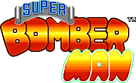 | [Super Bomberman](https://maxxthunder.github.io/bomberman/#sb1) | 1993 | password generator, cheats, debug menu patch |
| 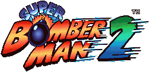 | [Super Bomberman 2](https://maxxthunder.github.io/bomberman/#sb2) | 1994 | password generator, cheats, debug menu patch |
| 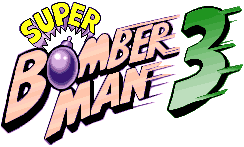 | [Super Bomberman 3](https://maxxthunder.github.io/bomberman/#sb3) | 1995 | password generator, cheats |
| 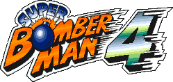 | [Super Bomberman 4](https://maxxthunder.github.io/bomberman/#sb4) | 1996 | password generator, cheats |
|  | [Super Bomberman 5](https://maxxthunder.github.io/bomberman/#sb5) | 1997 | option codes, character builder, cheats, debug rooms patch |
|  | [Super Bomberman: Panic Bomber W](https://maxxthunder.github.io/bomberman/#pbw) | 1995 | password generator, character and cheat codes |
| **TurboGrafx-16 / PC Engine** | | | |
|  | [Bomberman](https://maxxthunder.github.io/bomberman/#pce90) and Users Battle | 1990 | password generator, cheats, patches |
| 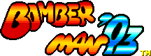 | [Bomberman '93](https://maxxthunder.github.io/bomberman/#pce93) | 1992 | password generator, cheats, patches |
| 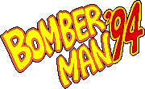 | [Bomberman '94](https://maxxthunder.github.io/bomberman/#pce94) | 1993 | password generator, cheats, debug patches |
| **Game Boy** | | | |
|  | [Atomic Punk / Bomber Boy](https://maxxthunder.github.io/bomberman/#bb) | 1990 | password generator for Game A and Game B |
| 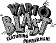 | [Wario Blast / Bomberman GB](https://maxxthunder.github.io/bomberman/#gb1) | 1994 | password generator, cheats |
| 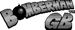 | [Bomberman GB / GB 2](https://maxxthunder.github.io/bomberman/#gb2) | 1995 | password generator, cheats |
|  | [Bomberman GB 3](https://maxxthunder.github.io/bomberman/#gb3) | 1996 | password generator, cheats |
| **Game Boy Color** | | | |
| 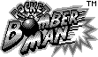 | [Pocket Bomberman](https://maxxthunder.github.io/bomberman/#pocket) | 1998 | password generator, cheats |
|  | [Bomberman Max](https://maxxthunder.github.io/bomberman/#max) | 1999 | Charabom code builder (the game saves), cheats |
| **NES / Famicom** | | | |
| 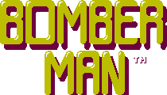 | [Bomberman](https://maxxthunder.github.io/bomberman/#nes1) | 1985 | password generator, cheats |
| 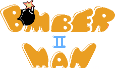 | [Bomberman II](https://maxxthunder.github.io/bomberman/#nes2) | 1991 | password generator, cheats |
| **Genesis** | | | |
| 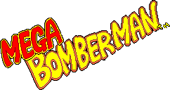 | [Mega Bomberman](https://maxxthunder.github.io/bomberman/#mega) and its 8-player demo | 1994 | password generator, cheats |
| **Virtual Boy** | | | |
|  | [Panic Bomber](https://maxxthunder.github.io/bomberman/#pbvb) | 1995 | password generator, special codes, debug menu, developer menu patch |

Every password checker was fuzzed against the game's own decoder in Mesen 2 (NES, Game Boy, SNES, PC Engine) or
BizHawk (Genesis): every possible code for the 4-digit games, and tens of thousands of codes (every state, plus
random and one-letter-off codes) for the longer ones. The game accepted exactly the codes the page accepts, in every
version.

## Highlights

The best finds for each game; the research notes have the rest.

**Super Bomberman**
- 140 stage passwords no list had: every stage takes four codes, and the game shows one at random.
- The unused debug menu, shown running without a ROM patch, and the first look at the 1993-05-11 beta.

**Super Bomberman 2**
- The debug menu works: stage select (6-0 plays the ending), no death, fire, bombs and items.
- The hidden battle stages need no Joycard: any steady X tap at 7–9 frames does it.

**Super Bomberman 3**
- `6514`: hard mode, every enemy takes one more hit.
- 78 stage passwords no list had, four for every stage.

**Super Bomberman 4**
- `4622` (everyone starts in the middle) and `0164` (a wider battle item pool).
- Tapping X 16 times on the title clears the villain silhouettes.

**Super Bomberman 5**
- Eight password handlers nothing points to, one of them invincibility.
- Gold Bomberman unlocks at 100%, and how the game records it.

**Mega Bomberman**
- The password stores which stages you cleared, so 50 codes skip stages, and each boss has several codes.
- The 8-player demo's unused CPU-time meter and item.

**Bomberman** (PC Engine) **and Users Battle**
- The Special Select Room needs a high score whose hundreds digit is exactly 3, all five buttons held, and the last
  demo played to its end.
- Users Battle still holds all 64 one-player stages and the password screen; a patch opens them.

**Bomberman '93**
- The US game no longer calls its "Configration" screen; a 7-byte patch puts the call back.
- The Special Version is a battle-only cart with the Normal Game and the password screen left inside.

**Bomberman '94**
- Every password also works in Mega Bomberman: the two games share the codec code for code.
- A debug pause menu works again with two small patches: invincibility, stage clear and an enemy editor.

**Bomberman** (NES)
- The 20-letter password fully decoded: stage, score and every power-up, with no range check, so fire 0–15, 16 bombs
  and stages 0–255 load.
- The letter-swap trick moves a value from wall pass to the flag that marks the exit and item.

**Bomberman II**
- The first letter is a key the rest are scrambled with, so every state has thousands of codes.
- A demo recorder left in the ROM, and the sound-test code hidden at the end of the US staff roll.

**Wario Blast / Bomberman GB**
- Wario Blast is the Japanese Bomberman GB: it keeps every Japanese code and adds 32 that play as Wario.
- An unused early title logo, and the 4-player battle on a Super Game Boy multitap.

**Bomberman GB / GB 2**
- 7824 sits in an unused older copy of the password table, where it meant the ending.

**Bomberman GB 3**
- The 28-bit password decoded: its check is a capsule balance between what the cleared areas paid and what you
  bought.

**Atomic Punk / Bomber Boy**
- Game A's password decoded: the islands cleared and the gold, with two check bytes; all eight islands is the ending.
- Game B takes NES Bomberman's codes; Atomic Punk shows A, E, I and O as 0, 1, 2 and 3.

**Pocket Bomberman**
- The 32-code list in full, with powered-up starts for Wind, Cloud and Evil, and 0278, the ending.
- An unused second password screen whose digits switch invincibility, world, area and a stopped clock.

**Bomberman Max**
- The Ain Version opens all 95 stages of both sides; the US release swaps two Charabom names.

## How the passwords work

| Game | Code | What it holds | Valid codes |
|---|---|---|---|
| Super Bomberman | 4 digits, 0–7 | stage only, plus a random salt and a check digit | 192 of 4,096, plus 5656 |
| Super Bomberman 2 | 4 digits | a fixed list: five stages, the same five at full power, 5656 | 11 |
| Super Bomberman 3 | 4 digits | stage, scrambled with a 4-bit check | 104 stage codes + 14 special |
| Super Bomberman 4 | 4 digits | a fixed table of 50 numbers | 38 stages + 12 special |
| Super Bomberman 5 | 4 digits; 6 symbols | option codes; Config Battle characters (30 bits with a 4-bit sum) | 12 option codes (10 on retail); any character |
| Mega Bomberman | 4 digits | area and a bitmask of the stages cleared, with a 5-bit check | 111 of 10,000 |
| Bomberman (PC Engine) | 8 letters | round, stage, bombs, fire, skate, with a bit-count check, scrambled at random | 5,930,496 strings |
| Bomberman '93 | 8 letters | world, stage, bombs, fire, speed, cleared planets, with a sum check | 716,800 |
| Bomberman '94 | 4 digits | the same as Mega Bomberman | 111 of 10,000 |
| Bomberman (NES) | 20 letters, A–P | stage, score, every power-up, with four sums | one code per state |
| Bomberman II | 8 characters | area, stage, bombs, fire, XORed with a key letter, with a sum | 4,096 per state + 7 secret |
| Wario Blast / Bomberman GB (Japan) | 4 digits | a fixed list | 68 (Japan 34) |
| Bomberman GB (US) / GB 2 | 4 digits | a fixed list | 11 |
| Bomberman GB 3 | 7 hex digits | area, stage, areas cleared, shop items, capsules, with a capsule balance | 20,329 |
| Pocket Bomberman | 4 digits | a fixed list | 32 |
| Bomberman Max | none: the game saves | (GameShark codes for the Charabom roster) | 30 Charaboms × levels 1–99 |
| Atomic Punk / Bomber Boy | 8 characters | islands cleared, gold, with a sum and an XOR check | one code per state |
| Panic Bomber (Virtual Boy), Panic Bomber W | 4 digits | a fixed list | 16 + 5 special; 30 + 9 special |

The details, with ROM addresses, are in the research notes.

## Using the patches

The IPS patches in [`patches/`](patches) restore debug menus and unused features. Each one
is for one exact ROM: the No-Intro name below (the checksums are in the game's research note). Apply it to a copy of
your ROM with any IPS patcher, such as Floating IPS or a browser-based ROM patcher, and keep the original.

| Patches | ROM |
|---|---|
| `sb1_debug_menu_us` / `_eu` / `_jp` / `_beta` | Super Bomberman (USA), (Europe), (Japan), (USA) (Beta) (1993-05-11) |
| `sb2_debug_menu_us` / `_eu` / `_jp` / `_beta` / `_caravan` | Super Bomberman 2 (USA), (Europe), (Japan) (En), (USA) (Beta), (Japan) (Caravan You Taikenban) |
| `sb5_debug_rooms` | Super Bomberman 5 (Japan) |
| `pceub_password_1p`, `pceub_select_room` | Bomberman - Users Battle (Japan) |
| `pce93_configration_us`, `pce93_normal_game_sp` | Bomberman '93 (USA); Bomberman '93 - Special Version (Japan) |
| `pce94_debug_menu`, `pce94_debug_pause` | Bomberman '94 (Japan) |
| `pbvb_dev_menu` | Panic Bomber (USA) (Virtual Boy) |

What each patch does, and how it was tested, is on the game's page under Patches.

## Research notes

- Super Nintendo: [Super Bomberman](docs/sb1.md), [2](docs/sb2.md), [3](docs/sb3.md), [4](docs/sb4.md),
  [5](docs/sb5.md), the English [4](docs/sb4en.md) and [5](docs/sb5en.md) (Super Bomberman Collection), and
  [Panic Bomber W](docs/pbw.md)
- PC Engine: [Bomberman](docs/pce90.md), [Users Battle](docs/pceub.md), [Bomberman '93](docs/pce93.md),
  [Bomberman '94](docs/pce94.md), and the [Wii U and Collection re-releases](docs/pcevc.md)
- Game Boy: [Atomic Punk / Bomber Boy](docs/bb.md), [Wario Blast / Bomberman GB](docs/gb1.md), [Bomberman GB / GB 2](docs/gb2.md),
  [Bomberman GB 3](docs/gb3.md)
- Game Boy Color: [Pocket Bomberman](docs/pocket.md), [Bomberman Max](docs/max.md)
- NES: [Bomberman](docs/nes1.md), [Bomberman II](docs/nes2.md)
- Genesis: [Mega Bomberman](docs/mega.md) and its [8-player demo](docs/mega8.md)
- Virtual Boy: [Panic Bomber](docs/pbvb.md)

Each code list is also in `docs/<game>_codes.json`, and the screenshots that prove the finds are in `docs/img/<game>/`.

## Tools

- `tools/<game>/password.py` and `password.mjs`: each game's password codec (the page uses the `.mjs` one).
- `tools/build_page.py`: builds `index.html` from `tools/page_template.html`, the codecs and the code lists.
  `node tools/check_page.mjs` checks the result.
- `tools/disasm.py`: recursive 65816 disassembler (LoROM and HiROM), grown with entry points from Mesen code/data
  logs. `tools/m68k.py`: 68000 listing for Mega Bomberman. `tools/m6502.py` (NES) and `tools/sm83.py` (Game Boy) do
  the same for the 8-bit games, and `tools/huc6280.py` for the PC Engine.
- `tools/<game>/run.sh script.lua [ver]` (all through `tools/emu/run.sh`) runs a game's Lua test scripts headless
  with `tools/emu/mesen.py` (or `mesen_gb.py`, `mesen_nes.py`, `bizhawk.py`). Set `MESEN` or `EMUHAWK` to the
  emulator.
- `tools/emu/ips.py`: the IPS writer the patch makers share.

ROMs aren't included. Put them in `roms/` with their No-Intro names.

## Credits and legal

*Bomberman*, *Bomberman II*, *Bomberman GB* 1–3, *Pocket Bomberman*, *Bomberman Max*, *Bomber Boy* / *Atomic Punk*,
*Bomberman '93*, *Bomberman '94*, *Panic Bomber*, *Super Bomberman: Panic Bomber W* and *Super Bomberman* 1–5 are © 1985–1999 Hudson Soft, *Mega Bomberman* is © 1994
Hudson Soft and Sega, and *Wario Blast* is © 1994 Hudson Soft and Nintendo; Bomberman now belongs to Konami. This
project isn't affiliated with or endorsed by Konami, Hudson Soft, Sega or Nintendo. The game art on the page and in
this repo (logos and screenshots) belongs to them and is used here for reference. The disassembly listings are for
research; no ROMs or game data are included.

Published codes were checked against the GameFAQs cheat pages and other published notes for each game.

Icons on the page are from [Font Awesome Free](https://fontawesome.com) 6.5.2 ([CC BY 4.0](https://creativecommons.org/licenses/by/4.0/)).

The code in this repo (the page, codecs, tests and tools) is released under the [MIT License](LICENSE).
