# Bomberman 64 (Nintendo 64, 1997): secrets

Hudson's first 3D Bomberman: Baku Bomberman in Japan. Everything here comes from the three ROMs and from BizHawk
(Mupen64Plus core). Addresses are N64 RAM addresses on the US ROM unless a region is named; "written" means a value
put into RAM in the emulator, not reached by play.

Prior art: the GameFAQs "Bomberman 64" cheats page and a second page on the game's debug material (both in `res/`: the Custom part sets, Full Power,
Rainbow Palace, the music test, the four extra Battle stages and the quick Start presses; the four test maps and a
scene warp, the placeholder music, an early logo, the map-information text and the European target times).
Marks: ★ **New** (in neither), **Known**.

 

| Dump | Header | Build date in the ROM |
|---|---|---|
| Baku Bomberman (Japan).z64 | `BAKU-BOMBERMAN`, NBMJ | FRI AUG  8 17:45:39 JST 1997 |
| Bomberman 64 (USA).z64 | `BOMBERMAN64U`, NBME | SAT SEP  6 14:57:59 JST 1997 |
| Bomberman 64 (Europe).z64 | `BOMBERMAN64E`, NBMP | MON SEP  8 12:04:49 JST 1997 |

## No passwords: the save

The game saves to the cartridge's EEPROM (`1B8` bytes used, magic `BAKU`, revision byte 02): three Adventure files and
a header whose byte 4 holds the three unlock flags in bits 5, 6 and 7. Holding Start at power-on brings up the erase
prompt. 

## ★ The Start code

On the title or main menu, press Start 10 to 14 times inside one 60-frame window (50 frames on the European ROM), never
leaving 7 frames or more between presses. Battle Mode's Stage Select grows from six stages to ten:
In the Gutter, Sea Sick, Blizzard Battle and Lost at Sea. 15 or more presses in the window fail. The flag (`802AC654`,
Europe `802AC644`, Japan `802AB884`) is not saved and reads 0 again after a reset. Played on all three ROMs.

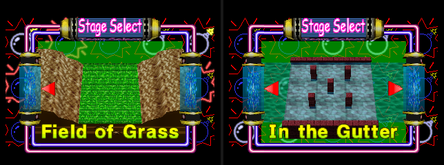 

Routine: title program (archive `160000` file 1), `80043660`. No other button code exists in the title, main menu,
Options or pause code, which were read in full; Battle setup, Custom, the world map and the in-game handler were read
at their button tests only. A general button-sequence matcher (`80239CC8`) is in the controller module, but nothing
calls it.

## ★ The three unlock flags

| Flag | Set when (from the stage-clear code at `80240254`) | Options | Battle stages |
|---|---|---|---|
| 0, `802A1DA8` | the best-time slots of all 16 stages of worlds 1-4 are filled | Music | 6 |
| 2, `802A1DB0` | a stage is cleared with world 6, stage 4 selected: Final Battle! | Music, View Credits | 8 |
| 1, `802A1DAC` | all 120 Gold Card flags are set | Full Power | 10 |

Japan: `802A0FF8`, `802A0FFC`, `802A1000`. A flag written by hand is not saved by leaving Options: the header is
rewritten only where the game grants one.

On the US ROM the game granted and saved each of the three, and each was still unlocked after a power cycle:

| Flag | Set up by hand first | Then | Save header byte 4 |
|---|---|---|---|
| 0 | the other 15 best times | Green Garden stage 1 cleared | `02` → `22` |
| 1 | 119 card flags | the same stage cleared under its target time, earning the last card | `02` → `42` |
| 2 | world 6 stage 4 selected, the boss's health cut, cheats held | Final Battle! cleared | `02` → `82` |

Bomberman was put on the switch and exit tiles by position writes, not walked there; everything from the clear on is
the game's own code. On the European and Japanese ROMs one such clear granted flags 0 and 1 together (`02` → `62`),
kept after a power cycle. 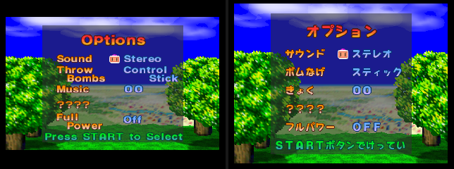 No "unlocked" message appears: the result screen only adds "Saving Data...".
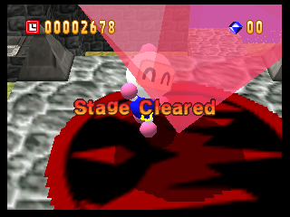 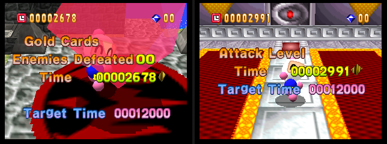
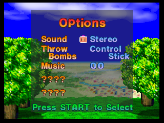 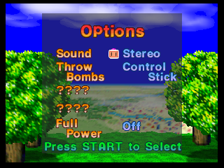 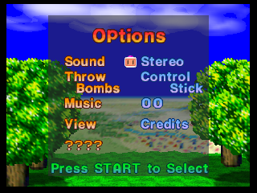

- **Music**: 47 numbers, 00-46, the size of the music bank (asset 32, 47 sequences). A plays the number shown and
  turns it yellow. From the game's own requests, not by ear: 01 an opening scene, 02 the world map, 03-08 the six
  worlds' stages, 24 on entering a stage, 10 and 18 the VS stages, 11-16 stages with a special flag, 19, 17, 39, 40
  and 42 bosses, 21 stage clear, 45 boss clear, 22 the ending, 26 the title, 27 the start of a Battle match, 29 the
  Battle menu and Custom, 31 and 32 Battle results, 33 the end of a match, 35 and 44 the last two VS stages,
  38 Continue. 20, 28 and 46 are asked for by code that was not placed.
  Nothing asks for 30, or for 00, 09, 23, 25, 34, 36, 37, 41 and 43, which are nine copies of one 184-byte
  placeholder. Recorded from the music test: 30 is a jingle of two bars that sounds for 5.8 seconds, once; the
  placeholder is one instrument playing a 16-note bar of 1.2 seconds four times; stage tune 03 loops every 71 seconds. 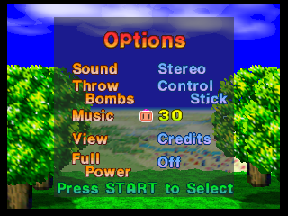 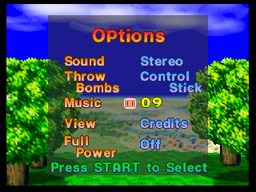 With flag 0 alone, numbers 08, 15, 16 and 44 are drawn as `--` and cannot be played; flag 2 opens
  them.  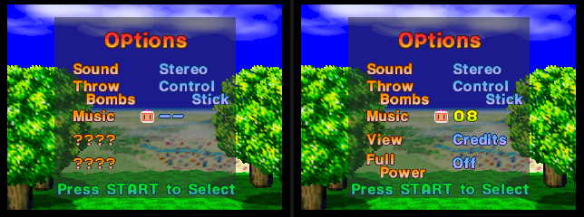
- **View Credits**: A starts the ending sequence (scene `1C`). 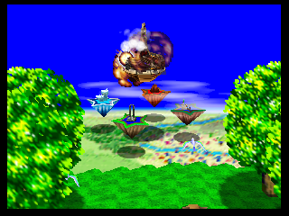
- **Full Power**: stored at `802AC650`. Off, picking a stage on the world map clears item bits `407` and caps the
  blast size at 4 (`80243718`), and a death clears the remote-bomb bit. On, both are skipped. Bomb count is kept either
  way, and Battle is not affected. 

## ★ Worlds 5 and 6, and the Gold Cards

- Card flag = `2C + world*20 + stage*5 + card` in the bit array at `8008E570`: five cards a stage, 24 stages, no
  difficulty term. Card 4 of a normal stage is the target-time card, drawn beside Time on the result screen; cards
  0-2 are drawn beside Gold Cards and card 3 beside Enemies Defeated. Cards 0-2 are inside destructible blocks (see Custom parts), and
  card 3 drops from the 30th enemy defeated (and again at 60 and 90); the Enemies Defeated number is that counter,
  `800BC520`. 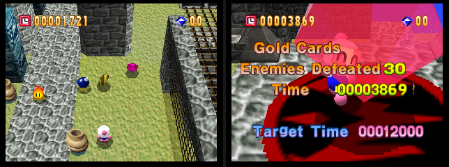 Writing flags `2C-30` turns Green Garden stage
  1's card slots gold. 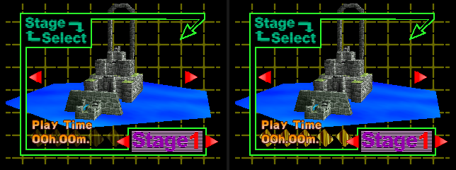
- Best times are 24 values from `8008E5DC`. Black Fortress opens when the first 16 are filled.
  
- Rainbow Palace needs Black Fortress stage 4's time and flag `A4` (`8008E584` bit 4), which that stage sets when all
  100 cards of worlds 1-5 are held. 

## ★ Test maps and the scene write

Scenes `14`-`17` are four developer test maps, in all three ROMs, with "debmap0" strings in their programs. To load a
scene, write the id to `802AC5D4` and `802AC5DC`, the entry number (`10`) to `802AC5D8` and `802AC5E0`, then set bit 0
of `802AC5D0` (Europe: each address 10 lower; Japan: `802AB804`, `802AB80C`, `802AB808`, `802AB810`, `802AB800`).

 

Bomberman can walk in each and lay bombs in 14, 15 and 16. In map 16, Start jumps to map 14. 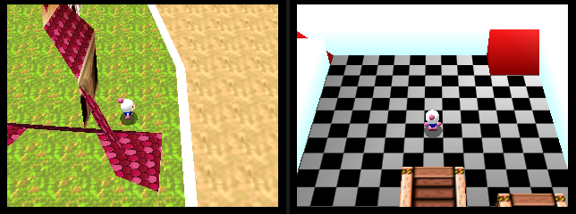

The game's own stage table (`802A04C8`), with the names from ROM `BA9E8` in the same order:

| World | Stage 1 | Stage 2 | Stage 3 | Stage 4 |
|---|---|---|---|---|
| 1 Green Garden | `28` Untouchable Treasure | `31` Friend or Foe? | `2D` To Have or Have Not | `88` Winged Guardian |
| 2 Blue Resort | `38` Switches and Bridges | `3E` VS Artemis | `3C` Pump it Up! | `89` Sewer Savage |
| 3 Red Mountain | `48` Hot on the Trail | `56` VS Orion | `50` On the Right Track | `8A` Hot Avenger |
| 4 White Glacier | `58` Blizzard Peaks | `62` VS Regulus | `5E` Shiny Slippy Icy Floor | `8B` Cold Killers |
| 5 Black Fortress | `68` Go for Broke | `8C` High-Tech Harvester | `6E` Trap Tower | `74` VS Altair |
| 6 Rainbow Palace | `78` Beyond the Clouds... | `8D` Spellmaker | `7B` Doom Castle | `7E` Final Battle! |

All 24 were loaded on the US ROM. 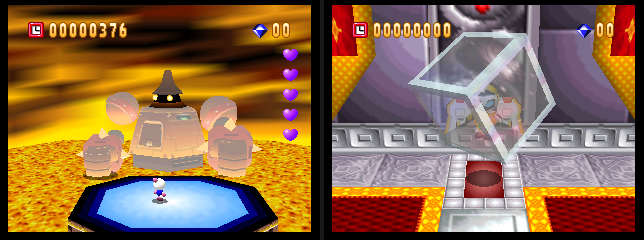

Other scenes: `19`-`1D` cutscenes (`1C` the ending), `1F` file select, `20` title and menu, `21` world map, `23` Battle
menu, `24` erase prompt, `25` Custom, `26` Options, `90`-`99` the ten Battle stages. Rooms inside a stage have their own
entry numbers: scene `29` is black with entry `10` and a room with `11`. 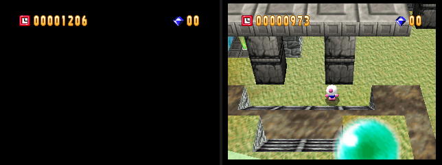

Scene `22` is the Battle result screen: a match that ends goes there by itself with entry `11`.
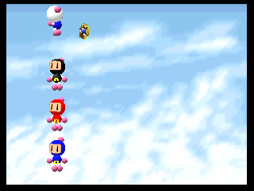 Scenes `18`, `7A`, `7D` and `9C`-`A4` have table entries but no program: `18`, `7A` and `9C`
gave a black screen.

Scene `9B`, which nothing asks for, is a one-enemy test room: it registers one enemy (type 7) and returns to the
title when none is left. Its collision-map number, 564, is now a graphics pack in all three ROMs, so the load stops on
a purple screen. With `80043B90` patched to ask for map 576 it loads, but never starts running.
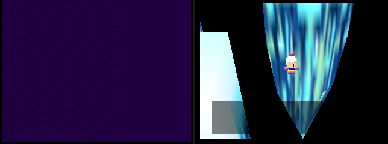

## GameShark codes

Player 1's block is at `800AEDF0` in all three ROMs. These are RAM writes made in BizHawk, written in GameShark
form; none was run through a cheat device, and whether a real GameShark needs an enable code was not looked at.
Bombs, blast size, item bits `0203`, the heart, the blast immunity, gems and lives were also run as held byte or
word writes on the US ROM. Giant bombs were run on the US ROM only, the rest on all three.

| Code | Effect | |
|---|---|---|
| `800AEE0F 0006` | six bombs |  |
| `800AEE13 0006` | blast size 6 |  |
| `810AEE0A 0201` | power bombs |  |
| `810AEE0A 0202` | remote bombs | 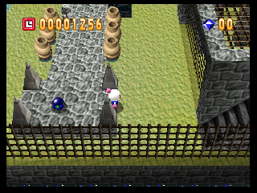 |
| `810AEE0A 0204` | giant cyan blast |  |
| `810AEE0A 0A00` | giant bombs |  |
| `800AEE07 0002` | a spare heart | 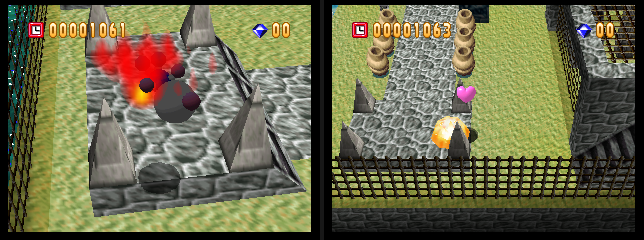 |
| `800AEE01 0001` | his own blast does not hurt him | 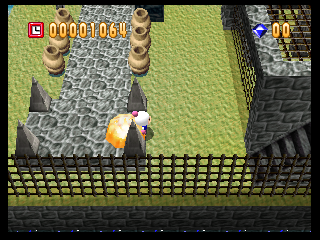 |

| Value | US | Europe | Japan |
|---|---|---|---|
| Gems | `802AC62C` | `802AC61C` | `802AB85C` |
| Stage clock, in hundredths of a second | `802AC640` | `802AC630` | `802AB870` |
| Lives | `802AC624` | `802AC614` | `802AB854` |
| Target time (the clock turns red above it) | `802AC638` | | |
| Extra Battle stages | `802AC654` | `802AC644` | `802AB884` |

Holding the clock's two halves (`812AC640 0000` + `812AC642 03D7`) stops it at 983. Held at 0 from the moment a
stage loads, the opening camera never settles. 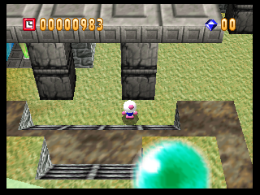

## ★ Custom parts

Flags `00`-`2B` are the Custom parts, four groups of eleven (head `00`, body `0B`, arms `16`, feet `21`); the first
flag of each group shows nothing.

| Flag in group | Head | Body | Arms | Feet | Set when |
|---|---|---|---|---|---|
| 1 | Knight Helmet | Knight Armor | Knight Sword | Knight Shoes | a save file is made |
| 2-7 | Dragon Head, Iron Goggles, Cat Hood, Ponytails, Sunglasses, Chicken Head | Dragon Mail, Iron Armor, Cat Suit, Dress, Duck Float, Rocking Horse | Dragon Gloves, Iron Nuckles, Cat Paws, Slash Claws, Drill Arms, Chicken Wings | Dragon Spikes, Iron Sneakers, Cat Paws, High Tops, Duck Feet, Bubby Socks | picked up (pickup ids `39`-`50`), each from one block, listed below |
| 8 | Samurai Head | Shogun Kimono | Fans | High Heels | all 120 Gold Cards |
| 9 | Clown Smile | Karate Ware | Boxing Gloves | Clogs | Final Battle! cleared with `802AC648` under 10801 |
| 10 | Gold Visor | Gold Armor | Gold Gloves | Gold Boots | all 120 cards with `802AC620` = 1 and `802AC648` at most 10800 |

`802AC648` is the file's play time in seconds: it goes up by one every 60 frames (`8023E0BC`), stops in pause and
is saved at each stage clear. The file select does not show it. The Gold rule was run on the US ROM with 119 card
flags, `802AC620` and `802AC648` written and the stage clear left to the game: the four Gold flags were set at
10780 and at 10800, and not at 10801 or with `802AC620` = 0. The Clown rule over the limit: Final Battle! was cleared with `802AC648` written to 20000, and the four Clown flags stayed off where the same clear with a small play time had set them.

`802AC620` is the file's difficulty. A on a New file brings up Difficulty Level with Normal and Hard; Hard writes 1
(store at `8028A120`, called from the file select at `80047658`) and Normal leaves 0. Played from power-on on a
blank save, so Hard needs no unlock. The Gold set therefore needs a Hard file. The same value chooses each room's
block list (below). Whether it can be changed on an existing file was not checked.
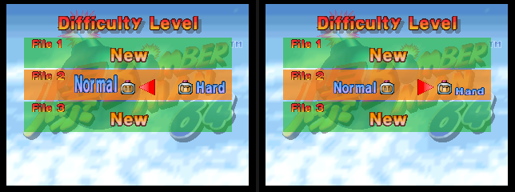 The Head order was seen flag by flag;
the other three follow the row order with every flag set. Spellings are the ROM's.
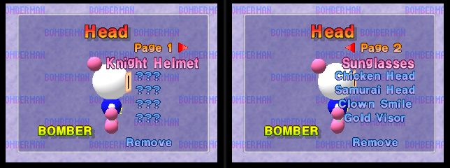 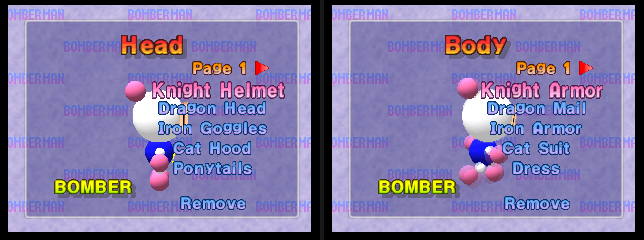

### Where the parts and Gold Cards are

Every pickup part and all but three of the 36 pickup Gold Cards is inside one destructible block. The contents of
blocks come from one table, read as each room loads (asset 220, ROM `587AD8`, the same in all three ROMs): a list
per room of pickup id and block cell. Each room has two lists: the first is used on a Normal file and the second on Hard. A block that is
not listed gives a random pickup. "Green Garden 1, room 3" is the third room of that world's first stage; the cell is
x, layer, z in hex, 100 units a cell.

| Part | Block on Normal | Block on Hard |
|---|---|---|
| Dragon Head | Green Garden 1, room 3, cell `17,4,9` | Green Garden 1, room 3, cell `13,0,17` |
| Iron Goggles | Red Mountain 1, room 7, cell `2,0,2` | Red Mountain 1, room 6, cell `9,0,2` |
| Cat Hood | Blue Resort 1, room 2, cell `1,4,1B` | Blue Resort 1, room 3, cell `2C,3,9` |
| Ponytails | Rainbow Palace 3, room 2, cell `2,4,7` | the same |
| Sunglasses | Black Fortress 3, room 3, cell `15,4,1A` | the same |
| Chicken Head | White Glacier 1, room 3, cell `1E,3,1C` | White Glacier 1, room 4, cell `B,2,12` |
| Dragon Mail | Green Garden 3, room 3, cell `17,1,9` | the same |
| Iron Armor | White Glacier 1, room 2, cell `2,4,13` | White Glacier 1, room 1, cell `1,3,19` |
| Cat Suit | Blue Resort 3, room 3, cell `E,4,1A` | Blue Resort 3, room 2, cell `17,2,C` |
| Dress | Black Fortress 3, room 6, cell `2D,0,F` | the same |
| Duck Float | Rainbow Palace 1, room 1, cell `29,2,1C` | Rainbow Palace 1, room 1, cell `26,2,1C` |
| Rocking Horse | Red Mountain 3, room 5, cell `1A,1,1A` | Red Mountain 3, room 2, cell `20,4,1B` |
| Dragon Gloves | Green Garden 1, room 5, cell `B,5,8` | Green Garden 1, room 5, cell `26,5,16` |
| Iron Nuckles | Blue Resort 1, room 1, cell `18,2,15` | not in the table |
| Cat Paws (arms) | Rainbow Palace 1, room 2, cell `2E,1,F` | Rainbow Palace 1, room 2, cell `2E,1,1E` |
| Slash Claws | Red Mountain 1, room 4, cell `13,2,1A` | Red Mountain 1, room 8, cell `F,0,D` |
| Drill Arms | Black Fortress 1, room 5, cell `8,2,F` | the same |
| Chicken Wings | White Glacier 3, room 2, cell `7,0,D` | White Glacier 3, room 2, cell `1E,0,1A` |
| Dragon Spikes | Green Garden 3, room 4, cell `1F,0,D` | the same |
| Iron Sneakers | White Glacier 3, room 4, cell `13,2,18` | White Glacier 3, room 4, cell `17,4,3` |
| Cat Paws (feet) | Red Mountain 3, room 6, cell `9,0,6` | the same |
| High Tops | Blue Resort 3, room 1, cell `3,0,1A` | Blue Resort 3, room 1, cell `9,0,D` |
| Duck Feet | Rainbow Palace 3, room 2, cell `5,4,7` | Rainbow Palace 3, room 1, cell `17,0,12` |
| Bubby Socks | Black Fortress 3, room 3, cell `20,1,14` | the same |

Iron Nuckles is missing from the second list; that room's program has a spawn of its own for it, not run.

| Gold Card | Block on Normal | Block on Hard |
|---|---|---|
| Green Garden 1, card 1 | room 2, cell `2,5,1` | the same |
| Green Garden 1, card 2 | not in the table | the same |
| Green Garden 1, card 3 | room 5, cell `23,1,F` | the same |
| Green Garden 3, card 1 | room 2, cell `2D,3,7` | room 2, cell `2D,3,4` |
| Green Garden 3, card 2 | room 4, cell `2B,0,8` | room 4, cell `1A,4,F` |
| Green Garden 3, card 3 | room 4, cell `23,2,8` | room 4, cell `23,2,16` |
| Blue Resort 1, card 1 | not in the table | the same |
| Blue Resort 1, card 2 | room 3, cell `2C,3,9` | room 2, cell `1,4,1B` |
| Blue Resort 1, card 3 | room 4, cell `13,4,11` | the same |
| Blue Resort 3, card 1 | room 3, cell `7,3,2` | the same |
| Blue Resort 3, card 2 | room 1, cell `11,0,1D` | room 1, cell `18,0,17` |
| Blue Resort 3, card 3 | room 2, cell `17,2,C` | room 2, cell `26,0,9` |
| Red Mountain 1, card 1 | room 2, cell `1B,0,15` | room 1, cell `2C,3,E` |
| Red Mountain 1, card 2 | room 4, cell `1E,4,12` | room 4, cell `13,2,1A` |
| Red Mountain 1, card 3 | room 6, cell `9,0,2` | room 7, cell `2,0,2` |
| Red Mountain 3, card 1 | not in the table | the same |
| Red Mountain 3, card 2 | room 2, cell `20,4,1B` | room 5, cell `1A,1,1A` |
| Red Mountain 3, card 3 | room 4, cell `C,4,1B` | the same |
| White Glacier 1, card 1 | room 1, cell `6,3,19` | room 2, cell `2,4,13` |
| White Glacier 1, card 2 | room 2, cell `10,0,6` | room 2, cell `C,2,11` |
| White Glacier 1, card 3 | room 4, cell `F,0,6` | room 3, cell `1E,3,1C` |
| White Glacier 3, card 1 | room 2, cell `1E,0,1A` | room 2, cell `7,0,D` |
| White Glacier 3, card 2 | room 3, cell `7,0,1B` | the same |
| White Glacier 3, card 3 | room 4, cell `17,4,3` | room 4, cell `13,2,18` |
| Black Fortress 1, card 1 | room 2, cell `8,1,4` | the same |
| Black Fortress 1, card 2 | room 4, cell `8,1,4` | the same |
| Black Fortress 1, card 3 | room 4, cell `9,1,1B` | the same |
| Black Fortress 3, card 1 | room 2, cell `1D,1,1B` | the same |
| Black Fortress 3, card 2 | room 3, cell `2C,0,19` | the same |
| Black Fortress 3, card 3 | room 6, cell `27,3,6` | the same |
| Rainbow Palace 1, card 1 | room 1, cell `2A,1,1` | the same |
| Rainbow Palace 1, card 2 | room 1, cell `26,2,1C` | room 1, cell `29,2,1C` |
| Rainbow Palace 1, card 3 | room 2, cell `2C,1,16` | the same |
| Rainbow Palace 3, card 1 | room 1, cell `24,1,B` | the same |
| Rainbow Palace 3, card 2 | room 1, cell `24,1,12` | the same |
| Rainbow Palace 3, card 3 | room 1, cell `17,0,12` | room 2, cell `5,4,7` |

The three not in the table: Green Garden 1 card 2 is in a block of the first room (cell `2C,5,0`), and Blue Resort 1
card 1 and Red Mountain 3 card 1 are dropped by their rooms' own programs, on conditions not read.

The table was checked against the running game in 52 rooms. Four blocks were bombed out on the US ROM with Bomberman
placed beside them by hand, and each gave the listed part (Dragon Head, Dragon Mail, Dragon Spikes, Cat Paws); with
`802AC620` written to 1 the Dragon Head block gave an ordinary pickup, as the second list says. One part was then
walked onto and its flag was set. The routes to the blocks were not played, and no card was bombed out.
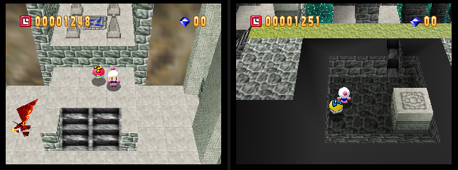

## The random pickup's seven effects

Routine `80279628`, 1200 frames each; set by hand here, one run each: 0 fast (919 units in 30 frames against 238),
1 slow (127), 2 A lays no bomb, 3 short fuse (60 ticks against 150), 4 cannot move, 5 a flame at his feet, 6 giant
blast. 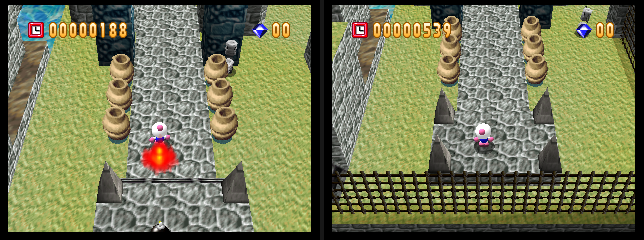

## ★ Green Garden stage 1 with the controller alone

Played on the US ROM with no RAM writes, as a chain of segments each starting from the savestate the one before
made, the first from power-on. It was not replayed as one unbroken run.

1. Sirius stands in the east path. Walk up to him, press B and read his speech through; he leaves.
   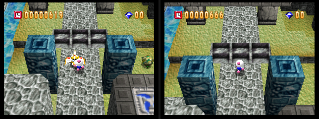
2. The net over the pit: lay a bomb outside the fence and kick it west, twice. Each blast takes out a post and the
   net goes. Enter the pit from the top of the west wall. 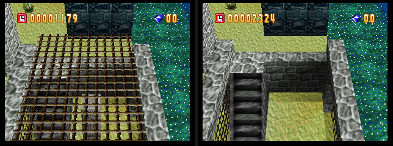
3. Two switches in the first room.
4. The bridge supports need a pumped bomb: lay with A, step back, lift with B and tap A quickly. The bomb grows
   (scale 1.0, 1.63 after 10 taps, about 1.9 after 20); B throws it. One landing near each support drops the bridge.
   Thrown from under the bridge it falls at his feet. 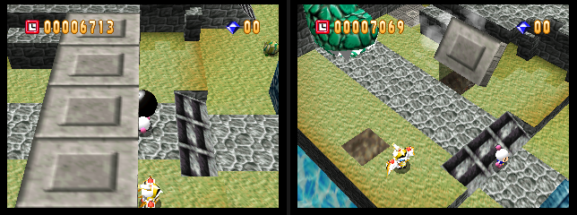
5. A third pumped bomb removes the green rock in front of the exit.
6. In the next room, two switch tiles, then the middle stairs to the crystal: "Stage Cleared", time 11956 against
   the target 12000, the time card, "Saving Data..." and the world map on Stage 2.
   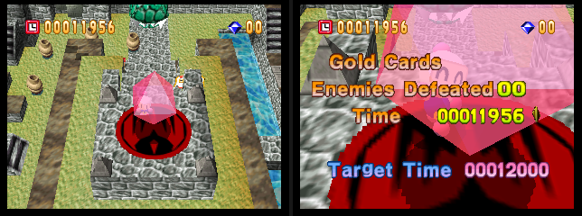

No Gold Card was picked up on the way.

## Unused content

- Music 30, a jingle nothing plays, and nine identical placeholder sequences.
- Graphics pack 517, an earlier look for the Battle stage Up and Down that nothing loads; patched in, it draws on the
  same collision and plays. 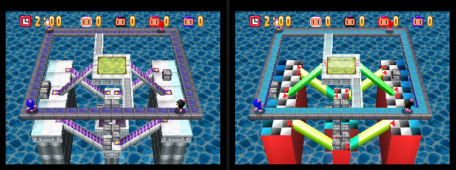
  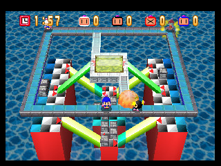 Pack 420 is the only unloaded set among Red Mountain's; patched
  into stage 3 it showed only a floor and one slab, and whether it is a leftover path was not settled.
- Spellmaker's card calls: Japan plays a clip for each of the eight cards (sounds `1D3`-`1DA`); the US and European
  program sends every card to sound `1CF`, leaving their re-recorded clips unused. Not checked by ear.
- Scene `9B`, the broken enemy test room.
- Enemy types 11 and 36 are registered only when a stage flag is set (`407`-`409`), by four Blue Resort rooms
  (`38`, `3A`, `3C`, `3D`), where they replace type 9; what sets `407` and `408` and where those enemies stand was
  not found. Type 25 has one registration in the main program that was never seen to run. All three were put on
  screen on the US ROM by changing room `3C`'s enemy table: 11 is a flat blue shape that floats and drifts, 36 a blue
  bird that walks, 25 a round pale head on a purple body that stands still and went down to the fourth bomb. Type 25
  was drawn with graphics 247, by the numbering the others follow; whether that is its own model is not known.
  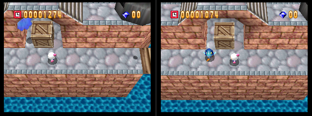 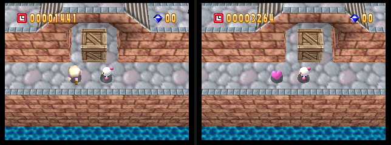
- An older all-capitals Battle menu in the Battle program: PLAYER 0, OPTIONS, COMLEVEL, NO LIMIT, CHARACTER TYPE,
  CONFIG, FILE 0, STAGE SELECT, STAGE 0, Congratulations!.
- "CLEAR BONUS" and "RANK" in the stage-result text (ROM `BAC0C`, `BAC1C`): no code points at them, and neither
  result screen shows them.
- Asset 35, a flat pre-drawn Japanese title logo, in all three ROMs; never asked for in the scenes sampled. 
- Assets 36 and 38, the Hudson logo and a ©1997 line, loaded only by the Japanese ROM.
  
- Debug text that goes to an empty print routine (ROM `24F8`): map information, a thread dump, `move.c` and EEPROM
  revision errors, "ZeroJump Error".
- Two program-module slots (17 and 31) with call stubs and no code; the scene `88` boss program still calls slot 31.

## Region differences

- Japan's title has no "64", says PUSH START and shows the ©1997 line; the US and European title says PRESS START after
  a licence screen that Japan lacks.
- Japan names two worlds White Ice and Black City; the others say White Glacier and Black Fortress.
  
- "HURRY UP!" and "No Data" in Japan, "Hurry up!" and "No File" elsewhere. The credits differ in the cast and add
  "NINTENDO ALL STAFF" outside Japan.
- US and Europe differ in 4 of 982 files: the Start code's window, two longer music sequences, and larger time values
  in scenes `74` and `7E`. All 24 target times come from one table (`802A0958`): Europe's are exactly 1.2 times the
  US ones, and Japan's equal the US. Europe's limit for the Clown and Gold sets is 14400 seconds, four hours (`slti
  0x3841` against `0x2A31`); the Gold set was granted at 14400 and not at 14401 there.

## Open

- A Gold Card picked up in play, and the routes to the part and card blocks.
- Where the play time is shown: not on the file select, the result screen or the world map, and no code that draws
  it was found.
- Green Garden stage 1 in one unbroken run from power-on, and anything from that run on the other two ROMs.
- What ends the respawn invincibility (no counter was found); scene `9B` running.
- Models were not rendered. 293 of 866 assets were never requested in a 150-frame visit to every scene, which is a
  starting list, not a list of unused assets.
