# Bomberman 64 (Nintendo 64, 1997): secrets

Hudson's first 3D Bomberman: Baku Bomberman in Japan. Everything here comes from the three ROMs and from BizHawk
(Mupen64Plus core). Addresses are N64 RAM addresses on the US ROM unless a region is named; "written" means a value
put into RAM in the emulator, not reached by play. Marks: ★ **New**.

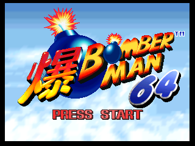 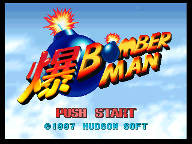

| Dump | Header | Build date in the ROM |
|---|---|---|
| Baku Bomberman (Japan).z64 | `BAKU-BOMBERMAN`, NBMJ | FRI AUG  8 17:45:39 JST 1997 |
| Bomberman 64 (USA).z64 | `BOMBERMAN64U`, NBME | SAT SEP  6 14:57:59 JST 1997 |
| Bomberman 64 (Europe).z64 | `BOMBERMAN64E`, NBMP | MON SEP  8 12:04:49 JST 1997 |

## No passwords: the save

The game saves to the cartridge's EEPROM (`1B8` bytes used, magic `BAKU`, revision byte 02): three Adventure files and
a header whose byte 4 holds the three unlock flags in bits 5, 6 and 7. Holding Start at power-on brings up the erase
prompt. 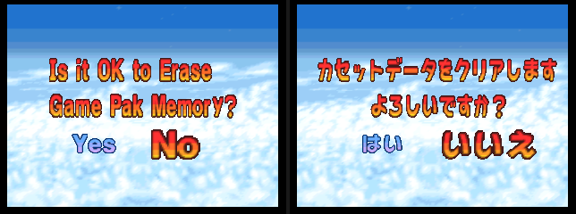

## ★ The Start code

On the title or main menu, press Start 10 to 14 times inside one 60-frame window (50 frames on the European ROM), never
leaving 7 frames or more between presses. Battle Mode's Stage Select grows from six stages to ten:
In the Gutter, Sea Sick, Blizzard Battle and Lost at Sea. 15 or more presses in the window fail. The flag (`802AC654`,
Europe `802AC644`, Japan `802AB884`) is not saved and reads 0 again after a reset. Played on all three ROMs.

 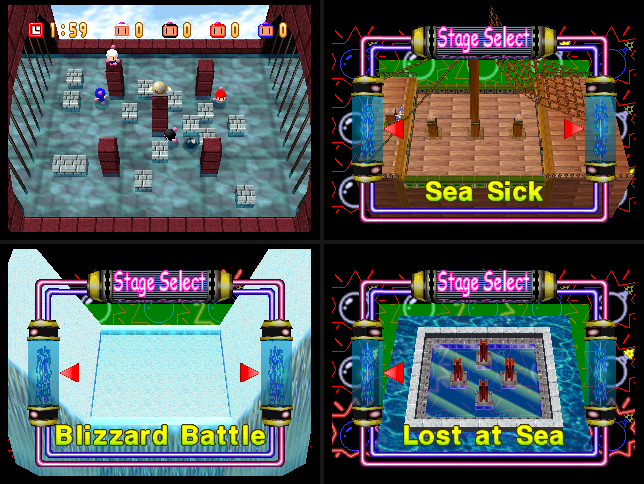

Routine: title program (archive `160000` file 1), `80043660`. No other button code exists in the title, main menu,
Options or pause code, which were read in full; Battle setup, Custom, the world map and the in-game handler were read
at their button tests only. A general button-sequence matcher (`80239CC8`) is in the controller module, but nothing
calls it.

## ★ The three unlock flags

| Flag | Set when (from the stage-clear code at `80240254`) | Options | Battle stages |
|---|---|---|---|
| 0, `802A1DA8` | the best-time slots of all 16 stages of worlds 1-4 are filled | Music | 6 |
| 2, `802A1DB0` | a stage is cleared with world 6, stage 4 selected: Final Battle! | Music, View Credits | 8 |
| 1, `802A1DAC` | all 120 Gold Card flags are set | Full Power | 10 |

Japan: `802A0FF8`, `802A0FFC`, `802A1000`. The conditions were read from the US ROM's code, not played; each entry was opened by writing its
flag. A written flag is not saved by leaving Options: the header is rewritten only where the game grants a flag.

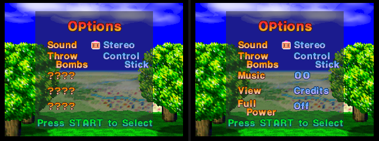

- **Music**: 47 numbers, 00-46, the size of the music bank (asset 32, 47 sequences). A plays the number shown and
  turns it yellow. With flag 0 alone, numbers 08, 15, 16 and 44 are drawn as `--` and cannot be played; flag 2 opens
  them. 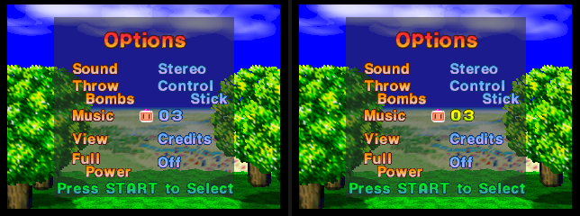 
- **View Credits**: A starts the ending sequence (scene `1C`). 
- **Full Power**: stored at `802AC650`. Off, picking a stage on the world map clears item bits `407` and caps the
  blast size at 4 (`80243718`), and a death clears the remote-bomb bit. On, both are skipped. Bomb count is kept either
  way, and Battle is not affected. 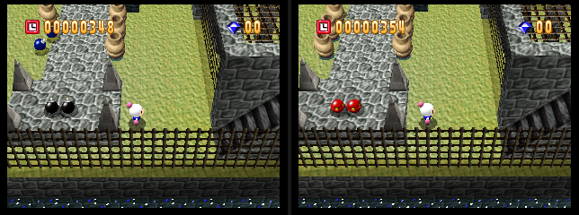

## ★ Worlds 5 and 6, and the Gold Cards

- Card flag = `2C + world*20 + stage*5 + card` in the bit array at `8008E570`: five cards a stage, 24 stages, no
  difficulty term. Card 4 of a normal stage is the target-time card. Writing flags `2C-30` turns Green Garden stage
  1's card slots gold. 
- Best times are 24 values from `8008E5DC`. Black Fortress opens when the first 16 are filled.
  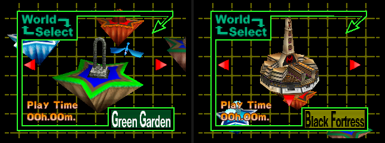
- Rainbow Palace needs Black Fortress stage 4's time and flag `A4` (`8008E584` bit 4), which that stage sets when all
  100 cards of worlds 1-5 are held. 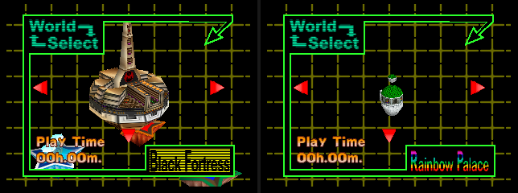

## ★ Test maps and the scene write

Scenes `14`-`17` are four developer test maps, in all three ROMs, with "debmap0" strings in their programs. To load a
scene, write the id to `802AC5D4` and `802AC5DC`, the entry number (`10`) to `802AC5D8` and `802AC5E0`, then set bit 0
of `802AC5D0` (Europe: each address 10 lower; Japan: `802AB804`, `802AB80C`, `802AB808`, `802AB810`, `802AB800`).

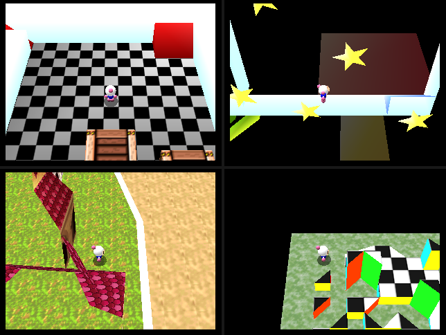 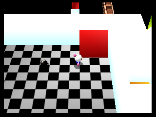

Bomberman can walk in each and lay bombs in 14, 15 and 16. In map 16, Start jumps to map 14. 

The game's own stage table (`802A04C8`), with the names from ROM `BA9E8` in the same order:

| World | Stage 1 | Stage 2 | Stage 3 | Stage 4 |
|---|---|---|---|---|
| 1 Green Garden | `28` Untouchable Treasure | `31` Friend or Foe? | `2D` To Have or Have Not | `88` Winged Guardian |
| 2 Blue Resort | `38` Switches and Bridges | `3E` VS Artemis | `3C` Pump it Up! | `89` Sewer Savage |
| 3 Red Mountain | `48` Hot on the Trail | `56` VS Orion | `50` On the Right Track | `8A` Hot Avenger |
| 4 White Glacier | `58` Blizzard Peaks | `62` VS Regulus | `5E` Shiny Slippy Icy Floor | `8B` Cold Killers |
| 5 Black Fortress | `68` Go for Broke | `8C` High-Tech Harvester | `6E` Trap Tower | `74` VS Altair |
| 6 Rainbow Palace | `78` Beyond the Clouds... | `8D` Spellmaker | `7B` Doom Castle | `7E` Final Battle! |

All 24 were loaded on the US ROM. 

Other scenes: `19`-`1D` cutscenes (`1C` the ending), `1F` file select, `20` title and menu, `21` world map, `23` Battle
menu, `24` erase prompt, `25` Custom, `26` Options, `90`-`99` the ten Battle stages. Rooms inside a stage have their own
entry numbers: scene `29` is black with entry `10` and a room with `11`. 

Scene `22` with entry `11` shows four Bombermen over clouds; what it is in normal play was not found.
 Scenes `18`, `7A`, `7D` and `9C`-`A4` have table entries but no program: `18`, `7A` and `9C`
gave a black screen. Scene `9B` is a dark purple screen with its own debug strings.

## GameShark codes

Player 1's block is at `800AEDF0` in all three ROMs. These are RAM writes made in BizHawk, written in GameShark
form; none was run through a cheat device, and whether a real GameShark needs an enable code was not looked at.
Bombs, blast size, item bits `0203`, the heart, the blast immunity, gems and lives were also run as held byte or
word writes on the US ROM. Giant bombs were run on the US ROM only, the rest on all three.

| Code | Effect | |
|---|---|---|
| `800AEE0F 0006` | six bombs | 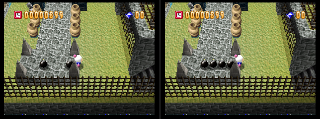 |
| `800AEE13 0006` | blast size 6 | 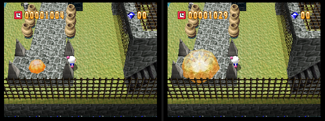 |
| `810AEE0A 0201` | power bombs | 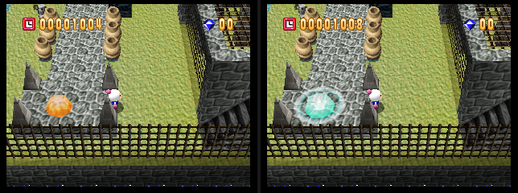 |
| `810AEE0A 0202` | remote bombs |  |
| `810AEE0A 0204` | giant cyan blast | 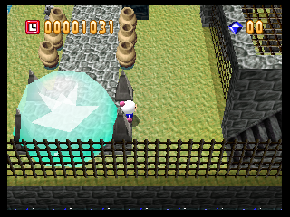 |
| `810AEE0A 0A00` | giant bombs | 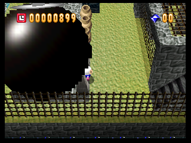 |
| `800AEE07 0002` | a spare heart |  |
| `800AEE01 0001` | his own blast does not hurt him |  |

| Value | US | Europe | Japan |
|---|---|---|---|
| Gems | `802AC62C` | `802AC61C` | `802AB85C` |
| Stage clock | `802AC640` | `802AC630` | `802AB870` |
| Lives | `802AC624` | `802AC614` | `802AB854` |
| Target time (the clock turns red above it) | `802AC638` | | |
| Extra Battle stages | `802AC654` | `802AC644` | `802AB884` |

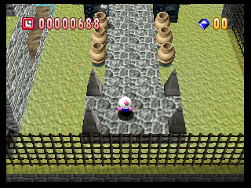

## Unused content

- An older all-capitals Battle menu in the Battle program: PLAYER 0, OPTIONS, COMLEVEL, NO LIMIT, CHARACTER TYPE,
  CONFIG, FILE 0, STAGE SELECT, STAGE 0, Congratulations!.
- "CLEAR BONUS" and "RANK" in the stage-result text (ROM `BAC0C`, `BAC1C`): no code points at them; the result
  screen was not reached in testing.
- Asset 35, a flat pre-drawn Japanese title logo, in all three ROMs; no title program asks for it by number. 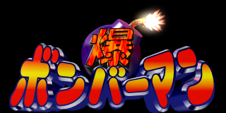
- Assets 36 and 38, the Hudson logo and a ©1997 line, loaded only by the Japanese title.
  
- Debug text that goes to an empty print routine (ROM `24F8`): map information, a thread dump, `move.c` and EEPROM
  revision errors, "ZeroJump Error".
- Two program-module slots (17 and 31) with call stubs and no code; the scene `88` boss program still calls slot 31.

## Region differences

- Japan's title has no "64", says PUSH START and shows the ©1997 line; the US and European title says PRESS START after
  a licence screen that Japan lacks.
- Japan names two worlds White Ice and Black City; the others say White Glacier and Black Fortress.
  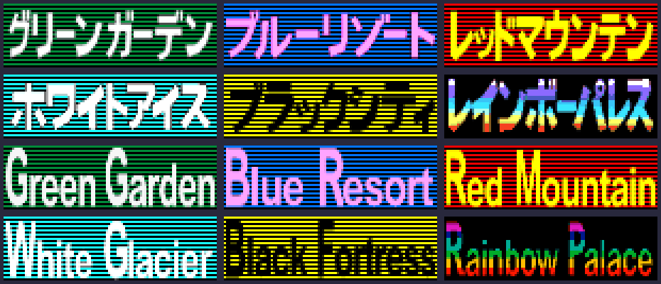
- "HURRY UP!" and "No Data" in Japan, "Hurry up!" and "No File" elsewhere. The credits differ in the cast and add
  "NINTENDO ALL STAFF" outside Japan.
- US and Europe differ in 4 of 982 files: the Start code's window, two longer music sequences, and larger time values
  in scenes `74` and `7E`.

## Open

- The unlock conditions and the saving of the flags, by a real stage clear; the Gold Card pickup itself.
- A clock freeze and the respawn invincibility timer; what item bit 10 does (Bomberman died).
- Rooms and cutscenes scene by scene; scenes `22` and `9B`.
- Item and enemy tables, and models, were not swept for unused entries.
