# Bomberman 64: The Second Attack! (Nintendo 64, 1999-2000): codes and secrets

Japan: Baku Bomberman 2 (1999). There is no European release. The game saves to the cartridge and has no passwords.
Everything here was read from the two ROMs and run in BizHawk. Addresses are US, with Japan in brackets.

Prior art: the GameFAQs "Bomberman 64: The Second Attack!" cheats page and a second page on the game's debug material (both in `res/`: the Battle-type
unlocks, the Z + A code and an alternate shop salesman; two test maps reached by a warp code, the build dates and the
engine's debug strings). Marks: ★ **New** (in neither), **Known**.

| Dump | Header | Build stamp |
|---|---|---|
| Bomberman 64 - The Second Attack! (USA) | `NBVE` | `MAR 16 15:58:02` |
| Baku Bomberman 2 (Japan) | `NBVJ` | `SEP 06 19:48:41` |

What each line rests on is said beside it: played with the controller, shown by writing a save byte, or read from
the code. No unlock was earned by play. Each run was made once.

## ★ Button codes

- **Hold Start at power-on: "Erase Game Pak Memory".** The start-up code (`80037678`) tests controller 1 for Start
  held and loads the erase screen before the logos. Played on both ROMs; Yes was not pressed.
  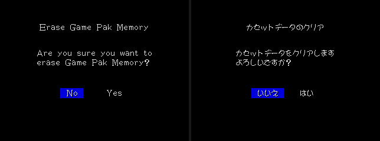
- **Z + A on Battle Character Select: play as a computer character.** The Battle setup program reads save byte
  `800AC2A3` bit `02`; with it, holding Z while a MAN slot is confirmed with A switches the slot to the 15-character
  computer grid. Without the bit Z + A just confirms Bomberman. 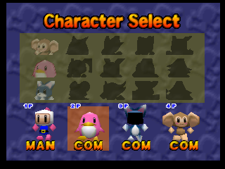
  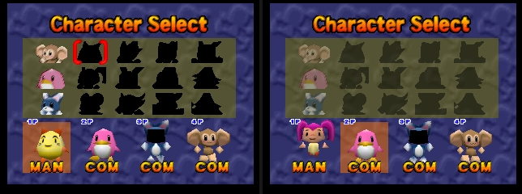
  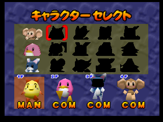
  A clean save shows 3 of the 15 and 12 silhouettes; with the five Challenge levels at 5 all 15 show. The rule for
  each character was not read. 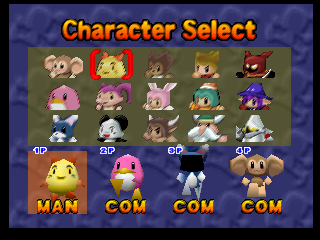

Searched for more: every test of two or more buttons in the main program and all 39 overlays, and the title and
main-menu loops. That search cannot see a code that holds one button and presses another, and it did not cover the
file select, Custom Bomberman, the pause menu or the stage programs.

## ★ Unlocks

All are bits of the global save block (`800AC2A0`, Japan `800AA100`). The rules are read from the code and the
effects shown by writing the bytes.

| Byte | Bit or value | Opens | Set when |
|---|---|---|---|
| `800AC2A3` | `01` | Options BGM line; blue-sky title | at the end of the story, with event flags `85` and `86` set and `FE` clear |
| | `02` | Z + A, and its Options line | all five Challenge levels at 5 |
| | `04` | other forms of the title character | at the end of the story, otherwise |
| | `08` `10` `20` `40` | Abandoned Mine, Desert Shrine, Crystal Palace, Rope Bridge | bought in the shop: Battle Map A-D, 200G each |
| | `80` | Tutorial 2 (US only) | in the first story area |
| `800AC2A4`-`A8` | 0-5 | Challenge level of each Battle type | goes up by one, to 5, after a battle with a setup flag set and a zero result; read as a Challenge win, not traced |

- **Battle types.** Type n+1 opens when type n's level is 3 or more; level 2 opens nothing.
  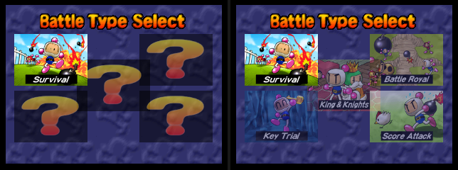
  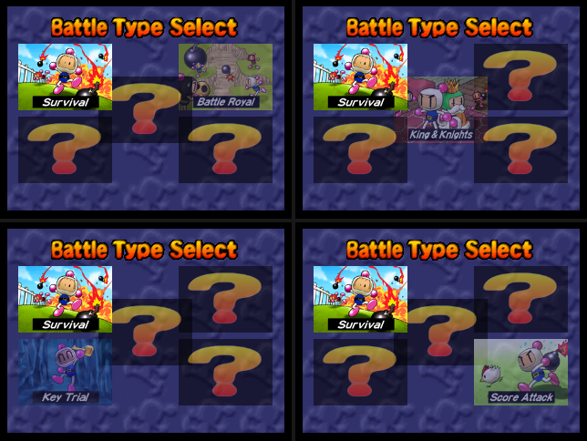
  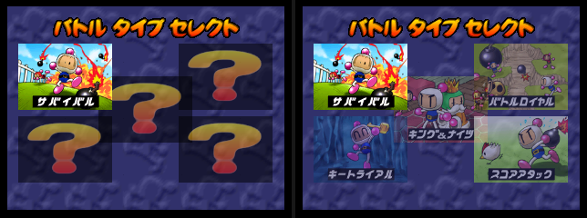 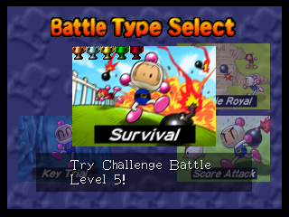
- **Options.** 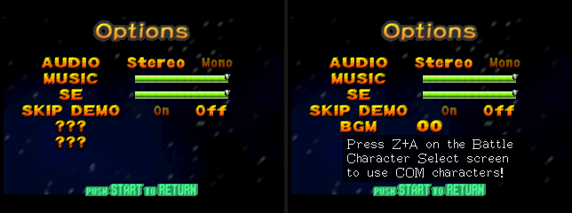 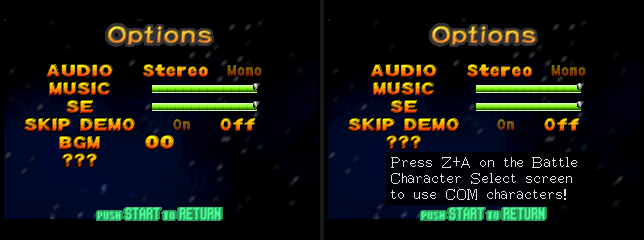
  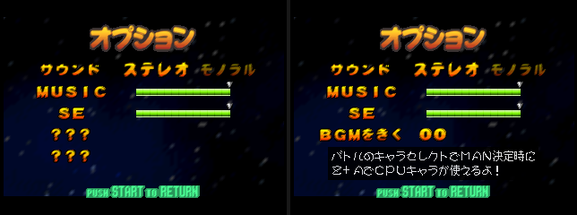 The BGM number did not change with the D-pad in the one try made.
- **Title.** Bit `01` swaps the starfield for a blue sky. With `04` or `01` the character beside PUSH START takes one
  of 14 forms at random, with a 1 in 16 chance of a rare one. 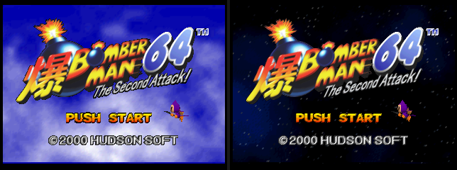
  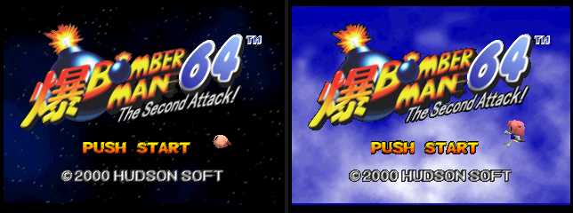
- **Battle stages.** 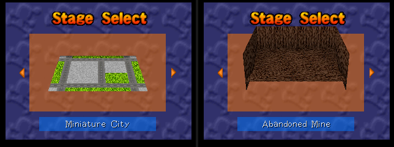
  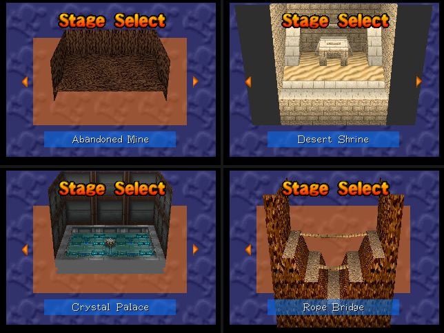 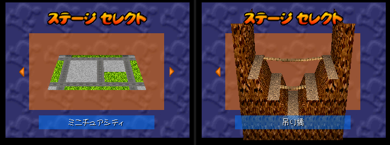
  Desert Shrine and Crystal Palace were only run with the other bits set; which bit is which is from the program's
  own table.
- **Tutorial 2.** 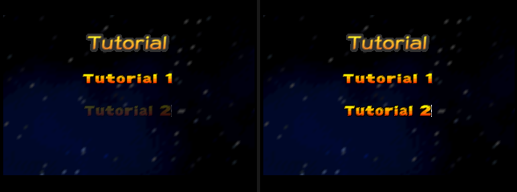

## GameShark codes

A code held from the first frame left the game on a black screen in the emulator: seen with the unlock byte, and
with the health, fire and money codes held for 1,500 frames. Held from frame 30 the unlock byte boots. The cause was
not traced. 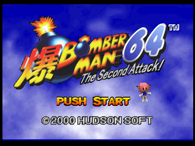

| Effect | US | Japan | |
|---|---|---|---|
| Unlock byte | `800AC2A3 00FF` | `800AA103 007F` | Japan run with `02`, `03` and `78` |
| All Battle types | `800AC2A4`-`A7 0003` | `800AA104`-`07 0003` | run on both |
| Health | `810AD75E 0005` | `810AB5BE 0005` | Japan not run |
| Maximum hearts | `810AD762 0008` | `810AB5C2 0008` | 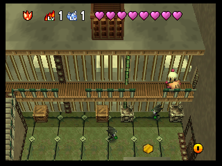 |
| Fire | `800AD733 00xx` | `800AB593 00xx` | |
| Bombs | `800AD737 00xx` | `800AB597 00xx` | |
| Bomb element | `800AD73B 000x` | `800AB59B 000x` | 0 fire, 1 ice, 2 wind, 3 earth, 4 lightning, 5 light, 6 dark |
| Money 999 | `810ABD52 03E7` | `810A9CC2 03E7` | |

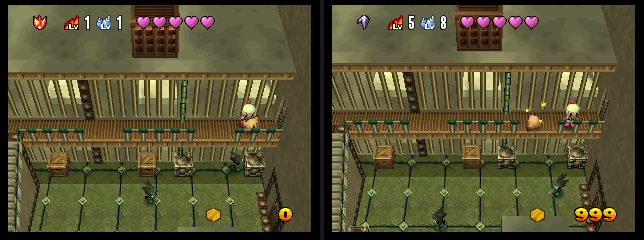
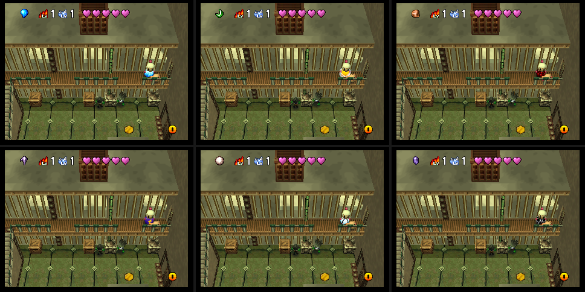

**Map warp.** `800ABD48` is the map number (an asset file number, `0800`-`08FF`), `800ABD4C` the entry point, and
bit 0 of `800ABD40` asks the story loop (`800383E0`) to load it. Written in Story Mode, any map loads: `808` is a
purple checkerboard with a slope and `809` a flat blue and white one, the only two maps no world list names.
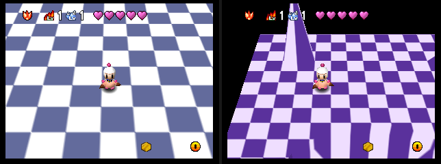 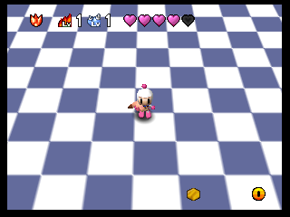
A second reference page gives the warp held on L + R (`D00A0171 0030` before each line); its Japanese condition,
`D009E0E0`, does not react, and `D009E111` does. Maps `882`, `884`, `8B0`, `8B2`, `818`, `8AF` and `8BB` all held
normal game content.

The player block is `3C` bytes a player. The game has no lives. Code modules are mapped
to addresses that move, so no code should point into them.

## Leftovers

- A debug print routine (`80000FA0`) that is now empty, with labels still in the program (one call was checked to
  reach it): "Castle=%d",
  "KingWarp=%d", "RESKEY2=%d", "15=%d", "16=%d", "14=%d".
- Placeholder messages in event files 2655 and 2656, in both ROMs: "[Temporary Message] In this pattern, the jewels
  are put in left and right.", "Right and left patterns are under construction.", "The elevator sound effect in the
  event file has been deleted." Whether a map still calls them was not traced.
- Ten event files left in Japanese in the US ROM (3090, 3091, 3094-3097, 3110-3112, 3119), and a Japanese menu block
  in string file 2030.
- Program numbers `1E`, `21`, `2A`, `63` and `64` are in the file table with no file behind them, in both ROMs.
- The last 64 KB of the PC Engine CD System Card 3.0 sits in asset slot 2 (ROM `68B8C8`), with Hudson's copyright
  notice and 1988 staff list at `69B3A9`. Nothing was found that loads it.
- No debug flag or test menu was found. That is a search result, not proof there is none.

## ★ Merchant Ship Frontier

The shop opens with R on World Select, the screen between worlds (scene `1F`, from event flag `94`). Each item has a
stock condition (`60002320`): always, an event flag, or, for the four Cowboy parts, all 32 regular parts owned
(event flags `00`-`1F`). Buying part n sets flag n; the Cowboy parts are flags `20`-`23`, and with all four the
salesman's model changes (`60003078`). The etc tab sells Battle Map A-D for the four extra Battle stages.
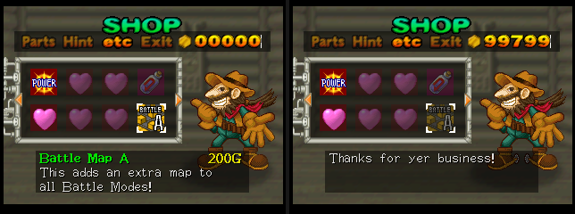
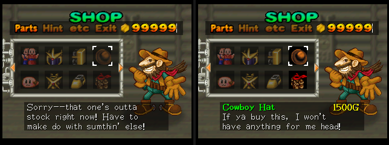
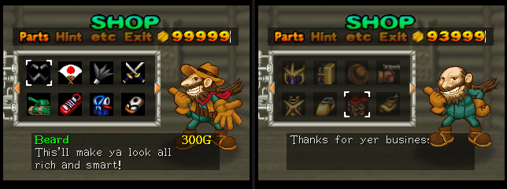
Played with the controller on the US ROM, with the money and the 32 part flags written. Not run on the Japanese ROM
(the same code is there).

## Region differences

- Title, logos and credit. 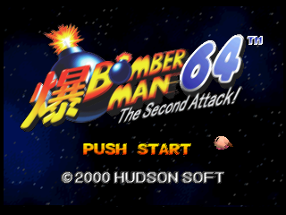 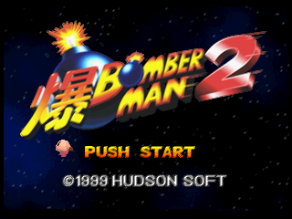
- The US main menu has a fifth entry, Tutorial; Japan has four. 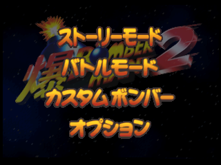
- US Options has SKIP DEMO (save bit `800AC2A9`); Japan has neither the line nor the bit. On or off, Start did not
  skip the opening of a new file.
- 22 code overlays are the same in both; the game program, every menu and every stage program differ. The US ROM has
  one more asset file.

## How the ROM is laid out

- Main program: ROM `1000`-`99000` at `80000400`, uncompressed. Same engine family as Bomberman 64, laid out
  differently: overlays call the main program through a dispatcher mapped at `10000000`.
- Ten code archives from ROM `100000` to `250000`, files packed with Bomberman 64's LZSS. Five were matched byte for
  byte against memory. The asset archive is at ROM `2A0000`: 3,134 files (Japan 3,133), 47 of which did not decode.
- Text is Shift-JIS inside event scripts, with full-width letters for English.
- The save is bit-packed from memory through two tables: global `8009071C` (Japan `8008E73C`), per file `80090774`
  (`8008E78C`); 256 event flags at `800AC2CC`.

## Open

- Every unlock earned by play, and which ending sets which bit.
- The rule for each computer character, and the shop's two ending items.
- Custom Bomberman and the Controller Pak; the pause menu, file select and stage programs for button codes.
- Unused maps, music and objects were not looked for.
