# Bomberman 64 (Nintendo 64, Japan, 2001): codes and secrets

The 2001 game released only in Japan: five modes on one cartridge (Bomberman, Panic Bomber, SameGame, Bomberman Park
and High Score), in 2D. It is not the 1997 Bomberman 64 and shares no engine with it; the title credits Racjin.
It saves to the cartridge and has no passwords. Read from the ROM (header `NHAJ`, MD5
`d54fd7067bd774e32b57f9c2c0496899`) and run in BizHawk. Each run was made once.

Prior art: a page on the game's debug material (in `res/`: the three lines of the debug menu as text, Bomberman Land
text, the extra Park areas, games and medals, the helper option and Panic Bomber X). Marks: ★ **New** (not in it),
**Known**.

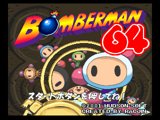 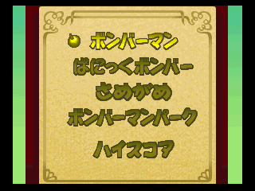

## ★ Button codes

- **Bomberman Park: L + R under two arches opens everything.** The Park's code (`8022800C`) watches for L and R
  pressed together with nothing else held, first on tile `4F,72`, under the right-hand welcome arch, one step in and
  against its left wall, then on tile `43,72`, in the middle of the lane under the left-hand arch. With both, a sound
  plays and `80240474` becomes 1. The left arch first does nothing.
  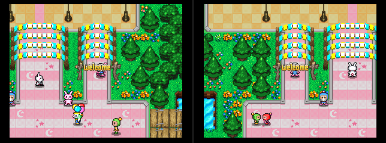
  While that word is not 0 the unlock test (`80215750`) answers "open" for every bit: both hidden Battle stages,
  both extra piece sets of SameGame and Panic Bomber, and Extra-large SameGame. Played with the controller as far as
  the flag and the full attraction list; the other effects are read from that one test. Nothing saves the word; it
  lasted through save-and-quit from the Park to the title.
- **Main menu: Start on High Score.** A sets the High Score state and Start a second one (`800C2808`), in which A on
  a line of the fourth page, Attraction High Score, starts that attraction. On a new save every line is `??????` and
  A buzzes. After the Park code all 26 show. 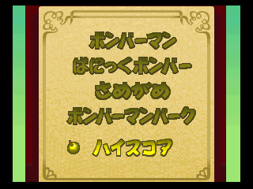
  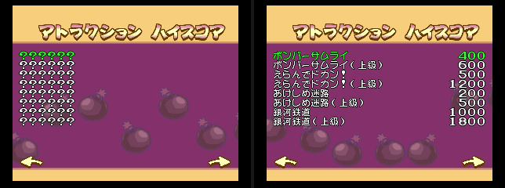 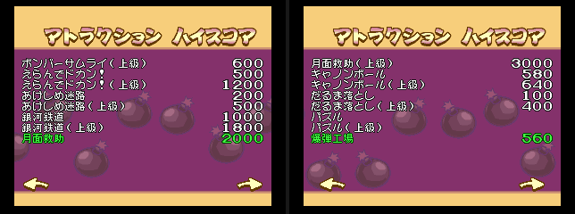
  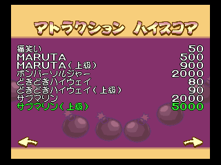
  The whole chain was played with the controller in one run: the Park code, save and quit, title, main menu, Start
  on High Score, three pages right. Starting an attraction from the list was shown with the flag written.
- **Hold Start at power-on:** "Clear the save data?" with Yes and No. 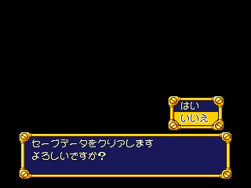
- **SameGame: L or R** swaps the bottom bar for a count of each colour.
  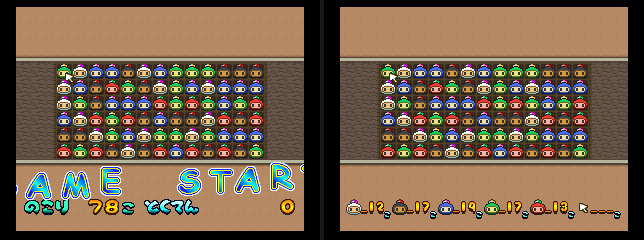

Searched: about 260 reads of the controller words in the main program and every overlay. Not covered: reads through
a pointer, and the Battle program's own button table.

## ★ Unlocks

All are bits of the save word `8023EBC0` (a new game has `337F3FFF`). The rules are read from the code; the effects
were shown by setting the bits, and none was earned.

| Bit | Opens | Set by |
|---|---|---|
| `00004000` | Battle stage マガって ドッカン！ | the 20-medal prize, or the director |
| `00008000` | Battle stage ベルコン アナあな！ | a late date: a man, then a girl behind Bomber Room First, then the man again |
| `00800000` | Extra-large SameGame | all three sizes above their starting scores of 150, 300 and 600 |
| `04000000`, `08000000` | SameGame piece sets | a lost child brought back to his mother; one person on first talk |
| `40000000`, `80000000` | Panic Bomber piece sets | the 10-medal prize; a lost cat found for a girl |

The director, behind a door that needs all 30 medals, sets all six Park bits at once and plays the staff roll. The piece-set bits are counted, not
named: one adds the first extra set and two add both.
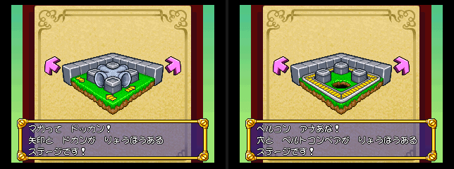 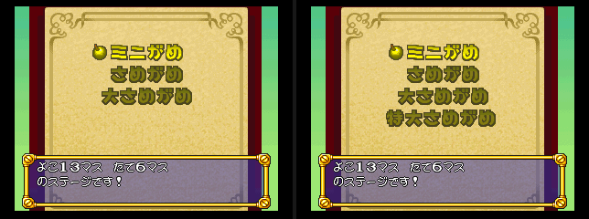
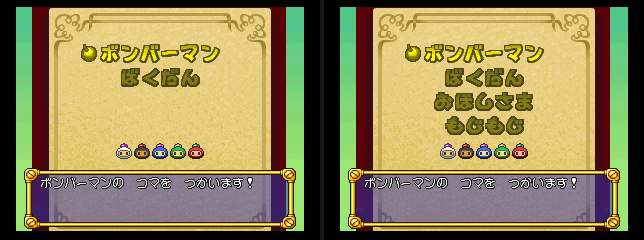 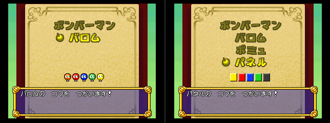

## ★ Bomberman Park: medals and errands

The Park has 30 medals (it says so, and the medal list has 30 lines; a system line about 25 is a leftover). Medal
bits are at `802E1D68` and the count at `802E1D88`; gates and people read the count, so both must be written.

- Medals 1-4 come from people: a gamer, a clerk, a woman and an old man.
  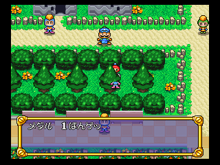
- Medals 5-30 are one for each attraction: the first new high score gives it (Puzzle: clearing it), or after ten
  plays you are offered it. Only when played in the Park; the High Score page's free play gives none.
- The medal list opens from the Park menu once a man has handed it over (Park flag `19`).
  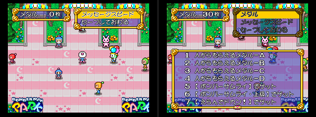
- Prizes: 10 medals, a Panic Bomber piece set; 20 medals, the Battle stage マガって ドッカン！.
  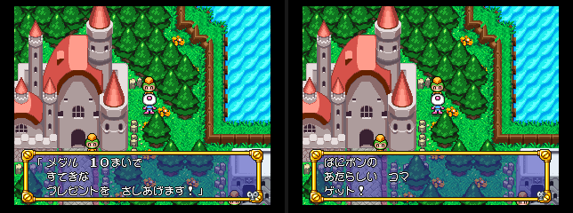
- Gates need 12, 16, 20, 20, 22 and 25 medals (16 to Dark Castle, 22 to Bomber Castle, 25 to the Mushroom House),
  and a door by the secret hall needs 30, to the director.
- The lost cat: the girl, the cat by Bomber Castle, the girl again, for a Panic Bomber piece set.
  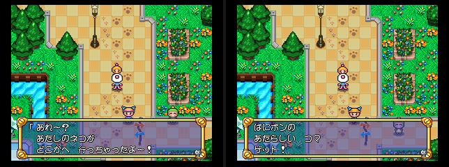

Played, with Bomberman placed beside each person by a position write and the medal count written where said:
medal 1, the cat, the 10-medal prize and the medal list. The attraction medals, the gates and the director were not
shown working; they are read from the code.

## GameShark codes

| Code | Effect | |
|---|---|---|
| `81240474 0001` | everything open, as the Park code | 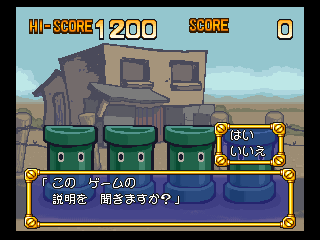 |
| `8123EBC0 FFFF` + `8123EBC2 FFFF` | every saved unlock | 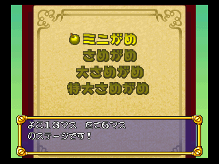 |
| `8123EC24 0001` | all 26 attractions count as played | read from the code; not run by itself |

A code held from frames 1 to 6 of a cold boot leaves a black screen; from frame 10 the game boots. Frames 7 to 9
were not tried. 

No code for lives, time, fire or bombs was found in the Bomberman mode after three tries; the other modes were not
searched.

## ★ Leftovers

- **A debug boot menu**, program `1B`: "00: Normal start", "01: Clear EEPROM", "02: Sound Test". A returns the
  line's value and B another. Nothing loads it: the four calls of the program loader and both id tables were
  checked, and the game now starts on a fixed state. Shown by copying its 36-byte table entry (`8023C628`) over the
  empty entry `8023C64C` and holding the state word `8027C720` at 4. The choices were not followed: the code at that
  state discards the answer. "Clear EEPROM" returns a value the game has no case for.
  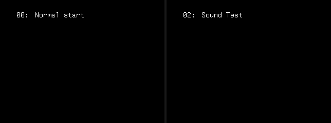 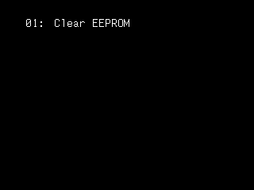
- **The Sound Test is gone.** State 4 loads program `1C`, which is 0 bytes long, and gives a black screen.
- **PlayStation save names**: "BISLPS-03002-" and "BISLPS-03002-SS" at ROM `44570`, followed by 15 and 14. No code
  refers to them. The data files' headers are little-endian, and texture headers give PlayStation screen-memory
  positions.
- **Panic Bomber X.** The title texture (file `14E`) carries the captions ボンバーマン, ぱにっくボンバー✕ and
  ミニボンバーマンランド (Mini Bomberman Land, perhaps the Park's earlier name) and nine frames of a tumbling X; the
  high-score texture (file `128`) has Panic Bomber with an X. In play neither X is drawn.
   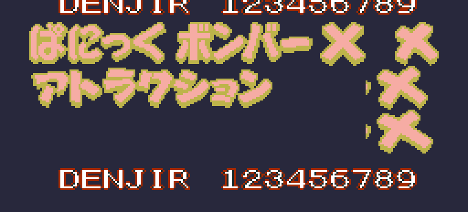
- **Text from Bomberman Land (PlayStation)**: its bosses (Dark Rose, Dark Doll, Dark Piece, Dark Witch, Dark Bomber),
  experience and levels, about 26 of its attractions, dice and card betting, memory-card messages, and Pommy saying
  Dark Bomber took the Red Bombers.
- **The Park:** Casino Area, Space Area and Dungeon Area (messages `E4`, `E6`, `E8`) are named but not in the area
  table (`802406E0`). Seven attractions are named but not in the attraction table: ボンガンマン, たまごをまもれ！ and
  おたからダッシュ with their advanced versions, and ボンバーアクション. Medal text runs to 40 medals and 11 given by
  people (A to K); the Park has 30.
- **Battle options:** a helper-character caption (おたすけキャラ), "Louie appears as a helper / no helper" and a devil
  character on or off; the rule screen has six lines without them. Start position is used.
  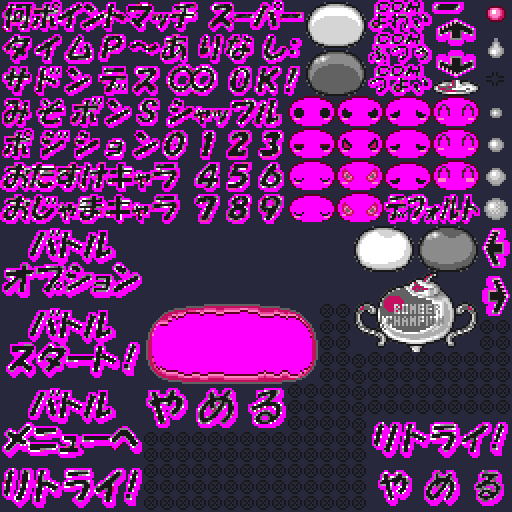
- **Debug text:** a stage select, a debug stage and a flag menu (phone flag, all mini-games, title mode, two
  four-panel-comic flags).

"Not used" above means no fixed message number next to the text table's address (all 66 places that load it were
checked) and none in the two id tables found; numbers worked out at run time were not all traced, and the sprite
tables were not decoded.
- Developer strings: "malloc err!!", "free err!!". No debug flag was found.
- Two scenes shown by forcing the game's state, to label them: a puppet show and the staff roll.
  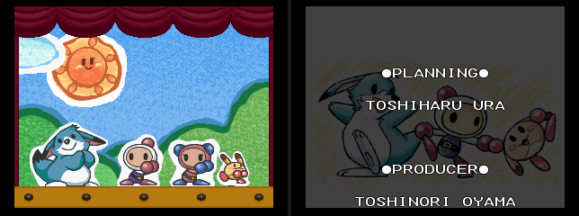

## How the ROM is laid out

- Main program: ROM `1000`-`45000` at `80200000`, uncompressed. 28 overlays, all linked at `800C0360`, one loaded at
  a time (table `8023C280`, loader `80206B20`).
- File table at `8023F1E0`: 337 ids, 82 with data. The data formats were not decoded.
- Data files are little-endian lists of records (offset, size, type, compressed flag); flagged records are LZSS.
  All 531 records unpack. Text tables are type `10D`.
- Text: 16-bit codes into a 12 x 12 font of two pages (`0000`-`01B8`, `4000`+), with `8000` end, `8001` new line,
  `8002` space, `8004` wait for a button and `8005`-`8009` inserted numbers and names.
- Game state: `8027C720`, 20 states. Controller words: held `8025A5F8`, pressed `8025A5FA`.

## Open

- Every unlock earned by play: no attraction medal, gate or director was shown working.
- Cheat codes for play in any mode.
- The save layout; the sprite tables; about 120 of the 155 textures were not looked at
  closely, and no search for unused music or stages was made.
- What the debug menu's choices did, and the Battle and pause-menu button code.
