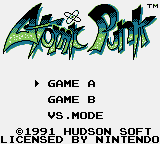
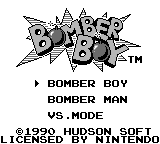
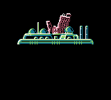
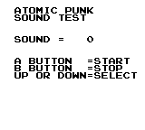
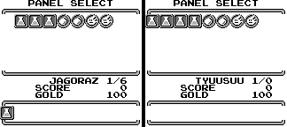
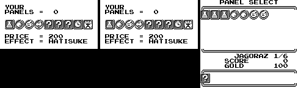

# Atomic Punk / Bomber Boy (Game Boy, 1990-91): passwords

Bomber Boy (Japan, 1990) and Atomic Punk (USA, 1991) are one game. Read from the ROMs and checked in Mesen 2 (helpers in
`tools/bb/lib.lua`, `CODE=... tools/emu/run.sh bb tools/bb/test_codes.lua us|jp`). Addresses are the same in both carts
unless two are given (US / JP).

Prior art: the GameFAQs "Atomic Punk" page (in `res/`). Marks: ★ **New**, **Known**.

| Dump | Header title | MD5 |
|---|---|---|
| Atomic Punk (USA) | `ATOMIC PUNK` | `76010c6ff6bd0c4e8ac934dc69fb96ab` |
| Bomber Boy (Japan) | `BOMBER BOY` | `fc2d9eb9479543614b6e3d0d63c359aa` |

128 KB each. The title menu offers GAME A / BOMBER BOY (the adventure), GAME B / BOMBER MAN and VS. MODE; Game A and
Game B each have their own password screen.

 

## Game A (Bomber Boy): 8 characters

CONTINUE opens INPUT PASSWORD: a grid of 32 places, 8 characters, END to check. `tools/bb/password.mjs` decodes and
encodes; `node tools/bb/test_password.mjs` round-trips every state.

| Cart | Grid (rows of 8) |
|---|---|
| Bomber Boy | `12345678` `ABCDEFGH` `JKLMNOPQ` `RSTUWXYZ` (no I, V, 9 or 0) |
| Atomic Punk | `12345678` `BCDFGHJK` `LMNPQRST` `VWXZ?!.=` (no vowels) |

The code stores each character's place, so the same state has a different code on each cart.

- The buffer `$C480-$C487` holds each character's place (0-31). `$01:44B2` / `$01:4497` turns it sideways: byte k
  (`$C490 + k`) gets bit k of every character, the first character in bit 7. Bytes 5-7 must be 0, which they always are.
- **Checks**: b1 + b2 + b3 = b0 and b1 ^ b2 ^ b3 ^ `$CA` = b4. ERROR !! otherwise.
- **Contents**: b1 → `$C0E9`, the islands cleared (one bit each); b2/b3 → `$C0E0`/`$C0E1`, the gold. That is all a
  code holds, so every state has exactly one code, and 1 string in 65,536 is valid.
- The game's own encoder (`$01:4670` / `$01:4655`, for the CONTINUE screen, from the copy kept at `$C9A0`) makes the
  same characters: with islands `$5A` and 9,999 gold it showed `K3RMPEGE` (Bomber Boy) and `M3VPSGJG` (Atomic Punk),
  as `password.mjs` does.

| Bit | Island | | Bit | Island |
|---|---|---|---|---|
| 0 | Cuolece | | 4 | Jagoraz |
| 1 | Windria | | 5 | Grad |
| 2 | Thulia | | 6 | Faria |
| 3 | Hevol | | 7 | Wather |

Names from `$00:0F79`; My Town, the hub you start on, has no bit. A new game is islands 0, gold 100 (`$00:08E2`).

- **Gold is 16 bits but capped at 9,999** (`$00:34E6`, `$00:379D`: past `$270F` it is set back to 9,999). The password
  takes any value up to 65,535 (`!!HH!H!G` loads 65,535); the cap applies the next time gold changes.
- **Faria is the last island**: it opens once the other seven are cleared (`$00:0EB7`, mask `$BF`).
- **All eight cleared goes to the ending** (`$00:0CA5`: `$FF` jumps to bank 3). `33FPS=J=` / `33DMPZGZ` play the
  closing scene and BOMBER BOY STAFF instead of opening the map; `$BF` opens the map. 

Typed in Mesen (RAM read back after END; the cards show the island map and the Panel Shop's GOLD): every Atomic Punk
code on the GameFAQs page, its US and "EU" lists alike, loads the islands and gold it decodes to. Two entries there are
misprints: `6M71L2B` has 7 characters, and `35QQB6CA` an A the grid doesn't have. The page's labels ("Hevol
Completed" and so on) name the last island its contributor cleared; the codes hold every island cleared so far.

## Game B (Bomber Man): NES Bomberman's code

Game B is a port of NES Bomberman, and its ENTER SECRET CODE screen is NES Bomberman's code system unchanged: the
letter chain v[k] = (l[k] + l[k-1] + 7) & 15 (`$02:451D`) and the same sum checks. `tools/nes1/password.mjs` covers it.

Bomber Boy's letters are NES Bomberman's (`ABCDEFGHIJKLMNOP` / `AOFKCPGELBHMJDNI`). Atomic Punk's table (`$02:44D5`)
is `0BCD1FGH2JKLMN3P` / `03FKCPG1LBHMJDN2`: the same letters with **A, E, I and O shown as 0, 1, 2 and 3**. So any NES
Bomberman code works on Atomic Punk with those four letters swapped.

Only the RAM moved: stage `$C40B`, bombs `$C402`, fire `$C403`, speed `$C404`, wall pass / flame pass / detonator
`$C406`-`$C408`. Typed in Mesen and read back: `BOHIDJFEKJGKEFOLFHAC` (Bomber Boy) and `B3H2DJF1KJGK1F3LFH0C`
(Atomic Punk) both start stage 50 with 10 bombs, fire 5 and every power-up, and `NM2HPPBPC0FH0BDPCPCH` (Atomic Punk)
stage 1 with 10 bombs, fire 5 and speed. The 20th letter submits the code.

## Button codes

- **Sound test** (Known): on Game A's stage select, choose MY TOWN with A + B + Select + Right held, and keep them held
  through the fade. `$00:2A95` checks for exactly that combination (`$17`) and jumps to the sound test (`$03:471A`).
  Typed in Mesen on both carts. 
- ★ **Soft reset**: hold Start and press Select. The joypad reader (`$00:04D7`) jumps back to the boot code (`$0179`);
  the bytes are the same in both carts, and both were tested in Mesen.
- No password check reads the joypad, so no code needs buttons held while it is entered.

## Text

- ★ **TYUUSUU**: Panel Select (`$00:30DA`) and the round results (`$00:35B5`) name the island from a second list
  (`$00:3630`, names `$3642`): CUOLECE, WINDRIA, THULIA, HEVOL, **TYUUSUU**, JAGORAZ, GRAD, FARIA, WATHER. The map uses
  the first list (`$00:0F79`), where island 4 is MY TOWN. My Town has no rounds (choosing it opens the Panel Shop), so
  TYUUSUU never shows. With `$C0EA` = 4 poked as Panel Select opens it reads TYUUSUU 1/0 (both carts, Mesen).
  
- ★ **HATISUKE**, a 10th panel. The panel tables have 10 entries: names (`$00:301F`: ELIXER, BOMB UP, FIRE UP,
  SPEED UP, REMOCON, WALLPASS, BOMBPASS, TIMER, FIREPASS, HATISUKE), prices (`$00:1CEC`, stored negated: 100, 50, 50,
  20, 30, 50, 40, 50, 100, **200**) and the island each one waits for (`$00:335B`, from REMOCON on). The shop's BUY
  cursor wraps after 9 (`$00:2E18`), and HATISUKE's mask is 0, so it would show ??? anyway. A round's panel comes
  from the jump table `$01:49D4`, which points at the stubs for panels 0-8 but not at the one for 9 (`$01:4A44`,
  Bomber Boy `$01:4A29`, both unreferenced). SELL and Panel Select step through 10 slots (`$00:2E0F`). So nothing
  gives it, and it does nothing: the round setup (`$00:0827`) counts panels 1-3 (bombs, fire, speed) and flags 4-8
  (REMOCON to FIREPASS), ELIXER is used on death, and nothing checks 9; after a round `$00:0924` removes it like the
  other one-round panels. Pointing the shop's lookups at slot 9 in Mesen draws PRICE = 200, EFFECT = HATISUKE (both
  carts); put in the inventory (`$C4C0` = 9) and equipped, it shows as a ? icon and the round starts with the same
  bombs, fire, speed and flags as with no panel.
  
- The other strings belong to screens normal play reaches: menus, map, shop, the sound test and Game B's code screen
  were read in Mesen data logs; the round results, game over, Game B's bonus stage and the staff roll weren't reached
  in those runs (the staff roll shows in the ending above).
  VS MODE's strings (bank 4: PANEL MODE, POWERFUL MODE, HOW MANY TIMES, VS MODE NOT READY) need a link cable and
  weren't run.

## Hidden-content sweep

Atomic Punk, with `tools/gbsweep.py` on Mesen code/data logs from 20 runs: title and attract, a new game, every
island picked in turn from a save with islands `$5A` (not each checked to reach a round), the Panel Shop, passwords and the ending, the sound test, Game B
(several stages), game over and the VS MODE menu. 20,616 bytes ran as code.

- **Dead code** (`disasm/bb/dead_us.txt`): branch-reachable never-run 2,219 bytes, dead 4,883, no reference 14; 85
  orphan candidates, mostly data. The largest pieces are VS MODE's link-cable game in bank 4 (it needs a second Game
  Boy) and branches of play the bot didn't hit. A round is won on the exit with no enemies left (`$00:0B8E`, bit 4 of
  `$FFA2`): the results (`$00:33A6`) tally TIME, BLOCK and GOLD into gold and score. An island's last round leads to
  the rescue scene (`$00:3CB9`, THANK YOU! KID!). `$00:10B0` is the enemy movement dispatcher (enemy type & `$3F`,
  called per enemy from `$00:152F`); all 12 handlers run in ordinary rounds. Start in the Panel Shop opens YOUR
  PANELS (`$00:2B13`), a list of the panels you own.
- ★ **A password nobody sees.** Before the rescue scene (not on Faria) the game adds the owned panels' prices to the
  gold, as game over does, writes a CONTINUE password into the screen map at `$9C0A` and puts the gold back. That
  map is never displayed and is wiped before the next screen, so only game over shows a password. After clearing
  Jagoraz with 300 gold and 600 in panels it held 6L1PLRCW (Bomber Boy 6J1MJOBS): Jagoraz cleared, 900 gold.
- **Unset flags** (`disasm/bb/flags_us.txt`): only bank 7's sound-driver fields and two VS MODE bytes written by
  untraced bank 4 code. Nothing that looks like a debug switch.
- **Input codes** (`disasm/bb/pad_us.txt`): menus, movement, the shop, the sound test's selector, the high-score
  check and the two codes above (sound test, soft reset). No other button combination.
