# Bomberman B-Daman (Super Famicom, Japan, 1996): secrets

Hudson's marble-shooting puzzle game. Everything here comes from the ROM and from Mesen 2 (headless test runner).
`$C0:xxxx` is file offset `xxxx` (HiROM); the code runs from the `$80`+ mirrors. Marks: ★ **New**.

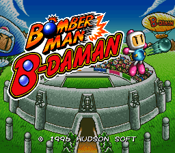 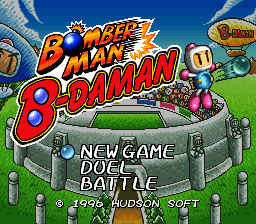

| Dump | Header | |
|---|---|---|
| Bomberman B-Daman (Japan).sfc | HiROM FastROM, ROM + RAM + battery, 1 MB, 8 KB SRAM, game code `AH9J`, maker `18` (Hudson) | checksum `$AB17`, good |

## The game

Hudson logo, the JBA (All Japan B-Daman Association) logo, an intro, then the title. The menu has NEW GAME, DUEL,
BATTLE, MY B-DAMAN, EDIT, RANKING and OPTION.

- **NEW GAME**: pick one of three save files, a B-Daman and a level. 10 levels of 10 stages; in each you slide left
  and right and fire one marble to blow up every bomb by chain reaction. All ten levels can be picked on a fresh
  save. A level ends with a score sheet, a save prompt, a rank certificate (認定証) and a ranking.
- **BATTLE**: 1 to 4 players, each MAN or COM, on a four-sided arena; pads 3-5 are read through a multitap on port 2
  (`$C0:8FFA`).
- **EDIT**: a stage editor (ORIGINAL STAGE 01: EDIT / 1P PLAY / 1P vs 2P / EXIT).
- **OPTION**: プレビュー ON/OFF, トライ 1-3, サウンド, BGM and SE tests, ALL CLEAR.

## No passwords: the save

Nothing in the scene list is a password screen. The game saves to battery RAM at `$30:6000-$7FFF`, valid when it
starts with `00 01 .. 0F` and `B_DAMAN Ver 0.1 ` and ends with `0F 0E .. 00` at `$30:7FF0` (`$C0:8A7D`); otherwise all
8 KB are cleared and defaults written. The copy lists at `$C0:8E07` give each of the three files a `$7A`-byte record
(`$30:60A4`, `$30:611E`, `$30:6198`); the best rank overall is `$30:628D`.

## ★ The debug mode

One ROM byte switches it off: `$80:8077` = 00 (file `$8077`). Game Genie **`DF65-4FAD`** sets it to 01. (`DF65-7FAD`,
the same byte in bank `$C0`, does not work: the reads go through bank `$80`.) Same inputs and frame in Mesen, without
and with the code: 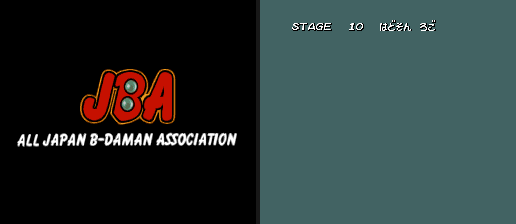

**Scene select.** Hold Start + Select on the Hudson logo, which sets `$1F5A` (`$C1:B4CD`; the game as sold does this
too, but nothing reads it). Then Start + Select held in any scene opens a list, "STAGE xx name" (`$83:8000`). A +1,
B -1, X +`$10`, Y -`$10`, Start runs the scene, L and R open two of the tools. Start + Select inside a scene comes back.
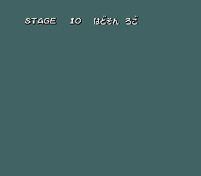

Scene names (table `$83:B19B`, half-width kana in the ROM):

| Scenes | Name |
|---|---|
| `00` | none: an empty wooden stage, where a PAL console boots |
| `01`, `05`, `90`, `91` | デュエル: キャラ セレクト, レベル センタク, セイセキ ハッピョウ, ショウハイ ハンテイ |
| `02`, `03` | ニンテイショウ チェック, ランキング チェック |
| `04`, `08`, `09` | オプション, ランキング, ニンテイショウ |
| `06`, `07`, `19`, `1D` | ノーマル: セイセキ ハッピョウ, レベル センタク, レベル ニンテイ, キャラ セレクト |
| `0A`, `0D`, `0E`, `1C` | ユウショウ ガメン (2P, 3P, 4P, 1P) |
| `0B`, `0C` | エディット モード, エディット プレイ ステージ |
| `0F`, `14`, `15`, `16`, `18` | COM レベル セッテイ, ルール セッテイ, ニンズウ セッテイ, スコアボード, キャラ セレクト (バトル) |
| `10`, `11`, `12` | ハドソン ロゴ, JBA, コンティニュー チェック |
| `13`, `17` | バトル ステージ, **バトル ステージ ソノ2** |
| `1A`, `1B`, `1E`, `1F` | ネーム エントリー, マイ ビーダマン, タイトル, カスタムパーツ セレクト |
| `20`-`83` | ノーマル ステージ 1-100 |
| `84`-`A3` | unnamed: attract demo stages (`84`-`88`), tutorial lessons (`92`, `94`-`98`), the intro (`93`), the mouse warning (`9C`) and others |
| `FB`-`FF` | the five tools below |

**The tools.**

| Scene | Tool | |
|---|---|---|
| `FB` (L) | BOMB ENTRY EDIT (`$83:A0AC`): a stage's bomb list | 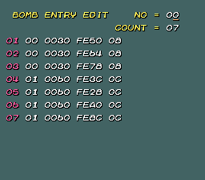 |
| `FC` (R) | MOVE TYPE EDIT (`$83:994A`): bomb movement scripts | 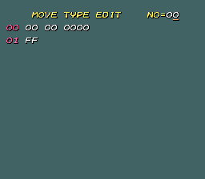 |
| `FD` | DEBUG MODE DATA SET (`$83:8571`): FLAG0-7 = `$1F4E-$1F55` as bits, DATAnn = the word at `$1F56 + 2n` | 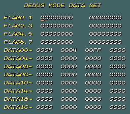 |
| `FE` | SOUND TEST (`$83:828B`): BGM NO, SE NO | 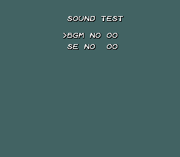 |
| `FF` | EXPLOSIOIN PARAM. SET (sic, `$83:844B`): INIT, END, ADD, KEEP, SUB, HOLD, H ADD for small, middle and large blasts | 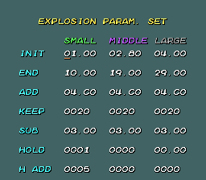 |

**Also behind the byte.** A new press of Select freezes the menu-type scenes listed at `$C0:84CA` until Start or
Select (`$C0:8493`; seen on the title). L + R + Select + Start jumps to the reset code (`$C0:8FDE`; read only).

**Debug flags.**

| Flag | Read at | Effect |
|---|---|---|
| `$1F4E` bit 0 (FLAG0) | `$C2:8F94`, `$C2:994A` | the stage editor shows a MOVE TYPE nn readout 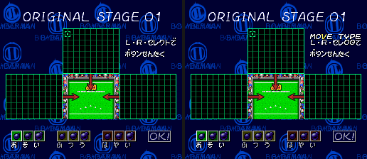 |
| `$1F50` bit 0 (FLAG2) | `$C1:D9A9`, `$C1:F4BF`, `$C2:DCF1` | Battle uses scene `$17`, Battle Stage 2, instead of `$13` (read; not watched in a real Battle) |

## ★ Battle Stage 2

バトル ステージ ソノ2 (scene `$17`) is a second battle arena: a grey cloudy floor with four coloured rails. The only
three stores of `$17` sit behind the `$1F50` test, and no code but the debug data page writes `$1F50`: with every row
of the Battle rules screen toggled, nothing wrote the flag bytes. So the game as sold never picks it. Seen through
the scene select. 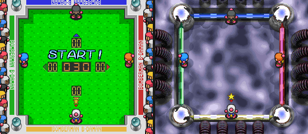

## ★ トライ ∞

The Option screen's トライ (tries on each stage) has a fourth value, ∞, offered only when the best-rank byte `$0D83`
is 6 or more (`$C2:B020`, `$C2:B04A`); the stage-end code treats it as "retry until cleared" (`$C2:84E3`). With
`$0D83` = 6, Right cycles 2 → 3 → ∞ → 1; with 0 it cycles 2 → 3 → 1. Which rank name is number 6 wasn't worked out.
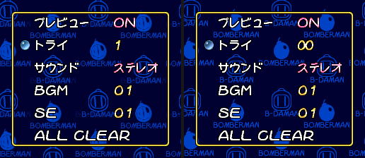

## Region and mouse checks

- A PAL console boots into scene `$00`, an empty stage with nothing to hit (`$C0:80E8`). 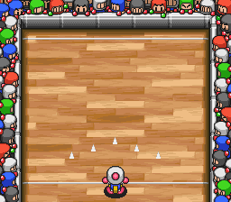
- With a SNES Mouse plugged in, the game stops on "You can not use a mouse with this game." after the JBA logo.
  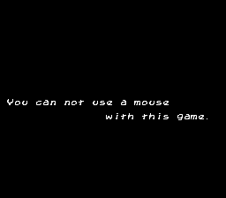

## Cheat codes

| Code | Effect | Check |
|---|---|---|
| Game Genie `DF65-4FAD` | the debug mode | Mesen cheat engine, off/on pair |
| PAR `7E0D85:03` | トライ ∞ | Mesen cheat engine: the Option screen reads ∞ 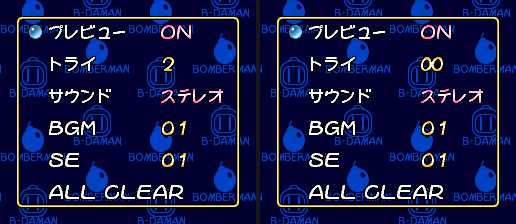 |
| PAR `7E0D83:06` | ∞ can be picked on the Option screen | RAM write in Mesen |
| PAR `7E1F4E:01` | MOVE TYPE readout in the stage editor | RAM write in Mesen |

Variables: `$117B` scene, `$0D80` level (0-9), `$0D99` position in the level, `$0D9A-$0DA3` the level's ten stage
numbers, `$0DA4-$0DAD` results, `$0D87` tries used, `$0D85` tries setting.

## Unused content

- The debug suite above, and Battle Stage 2.
- Sound driver credits at file `$4D58A`, never shown: "SFX SOUND DRIVER Ver 2.32 / 1993-96 Hudson Soft /
  Program : LU.Iwabuchi / Driver : Kazumi-TYPE / Note :".

## Open

- Battle Stage 2 in a real Battle with `7E1F50:01`; scenes `$89-$8F` and `$9E`, which have no constant store.
- Unused graphics, music and stage data: no coverage sweep was run, and the button-code search covered only
  held-pad compares, so a hidden title or menu code isn't ruled out.
- Level 10 on a fresh save played its stages in a shuffled order; not traced.
