# Bomberman GB (Game Boy, 1994) / Wario Blast featuring Bomberman!: passwords and secrets

Everything here comes from disassembling the ROMs (`tools/sm83.py`, a recursive SM83 disassembler that follows MBC1
bank switches and takes every executed code start from Mesen's code/data log; listings in `disasm/gb1/`) and
checking the results in Mesen 2 (`tools/gb1/run.sh` runs a Lua script headless with `tools/gb1/lib.lua` and
`tools/emu/mesen_gb.py`'s helpers prepended). Addresses are `bank:address` (bank 0 at `$0000`, the switched bank at
`$4000`). JP addresses unless Wario is named; most routines sit at the same address in both.

Prior art: the GameFAQs codes page for Wario Blast and a wiki article on Wario Blast (both saved in `res/`). The
GameFAQs page titled "Bomberman GB" is the US release of JP Bomberman GB 2 ([gb2.md](gb2.md)), but its 4622 and 5656
also work here. Marks: ★ **New** (in neither), **Fixed** (posted wrong or incomplete), **Known**.

## Dumps: which game is which

| Dump | Header title | MD5 | Game |
|---|---|---|---|
| Bomberman GB (Japan) (SGB Enhanced) | `BOMBERMAN GB` | `2cad6ee6df3402aeb8f8ab7921517779` | this game (JP 1994) |
| Wario Blast Featuring Bomberman! (USA, Europe) (SGB Enhanced) | `WARIO BLAST` | `14fe7234ee4bcb14adf20c743f084a35` | this game, US/EU, version tag `wario` |
| Bomberman GB (USA, Europe) (SGB Enhanced) | `BOMBER MAN GB` | `7e4c9c3620bea7b633394beb67e9680b` | **not** this game: it is JP Bomberman GB 2 ([gb2.md](gb2.md)) |

All are 256 KB MBC1 (cart type `$01`), no RAM, SGB flag `$03`, licensee `18` (Hudson). JP and Wario differ in
182,964 bytes, but banks 2, 5 and 7 are nearly equal (740, 1,386, 184 bytes) and the password check, its table
format, the player-hit check (`$01:4837`) and the set logic are the same code at the same or nearby addresses: the
same game, reworked. The US "Bomberman GB" shares only one 32-byte block with JP Bomberman GB and 6,681 with JP
Bomberman GB 2 (three banks identical), so the user's guess holds: **US Bomberman GB = JP Bomberman GB 2; JP
Bomberman GB = Wario Blast.**

## RAM that matters

| Address | Meaning | Evidence |
|---|---|---|
| `$C000` page | player object: `$C000` state (2 alive, 1 dying, 0 gone), `$C006` X | `$01:4861`, write log in Mesen |
| `$C100`, `$C200`, `$C300` | the enemy bombers' objects (same layout) | `$01:487E` |
| `$C3D5` | Wario only: 1 = playing as Bomberman, 0 = as Wario | `$0A:42A0`-`$0A:430E` |
| `$C3F0` | stage 0-31: round = n / 4 + 1, n % 4 = stage 1-3 or the boss | `$00:181F` (INC, `CP $20`) |
| `$C3F1` | music/sound request | `$0A:42CD` |
| `$C3F2-$C3F4`, `$C3F5` | result of sets 1-3 (1 lost, 2 won), set number | `$00:17B8`-`$00:181F` |
| `$C3FB` | 1 = start with every power-up (code 4622) | `$0A:42E0`, readers `$00:10AD`, `$00:2727`, `$01:405B` |
| `$C590` | set result: 2 won, 1 lost, 0 draw | `$01:48C7`-`$01:48EF` |
| `$C597-$C59A` | the 4 password digits (0-9); `$FFD3` cursor, `$FFD1` the digit being edited | `$0A:4258` |
| `$CC60` / `$CC61` | pad held / newly pressed (bit 0 A, 1 B, 2 Select, 3 Start, 4 Right, 5 Left, 6 Up, 7 Down) | `$0A:4194` |

## The game

The normal game is a string of duels: each stage is one or two sets against Black Bombermen in a small arena
(`ROUND1-1 VS ENEMY1`); two sets won clear it, two lost go to the continue screen. 8 rounds of 3 stages and a boss
make 32 stages. There are no lives, so there is no lives cheat: a lost match only costs a continue.

## The password

Code: `$0A:4194` (entry), `$0A:4272` (check; Wario `$0A:4255`), table `$0A:42EE` (Wario `$0A:4315`).
`tools/gb1/password.mjs` holds both tables; `node tools/gb1/test_password.mjs` checks it.

- 4 digits on the title's PASSWORD line. **Nothing is computed**: the check compares the digits with a list of
  5-byte records (4 digit bytes `$E0` + digit, one value), `$FF` ends it. JP has 34 records, Wario 68.
- Values below `$20` set `$C3F0` to the value. Wario uses `$00-$1F` for Bomberman (`$C3D5` = 1) and `$20-$3F` for
  the same 32 stages as Wario (`$C3D5` = 0, `$C3F0` = value & `$1F`).
- JP `$20` / Wario `$40` (Bomberman), `$42` (Wario): `$C3FB` = 1, start at 1-1 with every power-up.
- JP `$21` / Wario `$41`, `$43`: the extra battle (`$C3F1` = `$0C`, `$00:34B2` JP / `$00:3457` Wario).
- The 32 Bomberman stage codes are **the same in both versions** (Wario only added the Wario column and the two
  Wario specials), so every GameFAQs "(Bomberman)" code is also a JP code.

| Round | Stage 1 | Stage 2 | Stage 3 | Boss | Wario: 1 | 2 | 3 | Boss |
|---|---|---|---|---|---|---|---|---|
| 1 | 4696 | 7006 | 8774 | 5141 | 6964 | 6007 | 4778 | 1415 |
| 2 | 9185 | 4610 | 2630 | 3569 | 5819 | 0164 | 0362 | 9653 |
| 3 | 8401 | 8264 | 0173 | 2828 | 1048 | 4628 | 3710 | 8282 |
| 4 | 4152 | 3451 | 4312 | 0874 | 2514 | 1543 | 2134 | 4780 |
| 5 | 1909 | 5010 | 2904 | 1726 | 9091 | 0105 | 4092 | 6271 |
| 6 | 3614 | 0610 | 9867 | 9618 | 4163 | 0160 | 7689 | 8169 |
| 7 | 1884 | 7702 | 6925 | 7110 | 4881 | 2077 | 5296 | 0117 |
| 8 | 5814 | 8136 | 0390 | 3158 | 4185 | 6318 | 0930 | 8513 |

Specials: **4622** every power-up, **5656** extra battle; Wario adds **2264** / **6565**, the same as Wario.

**Codec API** (`tools/gb1/password.mjs`): `decode(code, version = 'jp' | 'wario')` returns
`{value, kind: 'stage' | 'powerup' | 'battle', round, stage, boss, player: 'bomberman' | 'wario'}` (round/stage/boss
only for stages) or `null`; `validate(code, version)`; `encode(round, stage, player, version)` (round 1-8, stage 1-4,
4 = boss); `allCodes(version)`; `TABLES` (version -> code -> table value).

### Verification

- **Fuzz** (`tools/gb1/fuzz.py`, `fuzz.lua`): all 10,000 codes were written into `$C597-$C59A` and run through the
  game's own check from a savestate at its entry, the result read at its two exits. JP: 34 accepted, Wario: 68,
  **0 mismatches** with `password.mjs` in either.
- **Typed with the pad** (`tools/gb1/test_codes.py`, `test_codes.lua`): every code in both versions (36 JP runs, 70
  Wario runs including `0000` and `1234`), Up/Down on the digit, A to the next, Start to check; `$C3F0`, `$C3FB`,
  `$C3D5` and the reject/battle exits read back. All as predicted.

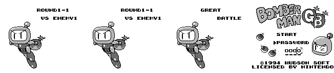

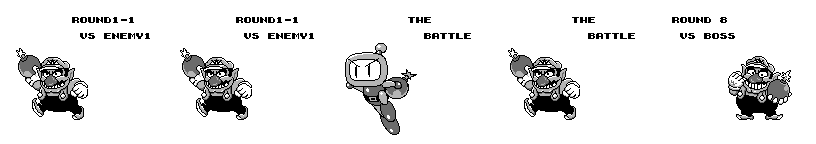

Entering: on the title, Down to PASSWORD, Start. Up/Down step the digit (wrapping 0-9), A stores it and moves right
(the next digit starts at 0), B goes back (and from the first digit leaves the entry), Start stores the 4th and checks.

## Secrets

### 5656: the extra battle (Known, mechanism added)

GameFAQs calls it Battle Mode / Extra Battle. It's an elimination run: the JP intro text (GREAT BATTLE) reads
"how many Black Bombermen can you defeat before you go down? The elimination battle begins!"; Wario's is THE
BATTLE. In JP it is reachable only by password; the title's BATTLE entry (SGB multitap only, below) is a different mode.

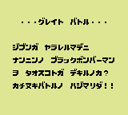

### Cheats (★ New)

All in `docs/gb1_codes.json` (`section: "cheat"`), verified with `tools/gb1/test_cheats.lua` (random-input bot).

| Code | Effect | Verified | Other device (same test) |
|---|---|---|---|
| `C98-37B-D5D` (Game Genie) | invincible: RET over the hit check `$01:4837` (same in both) | 6,000 frames: 0 hits; 7 without | GameShark `01014FC0` + `010049C0` (the after-hit flash flag `$C04F` on, counter `$C049` 0): 0 hits |
| `010000C1` + `010000C2` + `010000C3` (GameShark) | every set won at once (enemy states 0) | 6 sets won, 1-1 to the 1-boss in 6,000 frames; a boss set doesn't end (it waits for the boss) | Game Genie `AF8-8AB-3B4` (`$01:488A` OR A -> XOR A): with the invincibility code, 12 sets won, 1-1 to 1-4 |

## Hidden-content sweep

Coverage: Mesen code/data logs from the attract mode, the password screen with wrong codes and every special,
battles, and play with the cheats above (`tools/gb1/cov.sh`, scenarios in `cov.lua`; that run stalls at the
1-boss: the GameShark enemy codes don't end a boss set). Executed code: **21,136 bytes** (JP), **21,274** (Wario);
the dead-code numbers below are from these runs. The text, stage and graphics checks also use later runs: the
forced-win run to the staff roll and one per boss (`tools/gb1/cov_win.lua`), a time-up, the extra battle and the
multitap battle.

- **Dead code** (`tools/gbsweep.py dead`, `disasm/gb1/dead_<ver>.txt`): never-run code reached by a branch from code
  that ran: 4,771 bytes (JP) / 4,802 (Wario); reached only from never-run code: 1,538 / 1,316; no reference: 3 (the
  unused serial/timer/joypad interrupt RETIs). The larger stretches sampled are set and boss paths the bot never
  forced (draws, boss losses) and sound-driver states; not every stretch was read. The orphan list (428 / 446) is mostly graphics
  data in banks 2 and 9 that decodes as code; nothing in it references text or RAM the game lacks.
- **Unset flags** (`tools/gbsweep.py flags`): 15 sound-driver work bytes at `$D905-$D955`, written indexed through HL.
  None is a real flag.
- **Input codes** (`tools/gbsweep.py pad`, `disasm/gb1/pad_<ver>.txt`, 22 hits each): A+B+Select+Start held
  (`$00:07B7`, soft reset), the pause, the password digits and movement. **No hidden pad code** beyond the passwords.
- **Text** (`tools/gb1/textdump.py`, `disasm/gb1/text_jp.tsv`, `text_wario.tsv`): menu strings are BG tile codes
  copied by `$00:087F` (Latin set at `$C0`: A = `$EA`, 0 = `$E0`, W-Y `$CD-$CF`). The longer texts are scripts:
  pointer table `$04:467B` (17 entries, JP) / `$04:4B8C` (14, Wario), reader `$04:45E3` (JP); records of 5 bytes JP
  (frames, VRAM address, mark tile, character; `$F6` ゛ / `$F8` ゜ on the row above) or 4 Wario (no mark), `$FE` waits
  for a button, `$FF` ends. Each script screen loads its own font arrangement, so the code-to-character table was
  read off VRAM: `tools/gb1/txlog.lua` logs every queued copy with the tile data on screen, matched against the
  story and title glyphs (`FONTS` in the dump). Scripts: the story (JP 14-16: Known),
  boss-cleared lines 0-4/10 (ボス ヲ タオシタ! "ボムキック" ヲ トリカエシタ / BOSS CLEARED. RETRIEVED: KICKS),
  the five technique help pages 5-9, the victory line 11 (テンヲ コガス ダイバクハツ! / AN EXPLOSION OF EARTHQUAKE
  PROPORTIONS SIGNALS YOUR VICTORY.) and the staff roll 13. **Every script is read in play** (Mesen CDL; all but Wario's 10 also caught by the tile log;
  coverage needed a forced-win run, `tools/gb1/cov_win.lua`, as the earlier bot runs stopped at the 1-boss). Two
  strings never showed in the runs: Wario's `TIME UP` (JP's did, after `$C585-$C587` = 0) and **PERFECT! /
  CONGRATULATIONS!** (`$0A:4EE4`, drawn by `$0A:4DFF`, which the extra battle (5656) runs when the defeated count
  `$C1D1-$C1D3` reaches 240, `$0A:4EFC`; shown since: see the 240-win screen below). The bank 9
  strings (TECHNIQUE / ROUND SELECT, nPLAYER WIN!) belong to the multitap battle (below); the VICTORY! lines (match
  won) didn't come up in the battle runs. ★ New: the Wario ROM has no trace of the JP story (no script records).
- **Stages** (`tools/gb1/stages.py`, `disasm/gb1/stages_<ver>.tsv`): `$00:1608` looks up `$C3F0` in the word table
  `$08:5C19` (Wario `$08:5FA3`): 40 entries of an 8-byte header (map, metablock, sub-block and a 4th table) and a
  64-byte map of 8 x 8 metablocks (4 x 4 tiles each: the whole BG map); soft blocks are scattered afterwards
  (`$01:4C19`). 0-31 are the 32 stages (1-3/1-boss, 6-3/6-boss and 8-3/8-boss share a map: 29 distinct), **32-39 the 8
  multitap battle arenas** (`$09:47C3`: `$C3F0` = `$20` + round). The table ends at the first header and the headers
  and metablock tables are packed with no gap, so **there is no unused layout**. All 33 game/arena-1 maps were read in
  the runs; arenas 2-8 weren't picked.
- **Graphics** (CDL: which ROM bytes the coverage runs read, SGB and multitap runs included; `tools/gb1/gfx.py` for
  the tile format): almost everything unread is code (bank 2), the 7 unplayed battle arenas, sound data and small
  tails. One notable block: ★ **New: an unused title logo**, 128 compressed tiles at `$03:6911` (Wario `$03:62E2`, the
  same bytes), referenced by no graphics set (sets `$00:10C3` / `$00:12C2` list everything else; the title loads
  `$03:76AF`). It is the BOMBERMAN GB logo with no ® and the "GB" in grey with a dark outline instead of white with a
  black one; 104 of its tiles equal the shipped ones. Nothing in `res/` mentions it.

  
- **Debug features**: none found (no unreferenced menu, no flag read without a write).

### Super Game Boy

Captured without an SGB BIOS: `tools/emu/sgb.lua` decodes the packets the game writes to `$FF00` and answers
MLT_REQ like an SGB, so the game takes its SGB path; `tools/emu/sgb_dump.py` renders the transfers.
At boot (frame 85): MLT_REQ 2 players / back to 1 (the detection), eight DATA_SND (the standard SNES-side patch),
MASK_EN freeze, CHR_TRN (tiles 0-127), PCT_TRN (the border map and palettes), PAL_TRN, ATTR_TRN, PAL_SET.

| | JP | Wario |
|---|---|---|
| Border | 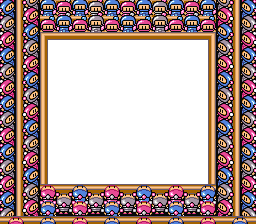 | 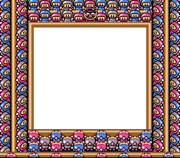 |
| Title in SGB colours | 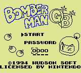 | 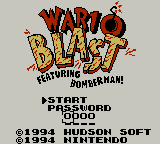 |

Wario's border puts Wario where the JP border has a blue Bomberman (top centre) (Known).

### SGB multitap: 4-player battle (Known that it exists; ★ New: how to reach it, verified in Mesen)

`sgb.lua` now also feeds pads 2-4: while the joypad id is 1-3 it answers reads with `SGBPAD[2..4]` (the id steps on
P15 low -> high, as the game's reader `$08:5B75` expects; it stores pad n at `$CC60 + 2n`). Pressing START on the
title calls `$08:404A`: MLT_REQ 2 players, a joypad-id check (`$08:5AF7`, `$C3FF`), and on an SGB **MLT_REQ 4 players
and a NORMAL / BATTLE menu**. BATTLE (all bank 9, never run before): a join screen (1-4PLAYER ON/OFF, each pad's A),
TECHNIQUE ON/OFF and ROUND SELECT, then a 4-player battle on one of the arenas 32-39; results show nPLAYER WIN! and
the run returns to the join screen after a match. Played with random input on all four pads for 18,000 frames in
JP and Wario (`tools/gb1/multitap.lua`, run with `tools/emu/sgb_dump.py`).

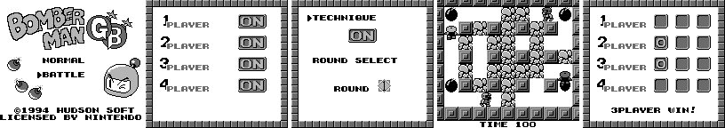

## Regions (Wario vs JP)

| | JP | Wario |
|---|---|---|
| Title | BOMBERMAN GB, START / PASSWORD | WARIO BLAST featuring BOMBERMAN!, same menu |
| Player | Bomberman only | Bomberman or Wario for the whole game (`$C3D5`); the other one is the enemy (Known) |
| Passwords | 34 codes | the same 34 + 32 Wario stage codes + 2264, 6565 |
| Story | attract story about the stolen techniques (Known), after about 36 s on the title (★ countdown `$3C20`, `$0A:40A7`) | removed, no trace in the ROM; the title waits forever ([img](img/gb1/title_idle.png)) |
| SGB border | blue Bombermen | Wario in the top centre |
| Title credit | LICENSED BY NINTENDO | ©1994 NINTENDO |
| ★ Arena code | | the stage bombs of round 6 stages 1-3 (`$00:31FB`) mark their cell `$20` instead of `$01` (`$00:3272`, `$32E6`, `$3313`; seen in RAM, same run in both), and the flame test (`$00:2F82`) lets a player's flame pass over them (JP stops it like a wall) and over soft blocks `$0D-$0F`; a saved `$19` (burning block) cell is cleared to floor when an object leaves it (`$01:5D39`), and a finished burn no longer clears a cell an object holds (`$00:3413`). The effects in play are read from the code: no flame reached a stage bomb in the runs |

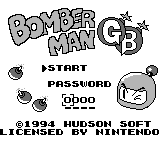 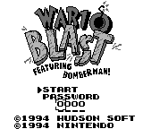

Logos: `docs/img/logos/gb1_jp.png`, `gb1_wario.png` (`tools/gb1/logo.py`: BG tiles of the title from
`tools/gb1/vdump.lua`, colour 0 transparent).

Item icons: the password stores no items (a table index only), so none were ripped for this game.

## ★ The extra battle's 240-win screen

After each round the extra battle (5656; Wario Blast 6565 as Wario, `$00:35A4`) calls `$0A:4EFC` (Wario `$0A:5398`),
which checks the defeat count `$C1D1-$C1D3` (one decimal digit per byte). At 240 it jumps to `$0A:4DFF` (Wario
`$0A:528B`): a screen drawn from `$08:40D2` with **PERFECT!**, **ENEMY 240**, a fixed **CODE -SVJV-** and
**CONGRATULATIONS!** (the first and last blinking); A or Start goes back to the title, and `$00:3662` (Wario
`$00:362A`) leaves the count at 240. The code is the same in both carts and nothing else uses it, so it was most
likely a contest proof code. In Mesen (JP): the count set to 239 during the battle, one more round won, and the
screen came up. GameShark `0102D1C1` + `0104D2C1`, switched on after the battle code is accepted (the same bytes are
the password digit buffer), brings it up after the first round in both carts.
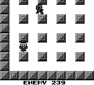

## Unused music

- ★ Music goes through the request byte `$C3F1` (`CALL $0AC4`): constants 00-06 and 0B, and 09-12 from the stage
  table at `$00:1F04` (Wario `$1E99`). Songs 07 and 08 of the table at `$07:4A0E` have their own data but no request:
  07 is about 11 s, loud, not looping; 08 about 11 s, quiet and rhythmic, not looping. Same in Wario Blast.

## Open

- The multitap battle's VICTORY! screen, arenas 2-8 and TECHNIQUE OFF weren't played through.
- Why the logo at `$03:6911` was dropped (an earlier palette design is a guess).
