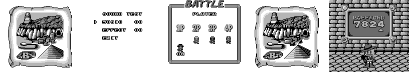
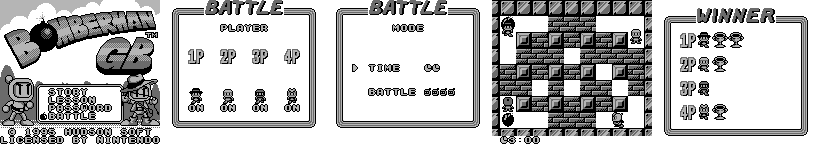
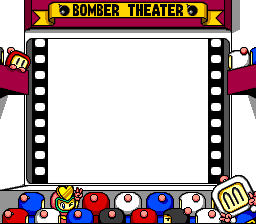
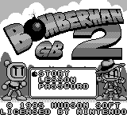
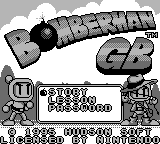

# Bomberman GB 2 (Japan, 1995) / Bomberman GB (USA, Europe): passwords and secrets

The US/EU "Bomberman GB" is this game, not JP Bomberman GB (that one became Wario Blast, [gb1.md](gb1.md)); see the
dump table there for the comparison. Everything here comes from disassembling the ROMs (`tools/sm83.py`, listings
in `disasm/gb2/`) and checking in Mesen 2 (`tools/gb2/run.sh`, helpers in `tools/gb2/lib.lua`). Addresses are
`bank:address`, US unless JP is named.

Prior art: the GameFAQs "Bomberman GB" codes page and a wiki article on "Bomberman GB" (both in `res/`; both mean
this game: the article gives "also known as Bomberman GB 2 (JP)", GameFAQs the 1998 US release). Marks: ★ **New**,
**Fixed**, **Known**. Every code either page lists works as described.

| Dump | Header title | MD5 | vs US |
|---|---|---|---|
| Bomberman GB (USA, Europe) (SGB Enhanced) | `BOMBER MAN GB` | `7e4c9c3620bea7b633394beb67e9680b` | |
| Bomberman GB 2 (Japan) (SGB Enhanced) | `BOMBER MAN GB 2` | `4ab78239e79ba059d0d7aa7a629a9474` | 28,666 bytes differ. Banks 8, 10, 11 are identical; bank 0 code is the same with shifts (the password check is `$00:35F9` in JP, `$00:35CC` in US); banks 5 and 15 hold the text and the table |
| Bomberman Collection (Japan) (SGB Enhanced) | `BOMCOL` | `9fb9c42cf52dcfdcfbad5e61ae1b5777` | the Japanese cart, byte-identical, in banks 48-63 of a 1 MB multicart with a 1996 menu (not run there) |

Both are 256 KB MBC1, SGB flag `$03`, licensee `18`.

## RAM that matters

| Address | Meaning | Evidence |
|---|---|---|
| `$C100` | world << 4 \| stage (stage 0-4, 7 = the boss) | `$00:250B`, `$00:25B3` |
| `$C103` / `$C104` / `$C105` | stage-end flag / player-dead flag / end countdown | `$00:24E3`, `$01:531E` |
| `$C106` | lives (3 per world start) | `$00:2555`, `$00:2577` |
| `$C11A` | 1 = battle (code 5656) | `$00:3682` |
| `$C125` / `$C126` | power-up bits (per world: `$00,$04,$0C,$4C,$5C,$7C,$7C,$7F`; 4622: `$7F`) | read back after each code |
| `$C1BC` / `$C1BD` / `$C1BE-$C1C1` | password cursor / found value / the 4 digits | `$00:35CC` |
| `$C800-$CB00` | the four player objects (one page each); player 1 X at `$C802` | position search |
| `$FFA0` / `$FFA1` | pad held / newly pressed | `$00:0309`, `$00:3583` |

## The password

Code: `$00:3578` (entry loop), `$00:35CC` (check; JP `$00:35F9`), `$00:3639` (dispatch), `$00:3744` (code for the
current world, shown on the CONTINUE screen by `$00:1FE5`). Table: bank `$0F`, `$7F72` US / `$54C1` JP.

- 4 digits; 12 records of 4 ASCII digits + 1 value are compared; the 12th is `$FF` filler. **No checksum**: 11 codes,
  the same in both versions:

| Code | Value | Effect |
|---|---|---|
| 8566, 9634, 1637, 0320, 6524, 3260, 4783, 5472 | `$80-$87` | start at world 1-8 (`$C100` = world << 4) |
| 2145 | `$88` | sound test |
| 5656 | `$8A` | battle (`$C11A` = 1) |
| 4622 | `$8D` | world 1 with every power-up (`$C125` = `$C126` = `$7F`, `$C11E` = 1) |

- ★ **New: dispatcher cases no code uses.** Values `$00-$7F` would set `$C100` to the value directly (any world and
  stage), `$8B` opens the sound test with `$C11B` = 1, `$8C` jumps to `$00:34E9` (the screen after the staff roll).
- **Fixed: 7824.** Known as a US password that only returns invalid, effect unknown. The US ROM has a second, older copy of the table at `$0F:5447` that nothing references; it has a 12th record **7824 =
  `$89`**, and `$89` in the dispatcher jumps to `$00:1E3A`, the **ending** (the same routine the game calls after
  world 8, `$00:260E`). The live table lacks it, so it is rejected (typed: the reject exit ran). JP has no copy.

**Codec API** (`tools/gb2/password.mjs`): `decode(code, version = 'us' | 'jp')` returns
`{value, kind: 'world' | 'soundtest' | 'battle' | 'powerup', world?, stage?}` or `null`; `describe(value)` for any
dispatcher value (also `'stage'`, `'ending'`, `'soundtest2'`, `'closing'`, `'title'`); `validate`; `encode(world)`;
`allCodes(version)`; `TABLES`; `UNUSED` (`{us: {'7824': 0x89}}`).

### Verification

- **Fuzz**: all 10,000 codes through the game's own check (`tools/gb2/fuzz.py`, savestate at the check's entry, result
  at its exits): US 11 accepted, JP 11, **0 mismatches**.
- **Typed with the pad** (`tools/gb2/test_codes.py`): all 11 codes plus `0000` and `7824`, US and JP; `$C1BD`,
  `$C100`, `$C11A`, `$C125/$C126` read back as predicted. Entering: Up/Down step the digit (wraps), Left/Right move
  the cursor, A or Start checks, B leaves.

## Secrets

- **2145 sound test** (Known). MUSIC / EFFECT / EXIT; Left/Right change the number, A plays.
- **5656 battle** (Known). The plain-GB title has only STORY / LESSON / PASSWORD; this code is the way into battle.
  The battle setup shows 1P-4P; with a Super Game Boy multitap the title has a BATTLE line instead (below).
- **4622 power-ups**, **8566-5472 world codes** (Known, GameFAQs "Level 1-8", "All Power-Ups").

### Cheats (★ New)

Verified with `tools/gb2/test_cheats.lua` (world 1 MODE-A, random-input bot, 6,000 frames), both versions share
the addresses.

| Code | Effect | Verified | Other device (same test) |
|---|---|---|---|
| `C92-96A-6EB` + `C92-ACA-6EB` + `C93-03A-6EB` (Game Genie) | invincible: RET over the three death handlers in the hit table `$01:4913` | 0 deaths; 5 and a game over without | no GameShark form found (RAM holds no invincibility state; the only timer that skips the hit also freezes the player) |
| `010306C1` | infinite lives (`$C106` = 3) | 10 deaths, no game over | Game Genie `B75-58D` + `B75-98D` (jp `B75-85D` + `B75-C5D`): DEC A -> OR A at both decrements; 10 deaths, no game over |
| `010103C1` + `010004C1` | every stage ends cleared | `$C100` 00, 01, 02, 03, 04, 07 (boss), 10 in 5,000 frames | Game Genie `C34-EDD` + `185-53D` (jp `C35-1AD` + `185-80D`): `$00:24ED` JP NZ -> JP, `$00:2553` JR Z -> JR; the same `$C100` sequence |

## Hidden-content sweep

Coverage (`tools/gb2/cov.sh`): intro and title, LESSON, the sound test with every number, battle, 4622, MODE-A and
MODE-B through the ending with the cheats, a game over. Executed: **28,498 bytes** (US), **28,702** (JP).

- **Dead code** (`disasm/gb2/dead_<ver>.txt`): branch-reachable never-run 3,742 (US) / 3,636 (JP) bytes, dead
  516 / 572, no reference 67 / 17 (data mistaken for code and the interrupt RETIs). The `$89`/`$8B`/`$8C` cases above
  are the notable ones.
- **Unset flags**: none (direct-address scan; the game's objects are written through HL).
- **Input codes** (`disasm/gb2/pad_<ver>.txt`, 43 / 21 hits): the joypad reader itself (`$00:081E`-`$00:0B11`,
  `$FF00`), menu and password cursors (`$00:0309`, `$00:0339`), world-map scrolling (`$00:17E0`), A/Start
  confirmations. No hidden pad code; no soft-reset combination was found either. Select in a stage gives it up
  (`$00:2619`, `$01:4966`: player state 7, a life lost, the area restarts); seen in Mesen.
- **Text** (`tools/gb2/textdump.py`, `disasm/gb2/text_us.tsv`, `text_jp.tsv`): `$00` space, `$01-$0A` digits, `$0B-$24`
  A-Z; JP `$30-$5D` katakana, `$60-$8D` hiragana, `$9x` small kana, stored as (mark, character) pairs with `$25` ゛,
  `$26` ゜. Story, rules, item help and the staff roll (`$06:7AF9` US) are all read in the runs. Unread: the JP mode
  name "?かくれアジト" (hidden hideout, MODE-A of one world, `$02:4053`); its US counterpart was read.
- **Stages** (`tools/gb2/stages.py`, `disasm/gb2/stages_<ver>.tsv`): `$00:0E32` splits `$C100` into world, mode
  (A/B) and stage; bank 5 `$4000` points at two tables (MODE-A, MODE-B) of 7 world records, whose header (`$00:0FEC`)
  gives the graphics, two compressed maps and per stage a layout pointer. World 8 and every boss (stage 7) use the 8
  headers at bank 5 `$4074` (`$00:0ED4`; world 8's stages take boss headers 1-5 as arenas, `$00:0EDC`, not checked
  in play). A layout (`$00:1054`) is width, height and
  width x height metatile numbers (2 x 2 tiles). 70 stage layouts + 8 boss arenas + 8 second boss layouts (6 x 5),
  all in bank 6, packed back to back with the compressed maps between worlds: **no layout that nothing points at**
  (same in JP). 27 were not read in the runs (whole worlds the MODE-A/B runs skipped: A2, A4, A7, B3, B5, B6, and
  some boss second layouts).
- **Graphics** (CDL incl. the SGB and multitap runs): graphics are raw blocks (2-byte length + tiles, `$00:02DB`)
  listed in 32 sets (`$00:3F7E`, loader `$00:3EDD`). Every unread block belongs to a set the code loads: sets 20-21
  (the 3P WIN and 4P WIN pictures, Black Bomberman and a girl bomber: `$12` + the match winner `$C1A8` at
  `$00:2BEE`; the coverage matches were won by 1P and 2P) and sets 3 and 10 (loaded by
  `$00:2AD4` and `$00:1F1A`, screens the runs didn't reach). Sets 12 and 13 repeat set 5. A tile log over the runs
  (every VRAM tile against the BG, window and sprites) finds one leftover: the US staff roll loads the Japanese
  version's whole kana font with the English letters, and no US screen uses it (seen by pointing the BG map at it
  during the staff roll). The rest are stage and boss tile variants.
- **Debug features**: none found.

### Super Game Boy

The border and title images here are real Super Game Boy output: BizHawk 2.11.1, BSNESv115+ core in SGB mode, with the
SGB1 BIOS. On the SNES the Game Boy screen sits at x 48-207, y 39-182.

Packets (`tools/emu/sgb.lua`): MLT_REQ 2 then 4 players, DATA_SND x8, ATTR_TRN, PAL_TRN, PAL_SET, CHR_TRN (both
halves), PCT_TRN, then PAL_SET fades. The border is the "BOMBER THEATER" stage in both versions.

**4-player battle (★ New, verified in Mesen, US and JP).** With the SGB answering 4 players (`sgb.lua` now also
feeds pads 2-4 from `SGBPAD`), the title has a 4th line, **BATTLE**. The pad reader `$00:086A` takes all four pads
each frame (`$FFA0/$FFA2/$FFA4/$FFA6` held, +1 new). PLAYER page: each player joins with Up or Down (`$00:3063`, flags
`$C1AA-$C1AD`); with all four in, Start goes to MODE (TIME / BATTLE count), STAGE, and a 4-player match; WINNER
counts the trophies. Played with random input on all four pads (`tools/gb2/multitap.lua`, run with
`tools/emu/sgb_dump.py`); players 2 and 4 won rounds, so the extra pads really steer their bombers.

Battle setup (Mesen, US, every page played): on the plain Game Boy, Start on the COMPUTER page buzzes until 2+
players are in (`$00:3196`); Up marks a player as COM. MODE: TIME 1-4 clocks = 2:00, 3:00, 5:00 and no limit (an
infinity sign, the clock never runs, no hurry-up: `$00:2CCA`, `$00:2DE0`); BATTLE 1-5 trophies = the wins a match
needs (`$00:2B82`). STAGE: six arenas (`$C1B1`, `$00:3293`); on the sixth everyone starts with 4 bombs and 4 fire
(`$00:2D42`, from the code). HURRY UP scrolls by at 0:09 (`$00:2DFE`); time up is a DRAW and the round is replayed.
A third MODE value `$C1B0` (set to 1 at `$00:2F3E`, limit 3 in `$00:3290`) has no line on the page and nothing
reads it.

 

## Unused sounds

- ★ Effects go through `$03DF` (music `$03D2`). Effects 0D, 17, 1C, 21, 22, 23, 25 and 26 are never asked for; only the
  hidden sound test plays them. 0D and 17 are looping low drones, 1C a burst then a repeating alarm, 21-23 and 26
  under a second, 25 about 1.8 s. Every tune 01-18 is used (a stray `LD A,$19 / CALL $03D2` sits in bank `$0F`).

## Regions

| | JP | US/EU |
|---|---|---|
| Title | BOMBERMAN GB 2 | BOMBERMAN GB, ™ (Known) |
| Text | kana | English |
| Passwords | 11 | the same 11; plus the unused 12-record copy with 7824 |
| Story text | one kana (mark row + character row) every 10 frames | ★ one letter every 5 frames, one row: twice as fast (`00:23C8` `CP $04`, JP `00:23E9` `CP $08`; Mesen, text pointer `$C1CF`) |

 

Logos: `docs/img/logos/gb2_jp.png`, `gb2_us.png` (`tools/gb2/logo.py`: the logo shares the window map with clouds
and trees, so everything outside its black outline is cut away).

Item icons: the password stores no items (a table index; the power-ups come from a per-world table), so none ripped.

## Open

- Graphics set 3 is the pause screen (Bomberman asleep,
  dreaming, with PAUSE; `$00:2A85`) and set 10 the TIME UP screen when the clock reaches 0:00 (`$00:28F8`), both
  seen in Mesen.
