# Bomberman GB 3 (Game Boy, Japan, 1996): passwords and secrets

Everything here comes from disassembling the ROM (`tools/sm83.py`, listing `disasm/gb3/jp.asm`) and checking in
Mesen 2 (`tools/gb3/run.sh`, helpers in `tools/gb3/lib.lua`). Addresses are `bank:address`.

Prior art: the GameFAQs "Bomberman GB 3" codes page (in `res/`). No wiki article on this game is saved there. Marks:
★ **New**, **Fixed**, **Known**.

| Dump | Header title | MD5 |
|---|---|---|
| Bomberman GB 3 (Japan) (SGB Enhanced) | `BOMBERMAN GB3` | `3addab2611566ab072fc996f8a81b224` |

256 KB MBC1, SGB flag `$03`, licensee `18`. It shares no code with the other Game Boy games (2-23 matching 32-byte
blocks); there was no release outside Japan.

## RAM that matters

| Address | Meaning | Evidence |
|---|---|---|
| `$C000` page | player object: `$C029` state (5 = dying, table `$01:4C4E`), `$C020` timer, `$C02A` | write log, `$01:4C07` |
| `$C1B8` | 1 = boss attack (DEB1F7F) | `$0D:691D`, `$00:13F7` |
| `$C1BC` | ★ unused invincibility flag (cleared at boot, never set) | `$00:12FA`, `$01:4BE6` |
| `$C1BD` | ★ unused clock-stop flag (cleared at boot, never set) | `$00:12FD`, `$00:29B1` |
| `$C2E0` / `$C2E1` | pad held (with repeat) / newly pressed | `$0D:6B0C` |
| `$C362` | area 0-6: Wood (モリモリ), City, Ice, Sand, Lava, Aqua, Evil | `$0D:6A26` |
| `$C363` | lives | `$00:1514` |
| `$C365` | stage - 1 (0-5) | `$0D:69E6` |
| `$C36B` | power-ups in effect; at a stage start it gets bits from the shop byte's high nibble (M1-M4, table `$00:140B`) | `$00:13DA` |
| `$C383-$C389` | areas cleared (one byte each) | `$0D:6A2A` |
| `$C38C` | capsules (クリスタル / カプセル) held: the shop currency | `$01:4BBA`, `$0A:769F` |
| `$C38D` | shop techniques bought, one bit each (see below) | `$0D:695A`, `$0A:767C` |
| `$C38E` | stage-5 reward, 0-2: +1 per special panel (pickup kind 7, `$00:38AC`); cleared at the start of each stage-5 room (`$00:15CE`, `$00:15DA`) and at a new area; read at the boss stage (`$0D:6DA7`, below) and kept by the stage-7 form of the password | `$00:38AC`, `$0D:6DA7`, `$02:7C52` |
| `$C480` | stage result: 0 playing, 1/2 died, 3 (set only when `$C1B8` = 2), `$FF` exit (cleared) | `$01:42D4`, `$01:45F0`, `$01:4690` |
| `$D200-$D206` | the 7 password digits (0-F); `$C621` cursor | `$0D:6B78` |

## The password

Code: `$0D:6AFC` (entry), `$0D:68EC` (check), `$02:7C41` (the code the game shows), tables `$0D:6AE0-$6AFB`.
`tools/gb3/password.mjs` decodes and encodes; `node tools/gb3/test_password.mjs` round-trips every state.

- **7 hex digits, 28 bits, every bit used.** `DEB1F7F` is compared as a literal first (boss attack). Otherwise:

| Field | Bits (digit:bit) | Meaning |
|---|---|---|
| s | d0:1 d0:0 d1:3 | stage 1-6; 7 = stage 6 with `$C38E` = b + 1; 0 rejects |
| b | d4:2 | must equal s & 1 (unless s = 7) |
| s check | d2:2 d3:1 = s & 3, d5:0 d6:3 = (s >> 1) & 3 | a second copy of s |
| group | d1:0 d2:3 | 3 = areas 0-2, 1 = areas 3-5, 2 = area 6; 0 rejects |
| y | d3:3 d3:2 | area = 3 × group + y - 1 (`$C362`, must be < 7); 0 rejects |
| group cleared | d6:2 d6:1 d6:0 | the 3 areas of the current group; the current area's own bit must be 0; area 6 takes none |
| shop | d0:2 d0:3 d1:1 d1:2 d2:0 d2:1 d4:3 d3:0 | `$C38D` bits 0-7 |
| capsules | d4:1 d4:0 d5:3 d5:2 d5:1 | `$C38C`, 0-18 |

- Entering group 1 marks areas 0-2 cleared, group 2 areas 0-5: the game is played in three tiers (Wood/City/Ice in
  any order, then Sand/Lava/Aqua, then Evil), which is what GameFAQs' notes describe.
- **The check is the capsule balance**: capsules + the prices of the bought techniques must equal the capsules the
  cleared areas paid out. Area payouts (`$0D:6AF2`): Wood 2, City 2, Ice 3, Sand 4, Lava 3, Aqua 4, Evil 0. Prices
  (`$0D:6AEA`, and on the shop screen): K 1, D 1, L 1, F 7, M1 1, M2 2, M3 2, M4 3.
- In all, **20,329** of the 2^28 strings are accepted (20,328 states + DEB1F7F; counted by brute force over
  `password.mjs`, and the encoder reaches all of them).

**Shop techniques** (bit order `$0A:7778`, prices as on the screen; icons ripped to `docs/img/items/gb3/`):

| Bit | Icon | Item | Price | File |
|---|---|---|---|---|
| 0 |  | K kick | 1 | `kick.png` |
| 1 |  | D dash | 1 | `dash.png` |
| 2 |  | L line bomb | 1 | `line.png` |
| 3 |  | F フルパワー (full power: always at full power; **Fixed**, GameFAQs: full bombs) | 7 | `full.png` |
| 4-7 |    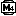 | M1-M4 モトボンバー1-4ごう: 1 takes one hit; 2 also hops one low hard block; 3 also breaks soft blocks when ridden into with B; 4 runs faster than dash and takes two hits | 1, 2, 2, 3 | `moto1.png`-`moto4.png` |

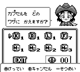

Names and effects are the shop's own help pages (Select on an item, messages 29-46 in `disasm/gb3/text_jp.tsv`; the K,
D and L pages were shown in Mesen, the others are read from the ROM).

**Codec API** (`tools/gb3/password.mjs`): `decode(code)` returns `{area, areaName, stage, extra, cleared[7], shop,
check}` (shop = the `$C38D` byte, check = capsules), `{special: 'boss'}` for DEB1F7F, or `null`; `validate(code)`;
`encode(area 0-6, stage 1-6, cleared[7], shop 0-255, extra 0-2)` returns the code or `null` when the capsules can't
balance; `stageCode(area, stage)` (nothing bought, only the required areas cleared); constants `AREAS`, `AREA_W`,
`SHOP_W`, `BOSS_ATTACK`.

### Verification

- **Fuzz** (`tools/gb3/fuzz.py`, `fuzz.lua`): 21,194 codes through the game's own check (savestate at `$0D:68EC`,
  results at `$0D:6871` accepted / `$0D:689C` rejected, area, stage, cleared flags, shop and capsules read back):
  every GameFAQs code, 224 encoded codes, 20,000 random, every digit at every position of 8 codes. 342 accepted,
  **0 mismatches**.
- **Typed with the pad** (`tools/gb3/test_codes.py`): all 73 distinct GameFAQs codes and 17 built ones. All as
  predicted.

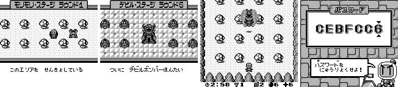

Entering: on the title, the 2nd line (ぱすわーど). Up/Down step the digit (0-F, wraps), Left/Right move the cursor
(wraps), A checks, B leaves.

## GameFAQs check

- The **"Passwords"** list (Dinob0t, CyberSach: Wood/City/Ice/Sand/Lava/Aqua 1-6, Fight Final Boss) and the
  **Boss Attack Code** DEB1F7F: all accepted and decode as their labels say (Known). Fight Final Boss F775818 is Evil 6
  with everything bought.
- **Fixed:** the **"Maxed Passwords"** list (36 codes, Aqua/City/Evil/Ice/Lava/Sand 1-6) is **all rejected**. With all
  8 techniques bought the prices total 18 capsules, and before Evil the cleared areas pay at most 14, so the balance
  can't hold; the Evil ones are wrong too (e.g. listed CF37D40, real CF37C00). Working Evil codes:

| Evil | nothing bought | everything bought |
|---|---|---|
| 1 | 0906640 | CF37C00 |
| 2 | 1144248 | D775808 |
| 3 | 1946648 | DF77C08 |
| 4 | 2104250 | E735810 |
| 5 | 2906650 | EF37C10 |
| 6 | 3144258 | F775818 |

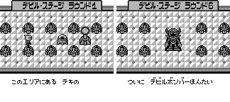

## Secrets

### Unused debug flags (★ New)

Boot clears `$C1B9-$C1BD` (`$00:12F7`-`$00:12FD`). Two of them are read but never set anywhere:

- **`$C1BC`: invincibility.** The player-hit routine `$01:4BE6` jumps past the dying state when it is non-zero.
  GameShark `0101BCC1`: 0 hits in 6,000 frames of the bot (11 deaths without).
- **`$C1BD`: clock stop.** `$00:29B1`, the per-frame clock update, returns at once. GameShark `0101BDC1`: after
  1,200 frames of Wood 1 the clock still reads 3:00 (2:41 without).

### Cheats (★ New, `tools/gb3/test_cheats.lua`)

| Code | Effect | Verified | Other device (same test) |
|---|---|---|---|
| `0101BCC1` | invincible (the debug flag) | 0 hits / 6,000 frames | Game Genie: the ROM patch below |
| `C3B-E6B-081` + `E4B-E7B-198` + `4AB-E8B-E6D` (Game Genie) | invincible as a ROM patch (`$01:4BE6` -> `JP $4AE4`) | 0 hits | GameShark `0101BCC1` |
| `010363C3` | infinite lives | 14 deaths, lives stay 3 | Game Genie `B75-17E` + `B75-61E` (DEC A -> OR A at `$00:1517`, `$00:1561`): 13 deaths, lives stay 3 |
| `01FF80C4` | every stage ends cleared (`$C480` = `$FF`) | Wood 1-6 then City 2 in 6,000 frames | Game Genie `18B-A2E` + `C3B-E8E` (`$00:1BA2` JR NZ -> JR, `$00:1BE8` JP Z -> JP): Wood 1-6 then City 1 |
| `0101BDC1` | clock stops (the debug flag) | 3:00 after 1,200 frames | Game Genie `C99-B5D` (`$00:29B5` RET NZ -> RET): 3:00 |

## Hidden-content sweep

Coverage (`tools/gb3/cov.sh`): intro and title, STORY, the 3rd title mode (ちゃれんじ, challenge mode: score attack on はらはら / どきどき stages, 2 or 5 minutes), the boss
attack, all three area tiers with the cheats, a game over. Executed: **44,079 bytes**.

- **Dead code** (`disasm/gb3/dead_jp.txt`): branch-reachable never-run 5,019 bytes, dead 1,244, no reference 0.
  The `$C480` = 3 path (`$00:16D1`, set by `$01:45F0` only when `$C1B8` = 2: the challenge-mode door, below) and
  `$00:16F7` never ran. Orphans (241) are mostly graphics data.
- **Unset flags**: the static scan finds only object-page reads (`$C012`, `$C100`, written through HL); `$C1BC`
  and `$C1BD` were found by hand from the boot clear (they have a write, the clear, so the scan doesn't list them).
- **Input codes** (`disasm/gb3/pad_jp.txt`, 31 hits): menus, the password cursor, movement. No hidden pad code.
- **Text** (`tools/gb3/textdump.py`, `disasm/gb3/text_jp.tsv`): text is drawn glyph by glyph into tiles (`$00:0880`:
  character n = one compressed tile from the pointer table `$00:08AD`, bank `$0C` below `$70`, bank 8 above); the
  table was built by rendering every glyph: `$00-$32` hiragana (gojuon, ユ where ぬ would be, small kana last),
  `$33-$69` katakana with punctuation and Ⓐ Ⓑ ♡, `$70-$79` digits. Messages: table `$0A:6905` (71 entries: 32
  characters in two lines of 16, then an 8-byte mask, 2 bits per character, 3 = ゛, 2 = ゜); shop prompts: `$0A:7CA6`
  (12: 20 characters + 20 mark bytes, `$AA` ゛, `$AB` ゜). Area briefings, the intro and ending story, boss lines and
  the shop all show in the runs. Not shown: message 19 (an area that moves) and 68 (rocks that stop moving), the
  shop help for F and M1-M4 and its M2-M4 prompts; all are picked by the same tables, so none is known to be unused.
  The title, password and challenge-mode words are BG tile maps (not in this dump).
- **Graphics.** Sets load through `$00:09A1` (table `$00:09A7`, 29 sets of 6-byte records: bank, source, VRAM address,
  tile count) and maps through `$00:2F03` (table `$00:2D7E`). Every call passes a constant (or area + `$0D`), and every
  set and map is loaded: sets 11 and 12 by the story-mode pause screen (`$00:1AE2` → `$0F:753E`, `$0F:75CD`; PAUSE,
  the area name and Bomberman in a spotlight), set 27 with map 1 at `$0A:62B1`. Challenge mode has no pause
  (`$00:1AD4` skips it when `$C1B8` = 2). One picture shows only when the clock runs out:
  - **TIME OVER** (set 9, `$0B:4BBE` and `$0B:51D9`, with map `$12`): a dizzy, spiral-eyed Bomberman and TIME OVER
    lettering, shown when the stage clock runs out (`$00:2A08` → `$01:42D8` → `$00:154E` → `$05:7E03`, which loads
    set 9 and map `$12`). Seen in Mesen in normal play: an invincible bot in Wood 1 until the clock ran out.
    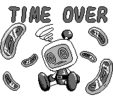
  - A tile log over the coverage runs (every VRAM tile against the BG, window and sprites) found only fragments
    besides these: stage-tile variants, unused font letters and the shop icons for M1-M4.
- **Stage format**: not decoded.

### Super Game Boy

The border and title images here are real Super Game Boy output: BizHawk 2.11.1, BSNESv115+ core in SGB mode, with the
SGB1 BIOS. On the SNES the Game Boy screen sits at x 48-207, y 39-182.

Packets (`tools/emu/sgb.lua`): MLT_REQ 2 / 1, DATA_SND x8, CHR_TRN x2, PCT_TRN, ATTR_TRN, PAL_TRN, PAL_SET, then
MLT_REQ 4 players and palette fades. ★ New: the 4 players are never used. The pad reader `$00:055E` stores all four
pads (`$C2E0 + 2 x id`), but only pad 2's new-press byte is touched (`$00:021F`, a latch next to pad 1's) and no
code reads pads 2-4; with 4 players answered and pads 2-4 fed (`sgb.lua`), the title still has only すとーりー /
ぱすわーど / ちゃれんじ and challenge mode is one player. The border (space, a castle, Bomberman, characters in the corners):

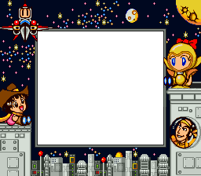

## Title

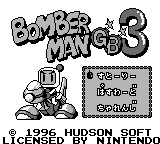

Logo: `docs/img/logos/gb3_jp.png` (`tools/gb3/logo.py`).

## Unused music

- ★ Music is requested with `CALL $3D0E` (song table `$0E:49F0`). The area table at `$00:1BF1` has 9 entries
  (09 09 0B 09 09 0B 0C 12 12) but the area never goes past 6, so song 12, the music of entries 7 and 8, is never
  played. It has its own channel data (the last in the bank, from `$78C0`) and is a full looping tune. Songs 05, 06
  and 0A point at other songs' data, so they're aliases, not lost music.

### Stage-5 diamonds and the boss helper (★ New)

Stage 5 of each area counts the diamonds you pick up: crystals lying on the floor (cell `$25`), taken by walking
onto them (pickup kind 8, `$00:38D1`: `$C390` in room 1; room 2's start copies it to `$C391` and clears `$C38E`, so
only room 2's panels count; in challenge mode they add score instead). Wood 5 holds 70 (30 + 40). In room 2, the count reaching the area's thresholds
(`$00:39B6`: Wood, Sand, Lava 40 / 50 / 60; City, Ice, Aqua 60 / 70 / 80; Evil 50 / 60 / 70) puts out a 1-up panel
(tile `$A4`), then a special panel (tile `$A8`) at each of the next two; each special panel adds 1 to `$C38E`. At
the boss stage, `$C38E` ≠ 0 brings a small flying helper (object `$52`, `$09:5E61`, from `$0D:6DA7`) that drops three
bomb / fire panels picked for your current power (`$02:7DF9`); the boss's contact and hit checks are off while it
flies (`$C4CA`). At 2 it flies a second, wavy lap (`$09:5E8E`) that drops nothing. The stage-7 password form keeps
`$C38E` for a boss-stage restart, which is why the known boss passwords (39C6418 and the others) bring the helper.
Mesen: Wood, City and Ice boss passwords with `$C38E` = 0, 1 and 2 (the helper only with 1 or 2; the middle panel was
fire up).
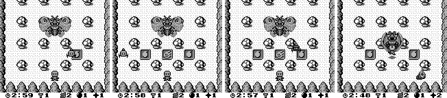

Played on Wood 5 (Mesen, from password 2986410; invincible, the player moved onto each crystal, each room ended by
force; the counters never written): all 70 taken through the game's own pickup code, the 1-up panel came out at 40,
the special panels at 50 and 60 (placed from the first `$0F` cell, `$00:24C7`), each taken raising `$C38E` to 1, then
2, and at the boss stage the helper flew in, dropped its panels and flew the second lap. The stage intro calls them
bell panels (ベルパネル) that call the Bomber Ball (ボンバーボール).
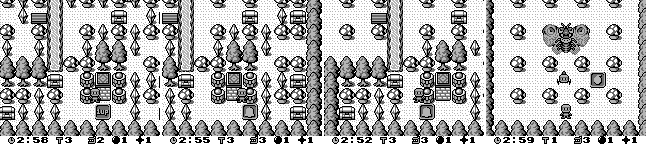

### Challenge mode

Ends at time up with タイムアップ!, a rating page (time left, blocks broken, enemies beaten, bonus, your score, best
score), a level (`$01:61D2`, `$01:6B55`; はらはら 2 min: ぷろぼん ≥ 9000, なみぼん ≥ 4000, みそぼん ≥ 1500, else
ぺけぼん; 5 min 18000 / 8000 / 3000; どきどき 2 min 14000 / 7000 / 3000, 5 min 25000 / 8000 / 3500, the last three
read from the ROM) and a ranking of four (defaults HUD 9000, I.Y 5000, B.R 2000, BOM 1000) with 3-initial name
entry, then つづけますか はい / いいえ. The cart has no battery, so the ranking lasts until power-off.
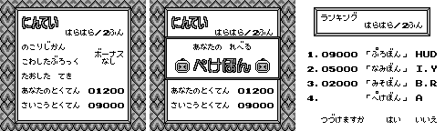

★ **A door in はらはら.** Room 117 (はらはら's arena) has door cells `$2C`/`$2D` in its bottom-right corner. Up at
the door puts the player in state 9 (`$01:522F`), which sets `$C480` = 3, and `$00:16D1` moves to room 118: a plain
11 × 12 arena with a horned, caped enemy, the clock still running (Mesen, the player moved next to the door).
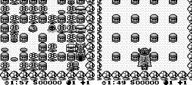

Room maps: `$00:1DC0[area × 30 + stage × 5 + k]` gives the room id, `$00:1ECE` + 3 × id its bank and pointer to four
words (map, then data for `$00:221A`, `$00:2302`, `$00:234D`). The map (`$00:2072`) is 2 header bytes, width, height,
then rows of RLE cells (a byte below `$80` is one cell; `$80` + n repeats the next byte n times), written 16 bytes
apart at `$D300` and copied to `$D200`; a decoded challenge room matched the RAM dump.

## Open

- How many crystals the other areas' stage 5 holds (City, Ice and Aqua need 80 for the second bell panel).
- Challenge mode: the cleared branch (`$C480` = `$FF`) and どきどき's doors (cells `$32`/`$33`, rooms 120-123) weren't
  reached; walking to はらはら's door wasn't done (the player was moved next to it); the room records' soft-block, item
  and object parts aren't decoded.
