# Bomberman Hero (Nintendo 64, 1998): secrets

Hudson's 3D platformer: Bomberman Hero: Mirian Oujo o Sukue! in Japan. Everything here comes from the three ROMs and
from BizHawk (Mupen64Plus core). Addresses are N64 RAM addresses on the US ROM unless a region is named; "written"
means a value put into RAM in the emulator. Marks: ★ **New**.

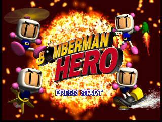 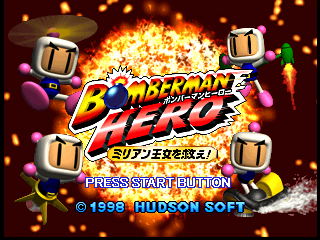

| Dump | Game code | Debug menu tag |
|---|---|---|
| Bomberman Hero - Mirian Oujo o Sukue! (Japan).z64 | NBDJ | `DBG---1998/03/15-A` |
| Bomberman Hero (USA).z64 | NBDE | `MASTER ----- DEBUG` |
| Bomberman Hero (Europe).z64 | NBDP | `MASTER ----- DEBUG` |

## No passwords: the save

Four files on the cartridge's EEPROM, `78`-byte records with a `BOMHERO` magic. Nothing is written to a Controller Pak.

## ★ The debug flag

One byte, `8016E424` (Japan `8016E41B`), switches on two debug menus. The game clears it at start-up, and no
instruction in any of the three ROMs can turn it from 0 to non-zero: the only stores of 1 run when it is already 1 or
2. A write trap from power-on through the logos, title, file select, a new game, a stage, Game Over and Continue saw
no write (US ROM), and seven button sets held at power-on left it at 0. So the menus need a cheat device:
**`8016E424 0001`** (Japan **`8016E41B 0001`**). Held from the first frame, the game boots normally.

A second trap run with a save file covered Score, Options, the Sound Test, Copy, Clear, the Planet 6 boss and three
ending scenes; on the European and Japanese ROMs it ran from power-on to the first stage. Not covered: the credits
and an ending reached by play. The logo
and title programs were read in full; the other menus were read at their button tests, which are A, B, Start and
directions only, apart from C-Left, C-Right and C-Down on the Options Sound Test.

### [BOMBERMAN ACTION MENU]: Z + Start in a stage

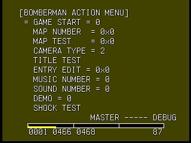 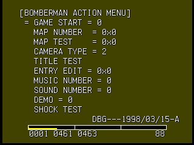

| Line | What it does | |
|---|---|---|
| GAME START 0-7 | restarts with a ready-made save in file 4: 1-4 Planets 2-5, 5 Garaden map 7 of 7, 6 Gossick with everything, 7 Garaden with 23 of 24; 0 a normal boot | 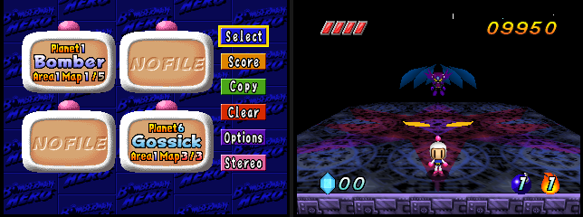 |
| MAP NUMBER 00-BF | loads that map | 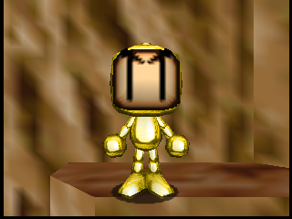 |
| MAP TEST | loads the map without its collision and floor data: HUD on black | |
| CAMERA TYPE 0-10 | the camera number: 2 the map's own, 4 close from the far side, 6 high side view, 7 low from outside | 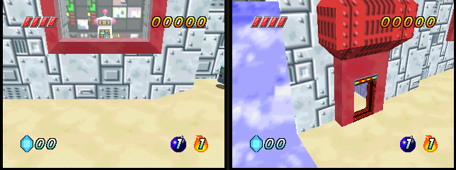 |
| TITLE TEST | an empty case | |
| ENTRY EDIT | an object editor; its SAVE MODE prints to a routine that is empty in the released game | 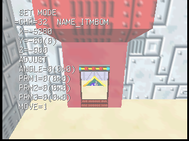 |
| MUSIC NUMBER, SOUND NUMBER | play 0-100 hex | |
| DEMO 0-9 | cutscenes | 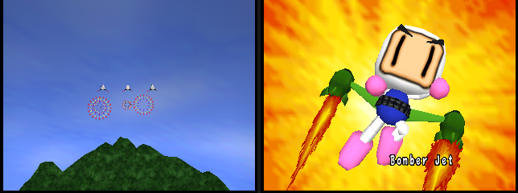 |
| SHOCK TEST | Rumble Pak test | 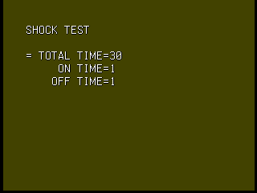 |

### The in-game menu: pause, then L

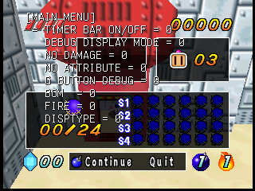 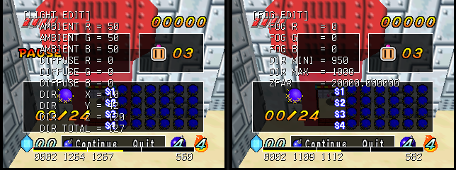

| Line | Address | Effect |
|---|---|---|
| TIMER BAR | `8016E3E4` | a frame-time bar 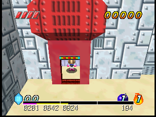 |
| DEBUG DISPLAY MODE | `8016E3F7` | 1 position and STAGE/AREA/MAP/CLEAR, 2 player and camera 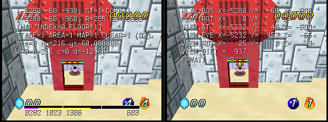 |
| NO DAMAGE | `8016E3FC` (Japan `8016E404`) | no damage; works without the debug flag 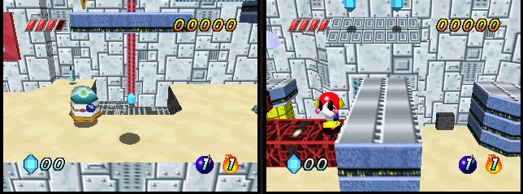 |
| NO ATTRIBUTE | `8016E404` (Japan `8016E406`) | floor types stop working; shown on an exit floor 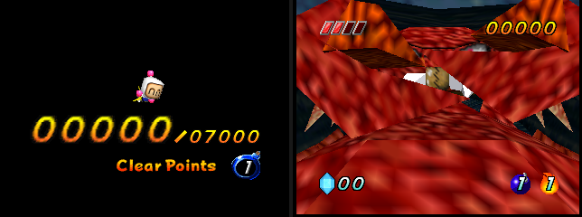 |
| G BUTTON DEBUG | `8016E40C` | hold Z to fly, A up, B down; Z + L ends the map; works without the debug flag 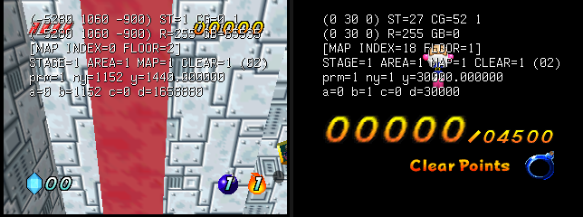 |
| BOM, FIRE | `8016523F`, `80165240` | extra bombs and fire, 0-3; fire scales the blast 0.60-1.50 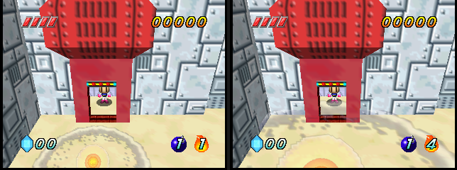 |
| DISPTYPE | `80177974` | what is drawn in the distance on some maps 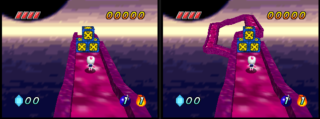 |

## GameShark codes

Held RAM writes in BizHawk, written in GameShark form; none was run on a GameShark.

| Code | US and Europe | Japan | |
|---|---|---|---|
| Debug mode | `8016E424 0001` | `8016E41B 0001` | |
| 4 bombs | `8016523F 0003` | `80165239 0003` | 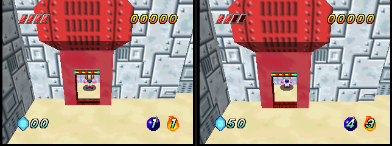 |
| Fire 3 | `80165240 0002` | `8016523A 0002` | 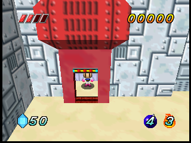 |
| 50 gems | `80165241 0032` | `8016523B 0032` | |
| Health 2 bars | `80165244 0002` | `8016523E 0002` | |
| 7 lives | `80165243 0007` | `8016523D 0007` | 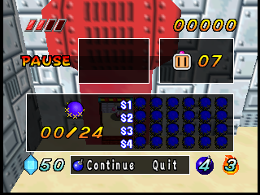 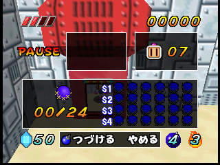 |
| No damage | `8016E3FC 0001` | `8016E404 0001` | 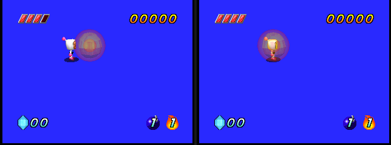 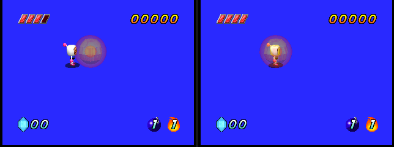 |
| Fly with Z | `8016E40C 0001` | `8016E40C 0001` | 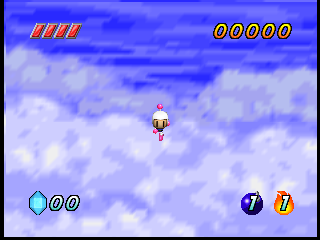 |

No damage held against the fall penalty on all three ROMs, and against enemy contact and two bosses on the US ROM.
The map number (`8016E428`, Japan `8016E420`) is read only when a
map loads, so there is no one-line warp; MAP NUMBER in the action menu is the warp.

## ★ Unlocks

- **Planet 6, Gossick.** Save flag bit 1 (record `+44`) is set at a stage clear when all 24 collectible bits are held
  and every stage of Planets 1-5 has a score of 5. With it, and Garaden cleared, the planet select and the Score
  screen show six planets. 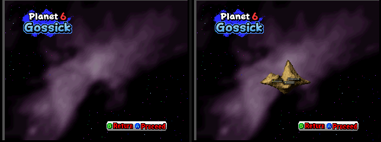 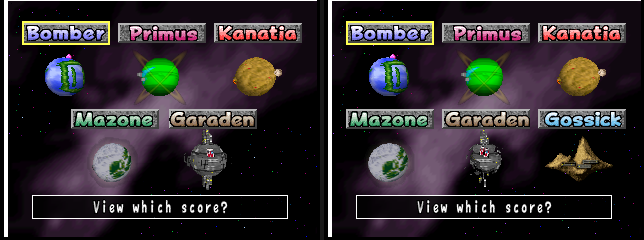
  On the US ROM the game set the flag itself: on a file one stage short, that stage was finished with a score of 5
  (finish and score forced), the flags byte went `05` → `07` by the game's own store, a scene of the planets played
  with no text, and Gossick was there after a power cycle. With a low score the flag stayed off.
  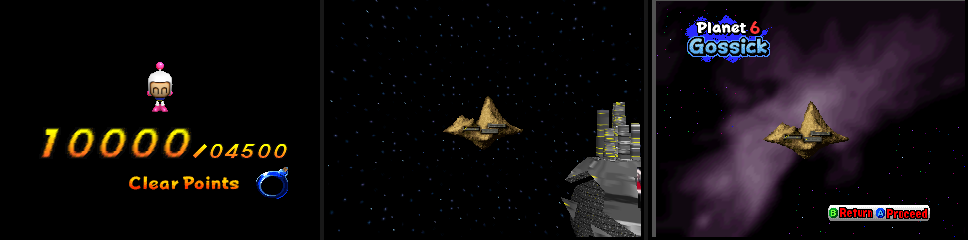
  Gossick's third stage is listed as Vs.???? even once cleared. 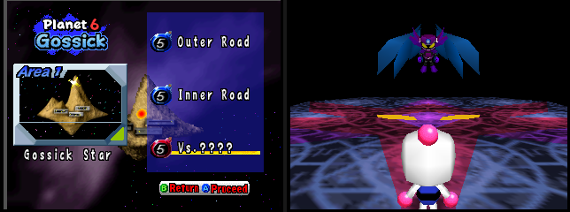
- **Options.** Slider Race needs three planets with every stage at 5, Golden Bomber five, Millian's Treasure Hunt all
  six. 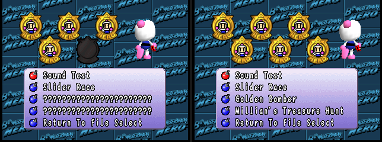 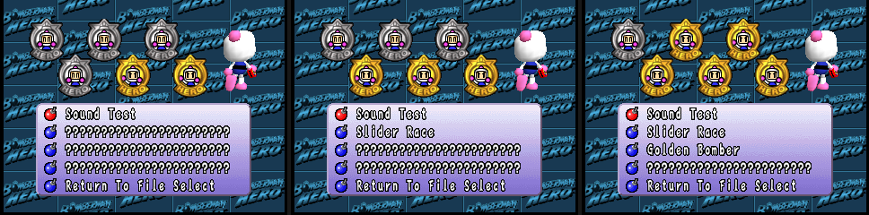
  - Slider Race: a timed race against a rival on the Bomber Slider. 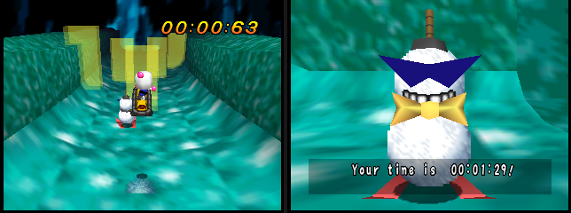
  - Golden Bomber: three scored stages as a gold Bomberman (maps `6F`, `70`, `65`). 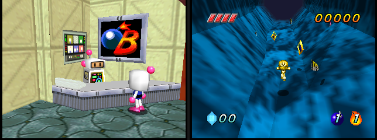
  - Millian's Treasure Hunt: the planets again, looking for 24 treasures. 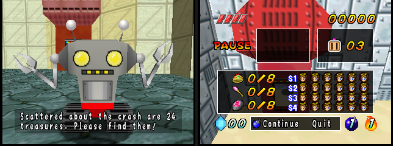
    The treasures are 24 bits of the save record (`+48`-`+4A`). When the set becomes complete during a Treasure Hunt
    stage the game plays map `B0`, a celebration at Millian's castle, and returns to Options; no flag is set. Shown
    by writing the three bytes in a stage and forcing the finish. 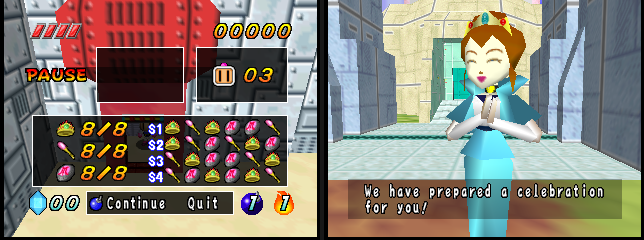
  - Slider Race and Golden Bomber wrote nothing to the save file in the runs made. The text has one time line,
    "Your time is", and no best-time or score-table wording.
  - In the Sound Test, holding C-Left or C-Right turns the band. 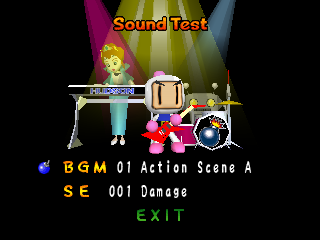
- Holding B throws more bombs at once: one after a 20-frame hold, two after 150, four after 300, whatever the bombs
  byte holds.
- Flag bits 0 and 2 are set when Garaden and Gossick are cleared; nothing was found that reads them.

## ★ Unused maps

35 of the 192 maps have nothing pointing to them: not the stage-select table (`80106DA0`), any map's exit list or any
map number in the code. Loaded with MAP NUMBER on the US ROM.

- `71`-`7C`, `7E`: checkerboard test rooms. 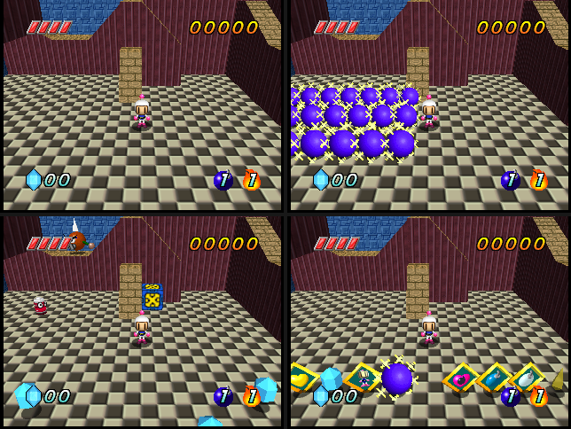
- `BC`-`BF` and `6D`. 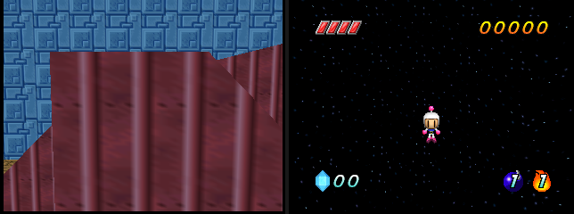
- `01 07 14 1A 20 24 2C 34 3A 3F 48 4B 56 5B 60`: one spare room beside each group of stages.
  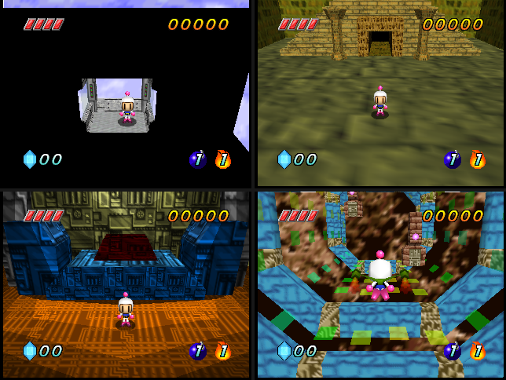
- `26` and `7D`, both tagged as stage 3-1-1. 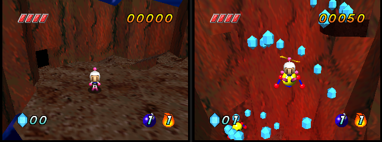

Not ruled out: a map number stored through a computed pointer, or an exit index past the end of a list.

The full table. Columns: map, stage-area-map from its record (`*` = clear flag 0), how it is reached, exit list.
`S` both stage-select bytes, `S0` first only, `S1` alternate only, `K` a constant in code, `x` only through another
map's exit, `--` nothing.

```
00 1-1-1* S0 80,00                   40 4-2-1  S1 41,00                   80 1-1-1* x  88,00
01 0-0-0  -- 7F,00                   41 4-2-2  S  4A,00                   81 1-1-5* x  82,00
02 1-1-1  S1 03,00                   42 4-2-5  S  92,00                   82 1-1-5  x  09,00
03 1-1-2  S  04,06,03,03             43 4-2-4  S  42,5F                   83 1-2-7* S0 0F,00
04 1-1-4  S  05,00                   44 4-3-2* S0 45,45,45,45             84 1-2-7  x  10,00
05 1-1-5* S  81,00                   45 4-3-2  S1 69,00                   85 2-2-1* S0 1C,00
06 1-1-3  S  05,06                   46 4-3-3  S1 6A,00                   86 2-2-6* S0 57,00
07 0-0-0  -- 7F,00                   47 4-3-4* S1 6B,00                   87 2-2-6* x  90,00
08 3-1-5  S  94,00                   48 0-0-0  -- 7F,00                   88 1-1-1* x  02,00
09 1-2-1  S  0A,00                   49 5-2-2  S  54,00                   89 3-2-7* S0 58,00
0A 1-2-2  S  0B,00                   4A 4-2-3  S  43,00                   8A 1-3-4* S0 13,00
0B 1-2-3  S  0D,0C                   4B 0-0-0  -- 7F,00                   8B 3-2-7  x  35,00
0C 1-2-5  S  0E,00                   4C 5-1-1  S1 4D,00                   8C 1-3-4  x  A6,00
0D 1-2-4  S  0E,00                   4D 5-1-2  S  4E,00                   8D 3-3-5  x  9B,00
0E 1-2-6  S  83,00                   4E 5-1-3  S  9D,00                   8E 3-2-1* x  2D,00
0F 1-2-7* S1 84,00                   4F 5-1-4* S1 9E,A7                   8F 2-3-4  x  98,00
10 1-3-1  S  11,00                   50 5-1-5  S  51,00                   90 2-2-6  x  21,00
11 1-3-2  S  12,00                   51 5-1-6  S  9F,00                   91 2-3-4* S0 25,00
12 1-3-3  S  8A,00                   52 5-1-7* S1 A0,00                   92 4-3-1* S0 59,00
13 1-3-4* S1 8C,00                   53 5-1-7* x  A2,00                   93 4-3-5  x  9C,00
14 0-0-0  -- 7F,00                   54 5-2-3* S  B8,00                   94 3-2-1* S0 8E,00
15 2-1-1  S1 16,15,15,A8             55 6-1-3  S1 55,00                   95 3-3-5* S0 39,00
16 2-1-2  S  17,16,16,16             56 0-0-0  -- 7F,00                   96 4-2-1* S0 40,00
17 2-1-3* S  5D,5E,17,17,17,00       57 2-2-6* S1 87,00                   97 4-3-5* S0 5A,00
18 2-1-4  S  85,18,18,00             58 3-2-7* S1 8B,00                   98 3-1-1* S0 27,00
19 2-1-5  S  85,00                   59 4-3-1* S1 9A,00                   99 3-2-5  x  A9,00
1A 0-0-0  -- 7F,00                   5A 4-3-5* S1 93,00                   9A 4-3-1  x  44,00
1B 2-2-2  S  1F,1E                   5B 0-0-0  -- 7F,00                   9B 4-1-1* S0 3D,00
1C 2-2-1  S1 1C,1B                   5C 3-2-6* x  33,00                   9C 5-1-1* S0 A5,00
1D 2-2-5  S  86,00                   5D 2-1-3  x  18,00                   9D 5-1-4* S0 4F,00
1E 2-2-4  S  1D,1E,1E,1E,1E,1E,1E,1E,1E,00   5E 2-1-3  x  19,00                   9E 5-1-4  x  50,00
1F 2-2-3  S  1D,00                   5F 4-2-4* x  43,00                   9F 5-1-7* S0 52,00
20 0-0-0  -- 7F,00                   60 0-0-0  -- 7F,00                   A0 5-1-7* x  6C,00
21 2-3-1  S  22,00                   61 0-0-0  K  7F,00                   A1 5-1-7* x  53,00
22 2-3-2  S  23,00                   62 0-0-0  K  7F,00                   A2 5-1-7  x  A3,00
23 2-3-3  S  91,00                   63 0-0-0  K  7F,00                   A3 6-1-1* S0 66,00
24 0-0-0  -- 7F,00                   64 0-0-0  K  7F,00                   A4 6-1-3* S0 55,00
25 2-3-4* S1 8F,00                   65 6-3-3* S  B3,00                   A5 5-1-1* x  4C,00
26 3-1-1* -- 27,00                   66 6-1-1  S1 67,00                   A6 2-1-1* S0 15,00
27 3-1-1  S1 28,00                   67 6-1-2  S  A4,00                   A7 5-1-4  x  50,00
28 3-1-2  S  29,00                   68 2-1-1  x  16,68,68,00             A8 2-1-1* x  68,00
29 3-1-3  S  2A,08                   69 4-3-3* S0 46,46,46,46             A9 3-2-6* S0 33,00
2A 3-1-4  S  94,00                   6A 4-3-4* S0 47,47,47,47             AA 1-1-7* K  7F,00
2B 5-2-1  S1 49,00                   6B 4-3-4  x  97,97,97,97             AB 1-1-1  K  7F,00
2C 0-0-0  -- 7F,00                   6C 5-1-7* x  A1,00                   AC 6-2-1* S  6E,00
2D 3-2-1  S1 30,2F,2D,2D             6D 0-0-0  -- 7F,00                   AD 6-2-1  K  7F,00
2E 3-2-2* x  30,00                   6E 6-2-1* x  AD,00                   AE 6-2-1  K  7F,00
2F 3-2-3  S  31,00                   6F 6-3-1  S1 70,00                   AF 0-0-0  K  7F,00
30 3-2-2  S  31,2E                   70 6-3-2  S  65,00                   B0 0-0-0  K  7F,00
31 3-2-4  S  32,32                   71 0-0-0  -- 7F,00                   B1 6-3-1* S0 B2,00
32 3-2-5* S  99,00                   72 0-0-0  -- 7F,00                   B2 6-3-1* x  6F,00
33 3-2-6  S1 89,5C                   73 0-0-0  -- 7F,00                   B3 6-3-3* x  B4,00
34 0-0-0  -- 7F,00                   74 0-0-0  -- 7F,00                   B4 6-3-3  x  7F,00
35 3-3-1  S  36,35,35,35,35,35,35,35,35,35,35,00   75 0-0-0  -- 7F,00                   B5 5-2-1* S0 B6,00
36 3-3-2  S  37,00                   76 0-0-0  -- 7F,00                   B6 5-2-1* x  B7,00
37 3-3-3  S  38,00                   77 0-0-0  -- 7F,00                   B7 5-2-1* x  2B,00
38 3-3-4  S  95,00                   78 0-0-0  -- 7F,00                   B8 5-2-3* x  B9,00
39 3-3-5* S1 8D,00                   79 0-0-0  -- 7F,00                   B9 5-2-3  x  7F,00
3A 0-0-0  -- 7F,00                   7A 0-0-0  -- 7F,00                   BA 0-0-0  K  7F,00
3B 4-1-3  S  96,3B                   7B 0-0-0  -- 7F,00                   BB 0-0-0  K  7F,00
3C 4-1-2  S  3B,3E                   7C 0-0-0  -- 7F,00                   BC 0-0-0  -- 7F,00
3D 4-1-1  S1 3C,00                   7D 3-1-1  -- 7F,00                   BD 0-0-0  -- 7F,00
3E 4-1-4  S  96,00                   7E 0-0-0  -- 7F,00                   BE 0-0-0  -- 7F,00
3F 0-0-0  -- 7F,00                   7F 6-3-7  filler 7F,00               BF 0-0-0  -- 7F,00
```

## ★ White Bomb mission

The game loop handles a file-select result that no visible entry gives: result 3 sets map `B5` and mode byte
`80177630` = 4. The file select builds seven entries (`80332FD0`) and its A handler has a case for cursor value 6
(`8033169C`), but six are drawn and Down from Stereo wraps to Select. The only stores to the word that would restore
the seventh position (`80134888`) are zero and the current position plus one.

Shown on the US ROM by writing the cursor value `80333424` = 6 once on the file select and pressing A. With nothing
more written the game set mode 4 and ran `B5` (the briefing: "Good work, White Bomb! Here's the next mission. The
secret in Bomber Star will be destroyed!"), `B6` (the Bomber Jet takes off), `B7` (it flies to a planet) and the
playable map `2B`. 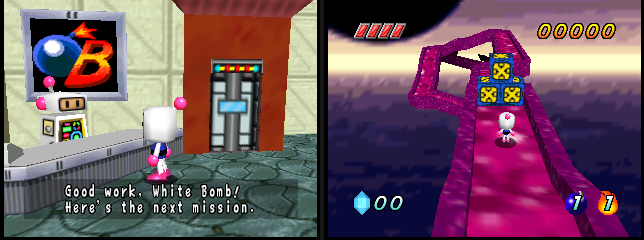 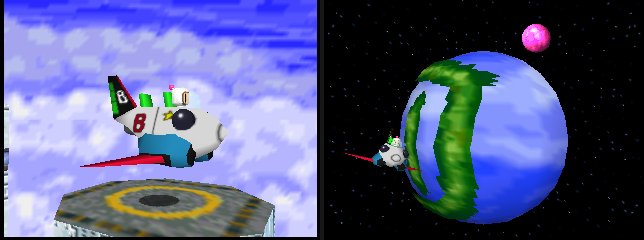

Maps `2B`, `49` and `54` are tagged 5-2-1 to 5-2-3, an area with no area picture and no stage-name labels. By the
exit lists the mission closes on scenes `B8` and `B9`. Not visited: `49`, `54`, `B8`, `B9`. Not read: what mode 4
changes inside a stage. Not checked on the other two ROMs. A write to the cursor through a pointer is not ruled out.

## ★ BACKUP MEMORY TEST

A developer screen with no caller anywhere (`80020550`, `80020844`). Run by writing the two scene callbacks
(`8016526C`, `80165274`). It shows each port's Controller Pak status and a note list, and offers PAK DATA WRITE,
PAK DATA READ, EEPROM DATA WRITE and EEPROM DATA READ. EEPROM DATA WRITE fills the first `200` bytes of the save
memory with a test pattern and so erases all four files. 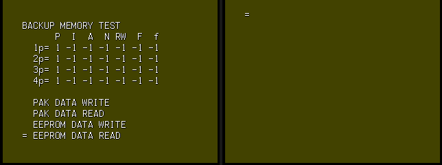

## Other leftovers

- 652 `NAME_` object labels (US ROM `1172F8`), printed only by ENTRY EDIT. 304 of those objects are placed by no map
  (30 blank slots, 274 named). The US ROM's code creates 257 of the named ones (creator `80027464`, 697 call sites,
  plus `80027C00`, direct id stores and the item spawner `800941C4`); the callers were not traced to live code.
  Nothing creates the other 17:

  | Id | Name | |
  |---|---|---|
  | 57-63 | ITMDUMMY9-15 | spare item slots sharing the bomb item's graphics |
  | 67 | SOFTBLK3 | a blue X crate 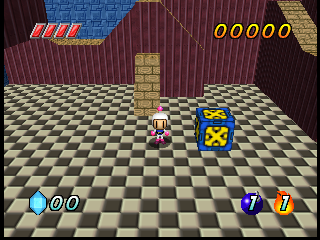 |
  | 72, 73 | CRASH2, CRASH3 | no graphics |
  | 247, 343 | GAGON_F, NGOGL_IC | no graphics; their sibling parts are created |
  | 421, 426, 450, 482 | ENDL_TG, BAL_WD, MEG_FB, BAG2_BR | boss parts in overlay code |
  | 546 | MCH_00 | the only one with a model of its own: two grey boxes |

  Placed by hand, the dummy items and MCH_00 hang the map load and the rest show nothing. ITMMUSEN, a small radio,
  is spawned by the craft object of the cutscenes.
- The warship model is in the ROM three times and two copies (`9F85D0`, `9F9A80`) are never loaded; `9EBD80` is an
  unloaded copy of `9EC7B0`, and five animation files (`9971C0`, `997850`, `9979C0`, `997FC0`, `9AEE10`) are never
  loaded. Checked on the US ROM only.
- Stage and area names are pictures, not text. Gossick's "Vs.????" is a drawn label with no second, revealed name.
- A design chart headed "Bomber Base" in the corner of the US and European font texture (US ROM `64C3C0`).
  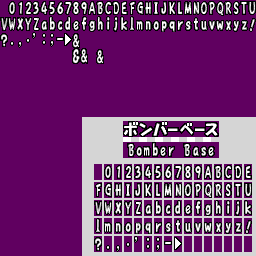
- "sbrk : can not change data segment space allocation!" and the editor's `<SAVE>` output lines.

## Region differences

- Europe matches the US ROM except map `04`, where two crystals are moved.
- Japan's object lists differ on 75 maps: it has far more full-health and extra-life pickups (59 and 56 against 7 and
  30), and the US ROM more enemies. The score needed for a 5 is higher in the US ROM on 67 maps.
- The stage-select table, the planet thresholds and the GAME START table are the same in all three.
- Text, read from the three scripts and compared by eye: Europe's strings are the US ones. Japan has Pibot hints for
  all four bosses where the US keeps only Endol's, and a cave hint the US lacks; the US has "Louie can kick the wall
  and jump high!" and 57 one-letter filler lines "a" in slots the translation left empty.
- The Sound Test label list names 31 BGM tracks in the US and 10 in Japan, and Japan has two placeholder labels,
  72 and 73 けつばんA/B ("missing number"). US "109 Washing Clothes B" is Japan's "selection sound B". Label strings
  only; not seen on screen.

## Open

- Textures were decoded on all three ROMs (1,618 on the US ROM) and looked through: no unused art was found.
  Animated-texture frames are only partly matched to their files, models are drawn un-posed, and the unloaded-file
  test was run on the US ROM only.
- No unused text was found, but a single unused line inside a used message would not show.
- The White Bomb mission past its first stage, and on the other two ROMs.
- The hidden modes by real play, and the 24 treasures collected rather than written.
- Gossick earned by an unforced clear. NO ATTRIBUTE on ice, conveyor and damage floors.
- The debug-flag trap on the credits and a played ending, and past the first stage on the other two ROMs.
