# Bomberman Max (Game Boy Color, 1999-2000): codes and secrets

Everything here comes from disassembling the ROMs (`tools/sm83.py`, listing `disasm/max/blue.asm`) and checking in
Mesen 2 (`tools/max/run.sh`, helpers in `tools/max/lib.lua`). Addresses are `bank:address` in Blue Champion unless
noted; cart RAM is `$A000-$BFFF`.

Prior art: the GameFAQs "Bomberman Max: Blue Champion" cheats page (in `res/`: the sound test and which stage gives
each Charabom) and other published notes (the sound test, the two unused Charaboms and their cart-RAM bytes, the
leftover debug-menu text). Marks: ★ **New**, **Known**.

## The five ROMs

| Tag | Dump | Header title | Header CRC | MD5 |
|---|---|---|---|---|
| `blue` | Bomberman Max - Blue Champion (USA) | `B-MAX-BLUE` + `A8BE` | `$9F1B` | `c987f711dfb9cba8dc1174219877360f` |
| `red` | Bomberman Max - Red Challenger (USA) | `B-MAX-RED` + `A7BE` | `$2B72` | `1757723cf346be2cea58d0fc4ed4cfa9` |
| `hikari` | Bomberman Max - Hikari no Yuusha (Japan) | `B-MAXHIKARI` + `A8BJ` | `$4220` | `c720432fe26cefbb5b177920ce20cd80` |
| `yami` | Bomberman Max - Yami no Senshi (Japan) | `B-MAXYAMI` + `A7BJ` | `$88EF` | `76c04694db94b72afa78dd6612dfe4a9` |
| `ain` | Bomberman Max - Ain Version (Japan) | `BMAX-PENTEL` + `BBPJ` | `$BBC4` | `54c8522c1d924a05bb05ac6673f023e6` |

All five: 2 MB, MBC5 + RAM + battery (`$1B`), 8 KB cart RAM, CGB flag `$C0` (Game Boy Color only; on a plain Game
Boy it shows a "This software is intended only for use with Game Boy Color" screen), new licensee `5P` (US) / `18`
(Japan). Banks `$3D-$3F`, `$49-$4F`, `$55` and `$5C-$7F` are empty fill in every version, so about 1.4 MB is used.

What is shared (identical 16 KB banks out of 128):

- **The two sides.** Blue = Hikari (you play Bomberman, white title) and Red = Yami (you play Max). Banks `$0B`, `$20`,
  `$21`, `$48` and others are the same in Blue, Hikari and Ain but differ in Red and Yami: the side's stages, sprites
  and story pictures.
- **The two languages.** Blue and Red share 100 banks; Hikari and Yami 107. The text and code banks (`$00-$0A` and
  more) differ between US and Japan.
- **Ain Version** is built on Hikari (104 banks the same, the white title and Bomberman) with its own code and text
  banks (`$00-$0A`, `$1B`, `$45`, `$50`) and the "Ain Version" logo. Its save header checksum byte differs, and it
  opens every stage of both sides (below).

## There is no password

Bomberman Max saves to battery RAM (two files, File1 / File2); no screen takes a code. The title menu is Normal Game /
Battle Game (the cursor skips it on a fresh save: `$01:6029` checks the two files first) / Pitch Area (infrared Send / Receive). The only text input is the
sound-test sequence on that menu. The strings `PASSWORD` / `STRAT` / `0000` at `$0A:4250` are leftover text of a debug
menu (Known) that nothing draws.

So what the page builds is **GameShark codes for the save**. `tools/max/password.mjs` holds the Charabom roster and
encodes / decodes those codes (`node tools/max/test_password.mjs`).

### Cart RAM layout (the same in all five versions)

| Address | Meaning | Evidence |
|---|---|---|
| `$A000-$A1FF` | the game in play; `$A200` and `$A400` are File1 and File2 (copied in and out) | `$00:2833`, `$01:6029` |
| `$A000` | `BOMBERMAN-MAX`, then a checksum byte at `$A00F` | `$09:4333`, `$00:274F` |
| `$A030` | stage table: a word per stage, 19 per world, 5 worlds + 5 more; byte 0 = the stage's flag (`$53:4D0E`), byte 1 set when it is done (`$53:4D45`) | `$53:4D7D` (world offsets) |
| `$A110 + 8 x id` | Charabom roster, ids 0-29: `[owned, id, level, attack, defense, speed, 0, 0]` | `$02:653E` (rescue), `$02:65AD` (owned?) |

The game reads the roster in place: setting an owned byte puts the Charabom on Charabom Select at once, and a save keeps
it. A GameShark code of type `$80` (cart RAM bank 0) writes it: `8001` + low + high byte of the address.

### The roster

| Id | Icon | US name | Japanese | Given by | Lv |
|---|---|---|---|---|---|
| 0 |  | Draco | ドラコ | Red / Yami | 3 |
| 1 | 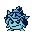 | Shell | シェル | Blue / Hikari | 4 |
| 2 | 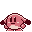 | Pommy | ポミュ | Blue / Hikari | 3 |
| 3 |  | Elephan | エレファン | Red / Yami | 4 |
| 4 |  | Seadran | シードラン | Blue / Hikari | 8 |
| 5 |  | Marine Eel | マリンイール | Red / Yami | 8 |
| 6 | 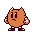 | Knuckle Pommy | ナックルポミュ | Red / Yami | 12 |
| 7 |  | Panther Fang | パンサーファング | Blue / Hikari | 12 |
| 8 | 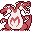 | Twin Dragon | ツインドラゴン | Red / Yami | 16 |
| 9 | 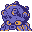 | Sea Balloon | シーバルーン | Blue / Hikari | 16 |
| 10 | 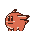 | Beast Pommy | アニマルポミュ | Blue / Hikari | 20 |
| 11 |  | Big Ox | ビッグオックス | Red / Yami | 20 |
| 12 | 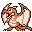 | Puteladon | プテラドン | Blue / Hikari | 24 |
| 13 |  | Sharkin | シャークン | Red / Yami | 24 |
| 14 |  | Hammer Pommy | ハンマーポミュ | Red / Yami | 28 |
| 15 | 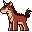 | Unicornos | ユニコルノス | Blue / Hikari | 28 |
| 16 | 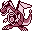 | Iron Dragon | アイアンドラゴン | Red / Yami | 32 |
| 17 |  | Iron Squid | クラーケン | Blue / Hikari | 32 |
| 18 | 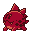 | Animal Pommy | ビーストポミュ | Blue / Hikari | 36 |
| 19 | 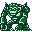 | Mecha Kong | メカコング | Red / Yami | 36 |
| 20-25 | 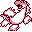 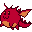 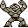  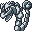  | Aqua Dragon, Pommy Dragon, Thunder Kong, Thunder Shark, Rock Snakey, Fire Force | アクアドラゴン, ポミュドラゴン, サンダーコング, サンダーシャーク, ロックスネーキー, ファイアーフォース | combining two | 5 |
| 26 |  | Shardra | シャードラ | legendary | 40 |
| 27 | 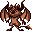 | Ox Battra | オックスバトラー | legendary | 40 |
| 28 | 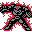 | Heat Rock | ヒートロック | nothing (unused, Known) | 50 |
| 29 |  | Oct Kong | タッコング | nothing (unused, Known) | 50 |

Names are the Charabom Select cards (all 30 owned, every card shown in Mesen in all five versions:
`tools/max/cards.lua`); "given by" is GameFAQs' stage list for 1-19, the game's text for the rest. The icons are the
32 x 32 card pictures (`tools/max/items.py`). ★ The US release swaps two names: id 10 is アニマルポミュ (Animal
Pommy) in Japan and Beast Pommy in the US, id 18 the other way round.

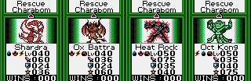

**Codec API** (`tools/max/password.mjs`): `encode({own: [ids], level: {id: 1-99}}, ver)` returns the GameShark codes;
`decode(code, ver)` returns `{id, name, field: 'owned' | 'level', value}` for a roster code, else `null`;
`validate(code, ver)`; `name(id, ver)`; constants `VERSIONS`, `CHARABOMS` (`{id, us, jp, home, lv, icon}`),
`SOUND_TEST`, `CHEATS`. The codes are the same in all five versions; `ver` only picks the name language.

### Verification

- `node tools/max/test_password.mjs`: every id and every level 1-99 round-trips (5,940 level codes), and wrong-shape
  codes are rejected.
- In Mesen's cheat engine (`gbGameShark`), the 30 own codes at once: every card shows on Charabom Select in all five
  versions. Type `01` codes do not reach cart RAM; type `80` does.
- No fuzz against a game check: the game has no check on these bytes beyond the save checksum, which it recomputes
  when it saves.

## Codes

| Code | Effect | Versions | Mark |
|---|---|---|---|
| Title menu: Right, Left, Right, Right, Left, Left, Right, Left, Right, Left, Left, Right, then A | sound test | all five | Known |

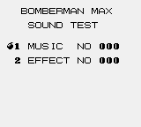

- **Sound test.** `$01:5F7E` compares each new press with the table `$01:5FCD` (Red `$01:5F87`, Hikari `$01:54BB`,
  Yami `$01:5475`, Ain `$01:6013`); a wrong press starts over. GameFAQs lists it for Blue, Red and Ain; Hikari and Yami
  have the same table, and it works in all five (`tools/max/test_codes.lua`).

### Ain Version: every stage of both sides (★ New)

The new-game template that fills the stage table `$A030` sets every stage's flag in the Ain Version. Each retail
version clears the flag of the 20 stages only the other side has: 55 stages are shared, Blue and Hikari have 20 more,
Red and Yami 20 others, and Ain has all 95 (read from cart RAM after a new game in all five versions). GameFAQs also lists a
"Complete Data Version" alias for the game; this may be it. Not played through to those stages.

## Cheats (★ New, `tools/max/test_cheats.lua`)

| Code | Effect | Verified | Other device (same test) |
|---|---|---|---|
| `C32-EBA-C41` (Game Genie) | invincible: `$02:52EB` JP Z -> JP, so the hit test (`$53:4000` via `$00:2A0F`) never reaches the dying state `$3C` | 0 hits in 6,000 bot frames, each version (8-9 without) | GameShark `011052C7`: the flash timer `$C752` (tested before the hit test, `$02:52E0`) held at `$10`; 0 hits, each version |
| `0103F7C2` | infinite lives (`$C2F7`, decremented at `$02:709F`) | 11-13 deaths, lives stay 3, each version | Game Genie `A70-9F8-19E` (Ain `A70-D08-19E`): DEC A -> AND A at `$02:709F` (Ain `$02:70D0`); 11-13 deaths, lives stay 3 |
| `8001xxA1` | own Charabom id (xx = `$10` + 8 x id); `80vv12A1` + 8 x id sets its level | every card shown | no Game Genie form (the roster lives in cart RAM) |
| `8001F0A1`, `8001F8A1` | own Heat Rock, Oct Kong (the unused pair; their bytes are Known) | shown | none (cart RAM) |
| `8001E0A1`, `8001E8A1` | own Shardra, Ox Battra (the legendary pair) | shown | none (cart RAM) |

The hit branch sits at the same address with the same bytes in all five versions (only the CALL target before it
moves), so one Game Genie code works everywhere.

The player object is the `$C700` page: `$C705` state (`$14` playing, `$3C` hit, `$1C`/`$1D` dying, `$08` respawn,
`$20` and up game over), `$C716`/`$C717` timers, `$C750` bit 2 a shield that turns a hit into `$02:67A1`.

## Hidden-content sweep

Coverage (`tools/max/cov.sh`, Blue): boot and title (8,000 frames), the sound test through 60 tunes and effects,
Pitch Area send and receive with no partner (with no file saved only Receive can be picked, `$01:60C6`; a
successful exchange, forced by skipping `CALL $3E32` at `$01:73F4`, turns the NETWORK box to OK! and returns to the
Pitch Area menu), a new game to the game over and Continue, and 60,000 bot frames with the
cheats above (1-01 to 1-03). Battle Game can't be entered on a fresh save. Executed:
**50,054 bytes** of code; ROM bytes touched at all: 264,717 of about 1.4 MB used. Later worlds, the Charabom battles,
the minigames and the ending were not reached, so this sweep is partial.

- **Dead code** (`disasm/max/dead_blue.txt`): branch-reachable never-run 7,360 bytes, dead 3,526, no reference 1,053;
  1,345 orphan candidates (mostly data). The largest pieces sit in the parts the runs didn't reach (`$53` stage
  events, `$0D` text, `$03` objects). `$00:3A97` is a Super Game Boy check (MLT_REQ, `$C182`) that only runs off a Game
  Boy Color, next to the lockout screen: left from a Super Game Boy-aware engine.
- **Unset flags** (`disasm/max/flags_blue.txt`): `$C006-$C069` are sound-driver channel fields written through HL
  (false positives); `$C183` is set only by state `$0E` of the bank-1 screen table (`$01:63B4`, after `$0C`
  fades and `$0D`), which nothing enters; when set, `$00:26A2` disables interrupts and loops at `$00:26B6`, a
  deliberate hang (seen in Mesen by poking `$C188` = `$0C`). `$C0B2` is the noise channel's pitch-slide step (`$C0AF`
  + channel, set by sound opcode 5 at `$3C:4166`, which 13 sounds use). Nothing that looks like a debug switch.
- **Input codes** (`disasm/max/pad_blue.txt`, 36 hits): menus, movement and the two codes above. No other sequence.
- **Text.** US text is ASCII with control bytes `$F0-$FE` (`$FC 01 01` starts a box, `$FE` new line, `$FF` end);
  Japanese uses its own kana codes. Known leftovers: the debug menu `$0A:4200` (INIT, TITLE DEMO, MODE SELECT
  1 NORMAL / 2 JUMP / 3 GB KISS, PASSWORD STRAT 0000, NORMAL GAME ... STAGE EVENT, TEST MENU 1-7, ROM DISPLAY), and
  the test-menu strings at `$52:6107` next to the sound test's (0 SCREEN TEST ... 6 EXIT); the sound test draws only
  its own two lines. ★ The game's messages are a table of 240 (US `$57:4400`, Japanese `$1B:4C07`; Japanese
  hiragana `$80-$AD`, katakana `$C0-$ED`, voiced kana `$50-$7B`) picked by a number in `$C1A7`. Every store to `$C1A7`
  takes a constant or one of seven tables (stage objectives `$53:43EB`, 5 × 19; minigame help `$53:54E9`; the
  ending's `$50:5F6A`; and others), the same in all five versions. Never picked:
  - Four stage objectives: `$15` "Enter all the Warp Holes!" (すべての ワープを くぐるのだ!), `$1D` "Cross all the
    Signals!" (すべての シグナルを わたるのだ!), `$28` "Stop every defence barrier!" (すべての ぼうぎょバリヤーを
    とめるのだ!; the US text is "Nothing") and `$30` "Defeat all except the Blockens!" (ブロックン いがいを すべて
    たおすのだ!).
  - `$D5`, a third Kick Game help page (the help shows `$D3`, `$D4`, `$BB`): ゲタアイテムを とりすぎると
    タイムオーバーに なります! ("Take too many Geta items and it's Time Over!"); blank in Blue and Red.
  - `$8E` 〈name〉が おでむかえだ!! ("〈name〉 has come to meet you!!") and `$8F` 〈name〉が なかまに くわわった!!
    ("〈name〉 joined you!!"); blank in Blue and Red.
  - `$8B` "Defense missed!", next to the battle lines `$85-$8A` (tables `$08:5EE0`, `$08:70F0`).
  Read from the ROM, not drawn in the game. Of the printer controls, `$FB t n` (tile t, n times) is in no string,
  and `$F9`/`$FA` (row / column skip) appear only in the debug and test menus (same in Pocket).
- **Graphics.** Blocks come from the table at `$1A:705A` (254 entries of 2 KB, the same in all five versions). The
  unread ones are mostly screens the runs didn't reach (Charabom battles, combining, VICTORY). ★ One slot has no entry
  at all: `$46:4000-$47FF`, a starfield with galaxies, sparkles and a planet's edge (entries 199 and 200 both point at
  `$46:4800`, and no code reads bank `$46` directly). Pointed to from the title's entry (`$43`, file `$6B123`) and laid
  out as tiles 0-127, in the title's palette:  Also unused: the two
  unused Charaboms' cards (Known), complete with art, stats and names.

## Title

 
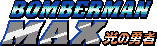  

Logos: `docs/img/logos/max_<ver>.png`, cut from the title screens (`tools/max/logo.py`). The Ain logo has no ™.

## ★ Regions

Every joypad test, the mode table and the debug text in bank `$0A` are the same in all five. What differs:

- **Game-over certificate.** Hikari and Yami draw a red seal by the signature (sprite group `$0B` at X `$7C`, Y `$70`,
  `$02:712B`; Ain `$02:715C`) and one of 7 rating pictures (VRAM `$88C0`, `$02:713E`). In Blue and Red `$02:712B` is a
  bare `RET` and the rating is text, picked from `$C198` in steps of 10. Seen on real game overs (a random-input bot,
  Blue and Hikari). 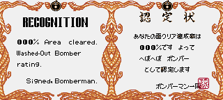
- **Ain: a Pentel logo at boot** after the Hudson one (`$00:0258-$026A`, loader `$01:4000` with `$C198` = 1).
  
- **On an original Game Boy** Blue and Red go straight to the "Game Boy Color only" screen; Hikari and Yami show the
  Hudson logo first (`$00:029B-$02C5`), Ain both logos (`$00:02B8-$02DD`). Seen in Mesen set to Game Boy.
  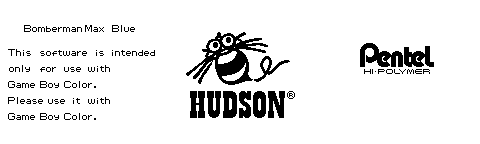
- **One sound request.** `$0D:42F7` asks for effect 58 in Blue, Hikari and Ain but 09 in Red and Yami, so 09 is
  heard in play only on Max's side; elsewhere only the sound test plays it. Static only.
- **An ending keyword.** The Japanese ending's table (`$50:5FE1`) shows message `$77`, キーワード「ばく
  ボンバーマン 2」 (keyword "Baku Bomberman 2"); the US table leaves it out and the US slot is blank. Static only.

## Unused sounds

- ★ Every sound goes through one routine (`$00:181D` in Blue and Red; Hikari, Yami `$00:18B5`; Ain `$00:1846`;
  `$C1A0` = function, `$C1A1` = number): 376 calls with the number written in and three tables. Music 01-1F are all
  asked for. Effect 0D is on no list (a 1.6 s noise hiss), and 1A only on the sound test's (`$52:5D0F`; a 1.7 s
  phrase that gets louder). The effect data is the same in all five.

## Open

- Play the Ain Version to a stage only the other side has (e.g. 1-9 on the Hikari side), and see whether a GameShark
  write to the stage table opens the other side's stages in a retail cart.
- What the 5 extra stage-table words (`$A0EE-$A0F7`) are, and the stage table's second byte.
- Pitch Area's infrared packet format (needs a second console).
- How the legendary Charaboms are earned, and Battle Game with a saved Charabom; both outside the coverage runs.
- A wider coverage run (worlds 2-5, minigames, ending) for the dead-code and graphics sweep.
- The unused messages drawn in the game.

## Battle against the computer (★ New)

On the Charabom Battle "OK?" screen (Selected highlighted), press Up, Down, Select, Start, Down, Up, Start, Select,
Up, Down, then A. Instead of the infrared NETWORK screen the battle starts against a computer rival (in Mesen, for
example Draco against "Rival1: Shell Lv 4", through to Round 1 Start!). The battle module is bank `$08`: its OK? scene
(`$08:4A65`) calls a sequence checker (`$08:4B28`, a copy of the title's sound-test checker, table `$08:4B77`) that
sets `$C4E3` = 1 after ten right presses; on A, `$08:4D3F` goes to scene `$15` and `$08:4B81` loads the rival from
`$08:4C24`, indexed by a frame counter. A wrong press sets `$C4E3` = `$FF`, which locks the code out until the screen
is opened again. Battle Game needs a saved file (the title skips it on a fresh save). The table is the same in all five
versions, and the code works in all five: typed in Mesen through to Round 1 Start! (Japan: 1かいせんめ かいし!). 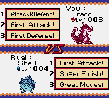

