# Bomberman Max 2 (Game Boy Advance, 2002): codes and secrets

Blue Advance and Red Advance (Bomberman Version and Max Version in Japan): stage action with Charaboms to rescue,
ride and merge. Each version opens 80 of 100 stages, 60 shared and 20 of its own. It saves to the cartridge and has
no passwords. Read from the six ROMs and run in BizHawk (mGBA core); addresses are Blue Advance (US), the same in Japan,
and Europe's are named where they differ. Each run was made once.

Prior art: a page on the game's debug material (in `res/`: the two unused Charaboms). Marks: ★ **New** (not in it),
**Known**.

| Dump | Header |
|---|---|
| Bomberman Max 2 - Blue Advance (USA), (Europe) | `AMHE`, `AMHP` |
| Bomberman Max 2 - Red Advance (USA), (Europe) | `AMYE`, `AMYP` |
| Bomberman Max 2 - Bomberman Version, Max Version (Japan) | `AMHJ`, `AMYJ` |

 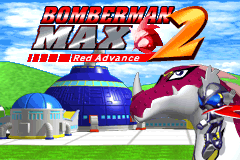

## How the game is laid out

- The main mode is the word at `030021EC` (Europe `0300220C`): 0 logos, 1 intro, 3 title menu, 4 Battle Game, 6 stage
  map, 7 a stage, 11 minigames. A stage's sub-state is `03002248` (Europe `03002268`).
- Controller: held `03005DE0`, pressed `03005DE4`.
- Text: `01`-`0A` digits, `0B`-`24` A-Z, `25`-`3E` a-z, `3F` space, `FF` end; Japan adds katakana from `87`.
- Save: three files of `300` bytes, each starting `BOMBERMAN-MAX2`, with a checksum; the stage table (5 worlds of 24,
  open and cleared bytes) at `+30` and the roster (30 Charaboms, 16 bytes each) at `+120`. The live copy is at
  `020059E0`, the roster at `02005B00`.
- Player at `02000000`: bombs `+51`, fire `+53`, the Charabom ridden `+63`. Lives `02008098`.

## ★ MINIGAME SELECT

A stage's sub-state `23` is a developer menu on a green screen. Nothing sets it: no code in the stage writes `23`,
and a trace of every sub-state write found none. Write `03004A3C` = 2 and then `03002248` = `23` in a stage for
MINIGAME SELECT, or 3 for BONUSGAME SELECT (Europe `03004A4C`, `03002268`). The pad picks a game and it starts.
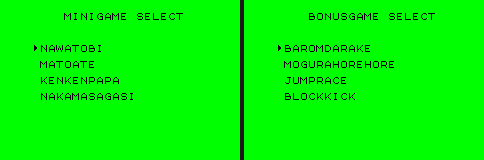
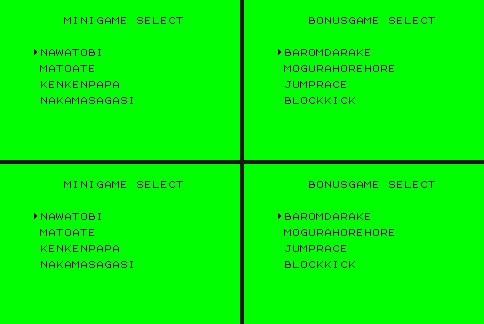

- MINIGAME SELECT: NAWATOBI (Jump the Jump Rope), MATOATE (the bomb kick), KENKENPAPA (Hop Scotch), NAKAMASAGASI (the
  find game). 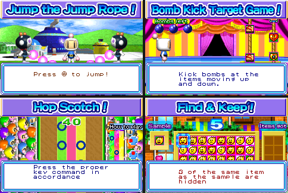
- BONUSGAME SELECT: BAROMDARAKE (the Balloms), MOGURAHOREHORE (the digging game), JUMPRACE, BLOCKKICK.
  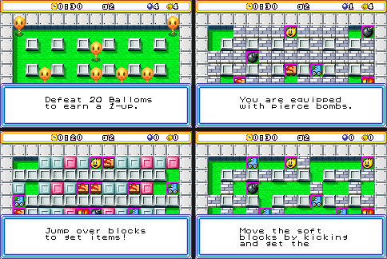

## ★ The complete save file

A routine at `08002670` (Europe `0800284C`) that nothing calls or points to copies a built-in file into the save.
There are two: `0806BC48` has all 100 stages cleared and 24 Charaboms; `0806BF48` has only this version's 80 stages
and all 30 Charaboms. Written into the save memory at power-on, the first shows 100% on File 1, and Red Advance's
stage 1-06 opens in Blue Advance and plays. 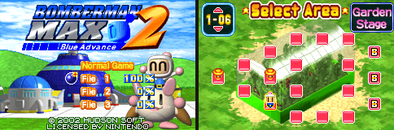 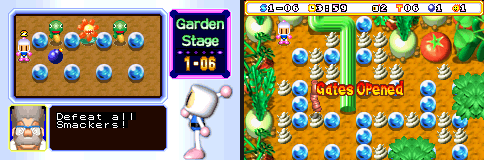
The second skips from 1-05 to 1-07. 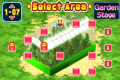

## Charaboms

- **Fly Shark and Elemouse** (Known): numbers 29 and 30, level 85, in every version, and no stage gives them. Own them
  with `02005CC0` and `02005CD0` = 1. 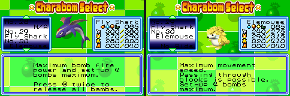 Ridden, they appear on the stage, but the
  stage froze every time. 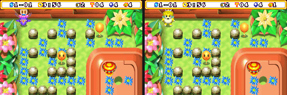
- ★ **Legendaries**: 100 jumps in Jump the Jump Rope win KameKing in Blue Advance and Bomberman Version, Th. Liger in
  Red Advance and Max Version. Shown with the counter (`0200016C`) at 99 and one real jump.
  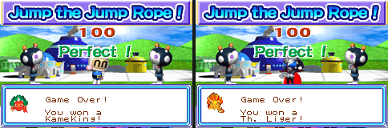
- ★ **Merge** works on one cart: two Charaboms of different groups (dragon, sea, Pommy, beast) make Shargon,
  P. Dragon, Elefandon, Sparkun, Rhinaus or P. Fangs; the same group is refused. A partner over link sending a
  legendary or Fly Shark or Elemouse passes it on as the result (read from the code). 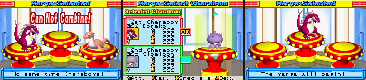

## Cheats

| Effect | Write | |
|---|---|---|
| 9 lives, 8 bombs, fire 8 | `02008098`=0009, `02000051`=08, `02000053`=08 | 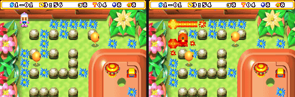 |
| Own Charabom id | `02005B00` + 16 × id = 0001 | |

Written once in memory in BizHawk; not tried as encrypted GameShark or Action Replay codes.

## Button codes

None found: every place that reads the controller was checked, and the only tables of buttons are animations, Hop
Scotch's arrows and directions. Bomberman Max's sound-test input does nothing on the title. A+B+Select+Start resets.
Not searched: pause, Charabom select, the stage map and the link modes. There is no sound test.

## Unused content

- MINIGAME SELECT and the complete save file (above).
- Fly Shark and Elemouse.
- "battle mode programming by fuzzball" at `08077FF8`, and the link library's ids `MultiSioSync4Sio32Load010308` and
  `Sio32MultiLoad010214`.
- Each version keeps the other's legendary prize message, with nothing pointing to it.

## Versions and regions

- Blue and Red: the player (Bomberman or Max), 20 stages each, the legendary and the last lines of the story.
- Boot: the US shows Majesco and Hudson; Europe Vivendi Universal, Majesco, Hudson and a language select; Japan
  only Hudson. 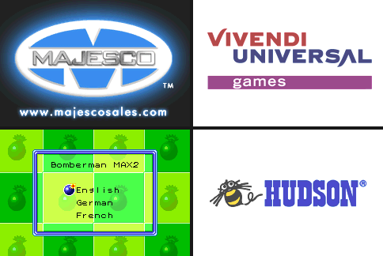
- Japan's title names the versions in katakana and has no Nintendo licence line. 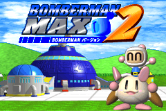
  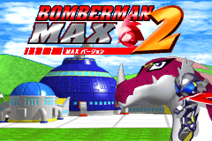
- Europe's memory addresses move (above).

## Open

- How stage rescues give Charaboms, so whether Fly Shark and Elemouse can be had any other way.
- Their abilities in play, the endings, the link modes, the Japanese hiragana, and 100 jumps by pad alone.
