# Mega Bomberman (Genesis / Mega Drive): passwords and secrets

Everything here comes from a linear 68000 disassembly of the ROMs (`tools/m68k.py`; output in `disasm/mega/`,
`usa.asm` and `eu.asm` for `$200-$40000`) and checking the results in BizHawk 2 (Genesis Plus GX core) with the Lua
scripts in `tools/mega/` (`run.sh script.lua us|eu`; run `mkstates.lua` first). Addresses are USA unless a version is
named; RAM addresses are short `$xxxx.w` forms of `$FFxxxx`. Prior art: the GameFAQs codes page and a published article on the game
in `res/`. Marks: ★ **New** (in neither), **Fixed** (prior art is wrong or misfiled), **Known** (prior art has it).

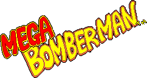

| Dump | MD5 | vs USA |
|---|---|---|
| USA | `514f6cad98f5f632d680983a050fffc4` | |
| Europe, Korea | `5a94b1e8792bb3572db92c2019d99377` | same code and data, 12 bytes shorter: see [Regions](#regions) |

Mega Bomberman is Westone's port of the PC Engine's Bomberman '94. The game calls its worlds **areas**; areas 1-5
have stages plus a boss, area 6 is the final area.

## RAM that matters

| Address | Meaning | Evidence |
|---|---|---|
| `$953A` | area being shown / played, 0-5 (the planet screen lets you scroll back to earlier areas); 6-11 = the battle-only stage sets | `$17A60`-`$17AB8`, `$112D0` |
| `$953B` | highest area reached, 0-5. Saved in the password | decode `$1BEC0`, encode `$1BA3C` |
| `$953C` | stage index in the area; set to the lowest stage not yet cleared (`$1899E`-`$189B4`) | Lua log after starting an area |
| `$953D` | stage-clear nibbles: low = stages cleared (bit n = stage n+1), high = stages whose clear has been shown on the map. After a clear `$C568` ORs the stage bit in; `$18D80` animates the seal piece when the nibbles differ | `$C584`, `$18D8C`, `$18FDC` |
| `$9543` | lives (a password start sets 3, `$1C274`) | dying took it to game over at 0 |
| `$9564`-`$9567` | password digits as shown, left to right; `$9568` cursor (0 = leftmost) | RAM diff while typing, `pwentry.lua` |
| `$A426`-`$A429` | stage timer: frames (6 per tenth), tenths, seconds, minutes; 60 frames a second in both regions | `$ACB6`, `$AC18` |
| `$62E` (ROM) | task pointers: 48-byte task records in RAM, `+0` next task, `+4` routine called each frame | `$5C0`, `$5F8` |
| `$9569` | high byte of the decoded number (area and stage bits) | `$1BE7C` |
| `$956C` / `$956D` | password accepted / rejected | `$1BF7A`, `$1BFBA` |
| `$956E` | the "all stages cleared" flag (password bit 5) | `$1BE46`, `$1BA80` |
| `$AED6`-`$AED9` | the password shown on the game-over screen, left to right | `$1BAD6` |
| `$AD02` | buttons newly pressed (with auto-repeat), all pads ORed: bit 0 Up, 1 Down, 2 Left, 3 Right, 4 B, 5 C, 6 A, 7 Start | `$10268` |
| `$AD0A + 8n` | per-pad records (`+2/+3` and `+4/+5` the two halves of the pad word) | `$102B6`, `$102E8` |
| `$A432` | player 1 object in battle and normal play: `+$1C` animation set (`$B590` for white Bomberman), `+$20` current animation script, `+$0A` sprite object (`$8AF4`) | RAM scan, `$130E`, `$1336` |

## The password

Code: `$1BD36` (entry screen input), `$1C024` (digits to number), `$1BE32` (check and load), `$1BA3C` (encode,
called by the game-over screen `$1B906`), `$1BB2C` (number to digits). `tools/mega/password.py` and
`tools/mega/password.mjs` reproduce both directions.

- 4 digits 0-9. Up/Down change the digit under the cursor (tables `$1BE00` / `$1BE0A`), Left/Right move the cursor
  (wraps), A, C or Start submit, B goes back to the title. Details under [Entering a password](#entering-a-password).
- The game reads the digits as a decimal number with the **leftmost digit as the ones**:
  N = d1 + 10·d2 + 100·d3 + 1000·d4 (`$1C024`). The game-over screen writes them back the same way (`$1BAD6`).
- Bits of N:

| Bits | Meaning |
|---|---|
| 0-4 | check: must equal bits 7-11 XOR `$16` (`$1BE5A`-`$1BE78`: `((N & $FF)·2 XOR $AC) & $3E` vs `(N >> 6) & $3E`) |
| 5 | all stages of the area cleared (boss open) |
| 6-9 | stage bits: the stages cleared, or with bit 5 set, the stages cleared **before the last one** |
| 10-12 | area 0-5 → `$953A` and `$953B` |
| 13 | ignored by the checker; the encoder never sets it |

- The checker also requires (`$1BE82`-`$1BF4E`): area < 6; area 6 (the final area) with no stage bits; area 1
  with stage bit 3 clear (it has 3 stages); without bit 5, not every stage bit set; with bit 5, exactly one stage
  bit clear. Then `$953D` = stage bits ×`$11`, or with bit 5, stage bits « 4 | `$F`.
- The encoder (`$1BA3C`) builds H = area « 4 | (low nibble of `$953D`, or the high nibble when every stage is
  cleared, setting bit 5), then N = H·64 + (((H XOR `$AC`) & `$3E`) » 1) + bit 5.
- Nothing else is saved: lives reset to 3, bombs/fire/power-ups to the starting values (`$1C258`).
- So a password stores the area plus *which* stages are cleared, not just a stage number. The game always
  clears them in order, so it only ever shows 5 codes per area (4 for area 1, 1 for the final area); the checker
  accepts every combination:
  - area 1: 7 partial clear sets + 3 boss codes; areas 2-5: 15 + 4 each; final area: 1 → **87 game states**;
  - ★ **New:** plus 24 alias codes with bit 13 set (N + 8192 ≤ 9999) → **111 valid codes** out of 10,000.
- Verified in BizHawk, both regions: all 10,000 codes put through the game's own checker (`fuzz.lua`, digits
  written to `$9564`, Start pressed) accept exactly the 111 codes `password.py` lists, with the same `$953B`/`$953D`
  for every one. 35 codes were also typed in with the pad and the area started (`codes.lua`); the AREA/STAGE intro
  showed the stage the codec predicts (`5120`: 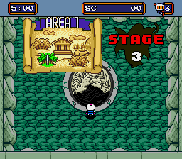), and the seal in the middle of the area hub shows one piece per stage cleared
  in a row from stage 1 (`$BF54`): 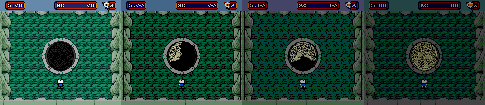 (2200, 6800, 5120, 7420)
- A wrong code shows the rabbit's X card and stays on the screen: 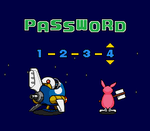
- The encoder was checked too (`gameover.lua`): starting from 14 codes, lives set to 0 and dying, the GAME OVER
  screen gave back the entered code for all 12 non-alias ones (in-order, out-of-order and every boss variant tried),
  and `8031` after `0059`, `2200` after `4128` (aliases come back in the game's own form): 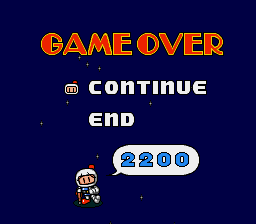

### Entering a password

Checked in BizHawk, both regions (`pwentry.lua`), and in the code (`$1BD36`, screen setup `$1C092`):

- The screen opens on `0-0-0-0` with the cursor (the arrows) on the **leftmost** digit: `$955C`-`$9579` are cleared,
  so all four digits and `$9568` start at 0. The cursor is drawn at x = `$44` + 40·cursor, so cursor 0 is the left digit.
- **Up/Down wrap**: Up goes 0→1→…→9→0 (`$1BE00` = `01 02 … 09 00`), Down goes 0→9→8→…→0 (`$1BE0A` = `09 00 01 … 08`).
  On the pad, Down from 0 gave 9 and Up twice from 9 gave 1. Holding a direction auto-repeats (60 frames of Up moved
  the digit 6 steps).
- **Left/Right wrap** too: Right `$1BE14` = `01 02 03 00`, Left `$1BE18` = `03 00 01 02` (Left from the first digit
  jumps to the last).
- Digit *k* on screen (left to right) is `$9564+k`, and `$1C024` weighs them 1, 10, 100, 1000. So the screen reads
  left to right like any number, but the value is the digits **reversed**: typing `1-5-0-3` gives N = 3051:
  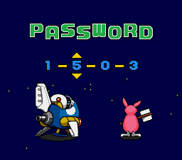
  Codes on this page and in the JSON are written as shown on screen, so type them left to right as printed; only the
  bit maths above uses the reversed value.

### The codes the game shows

GameFAQs lists 22 of these on its Genesis list and 25 on a list it labels TurboGrafx-16. All 22 Genesis codes are
right. The "TG16" list is the same set plus the three the Genesis list is missing, and every one of them is a
working Genesis code (**Fixed**: misfiled, not wrong).

| Area | Stage 1 | Stage 2 | Stage 3 | Stage 4 | Boss |
|---|---|---|---|---|---|
| 1 | `2200` (TG16 list only) | `6800` | `5120` | | `7420` |
| 2 | `4501` | `8111` | `7421` | `1051` | `3351` |
| 3 | `4502` | `8112` | `7422` (TG16 list only) | `1052` | `3352` |
| 4 | `6803` (TG16 list only) | `0513` | `9723` | `3353` | `5653` |
| 5 | `8114` | `2814` | `1134` | `5654` | `7954` |
| 6 | `0515` final area | | | | |

"Boss" codes open the boss in the area hub straight away (the intro is skipped and the boss is in the arena):
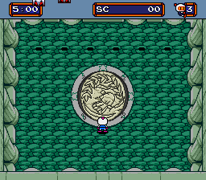

### ★ New: the other codes

**Other boss codes.** With every stage cleared, the game saves which stage you cleared last. These all start the
boss; the only difference is which seal piece the map counts as "not yet shown".

| Area | last = stage 1 | stage 2 | stage 3 | stage 4 |
|---|---|---|---|---|
| 1 | `7340` | `2730` | `7420` | |
| 2 | `7791` | `2191` | `7871` | `3351` |
| 3 | `7792` | `2192` | `7872` | `3352` |
| 4 | `9004` | `4493` | `9183` | `5653` |
| 5 | `1405` | `6794` | `1584` | `7954` |

**Out-of-order clears (stage skips).** The game never produces these, but it accepts them: the next stage is the
lowest one not cleared (`$189B4`) and the boss opens once every stage bit is set (`$17952`), so the stages marked
cleared are skipped. For example `5491` (area 2, stages 2-4 cleared) starts at AREA 2 STAGE 1, and `0881`
(stages 1, 3, 4) at STAGE 2: 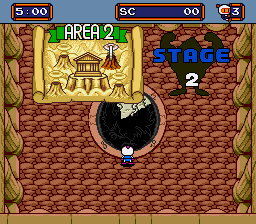

| Area | Cleared stages → code |
|---|---|
| 1 | 2: `1510` · 3: `6720` · 1,3: `0430` · 2,3: `5040` |
| 2 | 2: `3811` · 3: `8031` · 1,3: `2731` · 2,3: `7341` · 4: `2651` · 1,4: `6261` · 2,4: `1961` · 1,2,4: `5571` · 3,4: `6181` · 1,3,4: `0881` · 2,3,4: `5491` |
| 3 | 2: `3812` · 3: `8032` · 1,3: `2732` · 2,3: `7342` · 4: `2652` · 1,4: `6262` · 2,4: `1962` · 1,2,4: `5572` · 3,4: `6182` · 1,3,4: `0882` · 2,3,4: `5492` |
| 4 | 2: `5123` · 3: `0433` · 1,3: `4043` · 2,3: `9643` · 4: `4953` · 1,4: `8563` · 2,4: `3273` · 1,2,4: `7873` · 3,4: `8483` · 1,3,4: `2193` · 2,3,4: `7793` |
| 5 | 2: `7424` · 3: `2734` · 1,3: `6344` · 2,3: `1054` · 4: `6264` · 1,4: `0964` · 2,4: `5574` · 1,2,4: `9184` · 3,4: `0884` · 1,3,4: `4494` · 2,3,4: `9005` |

**Played through** (`skipthrough.lua`, both regions, identical screenshots): `0881` starts the area hub on STAGE 2.
Stage 2 was finished with the game's own clear routine (an idle task pointed at `$C4FC`, the code the exit calls).
That set `$953D` = `$DF`, the hub's seal filled in completely and the boss came down straight away. The boss fight was
then ended through the hub's own area-complete sequence (`$18DDC`), which advanced `$953B` to 2, cleared `$953D` and
showed the AREA 3 planet. Area 3 then started normally at stage 1. Left to right: hub on arrival (one seal piece),
boss after the clear, AREA 3 planet, Area 3 hub: 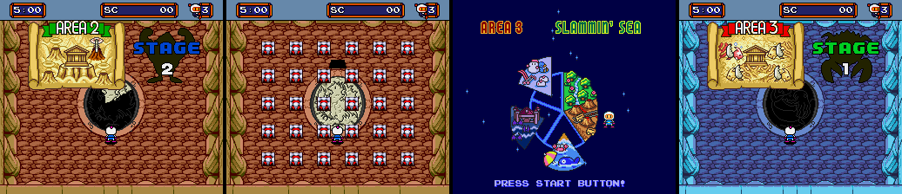
The boss itself was not beaten with bombs. Its first form takes 2 hits (`$A5D8`, routine `$15334`); forcing its
"hits = 0" branch (`$15368`) made it turn into its second form as normal, which was not followed further.

Oddities, none harmful:
- The seal counts cleared stages **in a row from stage 1** (`$BF54`), so with `0881` (1, 3, 4 cleared) the hub shows
  one piece, the same as `8111` (only stage 1 cleared). After stage 2 it jumps straight to the full seal.
- The hub's STAGE sign is a stage choice: Up cycles the stage index, Down picks EXIT (`$953C` = 6). With `0881` and
  `5491` Up offers all four stages, so the skipped stages can still be replayed. With `8111` it offers only stages 1-2,
  and with a boss code there is no choice. Replaying a stage already cleared uses the other exit routine (`$BFE4` →
  `$C054`), which does not count as a clear.

**Aliases.** Bit 13 of the number is never checked, so N + 8192 is the same state. Only states with N ≤ 1807 have
one, all in areas 1 and 2: `4128` `8728` `3438` `7048` `9348` `8648` `2358` `4658` `7958` `9268` (area 1, same
order as N) and `6429` `0139` `5739` `9349` `0059` `4659` `9269` `3969` `5279` `4579` `8189` `3889` `7499` `9799`
(area 2). The game never displays them.

`docs/mega_codes.json` lists all 111 with what each does.

## Hidden codes, menus and debug features

- **Fixed:** the GameFAQs sound test (title: Right, Left+Down, Down, Down+Right, II) is a Bomberman '94 code; II is
  a PC Engine button. The Genesis title menu (`$1A68C`) reads only Up, Down and Start (`$1A6A0`-`$1A6B4`), and there
  is no sound test in the ROM.
- No other button codes: every reader of the pad state (`$AD02` and the `$AD0A` records) was checked. Title,
  password screen, planet map and battle menus only handle their normal buttons; the in-game reads are the d-pad
  and the action buttons. Nothing reads the 6-button pad's X/Y/Z/Mode, and no code compares input against a
  sequence table.
- Battle setup has nothing locked: 2-4 combatants, single or tag (`$9541`, `$9540` bit 1, table `$10B28`), 1-5 games
  (`$9542`, table `$10C6C`), 9 characters (`$9E9C`, even values 0-16, Left/Right ±2 and Up/Down ±10 mod 18,
  `$10F4C`; animation sets `$B534`), and 10 stages (`$AD3F` 0-9, `$11294`), each mapped to a tileset by `$112FE` =
  `07 02 08 00 04 09 03 01 0A 0B`. The stage check `$112BC` always returns "allowed".
- No debug menu or test mode was found; the credits text at `$16A92` is the only plain ASCII in the ROM besides the
  header.
- Second, targeted pass: every RAM byte the code tests (`tst`/`btst`/`cmp` on `$8000`-`$FFFF`) was checked for a
  write anywhere in the code. Only 5 are never written by address, and all are fields of records written through a
  pointer (`$A44B` and `$A464` in the player record at `$A432`, `$A5DA` in the boss record, `$800D`/`$8017` the raw
  pad bytes read by the attract-mode timer at `$8246`). There is no dormant debug flag, so no IPS patch for this game.

## Unused content

- **Known (located here):** the known unused crying animations, one 2-frame loop for each of the 9 battle characters. They
  are in the player sprite sheets but **no frame points at them**. The player sprites come in 4 sets (frame table /
  DMA table, installed only by `$9840`-`$98BA`: `$EB6B4`/`$ECBC0` 184 frames, `$EC250`/`$EE6C8` 108,
  `$EDC6C`/`$EFA92` 173, `$EF17E`/`$F0D76` 102). Each frame's DMA list (`count, $FF`, then `source.l, length/8,
  VRAM tile`) names the 128-byte 16x16 pieces it copies. None of the 567 lists names the crying bodies, and no other
  long or 24-bit value in the ROM points at them (the few byte matches are inside compressed data), so nothing can
  play them. Found by matching the published GIFs against every piece in `$BD000`-`$D8000`, and drawn from the ROM by
  `tools/mega/cry.py`. All 9 match the published frames, apart from 1-5 pixels on 3 of them: 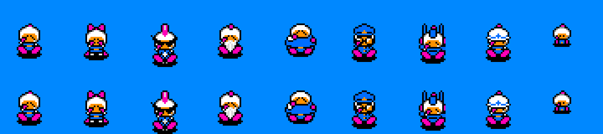

| # | Character | Head piece | Crying body, frame 1 / frame 2 |
|---|---|---|---|
| 1 | white Bomberman | `$BDC00` (used by set 0 frame `$11`) | `$BF500` / `$BF580` |
| 2 | bow | `$C1200` (set 0 `$61`, `$77`) | `$C2280` / `$C2300` |
| 3 | mohawk | `$C4A00` (set 0 `$B1`) | `$C4600` / `$C4700` |
| 4 | beard | `$C6480` (unused too) | `$C6500` / `$C6580` |
| 5 | fat | `$C8A00` and its mirror (unused too) | `$C8B00` + `$C8980` / `$C8900` + `$C8980` |
| 6 | cap | `$CF000` (set 2 `$87`) | `$D0400` / `$D0500` |
| 7 | antennae | `$D1480` (set 3 `$11`, `$2A`, `$2D`) | `$D2100` / `$D2180` |
| 8 | sailor cap | `$D4E80` (set 3 `$63`) | `$D5080` / `$D5A80` |
| 9 | small | (one piece) | `$CDD00` / `$CDD80` |

- ★ **New:** 25 more pieces in the same sheets that no frame uses (`tools/mega/unused.py` lists and draws them):
  `$BEA80` `$BEB80`-`$BED80` (a stick with a pink ball, some on a shadow), `$BFA00` `$BFA80` (a white head lying
  down), `$BFB00` `$BFB80` (white Bomberman's upper body with arms up), `$C0680`-`$C0780` (an egg-like shape with the
  same stick), `$C1D00`, `$C4180` (an orange arrow), `$C8180`, `$C9B80`, `$D1F00` `$D2080` (body pieces), `$D2B80`,
  `$D5B00`-`$D5D00` (sticks or legs). Most look like parts of other frames; what they were for is not known:
  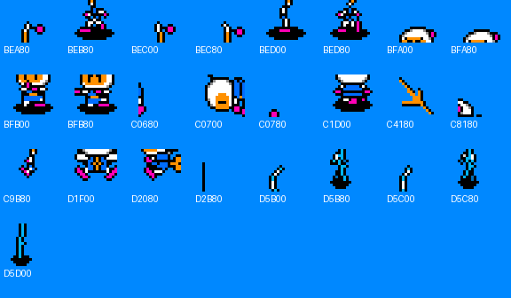
  Only the player sheets were swept. The rest of the graphics are compressed or loaded in bulk, and which of their
  tiles reach the screen was not tracked, so unused tiles and palettes there are still unchecked.
- ★ **New:** white Bomberman's animation block `$EC9E4`-`$ECAA4` (scripts are `duration, frame` pairs ending
  `FF 00` = loop or `00 00` = stop; ticked by `$1336`) has scripts no table or code points at: `$ECA5C` (frames
  `$2F`/`$30`, loop), `$ECA64` (`$31`/`$32`, loop), `$ECA6A` (`$33`, hold), `$ECA8C` (`$3D`-`$3F`), `$ECA94`
  (`$40`-`$42`), and the first frame of `$ECA6E` and `$ECA78` (the code at `$32BA`/`$32CA` starts both 2 bytes in,
  skipping frames `$34` and `$37`). Frames `$15`-`$18` are in no script at all. Shown in battle by writing the frame
  number to the sprite object and setting its "load tiles" bit (`+5` bit 4, which makes `$A1E` DMA the frame,
  `anims.lua`): a striped-shirt pose, sitting poses, sitting with a blue bubble, and back views:
   (`$2F` `$30` `$31` `$32` `$33` `$3D`-`$42`). What they were meant for is a
  guess; the other 8 characters' sets (`$B5D4`-`$B7B0`) have the same layout.

- ★ **An unused continue screen.** Graphics load through the list reader `$94D8` (directories at `$9554`). Its 63
  calls (fixed lists, menu and tileset tables, lists built in RAM) never name entry 2:`$14` (= 1:`$34`, `$A059E`).
  It is the continue screen's sheet (2:`$15`) with its colours renumbered, but with big outlined countdown digits in
  place of the small ones; the continue screen's frame table (`$DA7CC`, frames `$74-$7D`) builds them. Its palette
  2:`$1F` is never loaded either; renumbered the same way, its first line is the continue screen's palette. Digits
  on 2:`$1F`'s third line, a colour ramp, as the frames ask: 
- ★ **Bomberman '94's logo on the planet screen.** Maps 2:`$05`/`$06` (never loaded, like 2:`$03`, the starfield
  with 23 stars moved) are '94's maps for this screen, converted cell for cell. Their extra shape uses tiles
  `$600-$6F3`, which '94 builds by copying a sprite set into the background (`$9C02`); this game has neither the set
  nor the routine. With '94's tiles it is the start of the '94 logo on a cloud (logo colours a guess):
  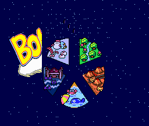
- ★ **A creature in the area 3 clear scene.** Graphics 1:`$1D` (loaded only by list `$198D0`, the crab boss scene)
  has two pieces, tiles `$5F8` and `$5FC`, that no frame table active there (`$DC3D8`, `$D9386`, `$DA5EA`, the
  players') and no map names: a round blue one-eyed creature in two frames (palette line a guess):
  

## Dead code

Tools: `tools/mega/callgraph.py` (static code map: recursive descent from the vectors, immediate and absolute
operands that point at clean 68000 code, long-pointer tables, plus "gap runs" = stretches the descent never reaches
that still decode as clean code ending in `rts`/`bra`/`jmp`; it can be re-seeded with addresses that ran),
`tools/mega/cover.lua` (routine coverage in BizHawk: one exec callback per candidate, dropped once it runs) and
`tools/mega/dead.py` (the join). Listing of every never-run candidate with its class, references and first
instructions: `disasm/mega/deadcode.txt` (USA addresses, Europe ones next to them; Europe is the same code shifted,
see [Regions](#regions), so its dead code is the same list).

The coverage runs (`tour2.lua`, `tour.lua`, `rooms.lua`) went through: power-on, the logos, the title and its
attract demo; Normal Game from the title, pause, game over and the continue screen; the password screen (typing, a
wrong code, B); a Battle Game on all 10 stages (4 combatants, single and tag, the time-up / draw ending on two of
them); every area from its stage-1 password with random input (areas 1-2: every stage cleared, the boss, the
area-complete sequence and the next planet); every room of the 15 multi-room stages (all 43 rooms; `rooms.lua`
moves on through the game's own room change `$9916`); the final area and the ending.

| | count |
|---|---|
| routine-level candidates (1,155 entries that are not plain branch targets, plus 536 gap runs) | 1,691 |
| ran in the tours | 814 |
| never ran, referenced by code (calls, `move.l #routine` task installs, jump tables): situations not covered | 463 |
| never ran, only referenced from other never-run code | 64 |
| never ran, gap run pointed at by a long in data (object tables of enemies and bosses not met) | 116 |
| never ran, inside a covered routine (a branch not taken) | 48 |
| never ran, the CPU exception handlers (`$200`-`$25A`, each loops forever: crash only) | 11 |
| gap runs that are really data (tables that decode as code) | 127 |
| **no reference anywhere** | 48 |

Not covered by the tours: a Team Player (more than 2 pads), the bosses of areas 3-5 and the final area fought to
the end, losing a life in the final area, battle wins and the winner screens (only draws), and most power-ups.

★ **New**, routines nothing references (read one by one; about half of the 48 start inside a data table, the rest
are real code):

- `$160A`: map cell under the camera (`$9EFA`/`$9EFE` ÷ 16 → `$9F08`/`$9F09`), a third sibling of `$15E6`
  (an object's cell) and `$15F8` (own cell), which are both used. Unreferenced helper.
- `$3EC4`: looks up to 3 cells ahead in the facing direction (`+$13`, step table `$3F0C`) for cell type 1 and
  returns carry; `$3F14` does the same for 1 cell. Unreferenced player helper.
- `$A87A`: starts a palette task (`$A8C2`, 8 steps through `$A904`/`$94B2`) with a given speed and table.
  Unreferenced (the game's fades use other entries).
- `$10B5C`: a battle-player loop clearing bits `$50` of `+$2D`, twin of the used `$10B74` (`$F0`) and `$10B8C` (all
  bits). Unreferenced variant.
- `$112E0`: a battle-menu sprite setup (`$109FA`, `$10E64`, then sprite `+8`/`+9`/`+$B`). Unreferenced.
- `$8090`, `$8138`, `$7FC2` are **not** dead: they are the Team Player reader (`$7ED4` in the device table at
  `$7EC8`, entered with `jsr $7EC8(pc,d0.w)`, so the static pass could not follow it) and its sub-device paths; the
  game uses Sega's usual peripheral-ID scheme (`$7EE8`) and only plain pads were plugged in.
- No debug menu, test mode or developer leftover is among them.

## Input codes

`tools/mega/padscan.py` lists every instruction that touches the pad RAM (`$AD02`-`$AD39` and the raw device
records `$800A`-`$805A`) with what follows it: `disasm/mega/padreads.txt`, 99 sites. The only compares are the
device-type checks of the reader (`cmpi.w #2`, `$8114`) and the title timeout (`cmpi.w #$F0, $AED0` next to a
Start test, `$92BE`); everything else tests single bits of the normal buttons. In the whole program there are 12
compares against an indexed or post-incremented table operand, and none is within 40 instructions of a pad read.
So the earlier result stands, now checked systematically: **no hidden button code** (known: the GameFAQs sound test
is the Bomberman '94 one, see above).

## Unset flags

`tools/mega/flags.py` takes every RAM byte the code tests or reads (`tst`, `btst`, `cmp`, any source operand, over
the 23,172 instructions of the code map re-seeded with the coverage) and looks for any write to it by address,
widened by the operand size; `lea`/`move.l #` bases count as records written through a pointer.

- 490 addresses are read, 48 never written by address. 45 are fields of pointer-written records (player records
  `$A432` + 48 n, boss and object records from `$A572`, task records, the VDP register copies `$F004`-`$F028`, the
  device records `$800A`, the password digits `$9564`), and `$8870` is a misdecoded table.
- ★ **New:** `$AABC` bit 0 is tested at `$6050` and nothing writes `$AABC`. In an object routine (`$5FC4`, its
  moving branch `$601E`) it switches the sprite depth from the fixed `$F8` to one computed from the Y position (the
  formula `$C7C0` always uses). Never set, so that object always draws at fixed depth. The branch ran once in a battle
  during the coverage tour and could not be brought up again on purpose, so the effect of setting it was **not**
  seen on screen.
- ★ **New:** `$ADD8`/`$ADD9` are only read (`$197DC`, added and range-checked), never written; that routine never ran
  in the tours, so what it belongs to is not known.
- No dormant debug or cheat flag, so still no IPS patch.

## Text

- ★ **New:** the only encoded text is the ending's staff roll at `$16A8C` (Europe `$16A86`), read by `$16880` /
  `$1691E`: blocks of `flags, wait, show`, then `01 row col` (cursor), `#` + hex digit (palette), `20` blank and
  `A`-`Z`, each letter 2 tiles (`(c - $41) * 2`, + `$80` for the other font) on plane A at `$E000`; `80 n` waits,
  `81` ends. `tools/mega/text.py` decodes it: `disasm/mega/text.txt`, 21 blocks. The reader has no branches, so
  every block is shown: **no unused text**. The spellings are the ROM's ("PROGRAMERS", "KESUKE MATSUURA").
- Everything else on screen (menus, planet names, PASSWORD, PAUSE, TIME UP, DRAW GAME, the AREA/STAGE signs) is
  graphics: 10 of those words searched in ASCII and in 8- and 16-bit relative encodings were not found. Whether the
  (compressed) graphics hold unused words was not checked.

## Maps

★ **New:** the stage format, decoded by `tools/mega/maps.py`.

- Table `$EB556` (shared by both versions): 59 entries of 6 bytes = data pointer, height, width (cells). `$953F`
  picks the entry: stage rooms = `$998C[$9984[area] + stage] + room` (`$9966`, room `$953E`), hubs = area + `$2B`
  (`$BE9E`), battle stages = `$31` + stage (`$112BC`), and `$30` for the scene at `$127C2`.
- Data: LZSS (`$CF4`/`$D4C`), bits MSB first; `1` + 8 bits = literal, `0` + 8-bit window position + 4-bit length (+2)
  = copy; 256-byte window from `$EF`. One byte per cell into `$955C`: the index of a 2x2-tile cell in the tileset's
  cell table (`$9E6C`, 4 name-table words per cell). The decoder output matches RAM (battle stage 1).
- `$00`-`$2A` are the 43 rooms of the 22 stages (16x13, 32x13 or 16x26 cells), `$2B`-`$2F` the area hubs, `$31`-`$3A`
  the 10 battle stages. All were seen in play.
- `$30` (16x26, lower half filler) is the only one not seen: `$127C2` loads it with a tileset of its own (`$C`) when
  a life is lost in the final area (`$3260`), but in play the room restarted straight away. Drawn as a schematic.

Every map, drawn with the game's own tiles from VRAM dumps of each tileset (`mapdump.lua`), file name = map id,
title = id, data address, size and use: `img/mega/maps/map_XX.png`; all on one sheet: 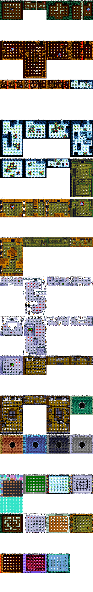

## Cheat codes

★ **New** (neither prior-art page has any). Game Genie codes made with `tools/mega/gg.py` and checked through
BizHawk's own cheat system (`client.addcheat`, `cheats.lua`), with and without the code, in both versions. The Pro
Action Replay column is the same ROM word as `AAAAAA:VVVV`; BizHawk's `client.addcheat` takes Genesis Action Replay
codes for RAM only, so those ran the same tests with the word written to `MD CART` every frame (same results):

| Code (USA) | Code (Europe) | Effect | Patch | Checked | Pro Action Replay |
|---|---|---|---|---|---|
| `HA3A-AYWC` | same | Infinite lives | `$3242` `subq.b #1,$9543` → `tst.b` | own bombs, 2400 frames: 3 lives lost without, none with | `003242:4A38` |
| `AJ2A-AAB2` | same | Invincible | `$3038`: the hit check `$3032` always says "not hit" | own bombs, 1200 frames: 2 lives lost without, none with. Player held on each of the 8 enemies of area 1 stage 1 for 120 frames: a life lost on each without, none with. Battle Game (2 players on their own bombs): both die every round without; with it nobody dies, closing-in blocks included, and the round only ends at time-up. Every death in these runs went through `$30A4`, behind the check | `003038:0002` |
| `HC0A-AYZ0` | `HC0A-AYZT` | Clock stops | `$ACB6` (Europe `$ACB0`) frame counter `subq` → `tst` | 600 frames: 3:57 stayed 3:57 | `00ACB6:4A38` (Europe `00ACB0:4A38`) |
| `HCXT-DEV6` `DJV6` `DNV6` `DTV6` `DYV6` | `HCXT-DEV0` `DJV0` `DNV0` `DTV0` `DYV0` | Normal Game starts at area 2, 3, 4, 5, 6 | `$1A73C` (Europe `$1A736`) `clr.b $953B` → `addq.b #n,$953B` | all five from the title: planet map shows AREA n, play starts in that area's first stage (`$953A` = n-1, map `$04`, `$0B`, `$13`, `$1C`, `$25`; area 6 after the final-area intro scene). Use from power-on (it adds to the old value) | `01A73C:5238` `5438` `5638` `5838` `5A38` (Europe `01A736:...`) |

Battle Game has nothing locked (see above), so there is no unlock code.

## Unused sounds

- ★ Sounds go through `$34B6` (197 callers) to `$B84E` (EU `$B848`), queued for the Z80 at `$A01C30`; the Z80 table at
  `$FA1EF` has IDs 00-9B (88-9B are silent). The call sites and the tables at `$4B58`, `$69B2`, `$9C74` and `$C868`
  never give 2E, 43, 55 or 63: 2E is a three-second effect in parts, 43 a short sound that runs into 42's data, 55 a
  short high blip, 63 a short low one. Every tune is used.

## Regions

- The two ROMs have the same graphics, data and passwords. Bytes `$40000`-end are identical; below that the
  Europe/Korea code is the USA code minus two pieces, with every later address shifted:
  - USA `$7C4A` `movem.l $0.w, a7` (reload the stack pointer from the reset vector before entering the main loop at
    `$9368`) is missing in Europe;
  - USA has 6 dead bytes after `$1E754` (a duplicate `ori #1, ccr / rts` tail).
- The password fuzz, the typed codes, the game-over encoder test, the password entry test and the 0881
  play-through gave identical results in both. Screen by screen, the password screen (empty and typed), the area
  hub, a stage, the boss, the planet map and the next hub and stage were pixel-identical in both ROMs. The text is in
  the shared data, so every screen's text is the same.
- **50 vs 60 Hz:** neither ROM reads the PAL bit (bit 6 of `$A10001`). The only console check is bit 7 (export vs
  Japanese) at `$83C0`, which on a non-Japanese console writes two extra tiles (`$30`, `$31`) to plane A at VRAM
  `$E630` (row 12, column 24). The stage timer counts fixed frames (`$ACB6`: 6 frames a tenth, 60 a second), so on a
  50 Hz console the Europe version's 5:00 lasts 6:00 of real time and the game runs at 5/6 speed. Nothing in the code
  adjusts the music tempo either, so it should play at 5/6 speed too. Not seen on a PAL machine: BizHawk ran both ROMs
  at 60 Hz (the header says `JUE`).
- The title screen is pixel-identical in both, so there is one logo: `img/logos/mega_us.png`, ripped from the
  title screen's VRAM/CRAM (`vdpdump.lua`, `logo.py`): plane at VRAM `$E000`, palette line 2, keeping only the
  letter colours (the comet streak shares the same cells) with colour 0 transparent.
