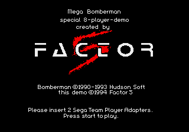
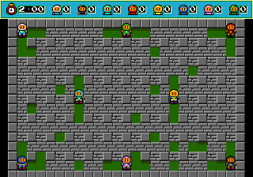
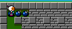
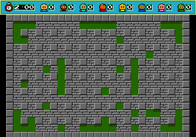
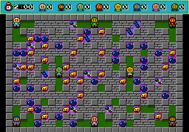
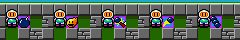

# Mega Bomberman – Special 8-Player Demo (Mega Drive, Europe, prototype)

Everything here comes from a linear 68000 disassembly of the ROM (`tools/m68k.py`; output in `disasm/mega8/`:
`demo.asm` is all of the game code, `$200`-`$37B2`, and `sound_head.asm` the start of the sound driver at `$D8000`)
and checks in BizHawk 2 (Genesis Plus GX core) with the Lua scripts in `tools/mega8/`
(`SCRATCH=dir run.sh script.lua tap|tap1|pad`; run `players.lua` first, it saves the battle state the others load).
RAM addresses are offsets from `$FF0000` (the game keeps `a6` = `$FF0000`). Prior art (a published article and the
GameFAQs page in `res/`) does not mention this demo at all, so every finding here is marked **unchecked** against it.

| Dump | MD5 | vs retail Europe |
|---|---|---|
| Special 8-Player Demo (Europe) (Proto) | `e4392bd5e77321e8ec6e76a142e9536b` | a different program: no 32-byte run of code or data in common |

## What it is

The boot screen says (in English, nothing to translate): "Mega Bomberman / special 8-player-demo / created by
FACTOR 5 / Bomberman ©1990-1993 Hudson Soft / this demo ©1994 Factor 5 / Please insert 2 Sega Team Player Adapters.
Press start to play." It is not a cut of the retail game (Westone's port) but a small separate program by Factor 5:

- **Code is 14 KB** (`$200`-`$37B2`). The rest of the 1 MB is three uncompressed graphics resources (directory at
  `$10000`: splash `$1000C`, sprites `$18892`, arena `$2031C`), a fixed arena layout table (`$E94`), PCM samples
  (`$C8100`-`$CED7E`) and a sound driver with its own ID string **`AUDIOS WAVE SLAVE MD`** at `$DA192`
  (driver `$D8000`-`$DAFAB`). 151 KB of zeros end the ROM, and `$30000`-`$C8000` is empty too.
- The header is blank apart from `SEGA MEGA DRIVE` and a correct checksum (`$E777`): no title, date, serial or
  region. The only build/date text is the bitmap on the splash ("this demo ©1994 Factor 5").
- **No menus, no modes.** Start on the first pad at the splash (`$256` waits for bit 7 of `$2F4`) goes straight
  into one battle. There is no title screen, Normal Game, Battle Game setup, password screen, character choice,
  stage choice, CPU players, timer, round end or winner.
- **One arena**, 25 x 17 cells (23 x 15 inside the wall) shown at 12 x 12 pixels a cell, about twice the area of a
  retail battle stage. To fit it, positions are in quarter pixels (48 units a cell) and the HBlank handler chain
  `$1124`-`$1456` rewrites the vertical scroll every few lines to squash the 16-pixel-tall tiles to 12.
- **Eight players**, the same Bomberman in 8 colours (white, black, teal, red, yellow, blue, pink, green), starting
  at cells (1,1) (12,1) (23,1) (7,8) (17,8) (1,15) (12,15) (23,15) (table `$1458`).

### Rules (from the code, checked in play)

- Start: 1 bomb, fire 2 (`$14E0`). A drops a bomb (edge-triggered, `$162A`); the fuse is 150 frames (`$224A`).
  B and C do nothing. Flames stop at bricks, destroy items they hit, and set off other bombs.
- **Items** under bricks (`$3554` table, placed by `$3566`): bomb up `$10`, fire up `$11`, kick `$12`, line bomb
  `$14`. Kick (`$24`) starts a bomb sliding when you walk into it (`$168C`). Line bomb (`$28`): A while standing
  on your own bomb lays all your remaining bombs in a line ahead (`$20F6`; with 4 bombs, 3 were laid in the 3 free
  cells): 
- Dying (standing in fire, `$1592`) plays a 96-frame animation (`$1B3C`), then the player's extra bombs, fire,
  line bombs and kicks are thrown back onto random free cells one per frame (`$1BDC`) and the player is gone.
- **The game never ends.** The HUD (clock `2:00` and a 0 next to each face) is part of the arena picture and no
  code updates it: after 70 s idle it was unchanged, and with all 8 players dead the empty arena just stays
  (`idle.lua`, 30 s more). You have to reset to play again. 
- **Same arena every time.** The random number seed is a constant (`$27DE`, `$434`) and only arena setup and
  item drops advance it, so the 16 bricks it clears and the hidden items are identical on every boot (pixel-equal
  arenas with Start pressed on different frames). All hidden items drawn over their bricks (`itemmap.lua`):
  27 bomb up, 27 fire up, 7 kick, 4 line bomb (the table asks for 32/32/7/4, but the placer can pick the same brick
  twice): 

## 8-player input

Code: `$2FF8` (port setup), `$3068` (read, every VBlank), `$30A0` (one port), `$31D2` (device jump table),
`$34FE` (plain pad), `$1E46` (pad words to players).

- Only the **Sega Team Player** protocol is supported, one in each control port (`$A10003` then `$A10005`; both
  ports' TH and TR are outputs, `$60` in `$A10009`/`$A1000B`). The EA 4-Way Play is not supported: the only values written to the port
  data registers are the Team Player's TH/TR handshake (`$30`, `$70`, `$10`, `$20`, TH set/clear), never the
  4-Way Play's selector values.
- Per port, `$30A0` reads the ID with TH high and low and wants `$73`/`$3F` (`cmp.l #$73003F`). Then it clocks
  nibbles by toggling TR and waiting for TL (timeout `$FF` tries), reads the 4 sub-port type nibbles, and calls
  per type: 0 = 3-button pad `$3212` (2 nibbles), 1 = 6-button pad `$32A6` (reads 3, keeps the 3-button part),
  2 = mouse `$337A` (6 nibbles, thrown away), anything else (`$F` = empty) nothing.
- Without the ID, the port is read as one ordinary pad (`$34FE`).
- Results go to 8 words at `$2F4`-`$302`, bit 0 Up, 1 Down, 2 Left, 3 Right, 4 B, 5 C, 6 A, 7 Start, active high.
  **They are packed**: a mouse, an empty Team Player socket or a missing device stores nothing, so the next pad
  takes its slot. Player n is simply the nth pad found, port 1 first. `$1E46` copies word n to player n's record
  (`$1A4` + 42n: `+0` buttons, `+$10`/`+$12` x/y, `+$20` bombs, `+$22` fire, `+$24` kick, `+$26` unused item,
  `+$28` line bomb, `+8` routine: `$152E` alive, `$1B3C`/`$1BDC` dying/dead).
- Players without a pad still stand in the arena and can be bombed.

Verified in BizHawk: GPGX can plug a Team Player into each port (sync setting `ControlType` 4, buttons `P1`-`P8`).
`run.sh` passes BizHawk a copy of its config with that set (`--config`), so the installed config is untouched.
`players.lua` pressed each pad in turn and logged who moved:

| Setup (`run.sh` mode) | Pads that move someone |
|---|---|
| Team Player in both ports (`tap`) | P1-P8 each move players 1-8 |
| Team Player in port 1, pad in port 2 (`tap1`) | P1-P4 → players 1-4, the port 2 pad → player 5; 6-8 idle |
| Two plain pads (`pad`) | players 1 and 2; 3-8 idle |

The 6-button and mouse paths were not tried (BizHawk's Team Player sockets are 3-button pads).

## Shared with retail, passwords

Nothing. No 32-byte run of the demo appears anywhere in retail Mega Bomberman (Europe), graphics included, and the
code has no Normal Game, no password screen and no password checker or encoder, so `tools/mega/password.mjs` does
not apply and there is nothing to fuzz. The retail RAM map in `mega.md` does not apply either.

## Hidden things and leftovers

- **Unused item `$13`.** The pickup code counts it (`$15DE`, player `+$26`) but nothing ever reads `+$26` and the
  item table never places it. Its graphic is in the arena tiles: a blue panel with a bomb and a yellow lightning
  bolt (maybe a remote control; that is a guess). Put on the floor with the game's own cell format and walked over
  (`items.lua`), it raised only `+$26`. Left to right: `$10` `$11` `$12` `$13` `$14`: 
- **Sound driver extras** (from the code only, not listened to): the game uses driver calls 0-6 but never `$D801C`
  (`$D8140`: play song 3 for `$180` frames, then go back) or `$D8020` (`$D81D4`, resume). Its effect table
  (`$DA1D2`, 10 entries) has samples 0-6; the game plays entries 1, 2, 4 and 6 (explosion, death, bomb laid, item),
  so entries 7-9 (samples 4-6) are never triggered. Only module 0 exists; table slots 1-5 (`$DA16E`) point at the
  end of the data.
- **Development leftovers** (not referenced by anything): `$212` stores the VBlank/HBlank addresses into the vector
  table at `$78`/`$70` (only useful when the program runs from RAM, as on a development kit) and restarts; `$280`
  turns the display off and executes `ILLEGAL` (`$4AFC`, a breakpoint trap).
- **Sprite overflow hang**: `$1F8A` loops forever (`bra.b $1F92`) if more than 63 sprites are queued.
- Palette 0 colour 8 is stepped through a colour cycle every frame (`$35DA`). No background cell uses it; bombs and
  burning bricks are sprites on palette 0, so it is probably their flash (not checked).
- PAL: the driver is told the console is 50 Hz (`$40C`, VDP status bit 0, call `$D8014`), but the game itself counts
  fixed frames, so play would run at 5/6 speed on PAL. Not seen on a PAL machine.
- No debug menu, button codes or locked content: the only pad reads are the splash's Start and the players'
  d-pad and A.

## Dead code

The whole program (`$200`-`$37B2`) was mapped with `tools/mega/callgraph.py` and run with routine coverage
(`tools/mega8/cover8.lua`, which uses `tools/mega/cover.lua`): power-on, the splash, Start, then 3,000 frames of
random input on all 8 pads, once with two Team Players and once with two plain pads. Listing:
`disasm/mega8/deadcode.txt`.

| | count |
|---|---|
| routine-level candidates (entries that are not plain branch targets, plus gap runs) | 93 |
| ran | 76 |
| never ran but referenced: the 6-button and mouse readers (`$32A6`, `$337A`) and the empty-socket `rts` (`$34FC`) from the device table `$31D2` (no such devices in BizHawk's Team Player); line bomb `$20F6` and the flame effect `$256C`/`$2592` (called from the flame code `$2894` and 7 more), which random play did not trigger | 7 |
| never ran, boot code that runs before the coverage starts (`$28E`, `$35FC`, `$36DC`) or `#$2500, sr` immediates that only look like pointers | 5 |
| exception handler `$200` (loops forever) | 1 |
| **no reference anywhere** | 4 |

The 4 unreferenced pieces:

- `$212` and `$280`: the development leftovers described above (vector writer, `ILLEGAL` breakpoint).
- ★ `$30C`-`$360`: a **CPU-time meter**. It sets the backdrop colour (CRAM 0) to red (`$00E`), waits 16 `nop`s,
  sets it back to black, waits again and returns, the usual way to see on screen how much of a frame the code uses.
  Nothing calls it.
- ★ `$22A4`-`$22D0`: a second way to start a sliding bomb: it sets the bomb's routine to `$22D2` (the slide the kick
  uses), resets the fuse to 150 frames and snaps the position to the 48-unit cell grid. The kick code (`$16A8` and
  3 copies) sets `$22D2` directly and keeps the fuse running, so this entry (a kick that relights the fuse?) is
  unused.

## Input codes

The pad words `$2F4`-`$302` are read in three places: the splash's Start test (`$256`), the copy into the player
records (`$1E46`, which makes `+0` = newly pressed and `+2` = held) and the reader that fills them (`$3050`-`$3076`).
The player records' pad words are read only by the player routine: `$161E` (A, bit 6) and `$165A` (the d-pad,
bits 0-3). No compares against constants or tables, no counters: **no input code** (unchecked: no prior art).

## Unset flags

`tools/mega/flags.py` with `A6=1` (the demo addresses its variables as `$x(a6)`) finds 15 tested RAM addresses, all
written somewhere (the one hit, `$2442`, is a pointer slot inside a record block). A second pass over record fields
(`d(aN)` reads and writes per register and offset) finds only write-only fields; the one of interest is the known
player `+$26` (the unused item `$13`, counted at `$15E6`, never read). No flag that is read but never set.

## Text

Nothing to decode: the only strings in the ROM are the header (`SEGA MEGA DRIVE`) and the sound driver's ID
`AUDIOS WAVE SLAVE MD`. The splash text and the HUD are bitmaps in the graphics resources.

## Maps

There is one arena, built from the fixed layout table `$E94` and the fixed random seed, so the arena and its
hidden items are the same on every boot; both are already drawn above (`img/mega8/battle_8p.png`,
`img/mega8/item_map.png`).

## Cheat codes

★ Game Genie codes (made with `tools/mega/gg.py`), all checked in BizHawk's cheat system (`client.addcheat`,
`tools/mega8/cheats8.lua`: boot with the code, start the battle, read player 1's record and count the hidden items):

| Code | Effect | Patch | Checked |
|---|---|---|---|
| `CN4T-AADC` | The 4 line bombs under bricks become the unused item `$13` | item table `$3562`: `$14` → `$13` | items: `$13` x4 instead of `$14` x4 |
| `PNLA-BE0E` | Every player starts with kick | `$14C4` `clr.w $24(a3)` → `addq.w #1` | `+$24` = 1 |
| `PNLA-BE0N` | Every player starts with line bomb | `$14CC` `clr.w $28(a3)` → `addq.w #1` | `+$28` = 1 |
| `BALA-AAHC` | Start with fire 8 | `$14E2` = 8 | `+$22` = 8 |
| `BALA-AAHJ` | Start with 8 bombs | `$14E8` = 8 | `+$20` = 8 |

## Logo

`img/logos/mega8_eu.png` (top). The demo has no Mega Bomberman logo; its on-screen title is the two text lines at
the top of the splash. Ripped from the splash VRAM/CRAM (`vdpdump.lua`, `logo.py`): plane A at `$C000`, palette
line 0, colour 0 transparent, cropped to the first two text lines.
