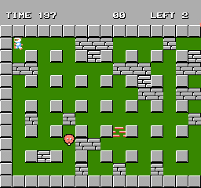
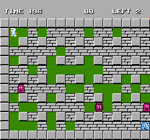
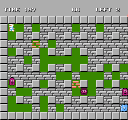
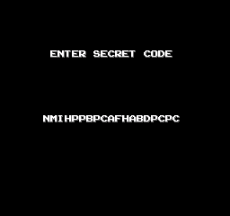
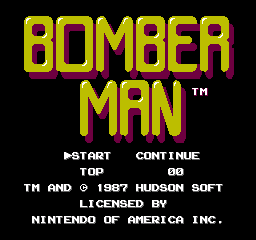
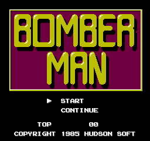
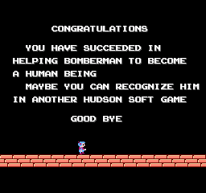
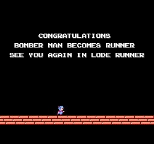

# Bomberman (NES / Famicom, 1985/1987): passwords and secrets

Everything here comes from disassembling the carts (`tools/m6502.py`, a small recursive-descent 6502 disassembler
shared with Bomberman II, with coverage grown from Mesen 2 code/data logs; listings in `disasm/nes1/`) and checking
the results in Mesen 2 (`tools/nes1/run.sh` runs a Lua script headless with `tools/nes1/lib.lua` prepended, output in
`$SCRATCH`). The PRG is one 16 KB bank at `$C000`; RAM is `$0000-$07FF`. US addresses unless a version is named.
Prior art: the GameFAQs codes pages for the NES game and for the Game Boy Advance Classic NES Series re-release (the
same list, all platforms mixed in) and a published article on the game, all in `res/`. Marks: ★ **New** (in none of them),
**Fixed** (prior art is wrong or incomplete), **Known** (prior art has it; the mechanism is added here).

| Dump | MD5 | vs US |
|---|---|---|
| USA | `775f664b177e561b34615614d160dfb7` | |
| Japan | `64c3903224298ca9972991ea6a2b22a4` | 12,033 bytes differ (586 of them in CHR). The password code and tables, the stage tables and the item code are the same; most of the code sits 8 bytes lower (the decoder is at `$DB72`, the encoder at `$E291`). The title screen and the ending text differ (see [Regions](#regions)) |

Both headers are iNES NROM, 16 KB PRG + 8 KB CHR. The Famicom Disk System version that GameFAQs and the article also cover was
not available, so nothing here is checked against it; its GameFAQs codes are the same strings as the cart codes.

## RAM that matters

| Address | Meaning | Evidence |
|---|---|---|
| `$01-$07` | top score, one decimal digit per byte | `$DDB9` |
| `$12` / `$13` | pad 1 / pad 2, read twice per frame and zeroed when the reads differ: `$80` A, `$40` B, `$20` Select, `$10` Start, `$08` Up, `$04` Down, `$02` Left, `$01` Right. Play reads `$12 OR $13` (`$CFA4`), so pad 2 steers Bomberman too (from the code) | `$C1BF`, `$C19D` |
| `$58` | stage (1-50; the password takes 0-255) | `$C4DE`, `$DBF6` |
| `$59` | non-zero in the attract demo | `$C3D9`, `$C4BF` |
| `$5B` | this stage's item (1-8) | `$C5F5` |
| `$5C` / `$5D` / `$5E` | dying / dead / stage clear | `$C6FF`, `$CC60`, `$CCA1` |
| `$61-$67` | score, 7 decimal digits, `$61` the top one; the screen adds `00` | `$DD8D` |
| `$68` | lives (shown as LEFT; +1 per stage cleared, `$C4DC`) | `$C498` |
| `$73` | fire (blast length) << 4: `$10` at the start, +`$10` per fire-up up to `$50` | `$CF1A` |
| `$74` | bombs - 1 (0-9) | `$CF0D` |
| `$75` | speed (non-zero: a step every frame instead of 3 frames in 4) | `$CCA4` |
| `$76` | wall pass, only when it is exactly 1 (`LDA $76 / EOR #$01`) | `$CF7D` |
| `$77` | detonator (B sets bombs off) | `$CCDC` |
| `$78` | bomb pass | `$CF45` |
| `$79` | flame pass (fire immunity) | `$C6E5` |
| `$7A` | mystery item: invincible to fire and enemies while non-zero (counts down) | `$C6E9`, `$D06F`, `$CC44` |
| `$94` | reveal: non-zero draws the hidden exit and item as marked bricks | `$CB1B` |
| `$7F-$92` | the 20 password letters (as nibbles) while decoding | `$DB54` |
| `$0180-$01A8` | the 20 encoded letters at the game over (every other byte) | `$E319` |
| `$0200-$039F` | the 13 x 32 map, one byte per cell | `$CA72` |

## The password

Code: `$DA8E` (ENTER SECRET CODE screen), `$DB7A` (decoder), `$E2BD` (encoder, from the GAME OVER screen `$DD3E`).
Tables: the letters `$E388` (`AOFKCPGELBHMJDNI`, nibble → letter), their inverse `$DFA0`, and the list of 20 RAM
addresses `$E360`. `tools/nes1/password.mjs` does both directions; `node tools/nes1/test_password.mjs` round-trips
65,536 states.

- **20 letters A-P.** Each letter k is a nibble l[k] (its place in `AOFKCPGELBHMJDNI`). The decoder chains them:
  **v[k] = (l[k] + l[k-1] + 7) & 15**, with l[-1] = 0. The encoder runs it backwards (`$E30A`).
- **Four checks**: v4, v9 and v14 are the 4-bit sums of the four values before each; v19 is v15 + v16 + v17 + v18
  plus twice v4, v9 and v14 (`$DB93-$DBCA`). A wrong check sends you back to an empty entry screen.
- **The other 16 values go straight to RAM, with no range check** (`$DBCF`):

  | v | RAM | | v | RAM | | v | RAM | | v | RAM |
  |---|---|---|---|---|---|---|---|---|---|---|
  | 0 | `$67` score digit 7 | | 5 | `$66` digit 6 | | 10 | `$74` bombs-1 | | 15 | `$65` digit 5 |
  | 1 | `$77` detonator | | 6 | `$73` fire (high nibble) | | 11 | `$63` digit 3 | | 16 | `$94` reveal |
  | 2 | `$58` stage, low nibble | | 7 | `$64` digit 4 | | 12 | `$75` speed | | 17 | `$58` stage, high nibble |
  | 3 | `$61` digit 1 (top) | | 8 | `$79` flame pass | | 13 | `$62` digit 2 | | 18 | `$76` wall pass |

- So a code holds the **stage, the score and six power-ups**. **Bomb pass (`$78`) and the mystery item are never
  saved**, and lives always restart at 2.
- **Every state has exactly one code** (16 free nibbles, 2^64 valid codes, 1 in 65,536 letter strings), so the code
  the game shows is the only one for that state. The game itself only shows codes at a game over, after a death has
  cleared wall pass, detonator, bomb pass and flame pass (`$C485`).

### What the missing range check allows (★ New)

| Value | Effect | Checked |
|---|---|---|
| fire 0-15 | blast length 0-15 (the game stops at 5) | RAM read back in Mesen |
| bombs 1-16 | 1-16 bombs (the game stops at 10) | RAM read back |
| speed, detonator, flame pass 1-15 | any non-zero value is on (`BNE`/`BEQ` tests) | code |
| wall pass 2-15 | **off**: only exactly 1 works (`EOR #$01`) | code |
| reveal 1-15 | the exit and item cells are drawn as marked bricks until bombed | Mesen screenshots |
| score digits 10-15 | drawn as garbage tiles (`img/nes1/score_digits_over_9.png`) | Mesen |
| stage 0 | plays | Mesen |
| stage 51 | freezes after the map is drawn: the enemy row comes from past the stage 26-50 table (`$D802` + 250: types `$86`, `$24`, `$84` ...) | Mesen |
| stages 53, 59, 74, 104, 131, 243 | play (some are GameFAQs "secret" levels); item and enemies come from past their tables | Mesen |
| stages 96-103, 224-231 | **hang** on the STAGE screen with NMIs off (`img/nes1/stage97_hang.png`) | Mesen: 96, 97, 100 hang, 90 and 95 build |

Why the hang: the arena is built from row templates (`$CA72`) and then `$CA4B` puts the item, the exit and
**50 + 2 x stage** soft blocks (an 8-bit sum) on random free cells, retrying until a cell is free (`$CACF`). There are
246 free cells. In Mesen stage 95 (240 blocks) built after 75,814 tries; stage 96 (242) never finished. Stage 103 and
231 overflow the count to 0, which `DEC` turns into 256.

  

### Codes verified

Every code in `docs/nes1_codes.json` was **typed with the pad** in Mesen from the CONTINUE screen
(`tools/nes1/test_codes.mjs` + `test_codes.lua`: the screen is saved once and reloaded per code), and the RAM above
read back and compared with `password.mjs`: all 64 GameFAQs codes in US and JP, plus the codes below. GameFAQs is
right about every code except as noted:

| Code | GameFAQs says | It is |
|---|---|---|
| `NMIHPPBPCAFHABDPPCCH` | swap the 3rd and 4th letters from the right of any code to show the exit and item | **Fixed**: the swap keeps the checksum (v16, v17, v18 change by +d, 0, -d) but adds d to reveal and takes d from wall pass. It does nothing when the two letters are equal, and it can turn wall pass off (here wall pass = 15) or on |
| `BOFEDJJDDJGKEFOLFMIH` | level 74 / level 76 | **Fixed**: stage 74, with fire 15, 10 bombs, every stored power-up and reveal |
| `IAHBEKOLLCPCPCPCPCPL` | stage 1, 14-block range, detonator, flame pass | **Fixed**: fire 11, not 14; the top score digit is 10 (a garbage tile) |
| `ABKGDODOLAFHABDABLOA` / `...BALOA` | new levels "?1" and "H3" (GBA) | **Fixed**: stages 131 and 243 |
| `BABABABABABABABABABA` | level 00 | **Fixed**: stage 0, and fire 0 (every value is 0) |
| `HJDIKMEFNCLFEINMIHF` | level 29 (FDS list) | **Fixed**: 19 letters; `IHJDIKMEFNCLFEINMIHF` (the other lists) is stage 29 |
| levels 01-50 | max bombs and fire | **Known**; each also has speed and a score of 3.5-7 million |
| `IIIIIJJJJJKKKKKNNNNN` (posted) | stage 53, which "and beyond" draws the hidden tiles | **Fixed**: the marks come from the code's reveal nibble (3). Stage 53 with reveal 0 shows nothing |

New codes (★, typed in US and JP unless marked): `BAHIMNJDJNMNMNMNMNMF` (stage 1, new game), `BOBAMNABONCPPCIHIHAN`
(stage 1, every storable power-up), `BOHIDJFEKJGKEFOLOMIC` (stage 50, the same), `BAHIMNJDJNMNMNMNJDJF` (stage 1 with
reveal), `BAHIMNHIHNHIHIBABABN` (fire 15, 16 bombs), `FEKIDPPDJABBAFBBABAF` (score 999,999,900),
`BABABAHIHABABABABABF` (stage 0), `BAJDIHABAHIHIHIHIDJL` (stage 51, freezes; US) and `BABABAHIHABABABABGKN`
(stage 96, hangs; US).

### Fuzz against the game's own decoder

`tools/nes1/fuzz.mjs` (with `fuzz.lua`) types one code, saves a state at the decoder entry, then for each test code
writes the 20 nibbles to `$7F-$92`, reloads the state and reads the RAM at the decoder's two exits (`$DBF8` accepted,
`$DBCC` rejected). Set: all 256 stages, 3,000 random states over every nibble, 3,000 random letter strings and every
letter at every position of one code: **6,576 codes, 3,306 accepted, 0 mismatches with `password.mjs`, US and JP.**

## Entering a password

Title: Select moves to CONTINUE, Start opens ENTER SECRET CODE (`$DA8E`). The current letter starts blank; **Right**
steps A, B ... P (`$DB24`), **Left, Up or Down** step back P, O ... A (`$DB05`), **A** enters it (`$DB43`); B does
nothing and there is no way back. The 20th letter submits. The entry screen shows letters as `$41-$50`, the decoder
reads `$DFA0[letter & 15]`.

## Secrets

### Reveal flag `$94` (Known, Fixed)

It was already known that `$94` non-zero draws the hidden door and item as red half-broken bricks. ★ It is value 16 of the
password, so any code can set it (`BAHIMNJDJNMNMNMNJDJF` is stage 1 with it). The new game clears it (`$C3D7`), and
nothing else in the game ever writes it: it is a debug switch reached only through the password. `$CB1B`: with `$94`
set the map draw skips turning cell types 4 (item) and 5 (exit) into plain bricks.

### Bonus items (Known)

GameFAQs and other published notes list the six bonus items (target, goddess mask, cola, Famicom, Nakamoto-san, Dezeniman-san) and their
conditions. The checks are `$E399-$E4AE`, called every frame from the main loop (`$C467`); the bonus item index per
stage is `$E4AF` (`$58 & 7`, 6 and 7 folded to 0-1). None of the runs met the
conditions, so this code never ran (it is the biggest `cond` stretch in `disasm/nes1/dead_us.txt`); **not reproduced
in Mesen**.

## Regions

| | US | JP |
|---|---|---|
| Password, stage and item tables | same | same |
| Title | no frame, START / CONTINUE side by side, Nintendo licence lines | logo in a frame, START over CONTINUE, COPYRIGHT 1985 |
| Ending | CONGRATULATIONS / YOU HAVE SUCCEEDED IN HELPING BOMBERMAN TO BECOME A HUMAN BEING / MAYBE YOU CAN RECOGNIZE HIM IN ANOTHER HUDSON SOFT GAME / GOOD BYE | CONGRATULATIONS / BOMBER MAN BECOMES RUNNER / SEE YOU AGAIN IN LODE RUNNER |

Both match what was known.    

## Title logo and item icons

`docs/img/logos/nes1_us.png` and `nes1_jp.png` (the JP one with its frame): a PPU dump at the title
(`tools/nes1/vdump.lua`) rendered by `tools/nes1/logo.py crop` (nametable 0, colour 0 transparent). The eight power-up
icons (`docs/img/items/nes1/<item>.png`, 16 x 16) come from an in-game dump with `tools/nes1/items.py`: map types 41-48,
tiles from the metatile table `$D9C6`, palette 2 from `$D994`. The password stores `bomb`, `fire`, `speed`, `wallpass`,
`detonator` and `flamepass`; `bombpass` and `mystery` are not stored.

## Hidden-content sweep

Coverage (US and JP, `tools/nes1/cov.sh` / `cov.lua`, CDLs merged): all 50 stages by password with a random bot (8
stages per run, cleared by `$5E`), the ending, the attract demo, a full game over with the GAME OVER code, bad and good
codes, and the out-of-range stages. **7,313 of the 7,510 traced code bytes ran** (US; JP 7,347).

- **Dead code** (`tools/nes1/deadcode.py`, lists `disasm/nes1/dead_us.txt`, `dead_jp.txt`): 290 bytes `cond`, 169
  `dead`, 1 `noref` (the RTI the IRQ vector points at). Everything left is reachable in play: the item pickup
  `$CEE9-$CF5F` (the bot never walked onto an item), the bonus-item checks `$E399-$E4AE`, points routines, and
  two pad-direction branches of the entry screen. One orphan (`$E61B`, 11 bytes) is a sound-driver case reached by a
  pointer. **No unused routine.**
- **Input codes** (`tools/nes1/padscan.py`): the only multi-button tests of `$12` are the entry screen's `AND #$8F`.
  **No hidden button code** in either version.
- **Unset flags** (`tools/nes1/flags.py`): none. Every RAM byte that is read is also written (`$94` is written by the
  new game and the decoder).
- **Text** (`tools/nes1/textdump.py`, `disasm/nes1/text_us.tsv`, `text_jp.tsv`): every string is read. GAME OVER
  (and TIME LEFT, STAGE, BONUS STAGE) are stored backwards (`REVO:EMAG`) and copied from the end (`$DD4E`).
- **Stages** (`tools/nes1/maps.py`, `disasm/nes1/stages_us.tsv`, `stages_jp.tsv` for 0-255): per stage the ROM keeps
  only the item (`$CC03`) and 10 enemy slots (`$D708` for 1-25, `$D802` for 26-50); the arena is a fixed template and
  the soft blocks are random. US and JP are identical for stages 1-50.
- **Graphics**: the CHR tiles never drawn in the JP runs (Mesen CHR log) are the bonus-item sprites, the letters Q, W, X,
  Z and a few block frames, all used by code. No unused graphics, which matches what was known.
- **Debug**: only `$94` (above).
- **Small bug** (★, from the code, not reproduced): the top-score compare at `$DDAA` checks 8 bytes, `$61-$68` against
  `$01-$08`, one past the 7 score digits: on an exact tie it compares lives (`$68`) with `$08`.

### Cheat codes

All verified in Mesen 2's cheat engine (`tools/nes1/test_cheats.lua`, random bot): `007A:FF` invincible (0 deaths in
12,000 frames; 3 and a game over without), Game Genie `OXTKPV` + `OZTSYE` (JP `OXTGPV` + `OZTIYE`) invincible by
patching `LDA $7A` to `LDA #$7A` in both death checks, `0068:02` infinite lives (19 deaths, no game over), `005E:01`
every stage clears at once (11 stages in 6,000 frames).

Both devices, the same tests: Pro Action Replay (address + value) `007AFF` invincible, `006802` infinite lives,
`005E01` stage clear; Game Genie `SXPKAG` (JP `SXPGAG`) infinite lives (`DEC $68` -> `LDA $68` at `$C498`, JP
`$C490`: 18 / 16 deaths, lives stay 2) and `OZTKTK` (JP `OZTGTK`) stage clear (the main loop's `LDA $5E` ->
`LDA #$5E` at `$C46E`, JP `$C466`: 11 stages in 6,000 frames).

## Open

- The bonus items were read from the code only; none was made to appear in Mesen.
- The hang limit (stage 96, 242 blocks, not 244) was measured, not derived: a model of the random number generator
  `$D670` reached all 246 cells, so the cause is not settled.
- The FDS version was not available.
