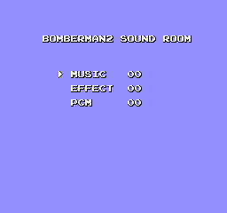
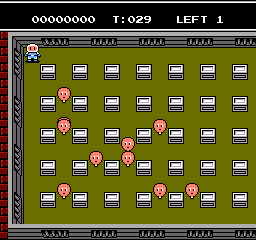
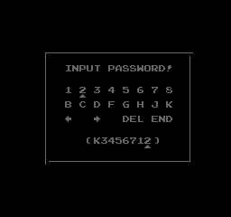
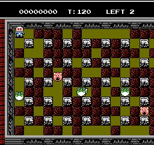
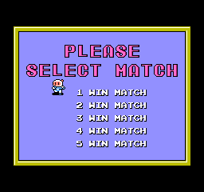
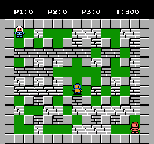
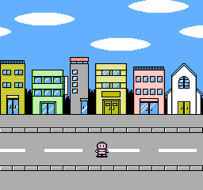
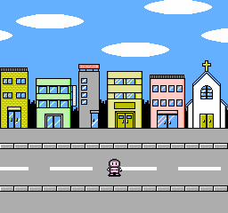
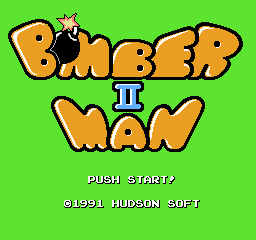

# Bomberman II (NES / Famicom, 1991/1993): passwords and secrets

Everything here comes from disassembling the carts (`tools/m6502.py` with `--far C852`, see below; listings in
`disasm/nes2/`) and checking the results in Mesen 2 (`tools/nes2/run.sh` runs a Lua script headless with
`tools/nes2/lib.lua` prepended, output in `$SCRATCH`). The analysis scripts are shared with Bomberman (NES) and live in
`tools/nes1/` (`deadcode.py`, `padscan.py`, `flags.py`, `textdump.py`, `logo.py`, `gg.py`); they take `--far C852`
here. Addresses are `bank:address` (16 KB PRG banks, 0-6 at `$8000`, bank 7 fixed at `$C000`); US unless a version
is named. Prior art: the GameFAQs codes page and a published article on the game in `res/`. Marks: ★ **New** (in neither),
**Fixed** (prior art is wrong or incomplete), **Known** (prior art has it; the mechanism is added here).

| Dump | MD5 | vs US |
|---|---|---|
| USA | `8d8b36adb154fad6b55f14133fc4f3f6` | |
| Japan | `2ca3ce695e6741a94120a9d07675547f` | 28,041 bytes differ, in banks 0, 1, 4, 5 and 7. The password code sits at the same addresses in bank 5 and is the same apart from RAM moves: the JP zero page is `$0E` lower (`$3D` area for `$4B`) and the password buffers 2 bytes lower (`$0540` for `$0542`). The letters differ (see [Regions](#regions)) |

MMC1, 128 KB PRG, 8 KB CHR RAM. Bank 7 calls the other banks through **`$C852`** (JP `$C7BE`): `JSR $C852` is followed by three
bytes, a bank number and a target address minus 1 (`$05 $61 $95` calls `$05:9562`); `m6502.py --far C852` lists those
bytes as `.far` and traces the target (JP: `--far C7BE`).

## RAM that matters

| Address (US) | JP | Meaning | Evidence |
|---|---|---|---|
| `$49` | `$3B` | game mode: 0 NORMAL, 1 VS, 2 BATTLE | `$05:A86B` |
| `$4B` / `$4C` | `$3D` / `$3E` | area - 1 (0-5) / stage - 1 (0-7) | `$CA47`, `$05:969D` |
| `$90,X` / `$93,X` | `$82,X` / `$85,X` | per player: bombs - 1 (0-7) / fire - 1 (0-4); X = 0-2 | `$05:96B1`, `$05:BC1B` |
| `$A5` | `$97` | the current player is dying | `$CEBC` |
| `$B7` | `$A9` | stage-clear counter: the stage ends when it reaches `$F0` | `$CA19` |
| `$4E` | `$40` | 1 in a bonus stage (no deaths) | `$05:9E9A`, `$CEAD` |
| `$03C0-$03C7` | same | `KOSAKA!!` once the game has run: tells a reset from a power-on | `$05:AC54` |
| `$03C8-$03CF` | same | top score | `$05:AA04` |
| `$03DB-$03E3` | same | the last password (the CONTINUE screen starts with it; `$FF` = empty) | `$05:9394`, `$05:938A` |
| `$03E4-$03EB` | same | the 8 characters on the entry screen, as nibbles (`$FF` = empty) | `$05:946B` |
| `$03ED` | same | bomb fuse: the start value of each bomb's timer `$6061,X` (75; the secret codes set 45 or 105) | `$05:928A`, `$05:BA07` |
| `$03EE` | same | detonator mode for NORMAL MODE: 0 none, 1 remote, 2 semi-remote | `$CE0C` |
| `$04B5-$04B7` / `$04B8-$04BA` | same | pads 1-3 held / newly pressed (A `$80`, B `$40`, Select `$20`, Start `$10`, Up, Down, Left, Right) | `$C399`, `$C406` |
| `$04E5` | same | lives (2) | `$C97F`, `$CAC4` |
| `$04E6` | same | the vest: invincible while non-zero (timer `$04E7/$04E8`) | `$05:872C`, `$CEA4` |
| `$054A` | `$0548` | submit flag of the entry screen | `$05:9619` |
| `$054B` / `$054C` / `$054D` | `$0549`... | entry grid column / row / input position | `$05:93AF` |
| `$054E` / `$054F` / `$0550` | `$054C`... | after the entry screen: back to the title / sound room / bonus stage | `$C957`-`$C969` |

## The password

Code: `$05:92C6` (entry screen), `$05:9619` (decoder), `$05:9562` (encoder, called from the game-over code screen
`$05:AA6A`). Tables: grid → nibble `$05:94BE`, nibble → character `$05:9609`, the secret codes `$05:9703`.
`tools/nes2/password.mjs` does both directions and both regions; `node tools/nes2/test_password.mjs` round-trips every
state with 16 keys.

- **8 characters.** Each is a nibble v[k]: its place in `K3DH6J8B75214CFG` (US) or `PCKNFOHIGEBADJLM` (JP). The
  two carts take **the same nibbles**, so a code converts letter by letter (`convert()`; already known as "A=1, H=8, I=B").
- **First the secret list** (`$05:96C6`): the raw code is compared with seven codes stored in JP letters (the US cart
  maps its nibbles through a copy of the JP alphabet at `$05:973B` first).
- **Then v0 is a key**: v1-v7 are XORed with it (`$05:966C`).
- **v3 must equal (v1 + v2 + v4 + v5 + v6 + v7) & 15** (`$05:967D`).
- **Fields** (`$05:969A`): v1 = area - 1 (< 6), v2 = stage - 1 (< 8), v4 = bombs - 1 (< 8), v6 = fire - 1 (< 5), each
  stored before it is range-checked. **v5 and v7 are free**: they only feed the checksum.
- Nothing else is kept: no score, no lives, no vest; the stored bombs and fire go to player 1.
- **The encoder** (`$05:9562`) picks the key at random from 1-15 (`BEQ` retries 0) and v5, v7 at random, so the game
  can show **3,840 codes for one state**; the decoder also takes key 0, so **4,096 work**. 1,920 states x 4,096 =
  **7,864,320 valid level codes**; none of the seven secret codes passes the checksum, so they never collide.
- **Checked against the game's own encoder**: a game over on 1-1 in Mesen made `JJJ4J6JC`, which decodes to 1-1, 1
  bomb, fire 1 (key 5).
- An empty code (END with nothing typed) sends you back to the title (`$05:9644`, `$054E`).

### Secret codes

| JP | US | Effect | |
|---|---|---|---|
| `PCDEFGAB` | `K3456712` | BOMBERMAN2 SOUND ROOM (`$054F`) | Known |
| `PONEJACK` | `KJH5C13D` | one life, the bonus stage, then the title (`$0550`, `$CCC0`) | Known |
| `PACHINKO` | `K138BHDJ` | remote bombs in NORMAL MODE (`$03EE` = 1) | Known |
| `PANICMAN` | `K1HB3G1H` | semi-remote: remote, and they also go off by themselves (`$03EE` = 2) | Known |
| `PBOMBACE` | `K2JG2135` | fuse 45 (`$03ED`, copied to each bomb's timer `$6061,X`) | Known |
| `PBOMBMAN` | `K2JG2G1H` | fuse 75 (the power-on value) | Known |
| `PBOMBOLD` | `K2JG2JF4` | fuse 105 | Known |

The fuse and detonator codes return to the title (`$054E`), so a level code can follow. ★ Their settings survive a
**Reset**: the boot code (`$05:AC54`) only clears the top score, the last password and these two settings
(`$05:9280`) when `KOSAKA!!` is missing from `$03C0`, which is only the case after power-on (the string was already known as the
reset check; the consequence is from the code, as Mesen's test runner can't reset). ★ The US staff roll ends with
**SECRET PASSWORD K3456712** (JP `PCDEFGAB`), the sound test, before ETC and the copyright (seen in the ending in Mesen).

 

### Codes verified

Every code in `docs/nes2_codes.json` was **typed with the pad** in Mesen (`tools/nes2/test_codes.mjs` +
`test_codes.lua`, the entry screen saved once and reloaded per code) and the decoder's verdict and the RAM it set
compared with `password.mjs`: all 162 GameFAQs codes (58 US, 104 JP, each in its own cart), and ★ `33333333` (US, 1-1:
key 1 and every field 0), `CCCCCCCC` (the same in JP), `368883J3` / `CFHHHCOC` (6-8, 8 bombs, fire 5) and `KKK1BK6K` (US,
key 0, which the game never shows). **All GameFAQs codes work as listed**; the notes add what each also carries (the
area lists' bombs and fire grow with the area; every JP "Level" code also has 8 bombs and fire 5).

 

### Fuzz against the game's own decoder

`tools/nes2/fuzz.mjs` (with `fuzz.lua`) saves a state when the decoder starts (`$05:9623`), then for each code writes
the 8 nibbles to `$03E4`, reloads and reads the RAM at the two exits (`$05:963D` accepted, `$05:9650` rejected). Set:
one code for each of the 1,920 states (random key and free nibbles), 4,000 random codes, every character at every
position of one code, the 7 secrets and every out-of-range value of v1, v2, v4 and v6 with a good checksum: **6,119
codes, 1,968 accepted, 0 mismatches, US and JP.**

## Entering a password

Menu: CONTINUE (three Downs, Start). The grid is `1 2 3 4 5 6 7 8` / `B C D F G H J K` / `← → DEL END` (JP `A-H` /
`I-P`); the cursor starts on the first key and the code starts as the last one the game showed (`$03DB`). D-pad moves
(columns wrap mod 8, rows mod 3; on the last row each key is two columns wide), **A** presses the key, **B** held with
Left/Right moves the input position, **Start** submits, and **the 8th character submits by itself** (`$05:946E`). A
bad code sounds the error and stays on the screen.

## Battle and VS modes

`$49` = 1 (VS: two players, "N WIN MATCH") or 2 (BATTLE: up to three players,
"PLEASE SELECT MATCH" 1-5 wins). VS players start with 2 bombs and fire 3, BATTLE players with 1 bomb and fire 2
(`$CE59`/`$CE5C`). ★ **Pad 3 differs by region**: the US cart first reads 24 bits from each port and checks the Four
Score signature (`$10` on `$4016`, `$20` on `$4017`, `$C430`); with it, pad 3 is the Four Score's third pad
(`$C47D`), without it the Famicom expansion pad (`$4016` bit 1). The JP cart only reads the expansion pad (`$C382`).
Both ran in Mesen with random input on all three pads (`cov.lua`, modes `vs` and `battle`). Four Score verified in
Mesen 2 (US, `Nes.Port1.Type = "FourScore"`; Mesen's game database also turns it on by itself): the signature reads
`$45`/`$46` = `$10`/`$20`, Left/Down on Four Score pad 3 (`emu.setInput(b, 0, 0, 2)`) land in `$04B7` and move P3 (the
blue one) in BATTLE, pad 4 changes nothing (the game reads three pads). Without a Four Score the signature reads
`$FF`/`$FF`; the expansion-pad fallback is from the code (Mesen's Famicom two-player adapter could not be driven
from Lua).

 

## Regions

| | US | JP |
|---|---|---|
| Password letters | `K3DH6J8B75214CFG` (no vowels) | `PCKNFOHIGEBADJLM` |
| Pad 3 | Four Score, else expansion port | expansion port |
| Title | ™ on the logo, TM AND © 1992 HUDSON SOFT, LICENSED BY NINTENDO | no ™, ©1991 HUDSON SOFT |
| Sound room title | BOMBERMAN2 SOUND ROOM | BOMBER MAN 2 SOUND ROOM |
| Build string at `$07:FFE0` | `BOMBERMAN2 92817` | `BOMBER MAN 2` |

All but pad 3 match what was known. **Known**: the church in the ending's street scene (after 6-8, before the staff roll) has
its cross only in JP; checked in Mesen (`H8666HBH` / `NHFFFNIN` = 6-8, then `$B7`/`$A9` = `$F0`).
 
 

## Title logo and item icons

`docs/img/logos/nes2_us.png` and `nes2_jp.png` (the JP one without ™): title-screen PPU dumps (`tools/nes2/vdump.lua`)
rendered with `tools/nes1/logo.py crop ... 0 1`, which keys out the green backdrop and draws the sprites (the bomb on
the O is one). The password holds bombs and fire only: `docs/img/items/nes2/bomb.png` and `fire.png` (16 x 16, tiles
`$60 $61 $70 $71` and `$62 $63 $72 $73` of the area-1 metatile table `$04:8080`) come from the stage 1-1 PPU dump with
`tools/nes2/items.py` with BG palette 0. Palette 0 is right: the metatile update `$07:CF34` takes the slot from a
nibble table at `($66)` (area 1 byte `$10` = `$00`: bomb low nibble, fire high nibble, both 0), and in Mesen a
fire-up revealed in 1-1 queued its attribute byte as `$00` (`$23DA`) and showed in the playfield colours (`$18`
`$10` `$30` `$0F`), matching `fire.png`. The bomb-up was not seen on screen.

## Hidden-content sweep

Coverage (US; `tools/nes2/cov.sh`): every area by password with a random bot (8 stages each, cleared through `$B7`),
the ending and staff roll, the attract demo, a game over and CONTINUE, VS and BATTLE with random input on three pads,
and the seven secrets, in both carts. **22,186 of 23,616 traced code bytes ran** (JP 21,765 of 23,455; lists
`disasm/nes2/dead_jp.txt`, `flags_jp.txt`, `text_jp.tsv`; JP has the same leftovers: the recorder switch is read at `$05:99F1`, the `$FF` read is at `$02:87C7`).

- **Dead code** (`disasm/nes2/dead_us.txt`): 1,068 bytes `cond`, 197 `dead`, nothing unreferenced. The rest is play
  the bot didn't reach (player states, the normal bonus stage after a stage `$CB05`, enemy routines at `$00:9188-$97EF`
  reached through the enemy table at `$00:8292`, sound-driver cases), plus:
- ★ **A demo recorder.** The attract-demo routine `$05:99ED` reads the ROM byte `$D2F7` (JP `$D263`), which is 1
  (play). With 0 it records instead: each change of pad 1 is stored as (buttons, frames) at `($B9),Y`, which points at
  the demo's own data in ROM (`$05:9A92`). Verified with the Game Genie code `AENIYZPA` (`$D2F7` = 0): the demo stood
  still and the recorder's store `$05:9A22` ran on each button change (0 times without the code, which ran the player
  915 times). On a cart those stores would hit the MMC1 registers; it is the tool the demos were made with.
  Bomberman (PC Engine) has the same kind of leftover (`docs/pce90.md`).
- **Input codes** (`padscan.py` on pads `$04B5-$04BA`, `$04C1-$04C4`): menus test A/Start (`AND #$90`) and
  Select/Up/Down (`AND #$2C`); the rest is the demo recorder and the pad reader. **No hidden button code**; the seven
  secrets are the only codes.
- **Unset flags** (`flags.py`, `disasm/nes2/flags_us.txt`): one, `$FF`, read at `$02:87C7` (`LDA $FF / STA $0353`) in
  a sound-driver command table where the neighbours load masked values. Nothing writes `$FF`, so this stores the
  power-on 0. ★ It looks like `LDA #$FF` (`A9 FF`) with the wrong opcode (`A5 FF`); from the code only.
- **Text** (`textdump.py`, `disasm/nes2/text_us.tsv`): every string ran. The unread hits are map and tile data.
- **Maps**: the stage layouts are blocks in bank 4 (`$04:9BE6-$A6xx`, records starting `2A 2B`); there are two
  copies of the area tables, and in the runs one copy of area 6's blocks (`$04:9F1F-$9FD4`) was never read while the
  other copy was. Not decoded further.
- **Graphics**: CHR is RAM, loaded from PRG per screen, so Mesen keeps no CHR log; the known unused Kondoria graphic was
  not located.

### Cheat codes

All verified in Mesen 2's cheat engine (`tools/nes2/test_cheats.lua`, NORMAL MODE, random bot, US and JP):
`04E6:01` invincible (0 deaths in 12,000 frames; 10-11 without), Game Genie `AVZGKT` + `AVGGKT` (JP `ATPGET` +
`ATLGET`) invincible by RTS over both kill routines, `04E5:02` infinite lives (12 deaths, no game over), `00B7:F0`
(JP `00A9:F0`) every stage clears at once (16 stages in 8,000 frames). Patches: `patches/nes2_invincible_us.ips`,
`_jp.ips` (`tools/nes2/mkpatch.py`).

Both devices, the same tests: Pro Action Replay (address + value) `04E601` invincible, `04E502` infinite lives,
`00B7F0` (JP `00A9F0`) stage clear; Game Genie `SXKGKXVK` (JP `SZUGEXVK`) infinite lives (`DEC $04E5` -> `LDA` at
`$CAC4`, JP `$CA30`: 12 deaths, lives stay 2) and `AAOKSZEY` (JP `AEEKOPEY`) stage clear (`CMP #$F0` -> `CMP #$00` at
`$CA1C`, JP `$C988`: 18 stage changes in 8,000 frames, to area 3). The demo recorder code `AENIYZPA` patches a ROM
byte and has no Pro Action Replay form.

## Open

- The expansion-pad path (no Four Score), the reset behaviour and the `$FF` typo are from the code.
- The known unused Kondoria graphic was not checked.
