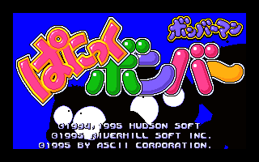
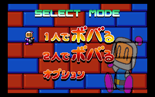
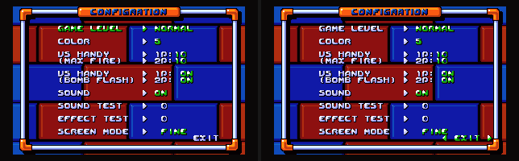
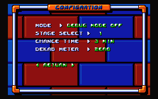
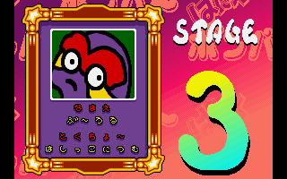
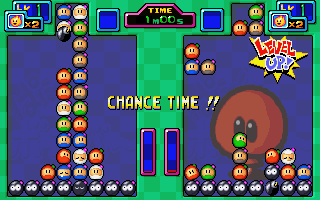
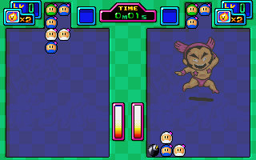
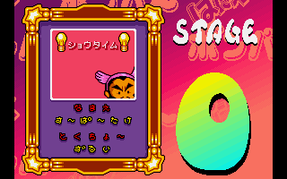

# Bomberman: Panic Bomber (NEC PC-9821, Japan, 1995): secrets

The PC-98 version of the falling-block Bomberman puzzle game, by ASCII and Riverhill Soft. Everything here comes from
the floppy image, disassembled, and from DOSBox-X in PC-98 mode (headless, keys scripted). Addresses: `CS:xxxx` is disk
`$2000 + xxxx`, `DS:xxxx` is disk `$11E80 + xxxx`. Marks: ★ **New**.

 

| Dump | MD5 | |
|---|---|---|
| Bomberman - Panic Bomber.hdm | `c8f2864deabd378ec660f137a00c3416` | 1,261,568 bytes, raw 2HD, 1024-byte sectors |

## The disk

There is no filesystem and no executable, so there are no command-line options. The boot sector ("PANIBON For PC9821
Only!") reads the main program from disk `$2000` to `2000:0000`; a table at `$400` lists 142 resource slots in an
archive at `$24000`, which is read into memory in one go. Nothing is ever written to the disk: the hi-score table is
RAM only. The game needs a PC-9821 and 3 MB of memory (checked at `CS:018A`, `CS:01A8`).

## Controls

Player 1: W / X / A / D, Z or SHIFT = button A, C = button B. Player 2: keypad 8 / 2 / 4 / 6, keypad 0 = A, keypad . =
B. A joystick on the FM board also works for player 1. The arrow keys and RETURN do nothing (key table `DS:19A4`).

## No passwords

The mode select has three items, 1人でボバる (1P), 2人でボバる (2P) and オプション, and the 1P game always starts at
stage 1. All 66 places that read the input were listed: they test single buttons, "any button", or the exact values
A, B, A + B and Up. Nothing collects a sequence, and there is no password text or screen.

## ★ The hidden DEBUG MODE page

The options screen (the game spells it CONFIGRATION) has GAME LEVEL, COLOR, the two VS HANDY rows, SOUND, SOUND TEST
0-12, EFFECT TEST 0-26, SCREEN MODE and EXIT. Button B on an item resets it to its default.

**The unlock.** Button B on EXIT runs `CS:C588`: while the flag `DS:468C` is 0 it counts presses in `DS:468E`
(cleared each time the options open); at 128 it draws `< EXIT >`, sets the flag and plays effect `$44`. Held, the key
repeats every 4 game frames, about 45 seconds in all. Done on the unpatched disk in DOSBox-X:

Left or Right on `< EXIT >` opens the page (seen on a copy of the disk with the flag already set, `$1650C` = 01):

| Item | Word | Values | Seen |
|---|---|---|---|
| MODE | `DS:466A` | DEBUG MODE OFF / BOMBER SELECT / 21 RENSA / 5 RENSA * 2 | read only |
| STAGE SELECT | `DS:466C` | 1-10; the 1P game starts there (`CS:ED5F`) | 3 and 10  |
| CHANCE TIME | `DS:466E` | 1-5 MIN or NOTHING, default 3 (`CS:AF91`) | 1 minute  |
| DEKAB METER | `DS:4670` | ZERO / MAX - 1: both giant-bomb meters start one step from full (`CS:BA1F`) |  |

- MODE, from the code: BOMBER SELECT holds the player's next piece in a select state where Up re-rolls it
  (`CS:F6F0`); 21 RENSA and 5 RENSA * 2 deal pieces from fixed lists (120 values at `DS:1FF6`, 60 at `DS:20E6`), the
  set-ups for a 21-chain and two 5-chains. BOMBER SELECT didn't show in two 1P runs.
- The three settings in the table were seen with their words preset on copies of the disk (`$164EC`, `$164EE`,
  `$164F0`), not through the page.

## ★ The hidden 10th opponent

After stage 9 the game goes to the ending unless the play time, the PAST TIME on the continue screen, is under
0:20:00. Then it sets `DS:4680` and plays stage index 9 first (`CS:703F`): すーぱーたけ (Super Take), trait ずるい, on
a card that reads STAGE 0. The opponent was seen through STAGE SELECT 10; the 20-minute rule was read, not played.
The cast list at `DS:34AA`: ばろむ, くりん, ぶーろる, ぱーす, ふにゃー, ばけばけ, ぺぎー, くろぼん, ばぐらー, すーぱーたけ.

## Other codes (read from the code, not run)

- **CTRL held at boot**: 31 kHz display instead of 24 kHz (`CS:02EC`).
- **A + B as a second player joins** a 1P game ("HERE COMES A NEW CHALLENGER !"): the options open before the VS
  game (`CS:6F9A`).
- **Up as the attract demo starts**: the two computer sides play as stages 8 and 9 instead of random ones from 1-5
  (`CS:DC2F`).

## Unused content

- Four English boot strings at `DS:0800`: "PANIC BOMBER", "FOR FM PC9821", "NOW LOADING..." and "PROTECT CHECK
  ERROR!!". The boot screen uses Japanese strings, and the code has no protection check.
- "Panibon For PC9821" (`DS:9410`), and the text titles "CONFIGRATION" and "DEBUG MODE": both pages' titles are part
  of their background pictures, and the debug page's picture also says CONFIGRATION.
- Resource 91, a second copy of the CHANCE TIME !! and PAUSE sprites, is never requested (static scan).
- Crash handlers: INT 3 prints the registers (`CS:06AE`); INT 0Dh opens a memory viewer at the fault address and
  prints "Ippan Hogo!!" (`CS:067B`, `CS:0566`). A text-console line input (`CS:03D4`) has no caller.
- All 12 tunes are used. Unused sound effects weren't settled (four call sites compute their ids).

## Open

- The three MODE values in play, the 20-minute rule played out, and the read-only codes above.
- The debug page opened on the unpatched disk right after the unlock (the run ended before it).
