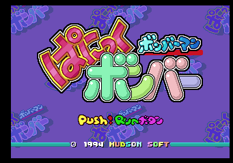
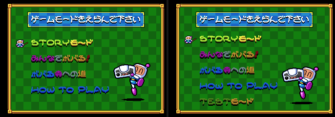
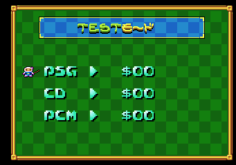
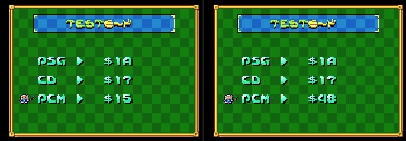
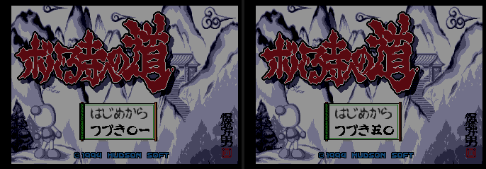
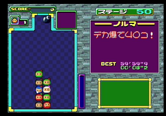
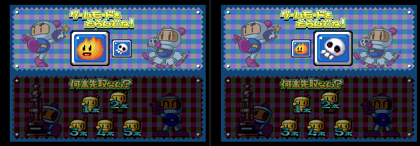

# Bomberman: Panic Bomber (PC Engine Super CD-ROM², Japan, 1994): secrets

Hudson's falling-block Bomberman puzzle game on CD. Everything here comes from the data track, disassembled, and
from Mesen 2 (headless test runner, System Card 3.0, multitap for the battles). Addresses are logical: work RAM is
`$2000-$3FFF` (bank `$F8`); the program runs in Super CD-RAM, and in the title and menu program MPR2-6 =
`$68 $69 $6A $6B $6D`, so `$4000` is the resident kernel, `$6000` the code and `$8000` its variables (e.g. `$90CD`).
"Sector N" is data sector N of track 2 (CD LBA 2664 + N). Marks: ★ **New**.

 

| Dump | MD5 | |
|---|---|---|
| Bomberman - Panic Bomber (Japan) (FAAT), Track 02.bin | `a7b03a799a421882d58929a8848a4533` | MODE1/2352 |
| Track 2 as 2048-byte sectors | `26ea60a85d0e69b5be5bfa14dfe05351` | 12,376 sectors after the 225-sector pregap |

The disc has 31 tracks: track 2 is the data, track 31 a second copy of it (149 sectors shorter, one sector
different), the rest audio. The pad is read from the System Card's `$2228` (held) and `$222D` (new presses): bit 0 I,
1 II, 2 SELECT, 3 RUN, 4 Up, 5 Right, 6 Down, 7 Left.

## Modes

The game-mode menu has STORYモード (EASY / NORMAL / HARD, then the map and 16 stages), みんなでボンバる! (battle
for 2 to 5 players, needs a multitap), ボンバる寺への道 (50 stages with a quota each, e.g. 3つ消しをしろ!) and HOW TO
PLAY. ボンバる寺への道's title offers はじめから (from the start) and つづき (continue, with a stage number).

## No passwords: the save file

No screen takes a code. STORY goes straight to the difficulty choice and never continues; ボンバる寺への道 keeps its
progress and best times in the System Card's backup RAM. The boot program (`$46C1` load, `$46E1` save) calls the
backup-RAM functions with the name `P.BOMBER` and a 166-byte buffer at `$364A`; it is written each time the title
program restarts and by the play programs.

| Offset | RAM | Meaning |
|---|---|---|
| `+$00` | `$364A` | flags; bit 1 = SELECT was held at the stage-mode start (dead, below) |
| `+$01` | `$364B` | 16-bit count of title-program starts |
| `+$03`, `+$04` | `$364D`, `$364E` | highest values of zero-page `$66` and `$69` seen in play |
| `+$06` | `$3650` | STORY snapshot (`$3651` = stage); the title zeroes the stage when STORY starts (`$727A`) |
| `+$09` | `$3653` | ボンバる寺への道: highest stage reached, 0-based (つづき offers stages 1 to n+1) |
| `+$10` | `$365A` | 50 best times of 3 bytes: tenths, seconds (BCD), minutes (BCD); default `09 59 59` = 59'59"9 |

Seen in Mesen: after stage 1 cleared in 17.2 s the first record was `02 17 00` and `$3653` = 1.

## ★ TESTモード, the hidden sound test

Bit 0 of `$90CD` adds a fifth entry, **TESTモード**, under HOW TO PLAY: the menu draws it and the cursor wraps at 5
(`$6769`, `$67F7`, `$6849`, `$69AD`). Only the program's start-up clears the byte (`$6038`, `$6538`) and bit 1 is the
"no multitap" flag (`$6A39`); nothing sets bit 0. Set in Mesen (cheat `0D50CD:01`), the entry opens a sound test:

| Row | Range |
|---|---|
| PSG | `$00-$1A` (`$74D0`) |
| CD | `$00-$17` (`$7524`): tracks 3-26; the kernel's table `$4689` has 28 entries, so tracks 27-30 can't be picked |
| PCM | `$00-$15` (`$7582`), or `$00-$48` with an Arcade Card (`$758E`) |

Up/Down picks the row, Left/Right the number, I or RUN plays it. II is tested (`$7656`) but there is no way back.

 

**The removed switch.** On the title, RUN's handler (`$6693`) does `LDA $2228,X / BIT #$03 / BEQ +0`: the test of
I or II is still there but branches to the next instruction. An older copy of the program, left in sector 986
(`+$43C`), has the rest, `BEQ +8 / LDA $8D4C / ORA #$01 / STA $8D4C` (that build's TEST flag): there, holding I or II
while pressing RUN on the title opened TESTモード.

**Arcade Card.** The boot program (`$6269`) probes the Arcade Card ports and sets bit 4 of zero-page `$03` when one
answers; the kernel has loaders for it (`$5A00-$5B40`). In Mesen as an Arcade Card the PCM row ran to `$48`, as a
Super CD-ROM² to `$15`. What the card changes in play wasn't looked at.

## ★ The dead stage select

When つづき is chosen, ボンバる寺への道 runs (`$E1A3`, program slot 28)
`LDA $3620 / BIT #$02 / BEQ skip / LDA $2228 / BIT #$04 / BEQ skip / LDA #$31 / STA $3653`: with bit 1 of `$3620`
set, holding SELECT opens all 50 stages (and puts 49 into the save). The boot code clears `$3620` (`$6086`) and no
program writes it again. With cheat `1F1620:02` and SELECT held, the number ran up to 50 and stage 50 started
(quota デカ爆で40コ!); without it the same input stayed at stage 1.

 

## Button codes

- ★ **Battle rule preset.** As the battle program is launched (`$6FC8`), I held stores 1 in `$361F`, whose bit 0
  is the battle rule. Held from the 1 vs 1 confirmation through the load, the rule screen opens on the skull
  instead of the flame. 
- **Dead checks.** SELECT at the start of ボンバる寺への道 (`$E2DB`) or of the demo sets bit 1 of `$364A`; its only
  readers are in the HOW TO PLAY program (`$83BF`, `$8457`), which clears the bit first (`$607C`). The STORY stage
  programs carry the same `$361F` test as the battle (`$7873`) but clear it when they start (`$60AB`).
- No other code: every program slot was searched for pad reads followed by a mask or a table compare (a byte
  pattern search, not a full disassembly).

## Cheat codes

Mesen 2's PC Engine codes are raw `AAAAAA:VV`, `AAAAAA` being the physical address: work RAM `$2000 + x` is
`1F` + x, card RAM bank `b` offset `o` is `b × $2000 + o`. Each was run in Mesen.

| Code | Address | Effect | Check |
|---|---|---|---|
| `0D50CD:01` | `$90CD` (bank `$6A`) | TESTモード on the menu; add it on the title | the entry appears and the sound test opens |
| `1F1620:02` | `$3620` | with SELECT held on つづき: all 50 ボンバる寺への道 stages | stage 50 started |
| `1F163C:nn` | `$363C` | STORY starts at stage nn+1 (`00-0F`); turn it off once the stage has started | `05`: the map showed STAGE-6  |

## Unused content

The kernel (sectors 2-5, at `$4000`) has three file tables of 4-byte entries: 41 program files (`$4450`), 6 VRAM
files (`$4524`) and 35 ADPCM files (`$4566`).

- Requested program slots: 0 title and menu, 1 and 38 the attract demos (38 is also HOW TO PLAY), 5 the STORY
  ending, 8-23 the 16 STORY stages, 24-27 the battles, 28 ボンバる寺への道. **Never requested: 2-4, 6, 7, 29-37, 39,
  40**, and VRAM slots 0 and 5.
- Slot 6 (sectors 962-1089) holds pieces of the older title build with the TEST switch; sectors 920-921 are copies
  of boot sectors 0-1.
- About 3,900 sectors (7.7 MB) in slots 29-35 and the gaps (354-415, 477-577, 3986-4801, 5422-6337, 7098-8001,
  9050-10015, 10462-10689) hold what looks like 16-bit stereo PCM. It matches none of the disc's audio tracks and
  hasn't been listened to.
- ADPCM slots 1-7, 9, 10, 13, 14 and 32-34 are never requested by a constant or by STORY's `16 + stage` formula.
- The kernel also has an Arcade Card loader that reads by raw sector (`$5A14`). No call to it was found, and every
  CD read in the runs stayed inside the table files, but the unrequested ADPCM slots could still be its voice data.
- Dead bytes in the battle launcher (`$6FF8`): `LDA #$07` and `LDA #$09`, older program numbers nothing jumps to.

## Open

- What the leftover PCM audio is, and which removed code set `$3620` bit 1 (probably the TEST switch).
- Only the first stage of each mode was played: the STORY ending, battles for 3 to 5 players and later stages were
  not run. Unused graphics inside the loaded files weren't looked for.
