# Panic Bomber (Virtual Boy, USA, 1995): passwords

Read from the ROM and checked in BizHawk (Virtual Boyee core, left eye only: `vb.anaglyph.preset` = disabled). Prior
art: the GameFAQs "Panic Bomber" (Virtual Boy) page (in `res/`). Marks: ★ **New**, **Known**.

| Dump | MD5 |
|---|---|
| Panic Bomber (USA) | `467247d5e3383d066005565bf8218436` |

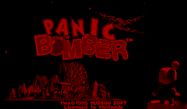

## The password

PASSWORD on the main menu: four digits (Up raises a digit, Right moves on), then A. There is no algorithm: the code is
looked up in a list of 4-digit records at ROM `$27DFE` (`$0702_7DFE`):

| Rows | Codes |
|---|---|
| Very Easy | `1000` `4390` `3281` `5607`, then `1000` four times |
| Easy | `2000` `6835` `9081` `2473`, then `2000` four times |
| Normal | `3000` `2695` `1038` `6934`, then `3000` four times |
| Hard | `4000` `8647` `0538` `9316`, then `4000` four times |
| (after the levels) | `9782` `1298`, then `1000` four times |
| with L and R held | `0612` `0130` `1001` `0720` `0716` `0911` `0704` `4476` `0825` `0513` |

- The four columns are the stages: **The Scary Ruins** (stage 1), **The Sinister Forest**, **Desert of Desolation**
  and **Doom Castle**. `d000` is stage 1 of level d; the four slots after Doom Castle repeat it, so a code for a
  later stage never comes up.
- Every level and stage code was typed in BizHawk and starts its stage (the stage card names it).
- GameFAQs has most of them, under shifting labels: the Very Easy row is filed under Normal as "Star/Moon/Sun Medal",
  the Hard row appears twice (as stages and as medals), and `4000` "The Scary Ruins" is Hard stage 1. The Very Easy
  row and `1000`, `2000` and `3000` are not on its page.

## Special codes

The decoder (`$0701_FFDC`, from the MAME `unidasm` V810 listing) walks all 48 entries and returns the first match;
entries 38-45 also need L and R held (`$0702_00D0`, pad copy `$0500_2510`), and entries 46-47 L, R, Up on the right
pad and Left on the left pad (`$0702_00F0`). The handlers start at `$0702_01EC`. Typed in BizHawk unless marked.

| Code | Hold | Effect |
|---|---|---|
| ★ `1298` | | pick a level, then THE SCARY RUINS against **Zach the Were-Bomberman** instead of Drifty 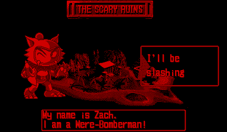 |
| ★ `9782` | | sets `$0500_24F4`: every game uses piece set (TUBU) 5 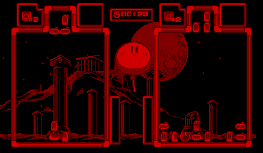 |
| `0130` | L R | auto play (Known) |
| `1001` | L R | sound test (Known) |
| `0720` | L R | stage select (Known) |
| `0716` | L R | the ending (Known) |
| ★ `4476` | L R | sets `$0500_24E8`: the opponent's control word becomes 1 (`$0700_6DDE`), so **your pad moves both fields** and the CPU never moves 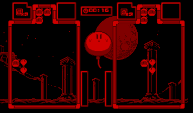 |
| ★ `0911` | L R | sets `$0500_24E0`: a **RESULT** screen (`$0700_7E46`: level, chains, giant bombs, stage times) after every round, normally only after the ending 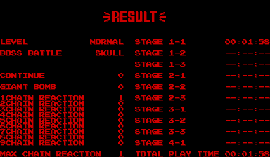 |
| ★ `0704` | L R | sets `$0500_24E4`: DOKURO on at every stage, so attack rows are brick blocks (kind `$B`), which drop items when cleared 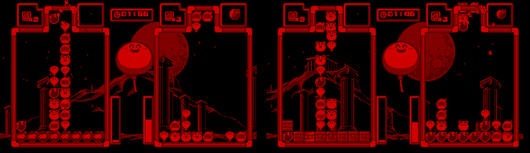 |
| ★ `0612` | L R | clears `$0500_2500`: ANIMATION 0 in every game, so blocks start their idle animations on every 4th frame instead of every 2nd (counted over 5,000 frames) |
| ★ `0825` | L R, right Up, left Left | the **[ DEBUG MENU ]**, then a game with its settings 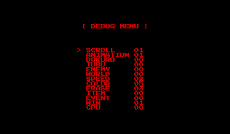 |
| ★ `0513` | L R, right Up, left Left | the DEBUG MENU, then a game where the CPU plays **both** sides (`$0700_6D64`) and the round replays 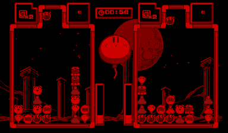 |

## The DEBUG MENU

Left-pad Right and Left change the selected value (they wrap). A normal game fills the same variables from a 9-byte
record per stage (`$0700_7AF8`, tables `$0702_6588`, `$65EB`, `$664E`, `$66B1`, one per level); the menu (`$0700_64B0`,
defaults `$0700_6B46`) lets you set them by hand.

| Setting | RAM | Range | Effect |
|---|---|---|---|
| SCROLL | `$0500_24C0` | 0-1 | background scroll; 0 = still (seen) |
| ANIMATION | `$0500_24C4` | 0-2 | how often a random block starts its idle animation (`$0700_EC68`): every 4th / 2nd (the default, 1) / every frame (counted) |
| DOKURO | `$0500_2540` | 0-1 | the 8-block attack row uses brick blocks, kind `$B` (`$0700_97F2`), which drop items when cleared (`$0701_2322`) (seen) |
| TUBU | `$0500_254E` | 0-5 | the piece set (seen) |
| ENEMY | `$0500_252E` | 0-10 | the opponent and portrait (seen: 10 is a girl in place of Drifty) |
| WORLD | `$0500_26E0` | 0-3 | the background (seen) |
| SPEED | `$0500_2536` | 0-5 | drop speed (seen) |
| COLOR | `$0500_2532` | 1-5 | how many kinds of block (seen: 1 = all the same face) |
| ERASE | `$0500_2534` | 1-6 | blocks in a row to clear (seen) |
| ITEM | `$0500_26E3` | 0-16 | n > 0 makes every item type n-1 (`$0701_5FEC`, normally random & 15); items come only from DOKURO blocks. Effects (switch `$0701_6632`), each icon seen: 1 bricks → bombs, 2 left/right swapped, 3 full drop speed, 4 blast level 0 (code), 5 bombs → rocks, 6 all bombs explode, 7 next piece a giant bomb, 8 a big Bomberman hides your field, 9 a brick row pushed up, 10 four rocks pushed up, 11 STOP countdown, 12 bricks dropped in the outer columns, 13 next piece rocks, 14 face blocks cleared, 15 a bomb row pushed up, 16 bombs removed; 2-4 last about 500 frames 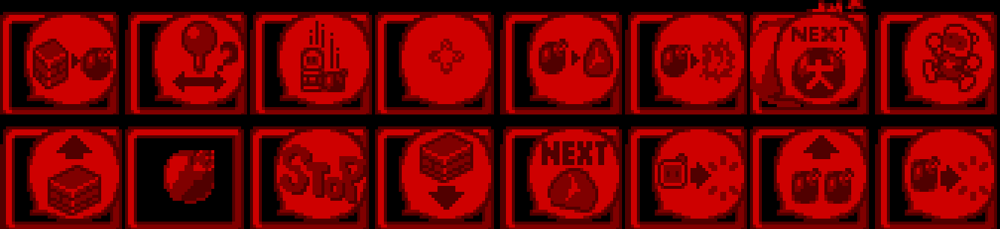 |
| EVENT | `$0500_26E4` | 0-4 | n > 0 forces event n-1 on a 2-chain (thresholds `$254A`/`$254C` 1 and 2, normally 4 and 5), for the left player only (struct `$5954`), so use `0513` to see it: a giant spiked robot, rolling explosions, a vortex, a red flood (seen) 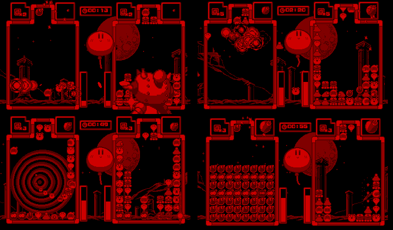 |
| WIN | `$0500_2538` | 1-2 | round wins that end a match (`$0700_6EBC` compares each side's win count): with 1 (the default) one win ends it, with 2 a 1-0 round goes on and 2-1 ends it (seen with `0513`) |
| CPU | `$0500_253C`, `$253A` | 0-15 | CPU level: at 15 the opponent drops fast and chains, at 0 it only clears (seen); your side stays yours unless `0513` |

## ★ The developer menu (patch)

An unreferenced routine at `$0700_0A48` draws a boot menu: **VERTIAL BOY** (sic) / PANIC BOMBER, **VERSION
1995/07/21**, with GAME START, DEBUG GAME PLAY, DEBUG AUTO PLAY, SOUND TEST and ENDING. Nothing calls it.
`patches/pbvb_dev_menu.ips` (`tools/pbvb/mkpatch.py`) calls it at power-on and points the three debug items at the
sub-mode word the finished game reads (`$0500_24F8`; the menu still writes the old byte `$0500_26D9`). Patched file
(MD5 `8799f344054ba0088d399684902eefa1`) in BizHawk: GAME START boots normally, DEBUG GAME PLAY and DEBUG AUTO PLAY give
the DEBUG MENU and then a game (as `0825` and `0513`), SOUND TEST and ENDING open those.
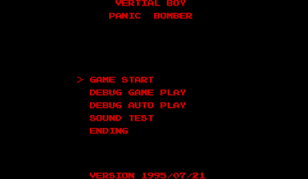

## Hidden-content sweep

BizHawk's Virtual Boy core reports no executed addresses, so coverage came from MAME (`vboy`, debugger breakpoints
on every block start found by a V810 tracer, logged to unused work RAM) over about 35 runs: attract, normal games on
Very Easy and Hard, passwords, every special code, the DEBUG MENU with several settings, auto play, sound test, stage
select and the ending code. Of 138,882 traced code bytes, 121,070 ran (87%).

- ★ **Title-screen code: a test screen.** On the PANIC BOMBER title, press right-pad Left, B, right-pad Down, A,
  right-pad Up (`$0701_B1DC`; any other press starts over). It sets mode 6 (`$0500_26D6`, `$0701_B270`): one horizontal
  line for the left eye and two short vertical bars for the right, which cross when seen together, like a chart for
  lining up the screens. A or Start returns to the intro. Seen in MAME and BizHawk.
  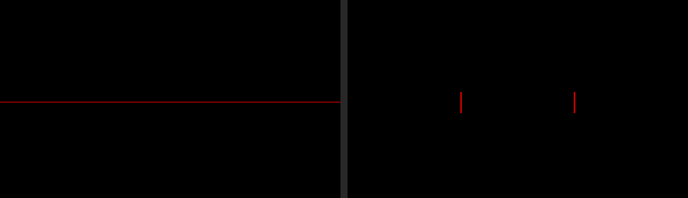
- **Won stages** (BizHawk, the player's side handed to the CPU at level 15 and the opponent at 0, so the game decides
  the win itself, `$0700_6EBC`): `$0701_D99A` is the medal card after each world boss (opponents 6-8, e.g. "Bomberman
  got the Star Medal. Password 4390"); `$0701_CC90` the Gold Bomber lines after Count Dracu-boom and Ms. Flashy (9,
  10). After Doom Castle a perfect run shows the castle door, then stage 10, Ms. Flashy's bonus stage. Mode 7
  (`$0701_8088`) is the ending: the door, the statue, then the next level's name (Very Easy and Easy) or the staff roll
  ending on END 1298 (Normal and Hard), then RESULT, and the level goes up by one. ★ Holding A, B, L, R, Start and
  Select (`$0701_87EA`) cuts each ending scene short, seen on screen.
- **Never run, normal play:** object handlers for situations the runs didn't reach, the cartridge and link-port interrupt handlers, and unused commands of the sound
  driver (its banner: "VSU DRIVER Version 0.19a ... Hudson Soft ... Prototype"). Other unreferenced routines are the
  developer menu above, two object handlers (`$0701_1D88`, `$0701_1E30`) and library helpers.
- **Input codes:** the passwords, the L+R and debug-menu checks, the title code above, the boot wait for buttons to be
  released and the mode-7 skip. Nothing else.
- **Text:** the ASCII strings are the developer menu, sound test, stage select, DEBUG MENU and RESULT labels, all
  above, and the sound driver's banner.

## Unused graphics

- ★ **Graphics `$C6`, other medals.** Graphics load through `$0700_46A4` (table `$0704_7000`, LZ as in Panic Bomber
  W) and BG maps through `$0700_46DC` (table `$0702_9000`). Of their 76 and 36 call sites, by immediate or as base +
  stage, opponent or world, none gives `$C6` (`$0706_6F9D`); every other entry is loaded. It holds large star, sun
  and moon medals, rougher and dithered unlike the medal card's (`$C5`), and a copy of the castle from `$C1`:
  

## Unused sounds

- ★ Music goes through `$0700_63B8` (table `$0707_4024`, 00-15), effects through `$0700_63C8` (table `$0707_4080`,
  00-28). Tune 0E and effects 00 and 1F are never requested; only the sound test plays them. Tunes 13-15 and effects
  24-28 lie past the test's range (BGM 0-12, SE 0-23), so nothing plays them: 0E is a full tune, 13 and 14 two
  versions of another, 15 a short rising run into a held note (likely a test tone); the effects last 0.2-0.8 s.
