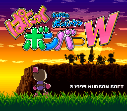
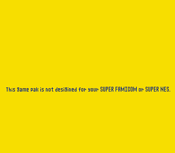
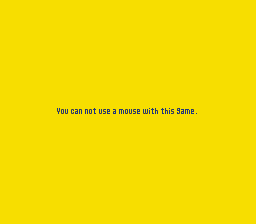
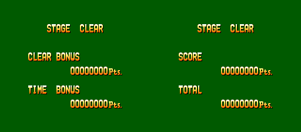
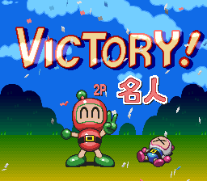
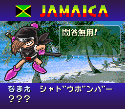

# Super Bomberman: Panic Bomber W (Super Famicom, Japan, 1995): passwords

Read from the ROM and checked in Mesen 2. The cart is SA-1 (map mode `$23`): the game's variables live in the SA-1's
I-RAM (`$00:3000-$37FF`), not in work RAM. Prior art: the GameFAQs "Super Bomberman: Panic Bomber W" page (in `res/`).
Marks: ★ **New**, **Known**.

| Dump | Header title | MD5 |
|---|---|---|
| Super Bomberman - Panic Bomber W (Japan) | `PANIC BOMBER WORLD` | `cc9c8195b55b94e075c771ca1628cbc8` |

## The password

ストーリーモード → パスワード: four digits (Up raises a digit, Right moves on), then A. The code is looked up in a list
of 4-digit records at file `$4AB5` (`$00:CAB5`), one row of 8 per difficulty:

| Difficulty | Round 1 | 2 | 3 | 4 | 5 | 6 |
|---|---|---|---|---|---|---|
| Easiest | `0001` | `1706` | `2158` | `7839` | `0285` | `1694` |
| Easy | `0002` | `3248` | `2516` | `0927` | `1439` | `6218` |
| Normal | `0003` | `7154` | `1386` | `2473` | `4890` | `3105` |
| Hard | `0004` | `5746` | `9510` | `4715` | `6532` | `1974` |
| Hardest | `0005` | `9650` | `3825` | `7431` | `5792` | `0819` |

- Each row ends with its round-1 code twice more; the Hardest row's last slots hold the character codes (`1993`,
  `5656`, `8111`, `4622`) and the L+R codes (`2200`, `4404`, `3445`, `0901`, `5963`).
- Every round code was typed in Mesen and starts its round. The round-1 codes `0001`-`0005` are not on GameFAQs;
  the rest of its list is complete and correct.
- The character codes are taken (the screen returns to the Story menu), and in a new Story game the falling pieces
  become baby Bombermen, balloons, Funya or Takahashi Meijin (watched in Mesen).
- With L and R held, typed in Mesen: `3445` sound test, `0901` stage select, `5963` the ending; `2200` and `4404` are
  taken (their rule changes, bombs exploding at once and four bombs to clear a line, are GameFAQs'). Without L and R
  the cheats are refused.

## ★ Warning screens

The boot code (`$80:E54B`) checks the console before the title. On a PAL console (`$213F` bit 4) it shows "This Game
pak is not designed for your SUPER FAMICOM or SUPER NES." on a yellow screen; with a SNES Mouse in either port (device
ID 1) it shows "You can not use a mouse with this Game." Both seen in Mesen (region PAL; a mouse in port 2). A patch at
file `$6585` (`D0` → `80`) skips the check.  

The character-swap codes set `$37CC` to 1-4; its table (`$80:8D93`) has two more slots, which give a black or garbled
board. Table slots 6-7 of each row and the last `0005` repeat earlier codes, so they can never be reached.

The PC Engine Super CD-ROM² version (Bomberman: Panic Bomber, 1994) has no password: it saves to the System Card's
backup memory instead. Its Story mode goes straight to the difficulty choice; the save routine near the start of the
data track calls the System Card's backup-memory functions with the file name `P.BOMBER` and a 166-byte buffer, and
after one boot in Mesen the backup memory holds that file.

## Hidden-content sweep

Mesen code/data logs from 18 runs (attract, Story from the start and from `0819`, forced Story wins, VS for 2, 3 and 4
players, Options, every code, the ending, two random-input runs); the SA-1's code is in the log too (its reset vector
`$00:8517` is set at `$80:84B8`). 56,737 bytes ran as code; a static trace with SA-1 banking finds 67,503.

- ★ **STAGE CLEAR.** Every Story win calls `$82:C897` (`$81:81A9`), and its first instruction is `BRL` to its own `RTL`.
  The skipped body shows two pages from tilemaps `$EE` and `$EF`, used nowhere else: STAGE CLEAR with CLEAR BONUS and
  TIME BONUS, then SCORE and TOTAL, each waiting for a button. Nothing writes the numbers, so they read 00000000. With
  the `BRL` NOPed (file `$14897`: `82 2A 01` → `EA EA EA`) the game hangs on a black screen in the object task's RAM
  routines; NOPing their two calls as well (`$10038` `22 21 00 7F`, `$10048` `22 72 00 7F` → `EA EA EA EA`) shows both
  pages, and the next opponent's intro follows as normal (Mesen, after a forced win, `$7E:009B` = 1).
  
- ★ **L or R + d-pad scrolls the menu background.** `$80:D61D`, run every frame by the menu loop (`$80:D588`): with L or
  R held, the d-pad moves the scroll of the pattern behind the menu (`$70E7`, `$70EB`) by 4 a frame (read back in
  Mesen: 128 → 208 after 20 frames of L+Right).
- **Reached with pokes:** the VS match-decided CONTINUE? (`$81:85C8`) and set results (`$80:9714`: VICTORY!, and ★ in
  2P, where a set takes 10 match wins, a 名人 stamp by the winner), Story GAME OVER after declining to continue
  (`$80:9D9B`), and opponent attacks 4, 5, 7 and 9 of `$81:F49E` (picked as random & 15, so just rare; 7 sends
  tumbling Bombermen, 9 raises a row of stones; what 4 and 5 do wasn't clear). ★ Bonus stage `$12` (`$82:D4CD`) is a
  surprise match against Shadow Bomber. 
  
- **Never run:** a warm-boot entry at `$80:805F`, with no reference.
- **Input codes:** besides the L+R password check (`$80:CA66`) and the scroll above, the pads are only compared with
  single directions and the usual confirm and cancel masks. No other button code.
- **Unset flags:** only `$3000`, `$3002` and `$3203`, written by index or by the other CPU.
- **Tables:** every menu's item count matches its table; stage numbers `$00-$10` are Story, `$11-$12` the bonus
  stages, `$13-$15` VS. No unused entry beyond the character-swap slots above.

## Unused sounds

- ★ Effects go through `$82:C22F`; its calls and the table `$82:BFFB` give 02, 07-0B, 0D-10, 12-18 and 1A-23. Effects
  0C and 11 (the sound test's EFFECT 3 and 8) are never requested: a tiny quiet blip and a low thud. Every tune
  (`$82:C508`) and voice (`$82:C1E4`) is used.
