# Bomberman (PC Engine / TurboGrafx-16, 1990): passwords and secrets

Everything here comes from disassembling the HuCards (`tools/huc6280.py`, a HuC6280 disassembler that
follows the MPR bank mapping; listings in `disasm/pce90/`) and checking the results in Mesen 2
(`tools/pce90/run.sh` runs a Lua script headless with `tools/pce90/lib.lua` prepended). Addresses are
`bank:address` as mapped when the code runs; the password code is bank 2 at `$C000`, the Special Select Room
bank 1 at `$A000`. Work RAM is `$2000-$3FFF`. US addresses unless a version is named. The only prior art is the
published article on the game in `res/`. Marks: ★ **New** (not in it), **Fixed** (it is wrong or incomplete), **Known** (it
has it; the mechanism is added here).

| Dump | MD5 | vs US |
|---|---|---|
| USA | `22945308eb41396f39c00444be9f251f` | |
| Japan (En) | `4bece0e426eec02f894399219f1951cf` | 136,665 bytes differ. The password, Special Select Room and sound-test code sit at the same addresses and differ only in JSR targets into bank 0 (shifted by `$19`) |

## RAM that matters

| Address | Meaning | Evidence |
|---|---|---|
| `$2000-$2007` | high score, one decimal digit per byte, `$2000` = tens (the ones digit is always 0), `$2001` = hundreds | Special Select Room test: writing `$2001` = 4 shows HI 400 |
| `$2010` (`$10`) | 1 when the last attract-mode demo played to its end, 0 when Run cut it short | `$0B:CDBE` / `$0B:CDC2` |
| `$2200` / `$220A` | pad 1 held / newly pressed: `$01` I, `$02` II, `$04` Select, `$08` Run, `$10` Up, `$20` Right, `$40` Down, `$80` Left | `$01:A004`, `$02:C8D3` |
| `$243A` | player power-up bits: `$10` remote control, `$20` wall pass, `$40` bomb pass, `$80` invincible (timer `$2446`); bits 0-2 = dying/dead state | `$09:8757` item handlers, `$09:8AE9`, `$09:8FA3` |
| `$2437` | 1 = stage cleared (set when all enemies are gone and Bomberman stands on the open exit); writing 1 clears any stage but 8-8 | `$0B:C1E0`, `$09:8943`, `$00:EC5F` |
| `$2438` | lives left (game over when `DEC` goes negative) | `$00:EC7F` |
| `$244A-$2849` | the 32 × 32 stage map, one byte per cell (graphic × 32 + type) | `$00:EE20`, see [Maps](#maps) |
| `$284A` | round - 1 (the game calls it SCENE in the select room) | `$02:C77D`, `$01:A156` |
| `$284B` | stage - 1 | same |
| `$284C` | bombs (1-10) | `$09:87A5` |
| `$284D` | fire (blast length) | `$09:8784` |
| `$284E` | roller skate: walk speed `$0100` instead of `$00C0` per frame | `$09:8B2E` |
| `$33B4` / `$33B6` | title menu cursor / chosen mode (0 1P START, 1 2-5P BATTLE, 2 C-LINK BATTLE, 3 PASSWORD, 4 LOAD) | `$01:A64F` |
| `$3444` / `$3445` | password grid cursor column / row | `$02:C84D`, `$02:C812` |
| `$3446-$344D` | the 8 letters entered (ASCII, `$20` = empty) | `$02:C908` |
| `$344F` / `$3450` | input position (0-7) / furthest position used | `$02:C90B` |
| `$3451` | `$FF` after BOMSOUND (sound test armed) | `$02:C968`, `$02:C76B` |
| `$3452-$3455` | the 4 decoded password bytes | `$02:CBBD` |
| `$345A-$345E` | decoded round-1, stage-1, bombs, fire, speed (copied to `$284A-$284E` on success) | `$02:CC34`-`$02:CCAD`, `$02:C77A` |
| `$3465` | decoder result: 1 valid, 2 invalid | `$02:CCD2`, `$02:CCD8` |

## The password

Code: `$02:C8D3` (entry screen input), `$02:CBAE` (decoder), `$02:CA40` (encoder). Tables: letter rows
`$02:CD8B`, field masks `$02:CD5F`, field byte indexes `$02:CD75`. `tools/pce90/password.py` and the
self-contained `tools/pce90/password.mjs` do both directions; `password.py --test` and
`node tools/pce90/test_password.mjs` round-trip every state.

- **8 letters, 4 bytes.** Letters 2k and 2k+1 are byte k: each letter is looked up (`$CD3A`) in that pair's
  16-letter row and its index is a nibble, low nibble first. A letter not in its row rejects the code.

  | Letters | Row (`$CD8B`) |
  |---|---|
  | 1-2 | `MUROYAGCQXSKIWHB` |
  | 3-4 | `WRECKFVBYHOZNAGL` |
  | 5-6 | `NEWSLOGIMPHJTVBQ` |
  | 7-8 | `NUCLEARHPSTVZYGK` |

- **Byte 0 is a header** (`$CBDE`-`$CC14`): bits 5, 6, 7 invert bytes 1, 2, 3 (`EOR #$FF`); bits 3-4 must be
  `10` (`AND #$18 / CMP #$10`, else rejected); bits 0-2 = n, and bytes 1-3 as one 24-bit big-endian number are
  shifted right n times (`$CD24`).
- **Bytes 1-3 then hold six fields**, each read bit by bit, most significant first, from a (byte, mask) list
  (`$CCE9`). Every bit read as 1 is counted in `$345F`.

  | Field | Bits (byte:mask, MSB first) | Accepted | Stored |
  |---|---|---|---|
  | round | 1:08 3:04 2:10 2:04 | 1-8 (`DEC A / CMP #$08`) | `$284A` = round-1 |
  | stage | 3:40 2:40 1:01 3:08 | 1-8 | `$284B` = stage-1 |
  | bombs | 2:80 1:10 2:01 3:20 | 1-10 (`BNE`, `CMP #$0B`) | `$284C` |
  | fire | 3:10 2:08 3:02 1:02 | 1-15 (non-zero) | `$284D` |
  | speed | 1:20 | 0-1 | `$284E` |
  | check | 2:02 3:01 1:04 3:80 2:20 | must equal the number of 1 bits in the five fields above (`$CCCB`) | |

  Bits 22-23 of the shifted value are not read, so they are free.
- Nothing else is saved: no score, lives, remote control, wall pass, bomb pass.
- ★ **New: fire up to 15.** In play a fire-up stops at 5 (`$09:8784 CMP #$05`) and a bomb-up at 10, but the
  password takes fire 1-15. `MUOEPHLA` (8-8, 10 bombs, fire 15, skate) set `$284D` = 15 in Mesen.
- **The encoder** (`$CA40`, called from `$D303`, the screen that offers CONTINUE / END / SAVE, strings at `$D565`)
  writes the fields from `$284A-$284E` with the free bits 0, picks the shift from `$E966` with X = 3 (0-2) and the
  flip bits with X = 8 (0-7) (`$CB12`-`$CB2E`), so it can show **24 different codes for one state**.
- **The decoder accepts many more.** Shifts 3-7 are legal (the encoder never uses them). With shift n the top n bits
  of y must be 0, because the shift brings in zeros, and the n bits shifted out are free. So the number of codes per
  state runs from **96** (24 × 4 for the two free bits) up to **2,080**; 1-1 with the starting power-ups has 544.
  In all, **5,930,496** of the 2^32 in-row letter strings are valid (`password.py --count`): 19,200 states
  (8 × 8 × 10 × 15 × 2), every one reachable.

### Codes verified

Every code below was **typed with real pad presses** in Mesen from the password screen (`tools/pce90/test_codes.py`,
`tools/pce90/test_codes.lua`), END pressed with I, and `$3465` and `$284A-$284E` read back. The prior art lists no level
passwords, so these are all status *unchecked* (no prior art to check against) in `docs/pce90_codes.json`.

| Code | Effect | Versions typed | Notes |
|---|---|---|---|
| `MUVWLNPC` | 1-1, 1 bomb, fire 1 | US, JP | the "zero" code (flip 0, shift 0) |
| `MUVWNEPC` | 2-1 | US | |
| `MUVWLSPC` | 3-1 | US | |
| `MUVWNNZC` | 4-1 | US | |
| `MUVWLWZC` | 5-1 | US | |
| `MUVWNSZC` | 6-1 | US | |
| `MUVWLEZT` | 7-1 | US | |
| `MUGWNNPC` | 8-1 | US, JP | |
| `MUOEPHLA` | 8-8, 10 bombs, fire 15, skate | US, JP | everything maxed |
| `MUEEVHVU` | 1-1, 10 bombs, fire 15, skate | US, JP | |
| `RKGEWVHY` | 3-5, 4 bombs, fire 2, skate | US, JP | flip 5, shift 2: a code the game itself could show |
| `ACLCHINN` | 1-1 | US | shift 5: never shown by the game, still accepted |
| `CUVYVPNP` | 1-3, 3 bombs, fire 14 | US, JP | shift 7 |
| `MUVWLNPU` | rejected | US, JP | check count wrong; PASSWORD ERROR |

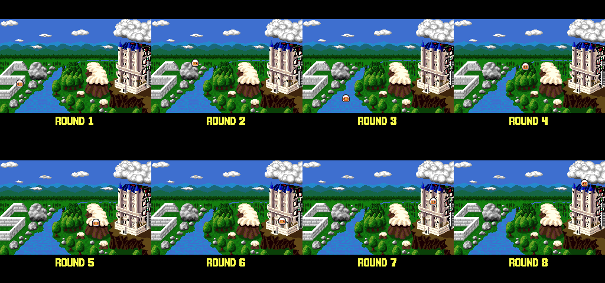

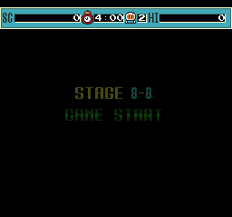 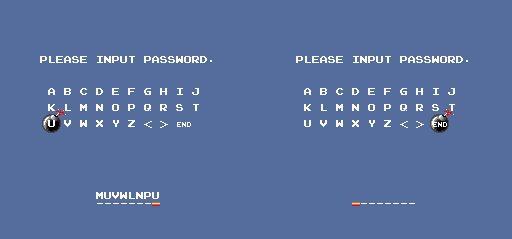

### Fuzz against the game's own decoder

The space is 2^32 byte values, too many to run through the emulator one by one (~750 decodes/s per Mesen
instance). What was run in the real decoder, with the result read at its own exits (`$CCD0` valid with
`$345A-$345E`, `$CCD6` invalid):

| Set | Codes | Accepted | Mismatches with `password.py` | US | JP |
|---|---|---|---|---|---|
| `tools/pce90/fuzz.py`: one code for each of the **19,200 states** (random flip and shift 0-7), 10,000 random in-row codes, every letter A-Z at every position of one code, all 256 values of byte 0 under three tails, BOMSOUND | 30,177 | 19,235 | 0 | yes | yes (same counts) |
| `tools/pce90/fuzz_all.py` (`fuzz_all.lua`): byte 0 = `$10`, bytes 1-3 = every value `$000000`-`$030D3F` in a row | 200,000 | 1,019 | 0 | yes | |

`fuzz.py` reloads a savestate for each code. `fuzz_all.lua` instead patches a small loop into free ROM in bank 2
(`$D600`, `$FF` fill in the dump): it builds the letters, jumps to `$CBAE`, and both decoder exits jump back to it,
so no Lua runs per code; accepted results go through a ring buffer at `$3100`. Both methods gave identical
accepted lists over the same 200,000 codes. The total of 5,930,496 is computed exactly from the bit layout above
(`count_valid()`), and the layout is what every emulator run confirmed. `password.mjs` matches `password.py` on
202,743 codes (200,000 random plus 2,743 encoded).

JP: the decoder, tables, BOMSOUND check and encoder are byte-identical to US apart from the bank-0 JSR targets
(`$CCE7`, `$CB14`, `$CB1F`). The JP `fuzz.py` run gave the same 30,177 / 19,235 / 0, and the 8 codes typed in JP (BOMSOUND
included) all behaved as predicted. **Both versions take the same passwords.**

## Entering a password

Title menu: PASSWORD is the 4th item (three Downs from 1P START / GAME START, then Run).

- The screen shows the grid `A-J` / `K-T` / `U-Z < > END` and eight dashes. The **grid cursor starts on A**
  (`$3444` = `$3445` = 0, `$02:C6C7`); the **input position starts at the first dash** (`$344F` = 0).
- **D-pad** moves the grid cursor (`$02:C7D3`). Left/Right wrap within the row: 10 columns on the first two rows,
  9 on the last (`U V W X Y Z < > END`). Up/Down wrap over the 3 rows; moving onto the last row from column 10
  (J or T) lands on END (`$02:C825`, `$02:C881`).
- **I or Run** (`$220A & $09`) on a letter writes it at the input position and moves right (`$02:C8FF`). After
  the 8th letter the position stays on the 8th, so further letters overwrite it.
- **II**, or **`<`**, moves the input position left without erasing (`$02:C93A`); **`>`** moves it right, but
  only as far as letters have been typed (`$02:C948`).
- **END** submits (`$02:C959`): first the BOMSOUND compare, then the decoder. On a bad code PASSWORD ERROR
  shows, the letters are cleared and the position goes back to the first dash (`$02:CCD6`). A good code goes to
  the ROUND screen and then STAGE x-y GAME START. A code with empty positions is rejected (a space is in no row).

## Secrets

### BOMSOUND: sound test (Known)

`$02:C959` compares the 8 letters with `BOMSOUND` at `$02:C96F`. A match sets `$3451` = `$FF` and then falls
into the normal decoder, which rejects it (the code is invalid as a password), so PASSWORD ERROR shows. The flag
survives: when the next **valid** code is entered, `$02:C76B` sees `$3451` = `$FF` and jumps to the sound test at
`$02:C59E` instead of copying the code to `$284A`. The flag is cleared only when the password screen is opened
again (`$02:C6CD`).

Sound test controls (`$02:C5EC`): I and II step the number `$3440` up and down through `$00-$39`, Run plays it,
Select stops. There is no exit: only a reset leaves the screen. Verified in US and JP: BOMSOUND, END,
MUVWLNPC, END → SOUND-00.

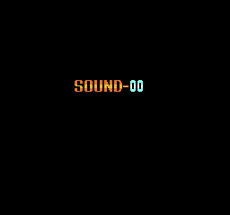

### Special Select Room (Fixed)

The known method: "300 points or more", reset, hold Down+Select+I+II as the title reappears after the first demo, Run on the
menu, keep holding Run through the intro. The check is `$01:A001`, called at `$00:EAEC` when the 1P intro ends,
only if the mode is 1P START (`$33B6` = 0), `$33BA` = 0 and `$284A` ≠ 8. It opens the room only if all of these
hold at that moment:

1. `$2200 & $4F = $4F`: **Down, Run, Select, II and I all held**;
2. `$10` ≠ 0: the **last attract demo played to its end**. Pressing Run during a demo clears `$10`
   (`$0B:CD86` → `$0B:CDC2`);
3. `$2001` = 3: the **hundreds digit of the high score is exactly 3**. So 300-390, 1,300, 2,350... work, and
   200 or 400 do not. "300 or more" is wrong.

The reset isn't needed itself: it's just a quick way back to the title with the high score kept, after which
the title times out into a demo. Holding the buttons before the menu appears means the menu never sees a new
Down or Select press, so the cursor stays on 1P START and Run starts the game.

Verified in Mesen (`tools/pce90/test_select_room.lua`, buttons held from the demo on, high score written to RAM),
left to right: 300, 400, 300 with the demo cut by Run, 300 without the reset, 1,300, 200. Only 300, 300 without
reset and 1,300 open the room. JP: same code at the same address, 300 opens it and 400 doesn't.

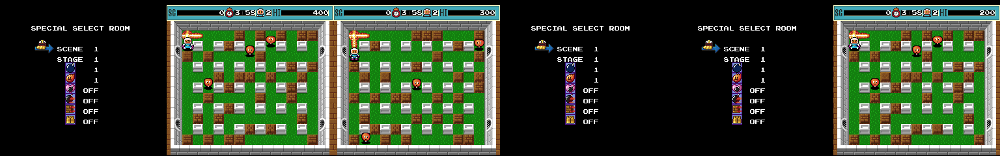

The room (`$01:A063`): Up/Down (or Select) moves between the 8 lines, I/II change the value: SCENE 1-8
(`$284A`, wraps), STAGE 1-8 (`$284B`), bombs 1-10 (`$284C`), fire 1-15 (`$284D`, again past the in-game cap of
5), and four ON/OFF power-ups, which are the `$243A` bits `$10` (remote control: bombs don't tick, II sets them
off, `$09:8FA3`/`$09:90A0`), `$20`, `$40` (`$20` bomb pass: cell type 0 is a bomb, `$09:8B03`; `$40` wall pass: types 2-6 are soft blocks,
`$09:8B0C`; from the code, not played) and `$80` (invincible, `$09:8716`). ★ **New:** entering the room also sets
`$284E` = 1 (`$01:A049`), so the game always starts with the roller skate. Run starts the chosen stage.

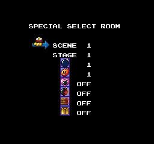

### TurboTap detection (★ New, minor)

When a battle mode is chosen, `$00:E371` compares the new presses of all five pad ports. Without a TurboTap
every port reads pad 1, so all five are equal and `$33` = 0; any difference sets `$33` = 1. In 2-5P BATTLE
`$08:601E` sends `$33` = 0 to `$08:78D9` (not traced; presumably the known tap error screen) instead of the
battle setup; C-LINK BATTLE skips the test. So with a tap,
the check fails only if all five players happen to press exactly the same buttons on the same frame.

## ★ Hidden bonus items

The item table (`$09:8757`) has 15 entries, but the stage lists (bank `$0C` `$43F3`) only use items 0-7, and item 8
(the skull) is battle only. Items 9-14 are bonus items that `$0A:A937` spawns once per stage when a hidden condition is
met (never on x-8 stages, never in battle); picking one up adds the points below (score digits `$2413`-`$2419`).

| Item | Condition | Points | Checked |
|---|---|---|---|
| 9 | every soft block destroyed (`$65` = 0, `$0A:A8CA`) | 18,800 | Mesen: spawned and collected |
| 10 | the clock falls below 1:00 (`$2D8D` = 0, `$0A:A8E0`) | 24,800 | Mesen: spawned and collected |
| 11 | every enemy dead with no soft block broken (`$2D96` = 1, `$65` = `$66`, `$0A:A8F7`) | 39,800 | Mesen: spawned and collected |
| 12 | stage 8-7 cleared in a game begun with 1P START, not a password, LOAD or the Select Room (`$71` = 1, set at `$01:A694`; `$0A:A914`) | 10,000,000 | Mesen: spawned and collected |
| 13 | the last soft block broken is the one hiding the exit (`$72` = 1 via `$09:9368`, `$0A:A8BA`) | 111,110 | Mesen: spawned and collected |
| 14 | standing on the uncovered exit at exactly 3:33 with enemies alive (`$09:88FB`, every frame) | 123,450 | Mesen: spawned and collected ([img](img/pce90/bonus_item_14.png)) |

In Mesen (US, from password `MUVWLNPC`) one RAM write forces each: `1F0065:00` (9), `1F0D8D:00` (10), `1F1D96:01` (11),
`1F0072:01` (13). JP gives the same for item 9. Users Battle has the same code, inside its dead 1P game.
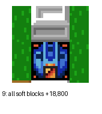 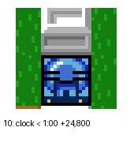 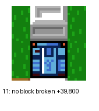 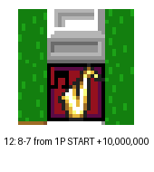 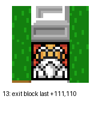

## Unused content

- **Music 2D and 39 (Fixed: used, in C-Link battle only).** The battle result code plays `$31` (`$08:6E2A`) and
  `$32` (`$08:7389`). In C-LINK BATTLE (`$33B6` = 2, two consoles linked) each console checks its own player
  (`$53`) instead: if that player's status bit 0 is set (`$23BD`/`$23BE`, the "dead" state set at `$09:8CBD`),
  it plays **`$39`** in place of `$31` and **`$2D`** in place of `$32` (`$08:6E4B`, `$08:73AD`). So the known
  "alternative death theme" (39) and "slowed-down Game Over" (2D) are the losing console's jingles. A link
  cable can't be emulated, so this is from the code only. Same in JP (`$08:6E7F`, `$08:73E1`).
- **Music 36, 37, 38 (Known).** No `LDA #n / JSR` to the sound routine (`$EA57` US, `$EA3E` JP) uses `$36`, `$37`
  or `$38` (nor `$00`, `$0E`, `$15`, `$16`, `$1E`, `$26`) in either ROM. They are reachable only from the sound
  test (range `$00-$39`, `$02:C5FB`). The scan finds only immediate operands, so a number loaded from a table
  wouldn't show; the absent `$0E`-`$26` are probably stage tunes picked that way.
- **Black Bomberman sliding sprite (Known):** already known, not located in the ROM here.

## Regions

| | US | JP |
|---|---|---|
| Passwords, BOMSOUND, Special Select Room | same code and data | same |
| Title menu | 1P START, 2-5P BATTLE, C-LINK BATTLE, PASSWORD, LOAD | GAME START, BATTLE, BATTLE (link icon), PASSWORD, LOAD |
| Password prompt | PLEASE INPUT PASSWORD. | PASSWORD ヲ ニュウリョクシテクダサイ |
| Title logo | ™ added | no ™ |
| Copyright line | FROM NEC ©1991 HUDSON SOFT | ©1990 HUDSON SOFT |

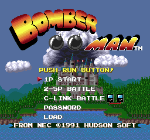 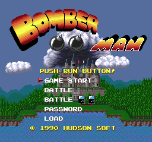

The game also saves to backup RAM (Tennokoe / CD-ROM² "file cabinet"; strings `BOMBERMAN1-3`, `!BM FORMAT!`,
`WHICH FILE TO LOAD?`, LOAD on the title, SAVE after a game over). The file list shows round and stage per file (`$02:D286`). This is a normal feature; it isn't covered further here.

## Title logos

`docs/img/logos/pce90_us.png` (227×71) and `pce90_jp.png` (231×71, no ™). The title screen's VRAM, VCE palette
and SAT were dumped at frame 600 (`tools/pce90/vdump.lua`). The logo is BG: BAT tiles 33-63 × 2-13 of the
128×64 map, which the title shows by a raster split. `tools/pce90/logo.py crop` renders those tiles (4bpp
planar, palette from the BAT word) with colour 0 transparent and crops to the bounding box. The cloud and the
eyes on the two bombs seen on the title are sprites (palette 3, behind the BG), so they aren't part of the logo.

## Hidden-content sweep

Six passes over US and JP, with the tools named below. Coverage came from Mesen runs (portable copies, code/data
logs merged): all 64 stages (passwords for 1-1 and 5-1, random input, each stage cleared by writing `$2437`, deaths
patched out), the ending (8-8 by password, the stage-clear test at `$00:EC5F` forced), three game overs with SAVE,
CONTINUE and END and a LOAD from the title, the attract demos, the password screen, BOMSOUND and all 58 tunes, the
Special Select Room with every line changed, and TurboTap battles (normal and skull mode, 2-5 players). Executed
code: **32,213 bytes** (US), **32,173** (JP). Scripts: `tools/pce90/cov_1p.lua`, `cov_ending.lua`, `cov_gameover.lua`,
`cov_battle.lua` (on a TurboTap Mesen copy) and `test_cheats.lua`.

### Dead code

`tools/pce90/deadcode.py` traces the ROM from the vectors plus every executed code start (Mesen's jump-target and
sub-entry flags). It lists each stretch of traced code that never ran, with its static references, and it decodes
the stretches the trace never reached ("orphans"). Full lists: `disasm/pce90/dead_us.txt` and
`disasm/pce90/dead_jp.txt`. The listings were regenerated with the new entry points (`disasm/pce90/us.asm`, `jp.asm`,
`entries_us.txt`, `entries_jp.txt`).

| | US | JP |
|---|---|---|
| never-run code reached by a branch or call from code that ran (`cond`) | 233 stretches, 3,570 bytes | 247, 3,388 |
| reached only from other never-run code (`dead`) | 63, 4,799 | 61, 4,900 |
| no reference found (`noref`) | 23, 916 | 19, 831 |
| orphan code (never traced) | 42, 1,704 | 49, 2,059 |

Almost all of it is **reachable only in situations the runs didn't cover**:

| Where (US) | Bytes | What it is |
|---|---|---|
| `$08:60EF-$77E2`, `$0A:A97C`, `$0B:D000` | ~2,500 | C-LINK BATTLE: the BOTH OF YOU MUST HAVE THIS SCREEN setup (`$08:6107` points at the text), the link I/O, which writes the pad port `$1000` and polls it in a timeout loop (`$0B:D000`; Users Battle doesn't have it), and the link-mode result and sync code (`$0A:A68C`: `$33B6` = 2). It needs a second console. |
| `$00:F6EF-$FEAB`, `$02:D106-$D1FF` | ~1,100 | the backup-RAM file manager's paths for a full or unformatted file cabinet (format, delete a file, MEMORY IN YOUR FILE CABINET IS NOT ENOUGH). Mesen's backup RAM always had room. |
| `$0A:B04D-$BCDF`, `$0B:C1B5-$C4ED` | ~3,000 | enemy and boss states the random bot never triggered, and the real 8-8 clear test (`$0B:C1A2`: `$3377`, `$2D96`, all enemies gone) |
| `$09:8796-$88F2` (`noref`, table `$09:8759`) | 330 | handlers for items the bot never picked up, reached through the item jump table |
| `$02:C802-$C8B3` | 100 | password-grid cursor wrap cases |
| `$04:91xx-$9Cxx` | 250 | sound-driver branches (effects and channel states no tune that played used) |

★ **New: unreferenced and debug code**

- **A pad recorder at `$00:EBA2` (JP `$00:EB89`).** It sits right after the attract-demo player `$00:EB75` and is
  its mirror image. The player reads 3 bytes per frame (held, new, previous) from `($7D)` into `$3F/$40/$41`. The
  recorder writes `$3F/$40/$41` to `($7D)` and advances the pointer, using the same bank table `$EBCF`. Nothing calls
  it (no JSR, JMP or pointer anywhere). `($7D)` points into the ROM bank that holds the demo input, so on a HuCard
  the writes go nowhere. It's the tool the demos were recorded with, on hardware with RAM in place of the ROM. Users
  Battle doesn't have it. *Debug, unreferenced.*
- **A typo in a queue routine at `$00:F2D2` (JP `$00:F2B9`, Users Battle `$00:F1F3`).** When the 128-entry queue at
  `$76/$77` is full, the routine saves `$2213` to `$73`, then saves `$2215` to `$73` too. Later it restores `$2215`
  from `$74`, which nothing ever writes. The path never ran. Forcing `$74` = `$FF` changed nothing: `$F2D2` ran 0
  times in 3,000 frames of play. *Reachable only on overflow; latent bug.*
- `$00:E230` is the timer-interrupt handler (vector `$FFFA`), and the timer is never enabled. `$00:F5E6` is entry 2
  of the VDC-setup jump table `$00:F559`, which no caller selects. `$00:EB09` (JSR `$EABC` / JMP `$ABCF`) looked
  unreferenced in the old listing, but it's the ending's entry, reached from `$08:7C73` after 8-8 (it ran).

Nothing looked cut: no orphan routine refers to unused text, music or RAM.

### Input codes

`tools/pce90/padscan.py` lists every read of the pad bytes (`$2200-$220E`, and the copies `$3F-$41`) that is tested
against a constant, a table or a multi-button mask. It found 20 hits in the full US listing, and the same set in JP.
Each was checked against the code and the runs:

| Hit | What it is |
|---|---|
| `$00:E351` / `$E358` | soft reset: Select newly pressed while Select+Run are held, on any port |
| `$00:E371-$E37E` | the TurboTap test (all five ports equal) |
| `$01:A004` | the Special Select Room's Down+Run+Select+II+I |
| `$01:A204-$A25C` | the room's line editing (I / II / Up / Down) |
| `$00:F6B1` | D-pad auto-repeat in the file screens |
| `$09:83D4`, `$09:8BE6` | walking |
| `$09:8F3F-$8FAC` | the skull illnesses that rewrite the held buttons (`ORA #$01`: bombs drop by themselves; `AND #$FE`: you can't drop one) and the remote control's II |

BOMSOUND is the only typed code (a string compare at `$02:C959`). **Neither version has any other hidden input code**
(known: Special Select Room, BOMSOUND, soft reset).

### Unset flags

`tools/pce90/flags.py` lists RAM that is read but never written, counting direct, indexed and block writes (a raw
scan of the ROM for store opcodes catches code the trace missed). It also lists RAM that code that ran reads, but
that only code that never ran writes. US and JP give **one** address: `$2074`, read only by the queue typo above.
Forced to `$FF` every frame in Mesen for 3,000 frames of play, it changed nothing. Every other flag that live code
reads is set somewhere.

### Text

`tools/pce90/textdump.py` decodes every text list (records `x y text`, ending in `$FE` / `$FF`; ASCII plus half-width
katakana) and marks the ones whose bytes were read in the runs. Dumps: `disasm/pce90/text_us.tsv`,
`disasm/pce90/text_jp.tsv`. Lists drawn by a block transfer don't get the data bit, so each unread string was also
checked for a code reference.

- **US**: every real string is used or reachable. The unread ones are the file-cabinet-full prompts (MEMORY IN YOUR
  FILE CABINET IS NOT ENOUGH. / DO YOU WISH TO DELETE FILES FROM YOUR CABINET? YES NO) and PASSWORD ERROR, which does
  show but is drawn by a block transfer.
- **JP**, with translations:

  | String | Translation | Status |
  |---|---|---|
  | PASSWORD ヲ ニュウリョクシテクダサイ | please enter the password | used |
  | ドレヲ LOAD シマスカ? / ドコニ SAVE シマスカ? | which one will you load? / where will you save? | used |
  | ドレヲ ケシマスカ? / マダ タリマセン / ケシテモ ヨイデスカ? YES NO | which one will you erase? / still not enough / OK to erase it? | backup RAM full only |
  | BACKUP RAM ノ メモリーガ タリマセン。 RAMチュウ ノ データヲ ケシマスカ? | not enough backup RAM memory. Erase data in the RAM? | backup RAM full only |
  | イズレカノMODEヲ エランデクダサイ | choose one of the modes | used |
  | タイセンスルニンズウヲ キメテクダサイ | decide how many will battle | used |
  | ショウセンカイスウヲ エランデクダサイ | choose the number of wins | used |
  | リョウシャトモ コノガメンニシテクダサイ / ドチラカガサキニ RUNボタンヲ オスコトニヨリ ホワイトボンバーマンヲ シヨウスル プレイヤーガケッテイサレマス | both of you, bring up this screen / whoever presses RUN first is the player who uses White Bomberman | C-Link (US: BOTH OF YOU MUST HAVE THIS SCREEN...) |
  | ★ アナタハ ホワイト ボンバーマン デス / アナタハ ブラック ボンバーマン デス | you are White Bomberman / you are Black Bomberman | **no reference found** (`$08:61E9`, `$08:6203`); the US card has no counterpart |

- Both: the whole staff roll at `$01:AE26` shows in the ending: Game Designer Tsukasa Kuwahara, Main Programmer
  Atsuo Nagata, Sub Programmer Wrecker Muroya, Graphics Designers Hideyuki Ogura and Mika Sasaki, Music Composer
  Atsushi Chikuma, Sound Programmer Keita Hoshi, Produced By HUDSON SOFT. "Wrecker Muroya" fits the password rows,
  which start `MUROYA...` and `WRECK...`.

### Maps

★ `tools/pce90/maps.py` decodes the stage format and renders every layout to `docs/img/pce90/maps/`
(`r<round>-<stage>.png`, `battle.png` and the contact sheet `_all.png`). Each image carries the stage id, header
address, layout type, soft-block count and block addresses. The US and JP data are byte-identical (all 67 renders
match).

- **Stage header** (bank `$0C` at `$4000`, `$00:ED94`): `$4028` + 2 × round → 8 stage pointers → 2 bytes, the layout
  type and the soft-block count. Round 9 (`$284A` = 8) is the battle arena.
- **Layout types**: `$4000` + 4 × type holds slot:block nibbles. The map at `$244A` is 32 × 32 cells in four 16 × 16
  slots (`$00:EEC5`). Types 0 and 1 are one screen (battle; rounds 1-2), type 2 is two screens tall, type 3 two
  screens wide. The soft blocks are **not** in the data: `$00:ED19` scatters the stage's count at random over the
  type's area (`$4020` / `$4024`), skipping shadow cells, so each play of a stage has a different block layout.
- **Blocks** (banks `$0D/$0E`, table `$00:EED5` + 2 × round): 16 rows, each RLE-coded (`$F0` ends the row,
  `$F1 n a b` repeats a pair, `$F2-$FF` is a run, anything else one tile). A tile below 8 is floor with graphic t
  (cell `t × 32 | $0A`), anything else wall (cell `$01`). Cell types in play (`$09:8AE0`): 0 bomb, 1 wall, 2-6 soft
  block (2) and its break animation, `$0B` and up fire.
- Soft-block counts climb from 30 (1-1) to 144 (8-7); every x-8 boss stage has 0.
- ★ **New: an unused layout.** Round 1's block table has blocks 0 and 1, a full two-screen-wide arena in the round-1
  tiles (`$0D:4ED8`, `$0D:4F39`; `unused_r1_blk0.png`, `unused_r1_blk1.png`). Every round-1 stage is type 1 or 2,
  so nothing loads them. Rounds 2-8 use their blocks 0/1 for their wide stages.

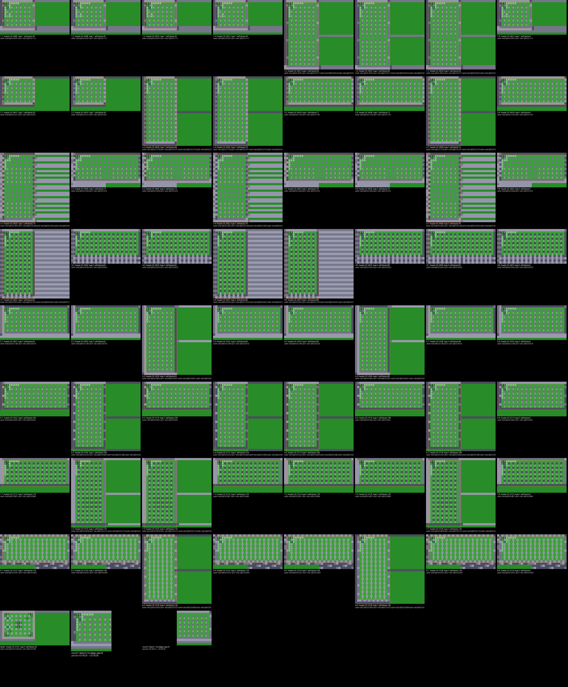

### Cheat codes

Mesen 2's PC Engine "raw" cheats replace the value the CPU reads at a **physical** address. RAM `$2xxx` (bank `$F8`)
is written `1F0xxx`/`1F1xxx`, and a ROM byte by its file offset. (Written as `F8xxxx`, Mesen ignored the code.) All of
these were verified in Mesen and are in `docs/pce90_codes.json` (`section: "cheat"`; the ROM patches are
`section: "patch"`).

| Code | Effect | Verified |
|---|---|---|
| `012AB3:60` + `014485:60` (US, Collection) / `012AD6:60` + `0144A8:60` (JP) | invincible to fire and enemies (RTS over the two checks; the clock still kills) | random-input bot, 6,000 frames: 0 deaths; without the cheat: 6 deaths and a game over |
| `1F0438:02` | infinite lives | 8 (US) / 9 (JP) deaths, no game over |
| `00200B:80` + `00200C:0B` | the Special Select Room after every 1P START intro, with no buttons held and any high score (round select) | the room code `$01:A063` ran in US, JP and the Collection |
| `1F1451:FF` | the sound test after any valid password | MUVWLNPC → SOUND-00 (US, JP) |

## Open

- The full 2^24 `fuzz_all.py` sweep was not run: it needs hours of emulator time on this machine.
- C-Link battle, the backup-RAM-full paths and the enemy states the bot never reached are read from the code only.
- Whether anything shows the JP "you are White / Black Bomberman" strings (no reference found).
- Where the black Bomberman sliding sprite is.
