# Bomberman '93 (PC Engine / TurboGrafx-16): passwords and secrets

Everything here comes from disassembling the three HuCards with `tools/huc6280.py 93` (recursive descent from
the reset vector, MPR bank tracking, extra entry points from Mesen 2 code/data logs via `tools/pce93/cdl2entries.py`;
output in `disasm/pce93/us.asm`, `jp.asm`, `sp.asm`) and checking the results in Mesen 2 with the Lua scripts in
`tools/pce93/` (`run.sh script.lua us|jp|sp`). Addresses are `bank:logical` in the USA version unless a version is named;
RAM is logical `$2000-$3FFF` (work RAM at MPR1 = `$F8`). The only prior art is a published article on the game in `res/`. Marks:
★ **New** (not in it), **Known** (it has it; any detail added is noted). There is no codes page, so every
password below is ★ New (status `unchecked` in `pce93_codes.json`).

| Dump | MD5 | Title logo |
|---|---|---|
| USA (TurboGrafx-16) | `795321485b7d58701cd5b661d6ad636a` |  |
| Japan | `17a08fca7468a24039f1a6c97015807f` |  |
| Japan, Special Version | `8930d24e64be677b898423a295b2bde0` |  |

All three are 512 KB (64 banks of 8 KB). See [Versions](#versions) for what differs.

## RAM that matters

USA and Japan use the same addresses; the Special Version's game variables sit 9 bytes lower (`$388C` for `$3895`)
and its password buffer at `$3C4D`.

| Address | Meaning | Evidence |
|---|---|---|
| `$3895` | world - 1 (0-6 in the Normal Game; 8 = Battle Game) | decoder `01:DD31`, battle entry `07:A6C8` |
| `$3896` | stage - 1 (0-7; stage 8 is the boss) | `01:DD37`, stage advance `02:847F` |
| `$3897` / `$3898` | bombs (1-10) / fire (1-5) carried between stages | `01:DD3D`, `01:DD43`; copied from the player at `02:90AD` |
| `$389A` | speed level (skates), 0-2 in play; copied into bits 4-5 of the player's `$9B` | `02:85D1`, `02:90C4`, skate item `03:A99B` (+1, max 2), slow-down item `03:AAEA` (-1) |
| `$3899` / `$389B` | other power-ups (bits for kick, line bomb, remote, block/bomb walk, ...); **cleared on death** (`02:8CD5`) and not in the password | config screen `08:8644` |
| `$389F` | lives in reserve (a new game sets 2) | `02:83F8` |
| `$38A1` | Normal Game state: 0 new game, 1 planet map, 2 stage, ... (jump table `02:83C7`) | `02:83BF` |
| `$38AF` | planets cleared, bit n = world n+1 (`$E0B5` = `01 02 04 08 10 20 40`); all of bits 0-5 opens world 7 | `02:8498`, `06:9B42`, `06:9C3B` |
| `$3C62-$3C69` | the 8 password letters (grid indices), decoded in place | `01:DC34`, `01:DCAC` |
| `$32-$36` / `$37-$3B` (zero page, `$2032`...) | pads 1-5 held / newly pressed: bit 0 I, 1 II, 2 Select, 3 Run, 4-7 Up Right Down Left | `08:8C82`, `07:A707` (JP) |
| `$3FFB` | the CONFIGRATION flag, set at the ending; survives a soft reset: the reset code clears only `$2200-$3FF9` (`00:E043`); power-on also clears the rest (`00:E031`) | `08:8C7D` US, `08:8C85` JP |
| `$3FFA` | backup RAM (Tennokoe / CD) present, `$FF` = none | `00:F2CB` |

## The password

Code: encoder `01:DC34`, decoder `01:DCAC` (USA; JP `06:99C4` / `06:9A3C`, Special Version `06:9723` / `06:979B`).
`tools/pce93/password.py` and `tools/pce93/password.mjs` do both directions.

8 letters from a 20-letter alphabet: US `B C D F G H J K L M N P Q R S T V W X Z` (no vowels), JP `A`-`T`. The JP grid
also offers `U`-`Z`, which never appear in a valid code. Each letter is its index 0-19 (p0..p7).

The game stores six values d0-d5:

| Value | Meaning | Range the decoder accepts |
|---|---|---|
| d0 | world - 1 | 0-6 |
| d1 | stage - 1 | 0-7 |
| d2 | bombs | 1-10 |
| d3 | fire | 1-5 |
| d4 | planets cleared, bits 0-3 (`$38AF & $0F`) | 0-15 (Special Version 0-14) |
| d5 | (planets cleared bits 4-5) << 2 \| speed | 0-15 (Special Version 0-14) |

Encoding (`01:DC34`):

1. S = d0 + d1 + ... + d5 (8 bits). p6 = S & 15, p7 = S >> 4. That is the checksum.
2. A 16-bit key K = p6 | p7 << 8 is rotated right by one bit, bit 0 going into bit 15 (`01:DC7E`: `LDA` low, `LSR A`, `ROR` high, `ROR` low),
   once before each letter; key x = K & 7 after x+1 rotations.
3. p0-p5 = d0-d5 + key0-key5.

Decoding (`01:DCAC`) does the reverse: subtract the keys (a letter smaller than its key is rejected, `01:DCC4`),
recompute S and compare with p6/p7 (`01:DCD1`), then check each range (`01:DCDF`-`01:DD1A`). A good code writes
`$3895-$3898`, `$389A` (d5 & 3) and `$38AF` (d4 + (d5 & 12) << 2) and returns carry clear (`01:DD47`).

Nothing else is stored: no lives, score, or kick/remote/etc. 7 × 8 × 10 × 5 × 16 × 16 = **716,800 valid codes**
(630,000 in the Special Version). Every state has exactly one code: the encoder has no random salt.

What the password can do that the game can't:

- ★ **Speed 3.** The game caps the skates at 2 (`03:A9A1`), but d5 takes 0-3. Speed 3 indexes the next entry of the
  speed table at `02:87E6` / `02:87EE` (Y = speed + 2 at `02:87B2`) and makes Bomberman faster than any skates allow.
  Measured in Mesen (`tools/pce93/test_speed.lua`, real presses, player sprite Y each frame while holding Down in
  1-1): speed 0 moves 3 px every 4 frames (0.75 px/frame), speed 2 8 px every 7 frames (1.14), speed 3 5 px every
  4 frames (**1.25**), until the wall two cells down.
- ★ **Any planet order.** The cleared mask is free, so world 7 (normally opened only when `$38AF & $3F` = `$3F`,
  `06:9C3B`) or any mix of cleared planets can be set. World 7 itself can't be forced early: a code for 7-1 with nothing
  cleared is accepted (`$3895` = 6) but the planet map puts you back on planet 1 (`$3895` = 0 in the stage). With
  all six planets cleared the same field takes you straight to world 7 (7-8 below).
- Bombs and fire are range-checked only against the normal caps (10, 5), so there is no over-cap power-up.

### Verified codes

Typed with real button presses on the entry grid in Mesen (`tools/pce93/test_passwords.sh`, one Mesen run per code, `test_password.lua`), state read after END
and again in the stage. The same letter positions give the JP code (see [carry-over](#codes-between-versions)).

| State | US | JP | Result in Mesen (typed in both versions unless noted) |
|---|---|---|---|
| 1-1, defaults | `CBCCBBDB` | `BABBAACA` | 1-1, bombs 1, fire 1; planet map, then 1-1 |
| 1-1, speed 1 | `CBCCBCFB` | `BABBABDA` | `$389A` = 1, player `$9B` = `$10` (US typed; JP by fuzz) |
| 1-1, speed 2 | `DCCCBDGB` | `CBBBACEA` | `$389A` = 2, `$9B` = `$20` (US typed; JP by fuzz) |
| 1-1, speed 3 | `DCCCBFHB` | `CBBBADFA` | `$389A` = 3, `$9B` = `$30` (★ above the maximum) |
| 3-5, 4 bombs, fire 2, speed 1, planets 1-2 | `DGGDFHBC` | `CEECDFAB` | as stored; in 3-5 the player's `$A0` = `$24` |
| 2-1, 10 bombs, fire 5, speed 2, planet 1 | `DBNHCJFC` | `CAKFBGDB` | as stored; player `$A0` = `$5A`, `$9B` = `$20` |
| 7-1, nothing cleared | `NDDCBBLB` | `KCCBAAIA` | accepted (`$3895` = 6), but the map starts planet 1: 1-1 |
| 7-8, everything | `PMPHTZNF` | `LJLFPTKD` | all stored; the map goes straight to the final stage |
| invalid | `BBBBBBBB` | | rejected: the entry is cleared and the cursor put on END (US) |

Special Version (through the patched menu, below): `BABBAACA` accepted, 1-1 with the same values.

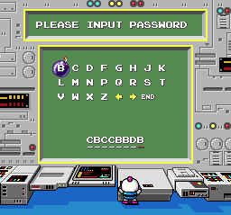 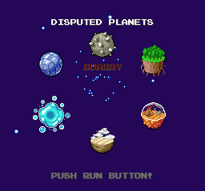 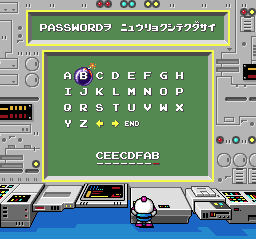 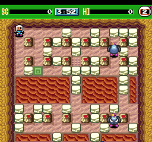 

`docs/pce93_codes.json` lists the start code for every stage (default power-ups) in both versions; any other state
comes from the generator (`python tools/pce93/password.py`, or `encode()` in `password.mjs`).

### Fuzz check against the game's own decoder

`tools/pce93/fuzz.sh` types one code for real, then at the decoder's entry writes each test code into the letter
buffer and reads the result at its two exits (`CLC` = accepted, with the six stored bytes; `SEC` = rejected), putting
the PC back on the entry for the next code (about 160 codes per frame). Inputs: every state the decoder accepts,
encoded by the same rule as `password.py`, plus 300,000 random letter strings (letters 0-19 US, 0-25 on the JP grid).
`tools/pce93/check_fuzz.py` compares every result with `password.py`:

| Version | Distinct codes run | Accepted by the game | Disagreements with `password.py` |
|---|---|---|---|
| USA | 1,016,791 | 716,800 | 0 |
| Japan | 1,014,800 | 716,800 | 0 |
| Special Version | 930,000 | 630,000 | 0 |

So the game accepts exactly the codes `password.py` accepts, and stores exactly the values it predicts.

### Codes between versions

The US and JP codecs are the same instructions with the same tables; only the letters drawn on the grid differ.
A code moves between them letter for letter by grid position: US `B C D F G H J K L M N P Q R S T` =
JP `A B C D E F G H I J K L M N O P` (the known "A = B, B = C, ..."; Known, and confirmed by the fuzz run, which fed
both decoders the same index strings). `convert()` in `password.mjs` does it.

The Special Version's decoder is the same except that d4 and d5 must be **below 15** (`CMP #$0F` instead of `#$10`):
a JP code whose d4 or d5 is 15 (planets 1-4 all cleared, or planets 5-6 cleared with speed 3) is rejected there.
Every other JP code is accepted, but the Special Version has no way to the password screen (below).

## Entering a password

USA: on the title choose **PASSWORD** (4th item) with the D-pad and press Run. JP: the same item, also called PASSWORD.
Special Version: there is no way in (see [below](#-the-special-version)).

- The grid is 8 letters per row; the cursor starts on the first letter. US: `B`-`K` / `L`-`T` / `V W X Z ← → END`.
  JP: `A`-`H` / `I`-`P` / `Q`-`X` / `Y Z ← → END`.
- D-pad moves the cursor; **I** types the letter under it into the next of the 8 places.
- Move to **END** and press **I** to submit. A good code goes to the planet map with the stored state; Run there
  starts the stage. A bad code is wiped and the cursor is put on END.
- (Not tested: the `←` `→` entries, presumably moving the entry position.)

Everything above was done with real presses in Mesen (`tools/pce93/lib.lua`, `type_pw` / `submit`). The game makes
codes itself on its continue screen (encoder called from `07:A2FA`); not played to here.

## Hidden screens and codes

### CONFIGRATION screen (Known; US access ★ New)

The known method: beat the game, at the end screen hold I and press Run, reset, start a Normal Game; JP only.

How it works: at the ending, `08:8C7D` (JP `08:8C85`) waits for I held (`$32` bit 0) and Run newly pressed (`$37`
bit 3), sets `$3FFB` bit 0 and plays a sound (`$F243`, effect `$0A`). `$3FFB` survives the soft reset. In JP, every
time the Normal Game reaches the planet map, state 1 far-calls `08:8620` (`02:843B`, `JSR $EACE / $8620 bank 8`);
that routine returns at once unless `$3FFB` is set, otherwise it draws the screen and lets you set STAGE, SCENE,
BOMB, FIRE, SHOES, BOMB KICK, LINE BOMB, RIMOCON, BLOCK WALK, BOMB WALK, FREE FIRE, REVIVE, STOCK, SE and MUSIC.

**USA:** the ending code still sets `$3FFB` and plays the sound (which is why the sound was already known), and the screen itself
is still in the ROM at `08:8620`, minus its `$3FFB` test. What is gone is the call: US state 1 (`02:8421`) goes
straight from the map to the stage. No byte in the US ROM calls `08:8620`, so **no input reaches the screen on a
retail US cart**. It can be put back with a 7-byte ROM patch at file offset `$4432`: `00 20 E7 EA 20 86 08`
(turns `BRA` at `02:8431` into a fall-through to a far call of `08:8620`), which then shows the screen after every
planet map.

Verified in Mesen (`tools/pce93/test_config.lua`, `test_config_use.lua`): JP with `$3FFB` = 1 and a soft reset
(Select+Run held): the screen appears after the opening of a Normal Game. STAGE +2,
SCENE +4, BOMB +3, STOCK +5 set with real presses; after Run the screen comes back at the next planet map still
showing them. US: `$3FFB` = 1, the Normal Game never shows it; with the patch it appears.

 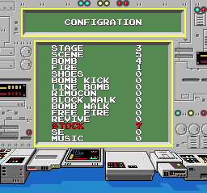 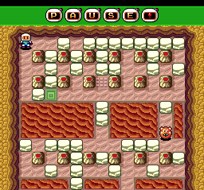 

### "Tap is not connected" screen (Known)

JP `07:A707`: on entering the Battle Game the game tests pad 5's held buttons, `$36 & $1F` = `$1F` (Up+I+II+Select+Run
held on pad 5, which with no Multi Tap is the single pad), and if so shows the error screen before the battle setup.
In the US version the test and its branch are gone (`07:A6D8` goes on to the setup). Verified in Mesen by writing
the pad-5 byte at the test (Mesen's test runner cannot drive pad 5): the screen appears in JP; nothing in US.

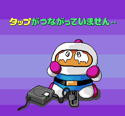

### Searched, nothing else found

- Every compare of a pad byte with an immediate value (`LDA $32-$3B` / `AND` / `CMP #`) in the three disassemblies:
  only the JP tap test. Every bit test on the pad bytes (`BBR`/`BBS`/`TST` on `$32-$3B`): menu and screen handling
  (I, II, Run presses); the only one that tests a held button together with a press is the ending's I+Run (`08:8C82`).
  Coverage is what the recursive trace plus the code/data logs reached, so code never run in the logs could hide more.
- The password decoder has no hard-coded code: it reads only the 8 letters and has no compare against fixed letters.

## Versions

### USA vs Japan

A shift-tolerant diff (16-byte runs of one ROM found nowhere in the other, as `tools/sb1/romdiff.py`) leaves about
73 KB unique to each, spread over the code banks (moved code) and the text and graphics banks.

- Password: same codec and checks; grid letters differ (no vowels in the US). Known.
- CONFIGRATION call and the tap test: removed in the US (above).
- Title: ™ added, "VS [ ][ ] GAME" → COM-LINK, © 1992 → TM & © 1993 (Known). The logo graphic is otherwise
  pixel-identical: the only difference is the ™ sprite.
- Text box 8 px wider, eyecatches redrawn (Known; not re-checked here).

### ★ The Special Version

It was listed as undocumented. It is a **Battle Game only** cart: the title shows the logo with a SPECIAL VERSION
banner and PUSH RUN BUTTON; Run goes straight to the battle setup (2-5 players, 1-5 wins). It differs from JP retail
in about 175 KB (more than half the code banks), and much of it looks older, not newer:

- The title's menu table (`06:984C`) has five entries, **all** `$A34E` (battle). The Normal Game, the password
  screen (`06:94A0`), the backup-RAM save/load code (file names "1 BOMBER-93" to "3 BOMBER-93" at `06:947C`) and the whole decoder are
  still in the ROM, unreachable.
- Its password decoder accepts d4/d5 only up to 14 (above); otherwise the same rules.
- Its leftover Normal Game shows an **older CONFIGRATION screen in place of the planet map, with no flag at all**:
  state 1 (`02:8421`) far-calls `08:88BD` unconditionally (and never the map). That screen has SOUND (a sound test, starting at 39, `$3894`)
  instead of the retail STOCK / SE / MUSIC items.
- Strings found only in the Special Version: SELECT STAGE, SOUND, PRESENTED BY 1992, the staff list with older
  spellings (TUKASA KUWAHARA, TOMOYUKI ENDOU, NAOKI KATOU, YASUYUKI NAKAJYOU); retail-only: CLEAR SCORE, CLEAR TIME,
  CONGRATULATIONS!, STAGE PLANET, STOCK, MUSIC, EYECATCH VOICE.

Verified in Mesen (`tools/pce93/test_passwords.sh sp`, which applies that patch through `sp_password()` in `lib.lua`): pointing menu entry 0 at `$94A0` in memory (`06:984C` = `A0 94`)
opens the password screen; JP code `BABBAACA` (1-1) is accepted and leads to the old configuration screen.
Run on that screen starts stage 1-1 of the Normal Game, which plays normally (`$3898` = 2, the stage state).

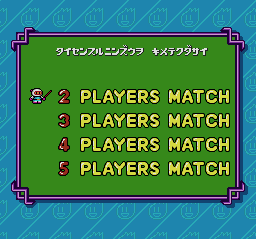 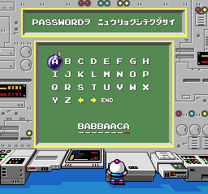 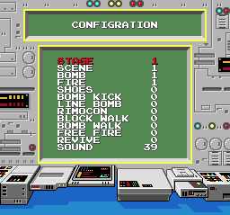 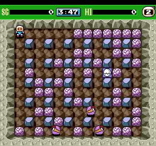

## ★ Items no stage gives you

An item's kind is `$A0` + its entry in the pickup table `03:A89F`; the per-stage lists (`03:AD9A` → `$ADAB`) use `$A0`-
`$AD`, `$AF` (the exit) and `$B0`-`$B3`, never `$AE` or `$B4`-`$B7`. (`$AA` is the alarm clock, which freezes enemies,
`04:80B5`; `$AC` speed-down, used once.)

- **Pierce fire, `$AE`** (orange flame): sets player bit 6 of `$91` (`03:AAFA`), and bomb fire no longer stops at the
  first soft block (`02:96D3`). Its only source is a hidden spawn (`03:AD4F`) from the enemy-spawn check `03:B4F2`:
  on world 2 stage 3, with 16 or more enemies on the field (`$3C5E` ≥ 16), bombing an item or the exit gives it instead
  of another enemy. Checked in Mesen (US) by holding `$3C5E` at 16. Cheats: `1F0091:40` (the effect: one bomb broke 3
  blocks against 1 without), or `006E3D:AE` (US; JP `006E43:AE`), which makes it 1-1's item.
  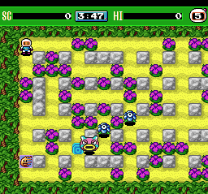 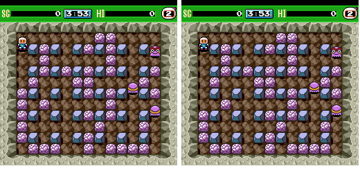
- **Red ribbon, `$B7`**: a bonus item with a pickup handler (`03:AB28`) that no list or spawn ever uses, in US, JP or
  SP. `006E3D:B7` puts it in 1-1. 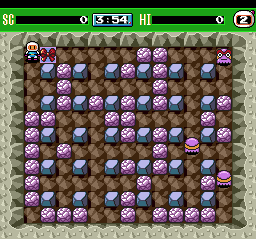
- **Onigiri `$B4`, chick `$B5`, tulip `$B6`**: bonus items spawned on a random floor cell once per stage (`03:AD74`).
  Tulip: the exit is uncovered when no soft blocks are left (not on stage 8), like 1990's item 13. Chick: fire hits
  cell type 6 while the clock reads exactly 2:22. Onigiri: counter `$3C54` reaches 200 (`03:AF65`). From the code;
  not triggered. 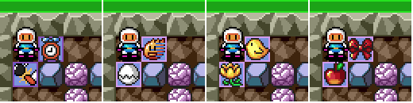

## Unused content

| What | Where | Versions | Reachable? |
|---|---|---|---|
| CONFIGRATION screen | `08:8620` | US (JP: hidden code) | US: patch only |
| "Tap is not connected" screen | `07:A712` | JP | JP: pad-5 hold |
| Normal Game, password, save/load screens | bank 2, `06:94A0`, `06:9430` | Special Version | patch only |
| Old CONFIGRATION screen with SOUND test | `08:88BD` | Special Version | patch only |
| Clear-time page of the ending | `08:8CBE` | US, JP | without passwords and continues |
| Map chunks `$3E`, `$6C` (SP `$68`) | file `$17014`, `$17EA0` (SP `$17C91`) | all | no |

## Deep sweep (dead code, input codes, unset flags, text, maps, cheats)

Method. 23 coverage runs over the three carts in fresh portable Mesen copies (one run per test, no `emu.reset()`):
`tools/pce93/cov.py` + `cov.lua`. Segments: a password, then every stage of every world by writing world/stage and
losing a life (the death path reloads the stage); the ending; game over and continue; the password screen with
random input; the Battle Game with the stage forced to cycle through all nine; the VS / COM-LINK item; title idle.
Each run leaves Mesen's code/data log and a bitmap of every RAM byte ever written non-zero. The sweeps are
`tools/pce93/sweep.py` (`dead`, `pad`, `flags`), `tools/pce93/text.py` and `tools/pce93/maps.py`; their outputs are
`disasm/pce93/dead_*.txt`, `pad_*.txt`, `flags_*.txt`, `text_*.txt`, `maps_*.txt`.
Fixed on the way: `cdl_dump` in `tools/pce93/lib.lua` dropped the first byte of the log (the Lua table is 0-based),
so the logs behind the earlier entry lists were one byte off.

### Dead code

| Version | Never-executed traced blocks | Bytes | After an executed branch or called by run code | Called only from dead code | Reached only through a jump table | Orphans (untraced, never run, decode as code) |
|---|---|---|---|---|---|---|
| USA | 418 | 13,590 | 287 (5.3 KB) | 81 (6.6 KB) | 50 (1.7 KB) | 148, 6.3 KB |
| Japan | 415 | 14,726 | 276 (5.0 KB) | 84 (7.6 KB) | 55 (2.2 KB) | 150, 6.6 KB |
| Special Version | 476 | 16,746 | 190 (3.6 KB) | 228 (9.5 KB) | 58 (3.6 KB) | 224, 10.3 KB |

Most blocks are error paths and branches random input never takes. The large ones, read and classed (USA
addresses; JP and SP have the same groups):

| Code | What it is | Class |
|---|---|---|
| `00:F445`-`F6xx`, `07:ACA9`-`AD2A` | COM-LINK / VS link: serial handshake through the pad port `$1000` after the "who pushes RUN is White" screen (world 9, set at `07:AC61`) | needs a second console and the cable; the screen itself was reached (below) |
| `00:FA96`-`FE82`, `06:9320` (802 bytes), `06:9654` | backup-RAM file system and the SAVE / LOAD / DELETE / FORMAT screens (title item LOAD) | needs a Tennokoe / CD backup RAM: situation not covered |
| `08:8620`, `08:86C3`, `08:87AF` | US: the CONFIGRATION screen | US: unreferenced (orphan, see above); JP: reached |
| `08:8CBE` | CONGRATULATIONS! / CLEAR TIME / CLEAR SCORE page of the ending | ★ reachable only without passwords and continues (below) |
| `08:8871` (317 bytes) | the lose-a-life path from state 6 with more than one life left | not covered (lives were kept up) |
| `02:874D`, `02:8766` | player input modifiers: stuck direction, swapped Up/Down and Left/Right (skull curses) | battle items not picked up |
| `05:B549`-`BE8E` (1.9 KB), `04:9D14` | boss behaviour phases | bosses were not hurt by random input |
| `13:415A`, `13:4254` | sound-driver commands no track uses | unused |
| `00:EE60` | an empty `RTS` called every frame just before the pad is read, next to the `$2F99` test (below) | ★ debug hook stub, cut |
| `00:EDB4` | the pad-read skip taken when `$2F99` is not 0 | its flag is never set |

### Input codes

`sweep.py pad` lists every read of the pad bytes (`$32`-`$3B`) with the compares that follow, and flags compares
against tables, multi-bit constants and a held-button test next to a newly-pressed test. Hits, all three carts:
the pad reader itself (`00:EDBB`), the password-grid cursor (`06:9898`, `08:87F8`: compares of the cursor index),
JP's pad-5 tap test (`07:A707`, Known) and the ending's I held + Run pressed (`08:8C7D` US / `08:8C85` JP, Known).
There is no other button code in any version.

The ending code was now played to with real presses (it was written directly before): the test runs **every frame**
on the END screen (logged over 6,000 times), so holding I and pressing Run works any time there; `$3FFB` became 1 in
US and JP. 

### Flags that are read but never set

Candidates: RAM read by the code but never stored to (static), and never written non-zero in any run (`flags_*.txt`),
plus the bits of the player's ability byte that no code sets. Each was set in Mesen.

| Flag | Read at | Set by the game? | Set in Mesen | Status |
|---|---|---|---|---|
| player ability `$91,X` bit 5 (`$2091` for player 1) | death check `02:8C79` (skips death), sprite flash `02:9171` | set for about 120 frames after a hit (`03:ACE8`, the blink when the heart item absorbs one); cleared `03:ACD6` | **invincible**: stood on its own bomb, lives stayed 2; with the bit clear the same test lost a life | ★ New |
| `$91,X` bit 4 | `02:96DF` (sets `$B1` bit 0) | never | survived its own bomb once, then died to an enemy; no clear effect | ★ New, effect unclear |
| `$91,X` bit 3 | fire check `02:8C9D` | yes: the vest item (`03:A9BF`, with a timer) | fire-proof | item effect |
| `$2F99` | pad reader `00:EDAF`: non-zero skips the pad read | never (cleared at `00:ED9B`) | input kept working; no visible effect | ★ New, effect unclear |
| `$38B1` | ending `08:8CB8`, clear timer `01:D93F` | 1 after a continue (`07:A191`) or a password (`01:D93B`) | 0 at the ending shows the clear page | ★ New |

The CONFIGRATION screen's BOMB WALK item is shown and changed but never stored (`08:862E` clears `$2204`, and the
write-back at `08:86C3` skips it), so it does nothing. ★ New.

★ **The clear-time page.** The ending shows CONGRATULATIONS!, CLEAR TIME (counted from the start of a new game,
`01:D93F`) and CLEAR SCORE only when the game was finished from a new game with no password and no continue. Shown
in Mesen with `$38B1` = 0 at the ending (cheat `1F18B1:00` below): 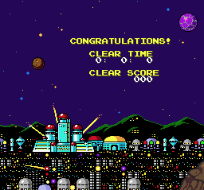

### Text

`text.py` dumps every string: ASCII plus half-width katakana (JIS X 0201, `$A1`-`$DF`), ended by `$00`, after a
3-byte position header. 251 (US), 226 (JP) and 195 (SP) strings, the ones no run read marked NEVER, in
`disasm/pce93/text_*.txt`. Unused or unreached groups:

- the CONFIGRATION item names (unreachable in the US), the COM-LINK texts (BOTH PLAYERS START HERE AT THE SAME
  TIME..., WHITE / BLACK BOMBER MAN PLAYER, RETRY..PUSH RUN BUTTON, GET READY!), the backup-RAM texts (WHICH FILE TO
  SAVE TO?, DATA ERROR!, FILE CABINET IS FULL, DELETE DATA?, FORMAT IT NOW?), CONGRATULATIONS! / CLEAR TIME /
  CLEAR SCORE. The link screen (title item 3) is reachable and waits for the other console:
  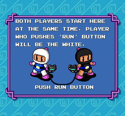 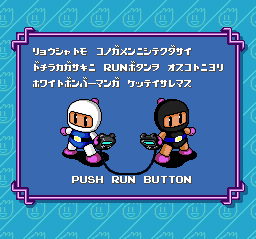
- The Japanese texts, translated:

| Japanese | Translation |
|---|---|
| ﾄﾞﾚｦ LOAD ｼﾏｽｶ? / ﾄﾞｺﾆ SAVE ｼﾏｽｶ? | Which one do you load? / Where do you save? |
| ｹｼﾀｲﾃﾞｰﾀｦ ｴﾗﾝﾃﾞｸﾀﾞｻｲ / ﾖﾛｼｲﾃﾞｽｶ? | Choose the data to erase / Is that OK? |
| ﾊﾞｯｸｱｯﾌﾟﾗﾑｶﾞ ｲｯﾊﾟｲﾃﾞｽ | The backup RAM is full |
| ﾊﾞｯｸｱｯﾌﾟﾗﾑ ｶﾞ ｼｮｷｶ ｻﾚﾃｲﾏｾﾝ ｼｮｷｶ ｼﾏｽｶ? | The backup RAM is not formatted. Format it? |
| PASSWORDｦ ﾆｭｳﾘｮｸｼﾃｸﾀﾞｻｲ | Please enter the password |
| ﾀｲｾﾝｽﾙﾆﾝｽﾞｳｦ ｷﾒﾃｸﾀﾞｻｲ / ﾄﾞﾉﾎﾞﾝﾊﾞｰﾏﾝｦ ｺﾝﾋﾟｭｰﾀｰﾆｼﾏｽｶ? | Choose the number of players / Which Bombermen does the computer play? |
| ｺﾝﾋﾟｭｰﾀｰﾉﾚﾍﾞﾙｦ ｷﾒﾃｸﾀﾞｻｲ / ｼｮｳｾﾝｶｲｽｳｦ ｴﾗﾝﾃﾞｸﾀﾞｻｲ / ﾀｲｾﾝｽﾙｽﾃｰｼﾞｦ ｴﾗﾝﾃﾞｸﾀﾞｻｲ | Set the computer's level / Choose the number of wins / Choose the stage |
| ﾘｮｳｼｬﾄﾓ ｺﾉｶﾞﾒﾝﾆｼﾃｸﾀﾞｻｲ / ﾄﾞﾁﾗｶｶﾞｻｷﾆ RUNﾎﾞﾀﾝｦ ｵｽｺﾄﾆﾖﾘ / ﾎﾜｲﾄﾎﾞﾝﾊﾞｰﾏﾝｶﾞ ｹｯﾃｲｻﾚﾏｽ | (VS link) Both players go to this screen / Whoever presses Run first / becomes White Bomberman |
| ｱｼﾞｱﾝｽﾀｰ, ﾌﾞﾗｼﾞﾗｽﾀｰ, ｻﾞｳﾙｽｽﾀｰ, ﾃﾞｭｰﾝｽﾀｰ, ｱｸｴﾘｱｽｽﾀｰ, ｸﾘｽﾀﾙｽﾀｰ, ｼﾞｪﾈｼｽｽﾀｰ | the planets: Asian Star, Brazil Star, Saurus Star, Dune Star, Aqueria Star, Crystal Star, Genesis Star (US: QUARRY, BLOSSOM, INFERNO, WITHER, SURF, ICICLE, TECHO) |
| ｱﾝｺｸ / ｼﾞｬﾝｸﾞﾙ / ｶｻﾞﾝ / ｻﾊﾞｸ / ﾐｽﾞ / ｺｵﾘ / ｷｶｲ ﾉ ﾎｼ | planet of darkness / of jungle / of volcanoes / of desert / of water / of ice / of machines |
| ﾎﾞｽ:ﾓﾝｶﾞｰ, ｻﾞﾝｺｸﾗﾝ, ﾌﾟﾃﾗﾉﾝ, ｶﾞﾊﾞﾗ, ｶﾆｺﾞｾﾞﾝ, ﾋﾊﾞﾄﾞﾝ | the bosses: Monger, Zankokuran, Pteranon, Gabara, Kanigozen, Hibadon (US: Digger, Petunia, Blastbat, El-Baal, the Cockle Twins, Grumpus) |
| ﾜｰﾌﾟｺﾞﾉ ﾌｧｲﾔｰ ｺｳｹﾞｷｦ ｻｹﾅｶﾞﾗ ｺｳｹﾞｷｾﾖ! | Fire after the warp. Dodge it and strike back! |
| ﾎﾞｽｶﾞ ﾎﾝﾀｲｦ ｱﾗﾜｽﾏﾃﾞ ｻﾞｺﾆ ｺｳｹﾞｷﾀﾞ! | Until the boss shows its true body, attack the small fry! |
| ﾁｼﾞｮｳﾆ ｵﾘﾀﾄｷｶﾞ ﾀﾞﾒｰｼﾞｦ ｱﾀｴﾙ ﾁｬﾝｽﾀﾞ! | When it comes down to the ground is your chance to hurt it! |
| ﾎﾞｽﾉ ｶｵﾆ ｱﾙ ｱｶｲ ﾎﾟｲﾝﾄｶﾞ ｼﾞｬｸﾃﾝﾀﾞ! | The red points on the boss's face are its weak spot! |
| ﾎﾞｽﾉ ｼｬｶﾞﾝﾀﾞﾄｷｶﾞ ｺｳｹﾞｷﾉ ﾁｬﾝｽﾀﾞ! | When the boss crouches is your chance to attack! |
| ﾎﾞｽﾉ ｼﾞｬﾝﾌﾟﾆﾊ ﾊﾞｸﾀﾞﾝｦ ﾊｶｲｽﾙ ﾁｶﾗｶﾞｱﾙ! | The boss's jumps can destroy bombs! |

- ★ The Special Version's planet briefings are an older draft. Planet 1: ﾜｰﾌﾟｺﾞﾉ ﾌｧｲﾔｰ ｺｳｹﾞｷﾆ ｷｦﾂｹﾛ! (fire after
  the warp, watch out for its attacks!); planet 2: ﾎﾞｽｶﾞ ﾎﾝﾀｲｦ ｱﾗﾜｽﾄｷ ﾎﾞｽｦｶｺﾑ ﾊﾞﾘﾔｰﾆ ｷｦﾂｹﾛ! (when the boss shows its
  body, watch out for the barrier around it!); planet 5: ﾎﾞｽﾉ ｶｹﾞﾉﾅｶﾉ ﾐﾄﾞﾘﾉ ﾎﾟｲﾝﾄﾆ ﾊﾞｸﾀﾞﾝｦ ｾｯﾄｾﾖ! (put a bomb on
  the green point in the boss's shadow!); planet 6: ﾎﾞｽｶﾞ ｵｺｽ ｼﾞｼﾝﾆﾊ ﾊﾞｸﾀﾞﾝｦ ﾊｶｲｽﾙﾁｶﾗｶﾞｱﾙ (the earthquakes the boss
  makes can destroy bombs). Boss 6 is ﾋﾞﾊﾞﾄﾞﾝ (Bibadon). Its battle stage names are the JP list (SIMPLE MAP, DESERT,
  NEON STREET, COLOSSEUM, SPACE, GREAT SKY, ARENA; tiles WARP HOLE, NON SET TILE, BELT CONVEYER, RETURN BLOCK).

### Maps

Format (`tools/pce93/maps.py`, the same in all three carts). Stage records, 8 bytes each, at `02:8156` (file
`$4156`), index `$D1` (SP `$D8`) = (world - 1) × 8 + stage - 1; the nine battle stages are records 64-72.
Bytes 0-3 = one chunk per quadrant of a 2×2-screen field (top-left, top-right, bottom-left, bottom-right); byte 4
low nibble = which are used (0 one screen, 2 two across, 3 two down, 4 all four), high nibble = palette set.
A chunk is 256 cells (16×16, one byte each; the play field is rows 1-11, columns 2-14) packed with an LZSS
(pointer table `$5CC8`, banks `$0A`/`$0B`; flag byte MSB first; literal, or ring-buffer offset with two copies
sharing one length byte, nibble + 2). Soft blocks are placed at random after unpacking (`02:80E9`), so the renders
show the fixed layout.

All 73 records of each cart are drawn in `docs/img/pce93/maps/<ver>_<record>.png` (ids and file addresses in
`disasm/pce93/maps_<ver>.txt`) with the real tiles, learnt from VRAM dumps of the stages taken in the coverage
runs. US and JP maps are identical; the Special Version differs in 16 records. Findings:

- Records 56-63 ("world 8") are eight copies of battle stage 3's record: never used.
- ★ **Unused chunk `$3E`** (US/JP, file `$17014`): the right half of a two-screen arena for the world 5 boss.
  Retail 5-8 uses one screen (`3D 3D 3D 3D 00`); the **Special Version's 5-8 uses the wide field**
  (`3D 3E 3D 3E 04`): 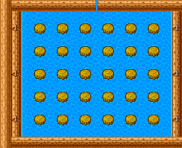 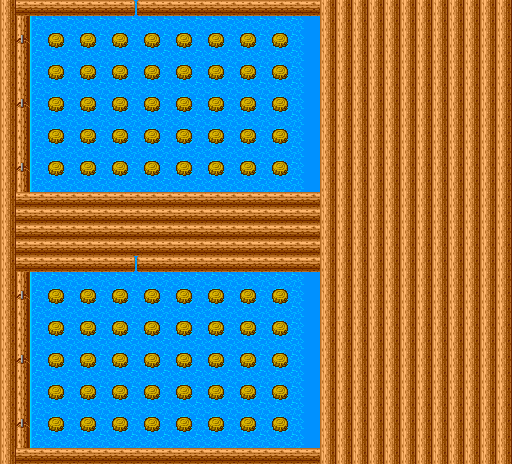 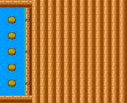
- ★ **Unused chunk `$6C`** (US/JP, file `$17EA0`): an empty battle arena, outer walls only:
  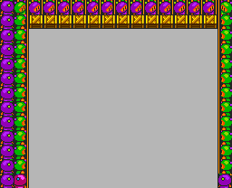
- ★ **Unused chunk `$68` in the Special Version** (file `$17C91`): a battle stage no record uses (tile set unknown,
  drawn as cell values): 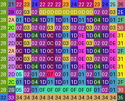
- The Special Version's battle records differ: its stages 7 and 8 use chunks `$69`/`$6B` and stage 9 repeats stage 2
  with palette set 1.

### Cheat codes

Mesen 2's PC Engine codes are raw `AAAAAA:VV`, `AAAAAA` being the 21-bit physical address: work RAM bank `$F8` is
`$1F0000`, so RAM `$2000 + x` (F8:x) is `1F` + x, and ROM bank `b` offset `o` is `b << 13 | o`. Each code below was
added with `emu.addCheat(emu.cheatType.pceRaw, ...)` and checked (USA unless noted; JP uses the same addresses;
the Special Version's game variables sit 9 bytes lower).

| Code (Mesen) | F8 address | Effect | Check |
|---|---|---|---|
| `1F0091:20` | F8:0091 | invincible (player 1 ability bit 5) | stood on its own bomb, lives kept |
| `1F189F:09` | F8:189F | 9 lives in reserve | HUD shows 9 |
| `1F189A:03` | F8:189A | speed 3 (above the skates' 2) | player `$9B` = `$30` in the stage |
| `1F1895:0w` + `1F1896:0s` | F8:1895, F8:1896 | every Normal Game stage is world w+1, stage s+1 | `03` + `04`: a new game loaded record 28 (4-5) |
| `1F1FFB:01` | F8:1FFB | JP: CONFIGRATION screen after every planet map | screen shown  |
| `1F18B1:00` | F8:18B1 | the ending shows the clear page even after a password or continue | page shown (RAM written as the ending reads it) |

Patches (IPS, built and checked against the ROM by `tools/pce93/mkpatch.py`):

- `patches/pce93_configration_us.ips` (USA): file `$4432` `08 20 E7 EA 9A AB 06` → `00 20 E7 EA 20 86 08`, the
  CONFIGRATION screen after every planet map. Verified on the patched file: 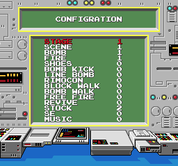
- `patches/pce93_normal_game_sp.ips` (Special Version): file `$D84C` `4E A3` → `A0 94`; Run on the title opens the
  leftover password screen and the Normal Game (the bytes of the in-memory test above; the IPS file itself was not run).

## Title logos

`docs/img/logos/pce93_us.png`, `pce93_jp.png`, `pce93_sp.png` (all three differ: US has the ™, SP the SPECIAL VERSION
banner). The logo is all sprites. Built from the game's own data: VRAM, VCE palette and SAT dumped on the title
screen in Mesen (`tools/pce93/logo_dump.lua`), then `tools/pce93/logo.py` keeps the sprites with palette 2 (the
logo), plus the ™ sprite (US) or the banner sprites (SP, palette 4), renders them with `tools/pce93/vram_render.py`
(4bpp 16×16 cells, colour 0 transparent) and crops to the bounding box: 216×81 US, 206×81 JP, 206×101 SP.

## Open

- A real pad-5 press for the tap screen (needs Mesen input on Multi Tap sub-ports).
- `$91` bit 4 and `$2F99`: set in Mesen with no clear effect.
- The backup-RAM screens and the COM-LINK game (need a Tennokoe or a second console); no cheat was checked on the Special Version.
- That a stage started from the JP CONFIGRATION screen uses its values (only the screen keeping them was seen).
- The `←` `→` entries on the password grid and the continue screen's code display.
