# Bomberman '94 (PC Engine HuCard, Japan) and its demo CD: passwords and secrets

Everything here comes from a disassembly of the HuCard (`tools/huc6280.py 94`, a recursive HuC6280 disassembler
fed with entry points from Mesen's code/data log; output in `disasm/pce94/bankNN.asm`, one file per 8 KB bank) and
of the demo CD's boot program (`tools/pce94/demo_disasm.py`, output in `disasm/pce94/demo/`), checked in Mesen 2
(portable copy, headless test runner) with the Lua scripts in `tools/pce94/` (`run.sh script.lua card|demo
[VAR=value]`; run `mkstates.lua` first). Addresses are ROM offsets (`$1B27C`) or, for RAM, logical `$2xxx`/`$3xxx`
(zero page `$xx` = `$20xx`). Prior art: two published articles on the game and the GameFAQs Mega Bomberman page in `res/`.
Marks: ★ **New** (in none of them), **Fixed** (prior art is wrong or misfiled), **Known** (prior art has it).

| Retail | Demo ("Special Version") |
|---|---|
|  |  |

| Dump | MD5 | |
|---|---|---|
| Bomberman '94 (Japan).pce | `31a21937e7bda97ee54fd49f2475b6d3` | 1 MB HuCard, no header |
| Demo, track 2 (data, MODE1/2352) | `c7d0e4995fee11a09d820c781710a310` | 311 data sectors after the 3 s pregap |
| Demo, track 1 (audio) | `ce7570578f3d4dd611996b681471a8b2` | |

The game calls its worlds **areas**: area 1 has 3 stages, areas 2-5 have 4, each with a boss; area 6 is the final
area. Mega Bomberman (Genesis) is Westone's port of this game, see [`mega.md`](mega.md) and
[the comparison below](#94-vs-mega-bomberman).

## RAM that matters

| Address | Meaning | Evidence |
|---|---|---|
| `$20B2` | area being played, 0-5 | checker `$1B2E5`, Lua log after each typed code |
| `$20B3` | area reached, 0-5; what the encoder saves | `$1B2E5`, encoder `$1AF48` |
| `$20B4` | stage the hub starts, 0-based: the lowest stage not cleared | Lua log after starting the area |
| `$20B5` | stage-clear nibbles: low = stages cleared (bit n = stage n+1), high = clears already shown on the map | `$1B31A`, `$1AF56` |
| `$2FBE`-`$2FC1` | password digits as shown, left to right; `$2FC2` cursor | `$1B232`, RAM writes in `fuzz.lua` |
| `$2FC3` | high byte of the decoded number (area and stage bits); `$2FC8` = bit 5 ("all stages cleared") | `$1B2B3`, `$1B298` |
| `$2FC6` / `$2FC7` | password accepted / rejected | `$1B353`, `$1B37A` |
| `$2FC9`-`$2FCC` | the code on the GAME OVER screen (`$2FCC` is the leftmost digit) | hook at `$1AFC3` |
| `$3704` | lives (3 after a password) | `gameover.lua` sets it to 0 |
| `$3709` | bit 1 = invincible (INV_MODE); the death check `$DA5A` skips while `$3709` is not 0 | `inv.lua`, `debugpause.lua` |
| `$B8` | stage state; bit 5 = MAP_CLEAR (the goal object `$10131` waits for it) | `$135E0` |
| `$28`-`$2C` / `$2D`-`$31` | held / newly pressed buttons, pads 1-5 (`$E369`): bit 0 I, 1 II, 2 Select, 3 Run, 4 Up, 5 Right, 6 Down, 7 Left. Run+Select resets (`$E3AC`) | |
| `$C5` | menu buttons, all pads: d-pad with auto-repeat \| new I/II/Select/Run (`$D5F2`) | |
| `$2023`/`$2024` | pause handler called every frame with the new buttons (`$E108` → `JMP ($2023)`): `$D829` running, `$D882` pause sliding in, `$D89C` paused, `$D8B7` sliding out | |
| `$305A`-`$3066` | title-code buffer: count, idle timer, matched flag, 10 held-button entries | `$1AC64` |

## The password

Code (bank `$0D`, run at `$A000`): `$1B20E` (entry screen), `$1B3FB` (digits to number), `$1B27C`-`$1B366`
(check and load), `$1AF48` (encode, for the GAME OVER screen), then a number-to-digits call ending at `$1AFC3`.
`tools/pce94/password.py` and `tools/pce94/password.mjs` reproduce both directions.

- 4 digits 0-9. Up/Down change the digit under the cursor (tables `$1B488`/`$1B492`), Left/Right move the cursor
  (tables `$1B4A0`/`$1B49C`, wraps), I or Run submit, II leaves the screen (`$1B3C7`).
- The game reads the digits as a decimal number with the **leftmost digit as the ones**:
  N = d1 + 10·d2 + 100·d3 + 1000·d4. The GAME OVER screen writes them back the same way.
- Bits of N:

| Bits | Meaning |
|---|---|
| 0-4 | check: must equal bits 7-11 XOR `$16` (`$1B29D`-`$1B2AC`: `((N & $FF)·2 XOR $AC) & $3E` vs `(N >> 6) & $3E`) |
| 5 | all stages of the area cleared (boss open) |
| 6-9 | stage bits: the stages cleared, or with bit 5 set, the stages cleared **before the last one** |
| 10-12 | area 0-5 → `$20B2` and `$20B3` |
| 13 | ignored by the checker; the encoder never sets it |

- The checker also requires: area < 6 (`$1B2BF`); area 6 with no stage bits (`$1B2CA`); area 1 with stage bit 3
  clear (`$1B2DC`, it has 3 stages); without bit 5, not every stage bit set (`$1B322`, `$1B32D`); with bit 5,
  exactly one stage bit clear (`$1B2F2`-`$1B30D`). Then `$20B5` = stage bits ×`$11`, or with bit 5,
  stage bits « 4 | `$F` (`$1B30F`).
- The encoder (`$1AF48`) builds H = area « 4 | (low nibble of `$20B5`, or the high nibble when every stage is
  cleared, setting bit 5), then N = H·64 + (((H XOR `$AC`) & `$3E`) » 1) + bit 5.
- Nothing else is saved: lives are 3 and the power-ups are back to the start.
- So a password stores the area plus *which* stages are cleared. The game clears them in order, so it only ever
  shows 5 codes per area (4 for area 1, 1 for the final area); the checker accepts every combination:
  - area 1: 7 partial clear sets + 3 boss codes; areas 2-5: 15 + 4 each; final area: 1 → **87 game states**;
  - plus 24 alias codes with bit 13 set (N + 8192 ≤ 9999) → **111 valid codes** out of 10,000.

### How it was verified

- **Fuzz against the game's own decoder** (`fuzz.lua`, from a savestate on the PASSWORD screen: digits written to
  `$2FBE`-`$2FC1`, I pressed, exit `$1B343` = accepted / `$1B367` = rejected logged): **10,000 codes run,
  111 accepted, 9,889 rejected, 0 with no result**; `password.py --fuzz log.txt` finds the same 111 with the same
  `$20B2`/`$20B3`/`$20B5` for every one, and no disagreement. Run twice with the same result (one Mesen
  test-runner session times out after about 6,400 codes, so it runs in 2 chunks: `FROM=0 TO=6476`, `FROM=6477 TO=9999`).
- **Typed with the pad** (`codes.lua`): the 25 GameFAQs codes and 9 others (out-of-order, boss variants, aliases)
  were typed on the PASSWORD screen and the area started; `$20B2`/`$20B3`/`$20B5` and the stage the hub started
  (`$20B4`) were what the codec predicts. `1234` and `0000` are refused (the rabbit's X card):
  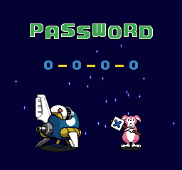
  `5120` starts area 1 stage 3, `0881` (area 2, stages 1, 3, 4 cleared) starts stage 2, `3351` opens the area 2
  boss, `0515` is the final area:
  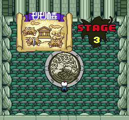 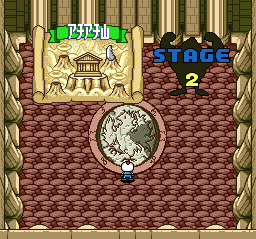 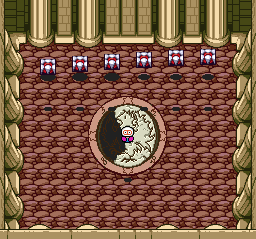 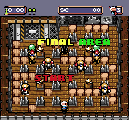
- **The encoder** (`gameover.lua`): 15 codes entered, lives set to 0, death. The GAME OVER screen gave back the
  entered code for all 13 non-alias ones (in order, out of order and every kind of boss code), and the game's own
  form for the aliases: `4128` → `2200`, `0059` → `8031`. 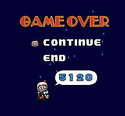
- `node tools/pce94/password.test.mjs` and `python tools/pce94/password.py` (self-check) both pass.

### The codes the game shows

**Known** (GameFAQs, on the Mega Bomberman page as the "TG16" list; that list is exactly this game's 25 codes):

| Area | Stage 1 | Stage 2 | Stage 3 | Stage 4 | Boss |
|---|---|---|---|---|---|
| 1 | `2200` | `6800` | `5120` | | `7420` |
| 2 | `4501` | `8111` | `7421` | `1051` | `3351` |
| 3 | `4502` | `8112` | `7422` | `1052` | `3352` |
| 4 | `6803` | `0513` | `9723` | `3353` | `5653` |
| 5 | `8114` | `2814` | `1134` | `5654` | `7954` |
| 6 | `0515` final area | | | | |

### ★ New: the other codes

**Other boss codes.** With every stage cleared, the game saves which stage was cleared last; all of these open the
boss.

| Area | last = stage 1 | stage 2 | stage 3 | stage 4 |
|---|---|---|---|---|
| 1 | `7340` | `2730` | `7420` | |
| 2 | `7791` | `2191` | `7871` | `3351` |
| 3 | `7792` | `2192` | `7872` | `3352` |
| 4 | `9004` | `4493` | `9183` | `5653` |
| 5 | `1405` | `6794` | `1584` | `7954` |

**Out-of-order clears (stage skips).** The game never produces these but accepts them: the hub starts the lowest
stage not cleared, so the stages marked cleared are skipped.

| Area | Cleared stages → code |
|---|---|
| 1 | 2: `1510` · 3: `6720` · 1,3: `0430` · 2,3: `5040` |
| 2 | 2: `3811` · 3: `8031` · 1,3: `2731` · 2,3: `7341` · 4: `2651` · 1,4: `6261` · 2,4: `1961` · 1,2,4: `5571` · 3,4: `6181` · 1,3,4: `0881` · 2,3,4: `5491` |
| 3 | 2: `3812` · 3: `8032` · 1,3: `2732` · 2,3: `7342` · 4: `2652` · 1,4: `6262` · 2,4: `1962` · 1,2,4: `5572` · 3,4: `6182` · 1,3,4: `0882` · 2,3,4: `5492` |
| 4 | 2: `5123` · 3: `0433` · 1,3: `4043` · 2,3: `9643` · 4: `4953` · 1,4: `8563` · 2,4: `3273` · 1,2,4: `7873` · 3,4: `8483` · 1,3,4: `2193` · 2,3,4: `7793` |
| 5 | 2: `7424` · 3: `2734` · 1,3: `6344` · 2,3: `1054` · 4: `6264` · 1,4: `0964` · 2,4: `5574` · 1,2,4: `9184` · 3,4: `0884` · 1,3,4: `4494` · 2,3,4: `9005` |

Not played through to the end of a skipped area; what is verified is the state loaded and the stage started.

**Aliases.** Bit 13 is never checked, so N + 8192 is the same state. Only N ≤ 1807 has one, all in areas 1 and 2:
`4128` `8728` `3438` `7048` `9348` `8648` `2358` `4658` `7958` `9268` (area 1) and `6429` `0139` `5739` `9349`
`0059` `4659` `9269` `3969` `5279` `4579` `8189` `3889` `7499` `9799` (area 2).

`docs/pce94_codes.json` lists all 111 with what each does, plus the codes below.

## Entering a password

1. At the title, press Run, choose PASS WORD with Down, press Run.
2. Up/Down change the digit under the cursor, Left/Right move between the 4 digits.
3. Press I or Run. A good code goes to the area map at the saved area; a bad one shows the rabbit's X card and
   leaves the digits on screen. II leaves the screen.
4. To work one out: `python tools/pce94/password.py` lists all 111; `password.py 0881` decodes one;
   `encode(area, cleared, last)` in `password.py` / `password.mjs` builds one (e.g. `encode(2, [1, 3, 4])` →
   `0881`, `encode(1, [1, 2, 3], last=3)` → `7420`).

## Hidden codes, menus and debug features

### Sound Room (Known)

At the title menu (NORMAL GAME / BATTLE GAME / PASS WORD), hold these button combinations in order: **Right,
Left, Left+Down, Down, Down+Right, Down+Right+II**. Releasing everything in between is allowed. `$1AC64` (called
every frame by the menu handler `$19DF3`) records each new held combination in `$305D` and compares the list with
`$1ACCA` = `20 80 C0 40 60 62 FF`; a wrong combination clears the list, and so does holding nothing new for 128
frames. On a match `$19E97` calls `$DF54`, which far-calls bank `$12` at `$9D89`: the Sound Room. The known wording
(press Right, hold Left, hold Down, release Left, hold Right, press II) is the same sequence. Verified with
`soundtest.lua`: 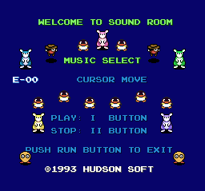

### Debug Version menu (Known; ★ answer to an open question)

The known patch (`$3F5B`: `89 85 67 A9 9D` → `29 85 67 A9 98`) changes the far-call target in `$DF54` from
`$12:$9D89` to `$12:$9829`, so the Sound Room code opens **BOMBERMAN94 DEBUG VERSION** (STAGE SELECT, BOSS
BATTLE, IMPRESSIVE ENDING, SOUND MODE). Verified (`soundtest.lua DEBUG=1`): 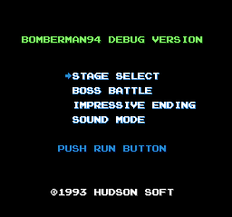

★ **There is no button combination for it.** `$DF54` is the only far call into bank `$12`, with `$9D89`
hard-coded; nothing in the 1 MB loads `$29`/`$98` into the far-call pointer, jumps to `$9829` or stores it in a
table (byte scan). The title-code checker has one table (above). Every reader of the pad bytes was checked:
`$E369` (pad read, soft reset Run+Select), `$D5F2`/`$D628`/`$D633` (menu helpers), the password screen
`$1B20E`, the title menu `$19DF3`, the player input copy `$16144` (`$C1`/`$C2`), and the menu code in the untraced
part of bank `$09` (`$125DF`-`$13133`) by linear disassembly: all test single buttons, none compares
against a combination or sequence.

### ★ New: the debug pause menu, restored

The known "development text" at `$3850` is part of a cut **pause menu**. What survives:

- `$D844` (ROM `$3844`): its text, `>INV_MODE`, `MAP_CLEAR`, `ENEMY;00`, `N;00 X;00 Y;00` (`;` is drawn as `:`).
- `$135C4` (bank `$09`, run with banks `$08`/`$09` at `$8000`-`$BFFF`): the menu handler. Up/Down move the cursor
  (`$3BFF`); I on INV_MODE toggles `$3709` bit 1 and redraws ON/OFF (`$13511`); I on MAP_CLEAR sets `$B8` bit 5
  and unpauses; Left/Right open the enemy editor `$13633` (ENEMY = slot `$3BFE`, then N type / X / Y through
  `$136EB` and `$13731`, which edit the enemy record at (`$C6`)).
- The pause-hook wrappers for the sub-screens, `$D8D0` / `$D8E7` / `$D8FE` (`BIT #$08` / unpause on Run / far
  call `$08:$B633` / `$B6EB` / `$B731`), still in bank `$01` but never installed by the retail game.
- The sub-screens return to hook `$D89C`, today the plain "paused" handler: the menu used to sit there.

Missing: the wrapper that called `$135C4` and the code that printed `$D844`. `debugpause.lua` restores them with
two small stubs in free `$FF` space of bank `$01` (`$DF66`, `$DF82`), points `$D891` (end of the pause slide-in)
and `$D89C` at them, and then plays: pausing area 1 shows the menu in the pause bar, I turns INV_MODE on, Right
opens the enemy editor, Up changes the slot, Left goes back. The stage keeps only the HUD digits in its font area,
so for the screenshots `FONT=1` copies the ASCII tiles from the title screen (`fontdump.lua`).
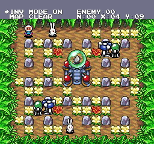 

- **INV_MODE works**: with `$3709` bit 1 set, standing on a bomb leaves lives at 3; with it clear the same test
  takes a life (`inv.lua`, INV=2 vs INV=0).
- **MAP_CLEAR works**: the stage's central machine opens at once: 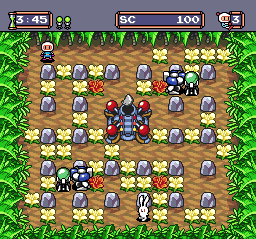
- The menu shows only one text row at a time (the pause bar is one row tall); N/X/Y are on the row below.

### Other features (★ New)

- **Battle: 2-5 players** (5 with a multitap), normal or tag, 9 characters:
  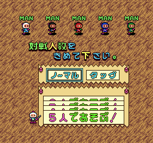

## Unused content

- **Known (not re-checked here):** the Fire Pass and Broken Egg item graphics.
- **Known:** the Debug Version menu in bank `$12` (`$25829`) and the pause-menu text at `$3850`, see above. Bank
  `$12` also holds the Sound Room (`$25D89`); the Sound Room is the only part the retail game can reach.

## Demo vs retail

The demo ("Bomberman '94 Special Version" in the prior art; キャラバン用 限定非売品 on the Japanese title) is a CD.

- ★ It is a **Super CD-ROM²** disc: the boot program (data sectors 2-17, loaded to `$4000` with MPR2-6 = `$80`-`$84`)
  asks the System Card for its version (`$E05A`, `$4011`) and with a card older than 3.0 shows a warning screen
  instead (data sectors 34-57, loaded to VRAM; read on no other path). It runs on the US Super System Card 3.0
  in Mesen. Forced with `X = 0` at `$4014` (`demo.lua OLD=1`):
  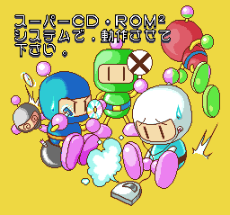
- **Known:** the Caution screens and the different title. ★ The title's Japanese variant is chosen by one read of
  the System Card pad byte `$2228` bit 7 at `$5640`, right after the program is loaded, so Left must be held
  through the loading after pressing Run, not during the BIOS screen itself. Its text is not a translation of
  SPECIAL VERSION: it reads キャラバン用 限定非売品 ("for the Caravan, limited, not for sale"), and the press-Run line
  is RUNボタンを押して下さい。  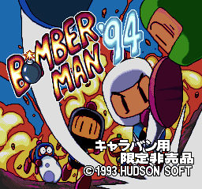
- The logo is drawn differently (sprites, palettes 0 and 2; the '94 cycles its colours), so there are two logos.
- **Known:** no character select, Arrow Arena only (seen here: the menu goes from player count to number of
  games to the match): 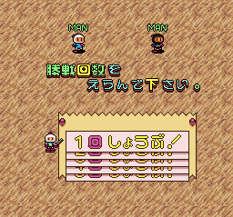
- ★ The battle game is the HuCard engine: data sectors 98-225 are a 256 KB, 32-bank image of it (bank 0 has the
  same pad reader as retail `$E369`, with the pad bytes at `$26`-`$2F` instead of `$28`-`$31`), loaded after
  sectors 26-33, 58-85 and 86-97. Sectors 130-132 and 138-139 are byte-identical to retail ROM `$3E000`-`$3F7FF`
  and `$48000`-`$48FFF`. A raw scan of the whole image for pad reads followed by a compare finds only the soft
  reset: the demo has **no title code and no Sound Room**.
- **Not checked:** the '93 placeholder music (audio) and battle rule changes inside the match (open items in the prior art); the
  match has a 3:00 timer.

### ★ New: unused data on the demo CD

The SCSI log of every run (normal boot, Left held, old-card path, battles) shows the data sectors read; never read:

- **Sectors 19-25**: graphics tiles (sector 18 is empty). 93 of their 253 non-blank tiles also occur in the
  warning screen's VRAM data (sectors 37-45), the rest do not: an earlier cut of that Bomberman-cast picture, left
  on the disc. Rendered as raw 4bpp tiles, 16 per row, grey levels (no palette is known for them;
  `rawtiles.py`): 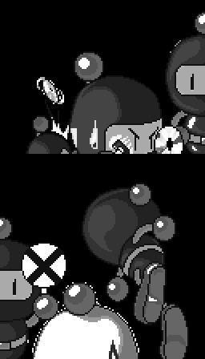
- **Sectors 226-310**: 228-309 are byte-identical to 122-203 (part of the engine image), 226-227 are code
  fragments that match 120 and 77 at other offsets, 310 is empty: a stale copy left from an earlier layout.
- The IPL header names the disc `Bomber Man 94 CDKim`.

## '94 vs Mega Bomberman

- **Password algorithm: identical.** Same digit order, same bit layout, same `$AC`/`$16` check, same rules, same
  encoder (`$1B27C`/`$1AF48` here, `$1BE32`/`$1BA3C` on Genesis). The two codecs agree on every one of the 10,000
  codes (same 111 valid, same area and clear nibbles), and both were fuzzed against their own game. So every
  password works in both games, aliases included; that is why GameFAQs' "TG16" list is also a full set of
  Genesis codes (`mega.md`).
- **Cut or changed in the port:**
  - battle: 2-5 players → 2-4 (the same 9 characters);
  - the bank `$12` module (Debug Version menu and Sound Room), the title-code checker `$1AC64` and the debug pause
    menu remnants (text, handler, editors) are all absent from the Genesis ROM (`mega.md`: no sound test, no debug
    menu, the only ASCII text is the credits).
- **Why the sound test is missing on Genesis:** in '94 it is not part of the game proper. It lives in bank `$12`
  with the debug menu and is reached only through the title-code far call `$DF54`. The port's title menu
  (`$1A68C`) reads only Up, Down and Start, and there is no sound player in the ROM. The GameFAQs entry on the
  Mega Bomberman page is this game's code (it ends with II, a PC Engine button), misfiled (**Fixed** in
  `mega.md`).

## Deep sweep (dead code, input codes, unset flags, text, maps, cheats)

Method. 18 HuCard coverage runs in fresh portable Mesen copies (`tools/pce94/cov.py` + `cov.lua`, one run per test):
title idle and the attract demo; all 25 game-shown passwords with random play and lives kept at 3 (every area,
every boss, the final area); game over; four Battle Game runs; the Sound Room; the Debug Version menu (the known
patch in memory) with its stage select (area 6-1), boss room (area 1 and area 6 bosses) and IMPRESSIVE ENDING.
Each run leaves Mesen's code/data log, a bitmap of RAM bytes ever written non-zero and, for every map loaded, VRAM
and the palette. Two demo runs trace every instruction executed from CD RAM. The sweeps are the shared
`tools/pce93/sweep.py` (`dead`, `pad`, `flags` with `94`) and `tools/pce93/text.py`, plus `tools/pce94/maps.py`;
outputs in `disasm/pce94/dead.txt`, `pad.txt`, `flags.txt`, `text.txt`, `maps.txt`.

### Dead code

348 traced blocks never executed, 8,938 bytes of 71,389 traced: 306 after an executed branch (5.1 KB), 34 called
only from dead code (2.7 KB), 8 reached only through a jump table (1.1 KB). 448 orphan runs (22 KB) decode as code
but are reached by nothing the tracer follows; most are task continuations (the game resumes tasks through the
pointers `$E501` / `$E528` store, which a static trace cannot follow), so the orphan list is an upper bound.

| Code | What it is | Class |
|---|---|---|
| `09:B511`-`B7C2` (`$13511`-`$137C2`), `$D8D0`-`$D8FE` | the debug pause menu handler, value printer and editors | debug, cut (known; restored below) |
| bank `$12` `$9829`, the boss room (`$25C1F` text), the stage select (`$259BB`) | the Debug Version menu and its screens | debug: patch only (known) |
| `00:E3B2` | soft reset: Select newly pressed while Run is held | not covered (never pressed) |
| `0C:93EC` (507 bytes), `08:8B40`-`8DCF` (1 KB), `0A:9A9D`, `0A:9B71` | boss phases and stage gimmicks of later areas | reachable, not covered by random play |
| `13:B012` (293 bytes, called from `12:9DC1`) | Sound Room / sound mode branch not taken | reachable, not covered |

### Input codes

`sweep.py pad` over the pad bytes (`$28`-`$31`) and the menu copies (`$C1`, `$C2`, `$C5`): 96 reads, 10 flagged,
all ordinary (the pad reader and soft reset `$E369`-`$E3B6`, battle-player input `0B:A403`-`A67E` against a
direction count, a menu index compare `0C:9190`) except the known Sound Room history table (`$1AC64` / `$1ACCA`).
No other button code, so still no code for the Debug Version menu.

### Flags that are read but never set

The model is `$3709` (INV_MODE): read by the death check, set only by the cut pause menu. The sweep found no other
flag of that kind: the 16 RAM candidates in `flags.txt` are table entries reached through indexed or block writes
(object tables `$2BDB`-`$2E5B`, `$3417`/`$3419`), the debug menu's own cursor bytes `$3BFE`/`$3BFF` (written only by
the cut handler), and `$20AA` bit 0 (`0A:92BB`, an object's sprite flag): set every frame in area 1, no visible
change. ★ New, effect unclear.

### Graphics

Graphics scripts (`00:EB16`) name blocks in four directories in bank `$1B` (`$9EE5`, `$81B4`, `$A866`, `$A318`; 5-byte
entries: bank, pointer, size); every load goes through `00:EB2A`. With all ten battle stages forced (`$3BED` 0-9),
the Buglear fight played, TAG battle's team screen (T0 #15) and a revisited area on the map (T1 #27, the EX label),
every block loads but these:
- ★ **T0 #158** (file `$8FD1D`): six sprite cells of a blue jet ship, in no other block. Its script (`$0F:A9FF`) is
  loaded only by a task entry at `$0F:AA90` that nothing points to. Started by pointing Buglear's object slot at it
  in the boss's space phase, it sets off explosions, stops the clock and shows the jet:
  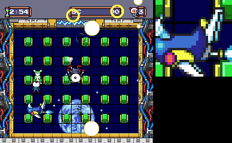
- T2 #33: a palette set (8 palettes), the first 32 bytes the same as #34's, which the scripts use instead.
- T2 #22: a copy of the used Bomberman sprite set #23.

### Text

`text.py 94` decodes the ASCII text with the control codes (`$01 x y` cursor, `#n` palette, `_` space, `;` drawn as
`:`, `@` as the copyright sign). 174 strings; the Japanese text of '94 is graphics. Never read in any run, retail or
with the debug patch:

- `$3844` `>INV_MODE / MAP_CLEAR / ENEMY:00 / N:00 X:00 Y:00` (the known development text, the cut pause menu; Known).
- The Sound Room's name table (`$25F17`, 32 bytes per entry, `E:00`-`E:67` effects and `M:xx` music): all reachable by
  scrolling the Sound Room, only the first entries were shown in the runs. Reached with the debug patch: the debug
  menu, WE NEED BRAVEST BOMBERMAN / STAGE SELECT, WELCOME TO BOSS ROOM (AREA1 SARU AND BANANACHER, AREA2 PYRAMID
  GAN:G, AREA3 GRUB ROBS, AREA4 KOMORI COUNT, AREA5 QUEEN OYOBEE, AREA6 BUGLEAR) and the bank `$12` staff roll of
  IMPRESSIVE ENDING. Nothing else is unused.

### Maps

★ Format (`tools/pce94/maps.py`): the stage code (`$F022`) takes the map id `$B7` = `$CBCD[$CBC6[area] + stage]`
+ room `$B6` and looks it up in the table at bank `$1B` `$9DBE` (file `$37DBE`), 5 bytes per map: bank, pointer
(bank at `$4000`), width, height in 16×16 cells. The map is LZSS-packed (`$EA40` / `$EA60`: bits MSB first; flag 1
= literal byte, flag 0 = 8-bit ring offset and 4-bit length + 2; 256-byte ring filled with `$20`, writing from `$EF`)
and unpacked into the cell grid at `$2FB6`; each cell is drawn from 8 bytes (2×2 BAT words) at (`$95`) with bank
`$341B` at `$4000`.

59 maps, all drawn in `docs/img/pce94/maps/mapNN.png` (ids, file addresses, sizes in `disasm/pce94/maps.txt`), with
the game's own cell tables and the VRAM and palette dumped when a map of the same tile set was loaded:

| Ids | What | Seen in Mesen |
|---|---|---|
| 0-42 | the areas' rooms: area 1 = 0-3, 2 = 4-10, 3 = 11-18, 4 = 19-27, 5 = 28-36, area 6 = 37-42 (6 rooms) | 20 dumped in Mesen (random play does not visit every room); the others drawn with their area's tiles |
| 43-48 | the boss arenas of areas 1-6 (`$B2` = 0-5) | all |
| 49 | loaded with `$B2` = 7 (battle setup / boss room) | yes |
| 50-58 | the nine battle stages | 50 and 58 loaded; the other seven have their own tile sets and are drawn as cell values |

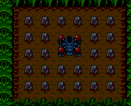 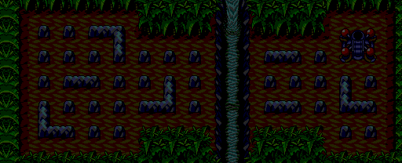 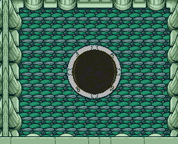

★ **The demo CD's maps.** The demo's engine image (data sectors 98-225) has its own map table (data sector 104,
offset `$13B` in the sector; 8 maps, bank `$07` of the image) with the maps packed in sector 126. Only Arrow Arena
can be played; the other seven are unused in the demo. Compared with retail: map 1 = retail 49, 2 = retail 51,
4 = retail 54, 5 = retail 56 (identical); map 0 is retail area 1-1 with one cell different; maps 3, 6 and 7 are
older versions of retail battle stages 52, 57 and 58 (30, 18 and 4 cells different). Drawn as cell values in
`docs/img/pce94/maps/demo_map0.png`-`demo_map7.png`. The never-read sectors 19-25 and 226-310 hold no maps (graphics
and a stale engine copy, above).

### Cheat codes

Mesen 2's raw PC Engine codes use the 21-bit physical address: RAM F8:x = `1F` + x, ROM file offset = address.
Each was added with `emu.addCheat(emu.cheatType.pceRaw, ...)` and checked:

| Code (Mesen) | F8 / ROM address | Effect | Check |
|---|---|---|---|
| `1F1709:02` | F8:1709 (`$3709`) | invincible (INV_MODE) | stood on its own bomb in area 1: lives stayed 3 (2 with `1F1709:00`) |
| `003F5B:29` + `003F5F:98` | ROM `$3F5B`, `$3F5F` | the Sound Room code opens the BOMBERMAN94 DEBUG VERSION menu (stage select, boss room, ending, sound) | menu shown  |
| title: Right, Left, Left+Down, Down, Down+Right, Down+Right+II | | Sound Room | Known (above) |

Patches (IPS, built and checked against the ROM by `tools/pce94/mkpatch.py`):

- `patches/pce94_debug_menu.ips`: the known `$3F5B` change. Verified on the patched file: the Sound Room code opens the
  debug menu.
- `patches/pce94_debug_pause.ips`: the `debugpause.lua` stubs (`$3F66`, `$3F82`) and hooks (`$3891`, `$389C`).
  Verified on the patched file: pausing area 1 installs hook `$DF66`, I turns INV_MODE on (`$3709` = 2):
  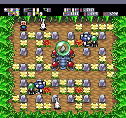 (the stage keeps no letters in its font, as above)

## Unused sounds

- ★ Effect 43, named "BOSS1 LANDING" in the ROM's own sound list, is never requested: of 210 calls to `$F9DF`, 204
  have the number written in and the rest come from `$01:C0A1`, `$0A:9536`, `$08:86F5` and the item handlers. Only
  the Sound Room plays it, a loud thud of about 80 ms. Every tune is used.

## Files

- `tools/pce94/password.py`, `password.mjs` (no imports), `password.test.mjs`: the codec, self-checks, `--fuzz`.
- `tools/pce94/fuzz.lua` (all 10,000 codes through the game), `codes.lua` (typed codes), `gameover.lua`
  (encoder), `soundtest.lua` (Sound Room, `DEBUG=1` the debug menu patch), `debugpause.lua` + `fontdump.lua`
  (restored pause menu), `inv.lua` (invincibility), `demo.lua` (demo boot variants), `mkstates.lua`, `lib.lua`,
  `run.sh`.
- `tools/pce94/logodump.lua` + `logo.py`: logos from the title screen's VRAM, SAT and palette. Retail: every
  sprite with palette 2, minus colours 10/12/13/15 (the comet streak shares the cells). Demo: sprites with
  palettes 0 and 2 above screen y 130. Colour 0 transparent, cropped tight. The Japanese-text demo title gives
  a byte-identical logo.
- `tools/huc6280.py 94`, `tools/pce94/demo_disasm.py`, `trace.lua`, `rawtiles.py`.
- `tools/pce94/cov.py` + `cov.lua` (coverage runs), `maps.py` (map decoder and renderer), `mkpatch.py` (IPS);
  the sweeps `tools/pce93/sweep.py` and `tools/pce93/text.py` take `94`.
