# Bomberman: Users Battle (PC Engine HuCard, Japan, 1990): what it is and what's left in it

Everything here comes from disassembling the HuCard (`tools/huc6280.py`, the pce90 HuC6280 disassembler;
coverage grown from Mesen 2 code/data logs of title, battle, password and 1P runs, listing in `disasm/pceub/ub.asm`,
entry points in `disasm/pceub/entries.txt`) and checking the results in Mesen 2 (`tools/pceub/run.sh` runs a Lua
script headless with `tools/pceub/lib.lua` prepended; a second Mesen copy with a TurboTap in port 1 runs the battle
tests). Addresses are `bank:address` as mapped when the code runs: bank 0 at `$E000`, the title in bank 1 at `$A000`,
the password code bank 2 at `$C000`, the battle code banks 8-9 at `$6000-$9FFF`. Work RAM is `$2000-$3FFF`.

The comparison card is the 1990 Japanese Bomberman, `roms/Bomberman (Japan) (En).pce`, written up in
[pce90.md](pce90.md). There is no prior art for Users Battle in `res/`. Marks: ★ **New** (no prior art), **Known**
(published notes for the 1990 card describe the same thing, and it works the same here).

| Dump | MD5 | Size |
|---|---|---|
| Bomberman - Users Battle (Japan) | `dccedf6d85ea5cf9c37c1c963b328735` | 256 KB, 32 banks |
| Bomberman (Japan) (En), for comparison | `4bece0e426eec02f894399219f1951cf` | 256 KB |

## What the game is

★ **Users Battle is the 1990 Bomberman with the battle mode alone left reachable.** There is no stage editor, no
stage data from users and no new arena: the battle field, enemies, items and rules are the 1990 card's battle mode.
What's new is the title screen and the way the two battle variants are picked.

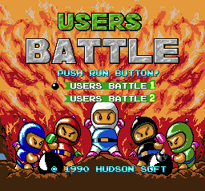

- **Title** (`$01:A40A`): the USERS BATTLE logo, PUSH RUN BUTTON!, and two lines, USERS BATTLE 1 and USERS BATTLE 2.
  Up, Down or Select move the bomb cursor `$337E` (`$01:A584`), Run picks (`$01:A491`). If nothing is picked in
  1,500 frames (`$3382/$3383` = `$05DC`, `$01:A47E`) the title sets `$3384` = 1 and the main loop restarts the
  card (`$00:EB23` → `JMP $E03B`). **There is no attract demo** (see [Leftovers](#leftovers-still-in-the-rom)).
- **The two lines are the 1990 card's two battle modes.** In the 1990 card BATTLE first asks
  イズレカノMODEヲ エランデクダサイ ("choose one of the modes"): NORMAL MODE or (skull) MODE, stored in `$50`.
  Users Battle drops that screen and the string; the title sets the same flag, now `$4D`:
  USERS BATTLE 1 → `$3380` = 1, `$4D` = 0 (`$01:A560`); USERS BATTLE 2 → `$3380` = 2, `$4D` = 1 (`$01:A572`).
  Both set round `$2849` = 8 (the battle "round") and `$284A` = 0, and both run the same battle code (`$00:EB2B`
  → `JSR $6000`, bank 8).

  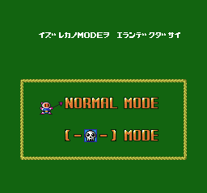

- **The only difference between 1 and 2 is skulls.** `$08:6F87` scatters the item list for the player count
  (`$6FB5`) under the soft blocks; with `$4D` = 1 (`$08:6F9B`) it adds the skull list (`$6FBD`). Item 0 is the
  fire-up and item 1 the bomb-up (the handlers are the 1990 card's; at `$08:7B75` the fire cap of 5 is skipped when
  `$2849` = 8), item 8 is the skull (its handler picks a random illness, as in the 1990 card `$09:8851`).

  | Players | Fire-ups | Bomb-ups | Skulls (USERS BATTLE 2) | Enemies (`$08:651E`) |
  |---|---|---|---|---|
  | 2 | 6 | 6 | 4 | 4 (`$653A`) |
  | 3 | 6 | 6 | 4 | 2 (`$6556`) |
  | 4 | 8 | 8 | 6 | 2 (`$656A`) |
  | 5 | 8 | 10 | 6 | none (`$6573 JMP $977D`) |

  The same tables are in the 1990 card (`$08:79D0`, enemy list at the same bytes); USERS BATTLE 2 is exactly the
  1990 skull mode.

  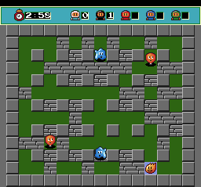 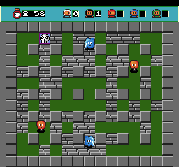 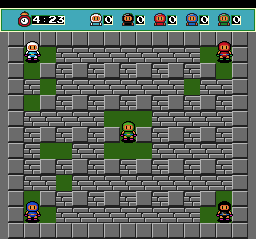

- **Battle setup** (bank 8), each screen as in the 1990 card:
  1. タイセンスル ニンズウヲ キメテクダサイ, "choose how many will battle": 2-5 PLAYERS MATCH (`$08:608D`,
     players in `$48`);
  2. the TurboTap picture with one Bomberman per port in use (`$08:618E`);
  3. ショウセンカイスウヲ エランデクダサイ, "choose the number of wins": 1-5 WIN MATCH (`$08:625F`, `$49`,
     `INC $49` at `$62C9`);
  4. "n WIN MATCH !" with the players, GAME START (`$08:636A`), then the match. Results show DRAW GAME or the winner;
     the match loop is `$08:6035`-`$6070`.

  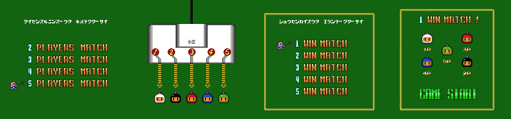

- **One arena.** The hard-block layout is the 1990 battle field; the soft blocks change from round to round
  (screenshots of successive rounds differ). The 2-player clock starts at 3:00.

### Controllers and the TurboTap (★ New)

- ★ **Any pad drives the menus.** A new routine, `$00:E2E9`, ORs the five ports' held / new / previous bytes
  (`$2200-$2204`, `$220A-$220E`, `$2205-$2209`) into `$33` / `$34` / `$35`, and the title (`$01:A584`, `$A491`)
  and the battle menus (`$08:6131`, `$62F6`, `$63AD`, ...) read `$34`. The 1990 card's battle menus read pad 1 only
  (`$220A`, `$08:7A8F`). In Mesen, Run on pad 4 alone started the game.
- **The tap check moved to the title.** When Run is pressed at PUSH RUN BUTTON, `$01:A4DD` calls `$00:E30A`, which
  compares the new presses of the five ports: all equal (as with no tap, where every port reads pad 1) sets
  `$32` = 0, any difference `$32` = 1. After USERS BATTLE 1/2, `$08:6014` jumps to the error screen `$08:6EDE` if
  `$32` = 0: 'タップ'が、つながっていません。, "the 'Tap' isn't connected", with no way out but a reset. The 1990
  card did the same test (`$00:E358` JP) when a battle mode was picked. So with a tap the error shows only if all
  five pads press exactly the same buttons on that frame. Mesen with a TurboTap (`tools/pceub/test_tap.lua`): Run on
  pad 1 or pad 4 → `$32` = 1, menus; Run on all five → `$32` = 0, error screen.

  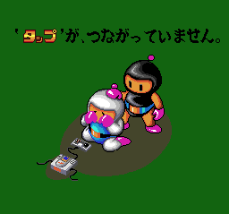

- Soft reset is still Select+Run on any pad (`$00:E2C8`: new = `$04` and held = `$0C` on one port).

## RAM that matters

| Address | Meaning | Evidence |
|---|---|---|
| `$2001` | high score hundreds digit (Special Select Room check) | `$01:A010` |
| `$10` | 1 when the last attract demo ran to its end; set only by the dead demo code in bank `$0B` | `$0B:C0F7`, `$0B:C0FB` |
| `$2200-$220E` | per port: held (`$2200,X`), previous (`$2205,X`), new (`$220A,X`); `$01` I, `$02` II, `$04` Select, `$08` Run, `$10` Up, `$20` Right, `$40` Down, `$80` Left | `$00:E28F` |
| `$32` | 1 = the five ports differed when Run was pressed on the title (a tap is there) | `$00:E30A` |
| `$33` / `$34` / `$35` | OR of the five ports: held / new / previous | `$00:E2E9` |
| `$337E` | title cursor (0 USERS BATTLE 1, 1 USERS BATTLE 2) | `$01:A554` |
| `$3380` | mode: 1 USERS BATTLE 1, 2 USERS BATTLE 2; 0 (the 1P game) is never set | `$01:A562`, `$01:A574`, `$00:EB2B` |
| `$3384` | 1 = title timed out, restart | `$01:A4D9`, `$00:EB23` |
| `$4D` | skull mode (0 / 1) | `$01:A567`, `$01:A579`, `$08:6F9B` |
| `$48` / `$49` | players 2-5 / wins 1-5 | `$08:60DF`, `$08:62C9` |
| `$2849` | round - 1; 8 = battle | `$01:A56B`, `$08:7256` |
| `$284A` / `$284B` / `$284C` / `$284D` | stage - 1 / bombs / fire / roller skate (one byte below the 1990 US card's `$284B-$284E`) | `$02:C74C`, `$08:7B81` |
| `$3410-$3417` | password letters (ASCII) | `$02:C8AD` |
| `$340E` / `$340F` | password grid cursor column / row | `$02:C3CA` |
| `$341B` | `$FF` after BOMSOUND | `$02:C665` |
| `$341C-$341F` | the 4 decoded password bytes | `$02:C8BA` |
| `$3424-$3428` | decoded round-1, stage-1, bombs, fire, speed | `$02:C931`-`$02:C9AA` |
| `$342F` | decoder result: 1 valid, 2 invalid | `$02:C9CF`, `$02:C9D5` |
| `$340A` | sound test number | `$02:C2C7` |

## The password (unreachable)

★ **The 1990 card's whole password system is still in bank 2, and nothing calls it.** The entry screen is
`$02:C3A5`; no `JSR`/`JMP` and no pointer anywhere in the ROM points at it, and the title menu has no PASSWORD line.
Bank 2's other screens (CONTINUE / END / SAVE at `$02:CFC7`, the file screens for backup RAM) are only called from
the 1P game's game-over path (`$00:EA49`), which can't run either (see below). Bank 2 never executed in any
unpatched Mesen run (code/data log: 0 bytes).

- **Same codec, byte for byte.** Decoder `$02:C8AB` (1990 JP: `$02:CBAE`), letter lookup `$CA37`, field reader
  `$C9E6`, shifts `$CA0B`/`$CA21`, encoder `$C73D`, BOMSOUND check `$C656`. 541 bytes of decoder and tables were
  compared with the 1990 card: the 110 differing bytes are all RAM operands (shifted by `-$36`: letters `$3446` →
  `$3410`, result `$3465` → `$342F`) and ROM operands (shifted by `-$303`), and the tables (field masks `$CA5C`,
  byte indexes `$CA72`, letter rows `$CA88`) are identical. So everything in [pce90.md](pce90.md#the-password)
  holds: 8 letters, 4 bytes, rows `MUROYAGCQXSKIWHB` / `WRECKFVBYHOZNAGL` / `NEWSLOGIMPHJTVBQ` / `NUCLEARHPSTVZYGK`,
  header byte with flip and shift, round 1-8, stage 1-8, bombs 1-10, fire 1-15, speed, a check count;
  **5,930,496** valid codes for 19,200 states.
- `tools/pceub/password.py` (`--test`, `--count`) is the pce90 codec with this card's addresses; it round-trips all
  19,200 states. The codes page checks these codes with the 1990 game's codec.

### Fuzz against the game's own decoder

The password screen was patched in (`$01:A40A` → `JMP $C3A5`, see below) and the decoder run on the codes in Mesen:

| Set | Codes | Accepted | Mismatches with `password.py` |
|---|---|---|---|
| `tools/pceub/fuzz.py`: one code for each of the 19,200 states, 10,000 random in-row codes, every letter at every position, all 256 byte-0 values under three tails, BOMSOUND (savestate per code, result read at the exits `$C9CD` / `$C9D3`) | 30,177 | 19,235 | 0 |
| `tools/pceub/fuzz_all.py` (in-ROM loop at `$02:D600`, free `$FF` space from `$D2AF`): byte 0 = `$10`, bytes 1-3 = `$000000`-`$030D3F` | 200,000 | 1,019 | 0 |
| same, byte 0 = `$12` (shift 2), bytes 1-3 = `$000000`-`$0FFFFF` | 1,048,576 | 6,948 | 0 |
| same, byte 0 = `$F5` (all three bytes flipped, shift 5) | 1,048,576 | 8,576 | 0 |
| same, byte 0 = `$08` (bad header bits) | 1,048,576 | 0 | 0 |

In all 3,375,905 codes and no mismatch. The counts for the first two sets are the same as the 1990 card's runs.

### Codes verified

Typed with real pad presses on the patched-in screen (`tools/pceub/test_codes.py`), END with I, `$342F` and
`$2849-$284D` read back. All match `password.py`. A valid code then starts the 1P game at that round (ROUND n,
STAGE n-m GAME START), whose stages have no graphics in this card.

| Code | Effect | Notes |
|---|---|---|
| `MUVWLNPC` | 1-1, 1 bomb, fire 1 | the zero code |
| `MUVWNEPC` | 2-1 | |
| `MUGWNNPC` | 8-1 | |
| `MUOEPHLA` | 8-8, 10 bombs, fire 15, skate | everything maxed |
| `MUEEVHVU` | 1-1, 10 bombs, fire 15, skate | |
| `RKGEWVHY` | 3-5, 4 bombs, fire 2, skate | flip 5, shift 2 |
| `ACLCHINN` | 1-1 | shift 5 |
| `CUVYVPNP` | 1-3, 3 bombs, fire 14 | shift 7 |
| `MUVWLNPU` | rejected | `$342F` = 2 |
| `BOMSOUND`, then `MUVWLNPC` | sound test | `$341B` = `$FF`, SOUND-00 |

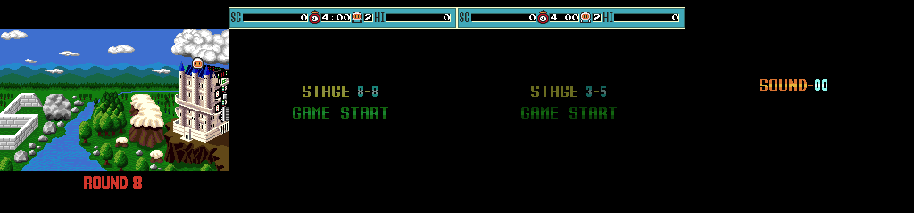

## Entering a password

Not possible on an unmodified card. With a patch (or a debugger), it works like the 1990 card:

- **Reach the screen:** change `$01:A40A` (ROM offset `$240A`) to `4C A5 C3` (`JMP $C3A5`). `$00:EA21` calls `$A40A`
  with banks 1-2 mapped, so the card shows PASSWORD ヲ ニュウリョクシテクダサイ ("please enter the password")
  instead of the title. `lib.lua`'s `to_password()` does this.
- **Enter:** the grid `A-J` / `K-T` / `U-Z < > END` with the cursor on A (`$340E` = `$340F` = 0, `$02:C3CA`); the
  D-pad moves it, I or Run enters a letter, II or `<` moves back, `>` forward, END submits. A bad code shows
  PASSWORD ERROR and clears the letters (`$02:C9D3`).
- **After a valid code** the screen returns into the 1P flow (`$00:EA24`): the castle intro, ROUND n, then the
  stage. The cursor and letter-position sprites are wrong (they show pieces of the title's USERS BATTLE labels),
  because the screen's sprite graphics are no longer loaded.

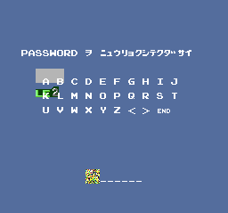

## Leftovers still in the ROM

### The 1P game (★ New)

The main loop (`$00:EB18`) still has the 1990 card's 1P game: after the title it runs the battle only if `$3380` is
1 or 2 (`$00:EB2B`-`$EB38`), otherwise it falls into the 1P round loop at `$00:EB3B` (intro, ROUND n, stage,
`$00:EB80`-`$EBD2` death, game over and continue). The title never leaves `$3380` at 0, so it's dead. Forcing
`$3380` = 0 when `$00:EB2B` executes (a Mesen exec callback) starts it: the castle intro and ROUND 1 / STAGE 1-1 GAME
START look right, the score bar works and the 1-1 enemies walk, but the stage's background tiles are garbage, so the
1P stage graphics were most likely dropped from the card (banks 2, 11, 14 and 31 have 2.6-4.8 KB more `$FF` fill
than the 1990 card's; 24.5 KB of `$FF` runs in all against 9.1 KB; which data went where was not traced). The staff roll text (`$01:AB2D`, the 1990 card's) belongs to the
1P ending and is unreachable too.

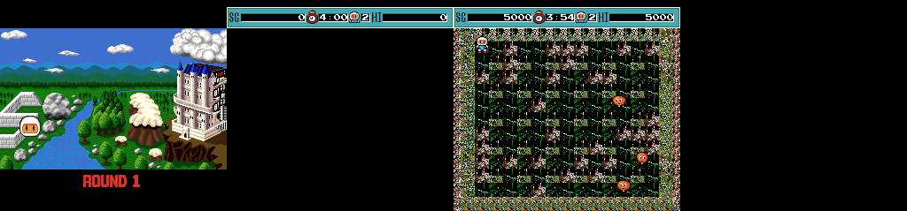

### BOMSOUND sound test (Known)

Unchanged from the 1990 card, where it was already known: `$02:C656` compares the letters with `BOMSOUND` (`$02:C66C`) and sets `$341B`
= `$FF`; the decoder rejects it; the next valid code goes to the sound test `$02:C2A5` instead of the game. I / II
step `$340A` through `$00-$39` (`$02:C2F9`, `CMP #$39`), Run plays, Select stops, no exit. Reachable only through
the patched-in password screen; verified there (SOUND-00).

### Special Select Room (Known)

The check `$01:A001` is still there and still called, from `$00:EA43`, but only when `$3380` = 0, `$3384` = 0 and
`$2849` ≠ 8. Its conditions are the 1990 card's (see [pce90.md](pce90.md#special-select-room-fixed)), except that
the buttons are read from `$33` (all pads ORed) instead of pad 1: `$33 & $4F` = `$4F` (Down, Run, Select, II, I
held), `$10` ≠ 0 and `$2001` = 3. In the shipped card it can't open twice over: the title always sets `$3380` = 1/2
and `$2849` = 8, and `$10` is only set by the dead demo code. In Mesen with the password screen patched in,
MUVWLNPC entered, `$10` = 1, `$2001` = 3 and the five buttons held from the frame after END
(`tools/pceub/test_select_room.lua`), the room opened (and set `$284D` = 1, the roller skate, as in the 1990 card);
with `$2001` = 4, or `$10` = 0, it did not.

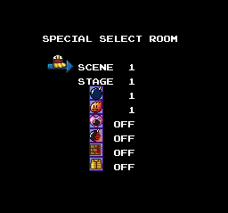

### Attract demo (★ New)

The demo player is still in bank `$0B` (`$0B:C06D`: it rebuilds a stage, plays recorded input, any Run on any port
ends it, `$0B:C0B5`), and bank `$0B` is still mapped at `$C000` during the game, but no code refers to `$C06D` or
the rest of the bank, and the title times out into a restart instead. The `DEMO` string (`$08:77A5`) goes with it.

### Backup RAM

The save code (`BOMBERMAN1-3`, `!BM FORMAT!` at `$00:F697`, `HUBM` at `$00:F9AC`, file screens and their texts in bank
2: ドレヲ LOAD シマスカ? "which one to load?", ドコニ SAVE シマスカ? "where to save?", BACKUP RAM ノ メモリーガ
タリマセン。 "not enough backup RAM", ドレヲ ケシマスカ? "which one to erase?") is all 1P-game code and never runs: the
card doesn't touch backup RAM (none of it is in the code/data logs).

### C-Link battle and music (★ New)

The 1990 card's two-console C-LINK BATTLE is gone: nothing reads the mode for it, and the battle result code plays
`$31` (`$08:68D8`) and `$32` (`$08:6BE7`) unconditionally where the 1990 card chose `$39` / `$2D` for the losing
console (JP `$08:6E7F`, `$08:73E1`). **No `LDA #$39` is left anywhere in the code banks**, so tune `$39` is only in
the (unreachable) sound test; `$2D` is loaded only at `$09:9EDC` / `$0A:BC04`, code that didn't run in battle (not
traced). Tunes `$36` and `$37`/`$38` stay as in the 1990 card (no immediate load of `$36`). A scan of `LDA #n / JSR
$E9AE` against the code/data logs: tunes and effects `$01-$04`, `$08`, `$13`, `$14`, `$19`, `$1A`, `$1D`, `$20`,
`$24`, `$25`, `$30-$33` were played in battle and title runs; the rest of the immediates sit in 1P-game code.

## Differences from the 1990 Bomberman

200,373 of the 262,144 bytes differ in place. Banks 5, 6 and 13 are identical; most graphics banks match with a
one-bank shift; the code banks (0-3, 8-11) are the 1990 code with parts cut and moved, so almost every address
differs.

| | Bomberman (1990, JP) | Users Battle |
|---|---|---|
| Title | BOMBERMAN logo over a castle; GAME START, BATTLE, BATTLE (link), PASSWORD, LOAD | USERS BATTLE logo over flames and five Bombermen; USERS BATTLE 1, USERS BATTLE 2 |
| Attract demo | yes, after the title | none: the title restarts the card after 1,500 frames |
| 1P game, passwords, backup RAM, sound test, Special Select Room | reachable | code present, unreachable; 1P stage graphics removed |
| Battle mode choice | NORMAL MODE / (skull) MODE screen | USERS BATTLE 1 / 2 on the title; the screen and its text are removed |
| Battle | same arena, enemies, items, setup screens | same |
| C-Link battle | yes | removed |
| Menus read | pad 1 | any of the five pads |
| TurboTap check | when a battle mode is picked | when Run is pressed on the title |
| RAM layout | | password block `-$36`, round/stage/power-ups one byte lower (vs the US card) |

## Title logo

`docs/img/logos/pceub_jp.png` (192×64). Unlike the 1990 card's logo (BG tiles), USERS BATTLE is **sprites**: the
title's VRAM, VCE palette and SAT were dumped at frame 400 (`tools/pce90/vdump.lua`), and the BG map holds only
the flames and the five Bombermen. SAT entries 0-3 (32×64, `USERS` over `ATTL`, attribute `$2182`) and 4-5 (32×32,
`B` and `E`, `$1182`) are the logo, all sprite palette 2; entries 6-15 are PUSH RUN BUTTON!, the menu labels and
the copyright. `tools/pceub/logo.py spr <dump> <png> 2 0 60` draws the palette-2 sprites whose tops are in rows
0-60 (16×16 cells, 4 planes of 16 words, colour 0 transparent) and crops to the bounding box. The holes in B and A
are transparent in the game too (the flames show through).

## Hidden-content sweep

Six passes, with the pce90 tools (`tools/pce90/deadcode.py`, `padscan.py`, `flags.py`, `textdump.py`, `maps.py`, which
all take this card too). The coverage for the **shipped** card comes only from unpatched Mesen runs: the title, its
1,500-frame timeout and restart, and TurboTap battles in USERS BATTLE 1 and 2 with 2, 3, 4 and 5 players. The
patched-in password runs were left out. Executed code: **15,451 bytes**, against 32,173 in the 1990 JP card. Scripts:
`tools/pceub/cov_battle.lua` and `tools/pceub/test_cheats.lua`.

### Dead code

Full list: `disasm/pceub/dead.txt`. The listing was regenerated with the new entry points (`disasm/pceub/ub.asm`,
`entries.txt`).

| | Stretches | Bytes |
|---|---|---|
| never-run code reached from code that ran (`cond`) | 132 | 1,896 |
| reached only from never-run code (`dead`) | 26 | 1,467 |
| no reference found (`noref`) | 16 | 973 |
| orphan code (never traced) | 240 | 10,488 |

**Which 1990 features are dead** (★ New, mapped from the code and the coverage):

| 1990 feature | Where in Users Battle | State |
|---|---|---|
| 1P game: round loop, intro, ROUND n screens, death, game over, CONTINUE / END / SAVE | `$00:EB3B-$EBD2`; player, enemies and bosses across banks 8-`$0A` (`$0A` alone: 3,654 orphan bytes) | complete but unreachable (`$3380` is never 0); runs with a patch; stage tiles gone |
| attract demo player | `$0B:C06D` | unreferenced. Its companion pad recorder (`$00:EBA2` in the 1990 card) was **removed** |
| password, BOMSOUND, sound test | bank 2 (`$02:C2A3-$D28B`, 2,282 orphan bytes) | unreferenced; works with a patch |
| backup RAM: files, LOAD, SAVE, format | `$00:F6xx-$FExx`, bank 2 file screens | unreachable (only the 1P game-over path calls it) |
| staff roll and ending | `$01:A8C8` onwards, text `$01:AB2D` | unreachable (follows 8-8 of the 1P game) |
| Special Select Room | `$01:A001` | called only on the 1P path; works with a patch |
| C-Link battle | — | **removed**: no setup screen, no link I/O (`$0B:D000` in the 1990 card), no link texts |

★ **New code:** 11 never-run stretches have no opcode-for-opcode counterpart in the 1990 card. All of them are 1990
routines adapted to the new RAM layout or input: `$01:A001` is the room check reading `$33` instead of `$2200`,
`$01:A7A9` the 1P new-game setup with round/stage one byte lower, and `$00:E163` a VDC branch. **Nothing new and
unreferenced** was found. The 1990 queue-routine typo survives at `$00:F1F3` (`STA $6A` twice).

### Input codes

`padscan.py` (pad bytes plus the ORed `$33-$35`): 17 hits. They are the soft reset (`$00:E2C9`), the TurboTap
compare (`$00:E30A`), the new five-port OR (`$00:E2E9`), the menus' Run / I tests, D-pad repeat (`$00:F5D2`),
walking, and the skull illnesses' button rewrites (`$09:8336-$83A3`). The Special Select Room's five-button check is
only on the 1P path. **No hidden input code.**

### Unset flags

`flags.py` gives `$206B` (the typo routine's restore, as in the 1990 card), `$20A8-$20AE` (read by a VDC routine at
`$00:F4A9` that never runs) and `$3358` (read only at `$09:8B9B`, 1P-game code). In Mesen, `$3358` forced to 1
through the title and battle setup changed nothing; its reader ran 0 times. None of them is a hidden switch.

### Text

`textdump.py` dump: `disasm/pceub/text.tsv`. Of the 1990 card's strings, the battle ones are used:
タイセンスルニンズウヲ キメテクダサイ ("decide how many will battle"), ショウセンカイスウヲ エランデクダサイ ("choose the
number of wins"), RETRY・・PUSH RUN BUTTON and PAUSE!. The new texts (USERS BATTLE 1/2, the tap error) are drawn as
tiles, not text lists. **Unused leftovers** (all reachable only through the dead 1P code):

- the staff roll (`$01:AB2D`, as in the 1990 card), SPECIAL SELECT ROOM / SCENE / STAGE;
- PASSWORD ヲ ニュウリョクシテクダサイ ("please enter the password"), PASSWORD ERROR, the letter grid;
- ドレヲ LOAD シマスカ? / ドコニ SAVE シマスカ? / 1-3 BOMBERMAN ("which one will you load?", "where will you save?"),
  BACKUP RAM ノ メモリーガ タリマセン。 RAMチュウ ノ データヲ ケシマスカ? ("not enough backup RAM memory; erase data in
  the RAM?"), ドレヲ ケシマスカ? / マダ タリマセン / ケシテモ ヨイデスカ? ("which one will you erase? / still not enough /
  OK to erase it?"), YES NO;
- CONTINUE / END / SAVE and CONTINUE LAST (the game-over menu);
- the 1990 title menu's tile strings (`$08:1530-$15D6`) and DEMO (`$08:17A3`).

Removed outright: イズレカノMODEヲ エランデクダサイ ("choose one of the modes") and all the C-Link texts.

### Maps

★ `maps.py` renders every layout to `docs/img/pceub/maps/` (same names as the pce90 set, contact sheet `_all.png`).
**All 64 1P stage layouts and the unused round-1 wide layout are still in the card, byte-identical to the 1990
card's** (stage headers bank `$0C`, blocks bank `$0D`; every render matches). Only the battle arena is used. So the
"dropped 1P stage graphics" are the tile graphics only: the layouts survive. Format: see [pce90.md](pce90.md#maps).
The only code change is that the block table is loaded with `LDA $2849 / ... STA $58` at `$00:ED8A`.

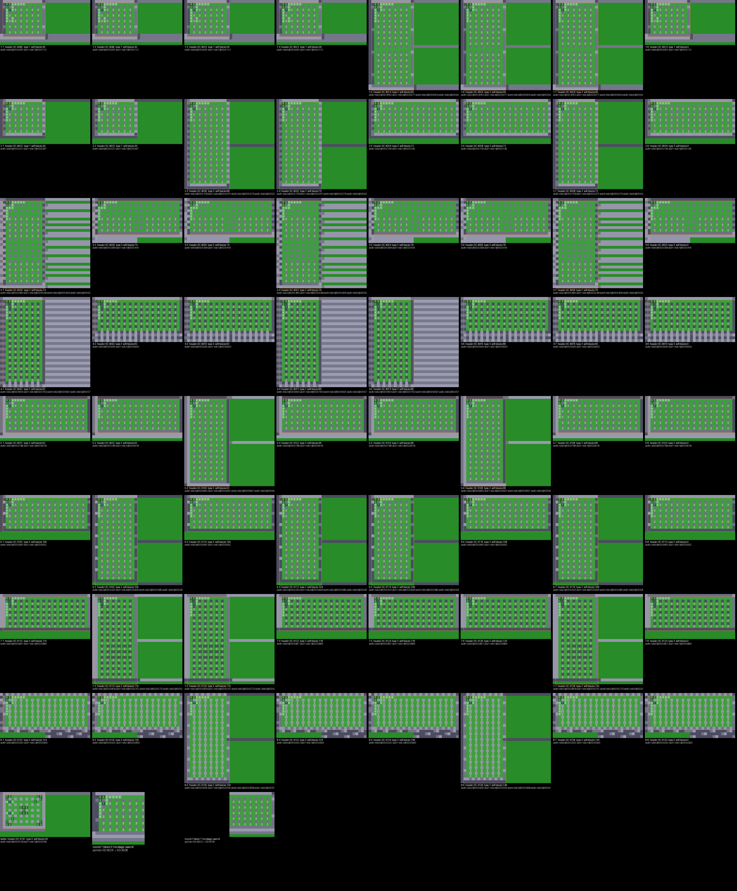

### Cheat codes

Mesen raw cheats (physical address: RAM `$2xxx` = `1F0xxx`/`1F1xxx`, a ROM byte = its file offset). All verified in
Mesen and added to `docs/pceub_codes.json`:

| Code | Effect | Verified |
|---|---|---|
| `00240A:4C` + `00240B:A5` + `00240C:C3` | ★ password screen instead of the title; a valid code starts the 1P game | screen shown; MUVWLNPC → ROUND 1 and the (garbled) stage |
| the above + `1F141B:FF` | sound test after any valid code | MUVWLNPC → SOUND-00 |
| the above + `00200A:80` + `00200B:0B` | Special Select Room after the password | room code `$01:A017` ran |

★ Patches: `patches/pceub_password_1p.ips` (file `$240A`: `20 4E E2` → `4C A5 C3`: password screen at power-on,
then the 1P game, and BOMSOUND reaches the sound test) and `patches/pceub_select_room.ips` (adds file `$200A`:
`D0 F4` → `80 0B`). Both patched files were run in Mesen. The 1P game can't be fixed by a patch, because its stage
tiles aren't in the card.

## Open

- The per-player-count clock was not traced (only the 2-player 3:00 was seen). The soft blocks are random, scattered over the arena by the 1990 routine (see [pce90.md](pce90.md#maps)).
- The 1P-game orphan code in banks 8-`$0A` was classified by bank and by its 1990 counterpart, not read routine by routine.
- Which illnesses the skull gives in this card (the handler matches the 1990 card's `$09:8851` table; not played).
- The code that still loads tune `$2D` (`$09:9EDC`, `$0A:BC04`).
- The full 2^32 decoder sweep was not run; 3.4 million codes were.
