# PC Engine re-releases: Wii U Virtual Console and Bomberman Collection

Four re-release dumps compared byte for byte with the retail HuCards documented in [`pce90.md`](pce90.md),
[`pce93.md`](pce93.md) and [`pce94.md`](pce94.md), and checked in a portable Mesen 2 (headless test runner) with the
scripts in `tools/pcevc/` (`run.sh <pce90|pce93|pce94> "<rom file>" script.lua [VAR=value]`, which reuses that
game's `lib.lua`). Addresses are `bank:logical` or file offsets as in the game's own page.

| Dump | MD5 | Compared with | Bytes that differ |
|---|---|---|---|
| Bomberman '93 (Japan) (Wii U Virtual Console) | `30d49af2d65d39ed1dcc1b2b7f0814ab` | '93 Japan | 2 |
| Bomberman '93 (USA, Europe) (Wii U Virtual Console) | `32e20c5b317f599060195d3276daddd2` | '93 USA | 2 |
| Bomberman (USA) (Bomberman Collection) | `ee98dbf64d0e9e1d30b781dc84e6c485` | Bomberman USA | 43 |
| Bomberman '94 (World) (Wii U Virtual Console) | `b8e9de07aadef68fdb306e4b1d97b928` | '94 Japan | 13,646 |

In short: the '93 releases send the link-cable mode to the Battle Game; the Collection drops the TurboGrafx
region check and adds an NMI hook for its host; the '94 "World" release is **not** a localisation: it is the
Japanese game with one emblem removed from a character portrait (plus edits to data the game never reads).
Every password, hidden code and debug feature works unchanged in all four.

## Bomberman '93 (Wii U VC, Japan and USA/Europe)

### What changed: the link-cable mode now starts the Battle Game

Both patches change the same word: entry 2 of the title menu's jump table (`06:9AE9` JP, `06:9A18` US;
`JMP ($9AE9,X)` at `06:9AE6`, index = menu item from `$3C72`).

| | JP file `$DAED` | US file `$DA1C` |
|---|---|---|
| Retail | `$ACD6` = VS [ ][ ] GAME (two consoles over the link cable) | `$AC61` = COM-LINK |
| VC | `$A6F5` = BATTLE GAME (same as entry 1) | `$A6C6` = BATTLE GAME |

The retail target sets `$3895` = 9 and waits in a loop for the other console (`07:ACA9` US: send/receive through
`07:AD14` / `07:AD1C`, which call `$F5C3` / `$F51C` with X = `$80`, waiting for the `$7F` / `$80` handshake). On the
Virtual Console there is no link cable, so that screen would wait forever. The patch points the menu item at the
Battle Game entry instead (`$3895` = 8). The menu text is not changed: the title still says VS [ ][ ] GAME / COM-LINK.
No flashing or timing change: nothing else in the ROM differs.

Verified in Mesen (`tools/pcevc/link93.lua`: title, Down twice, Run): retail goes to the two-console wait screen
(`$3895` = 9), VC goes to the Battle Game player-count screen (`$3895` = 8), in both regions.

| | Retail | Wii U VC |
|---|---|---|
| JP | 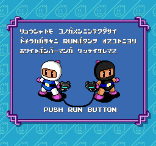 | 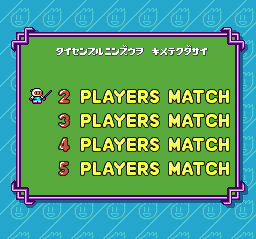 |
| US | 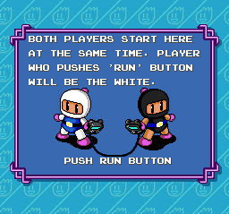 | 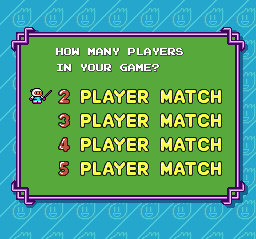 |

### Passwords and secrets

The password encoder and decoder (`01:DC34` / `01:DCAC` US, `06:99C4` / `06:9A3C` JP) are byte-identical, so every
code in `pce93.md` / `pce93_codes.json` works. Typed with real presses (`tools/pce93/test_password.lua`, through
`tools/pcevc/run.sh`) in both VC dumps: JP `CEECDFAB` / US `DGGDFHBC` (3-5, 4 bombs, fire 2, speed 1, planets 1-2)
and JP `CAKFBGDB` / US `DBNHCJFC` (2-1, 10 bombs, fire 5, speed 2, planet 1): the decoded state after END and in the
stage is exactly what `password.mjs` gives, and `BBBBBBBB` is rejected. The CONFIGRATION flag code, the JP tap
screen and everything else in `pce93.md` is in unchanged bytes.

## Bomberman (USA) (Bomberman Collection)

### What changed

**1. The region check is gone** (`$0000-$0018` → `EA`). Retail starts at `00:E000` with:

```
E000  SEI / CSL / LDA #$FF / TAM #$01
E006  LDA $1000      ; I/O port
E009  AND #$40       ; bit 6: 0 on a TurboGrafx-16, 1 on a Japanese PC Engine
E00B  BEQ $E019      ; TurboGrafx: normal reset code
E00D  LDA #$90 / TAM #$04 / JMP $4000   ; PC Engine: jump into unmapped bank $90 = hang
E014  db " NEC "
```

The Collection NOPs all of it and falls through to `$E019`, so the US game boots on either console type.
Verified with two portable Mesen copies, console type Auto (TurboGrafx-16: the port reads `$3F`) and PC Engine
(`$7F`): retail USA hangs at `$416E` with bank `$90` in MPR2 on the PC Engine; the Collection boots to the title on
both (`tools/pcevc/boot90.lua`).

| Retail USA on a PC Engine | Collection on a PC Engine |
|---|---|
|  | 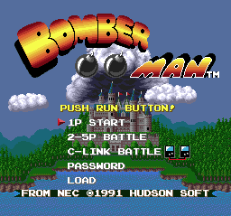 |

**2. An NMI hook** (`$1FE0-$1FEF` and the NMI vector `$1FFC`: `$E243` → `$FFE0`). Retail's NMI vector points at an
`RTI`. The stub:

```
FFE0  PHA
FFE1  TMA #$80       ; save MPR7 (the $E000 bank)
FFE3  PHA
FFE4  LDA #$FC
FFE6  TAM #$80       ; map bank $FC at $E000-$FFFF
FFE8  JMP $F377      ; (already fetched from bank $FC: see below)
FFEB  PLA
FFEC  TAM #$80       ; restore MPR7
FFEE  PLA
FFEF  RTI
```

After `TAM #$80` the next instruction is fetched from bank `$FC`, which is not ROM or RAM on a HuCard system (it
is unmapped). So this only does something on a host that raises NMI and puts its own code in bank `$FC`, which
later jumps back to `$FFEB` to restore the bank and return. A launcher / emulator hook (for the collection's menu,
reset or save handling), not game code. On real hardware NMI is not wired, and Mesen never raises it: the game
behaves exactly like retail USA.

Still unchanged: the title keeps C-LINK BATTLE (the Collection did not patch the link mode the way the '93 VC did).

### Passwords and secrets

Password code (bank 2), Special Select Room and sound test are in unchanged bytes. Typed in Mesen
(`tools/pce90/test_codes.lua` through `tools/pcevc/run.sh`): `MUVWLNPC` → round 1 stage 1, 1 bomb, fire 1;
`MUOEPHLA` → round 8 stage 8, 10 bombs, fire 15, skates (both as `password.mjs` decodes them); `AAAAAAAA` refused;
`BOMSOUND` then a valid code → the SOUND screen. The Special Select Room (`tools/pce90/test_select_room.lua`,
HUND=3) opens:

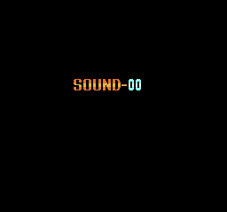 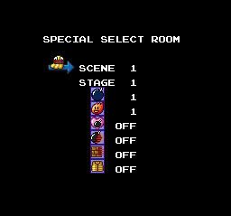

## Bomberman '94 (World) (Wii U Virtual Console)

### It is not a localisation

The title, menus, area names, story map, hub and character select are the Japanese release's: every byte outside
the three ranges below is identical, so there is no text change anywhere. The title screen's VRAM, palette and
SAT are identical to JP's (logo dump with `tools/pce94/logodump.lua`), so there is no separate World logo
(`pce94_jp.png` applies).

| Range (file) | What it is | Used? |
|---|---|---|
| `$62948-$63B74` (bank `$31`) | an LZSS-packed block (starts at `$627EC`) loaded on the Battle Game character select | yes |
| `$4D277-$4F751` (banks `$26`/`$27`) | small edits to about ten packed graphics blocks; everything after them moves by 1-5 bytes | **never read** |
| `$691F-$78B1` (bank `$03`) | the pointers to those blocks in an asset list, shifted to match | **never read** |

### The used change: the cross on a portrait

On the Battle Game character select, the ninth portrait (bottom row, right) wears a headband with a cross on it.
The World release removes the cross. Of the whole VRAM on that screen only two BG tiles differ, `$1B4` and `$1B5`
(BAT words `$CD8`/`$CD9`, palette 1), and they are exactly the cross. Removing cross emblems (Red Cross style) is
the usual reason for such an edit; nothing in the ROM says why.

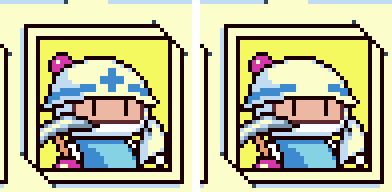 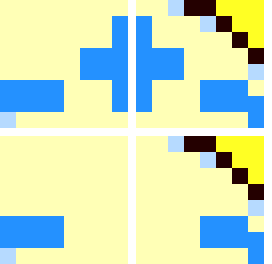

(JP left / top, World right / bottom; tiles at 16×.) The World character select: 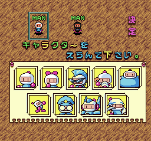

How it was found: Mesen's code/data log, checked at every screenshot (`tools/pcevc/romreads94.lua`), shows the
`$62800-$63BFF` pages read only on entering the Battle Game's menus (character select). The block is decoded by
the routine at `00:EA40`/`$EA60`, an LZSS (1-bit flag, 8-bit literal or 8-bit ring offset + 4-bit length - 2,
256-byte ring filled with `$20` starting at `$EF`); `tools/pcevc/lz94.py` reproduces it and matched the routine's
output byte for byte in Mesen. The screenshots and VRAM come from `tools/pcevc/charsel94.lua` + `vramdiff.py`.

### The unused changes (banks `$26`/`$27`, `$03`)

The asset list in bank `$03` (pointer list at file `$65E4`, records of bank / address / type) and the data it
points at in banks `$24`-`$27` are never read in either version: not in any run here (title and attract mode for
6,000 frames, the opening, all 11 kinds of password start, every one of the 20 stages from the debug STAGE
SELECT, the ending, BOSS BATTLE, SOUND MODE, a GAME OVER, the Battle Game menus) and not in the code/data log
left by the `pce94.md` work either (banks `$03` and `$24`-`$27` have no byte marked). The World edits there are
bit flips in packed data, the same few bytes in six places (e.g. `7C 3E 46` → `FC FE3F C6`), i.e. one small
graphic changed in several copies. Their packing is neither of the two formats the loader uses (`lz94.py lz` and
`mask` give no tile data), so they are **not rendered**.

### Passwords: codec unchanged

The checker (`$1B27C`) and encoder (`$1AF48`) are in unchanged bank `$0D`. Fuzzed as `pce94.md` describes
(`tools/pce94/fuzz.lua` from a PASSWORD-screen savestate made on the World ROM by `mkstates.lua`, chunks
`FROM=0 TO=6476` and `FROM=6477 TO=9999`): **10,000 codes, 111 accepted, 9,889 rejected**, and
`python tools/pce94/password.py --fuzz` reports no disagreement with `decode()`. Typed with the pad
(`tools/pce94/codes.lua`): `2200 7420 4501 3351 4502 3352 6803 5653 8114 7954 0515` all start the area with the
predicted `$20B2`/`$20B3`/`$20B5`. The GAME OVER screen after `5120` shows `5120` (`gameover.lua`).


### Sound Room, debug menu, debug pause menu: all work

- Sound Room code (`tools/pce94/soundtest.lua`): opens. 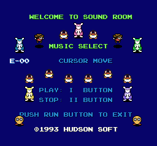
- The known patch (`$3F5B`, `soundtest.lua DEBUG=1`): BOMBERMAN94 DEBUG VERSION. Its STAGE SELECT starts all 20
  stages, IMPRESSIVE ENDING plays the staff roll (`tools/pcevc/stages94.lua`, `ending94.lua`).
  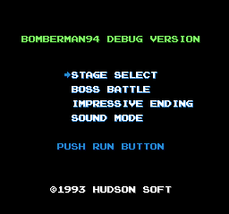
- The restored debug pause menu (`tools/pce94/debugpause.lua FONT=1`): the same log as retail (INV_MODE sets
  `$3709` = 2, Right opens the enemy editor, MAP_CLEAR sets `$B8` bit 5 and opens the machine).
  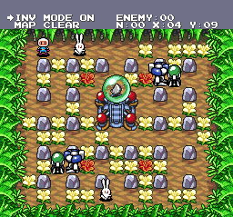 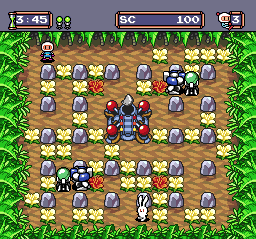

## Open

- '94 World: what the unused bank `$26`/`$27` edits draw (their packing is not one the game's loader uses).
- '94 World: a battle played with the ninth character (the scripts here do not get past the character select's
  confirm), so its in-match sprite was not compared.
- Collection: what the host puts in bank `$FC`, and which collection / platform this dump comes from.

## Files

`tools/pcevc/`: `run.sh` (runner for any of the three games' scripts), `link93.lua` ('93 menu item 3),
`boot90.lua` (region check), `tour94.lua` (fixed-input screenshot tours), `romreads94.lua` (code/data-log pages
read per shot), `scenelog94.lua` (reads of the bank `$03` asset list: none), `stages94.lua`, `ending94.lua`,
`battle94.lua`, `charsel94.lua`, `vramdiff.py`, `lz94.py` (both decompressors, `--test`).
