# Pocket Bomberman (Game Boy Color, US / Europe, 1998): passwords and secrets

Everything here comes from disassembling the ROM (`tools/sm83.py`, listing `disasm/pocket/us.asm`) and checking in
Mesen 2 (`tools/pocket/run.sh`, helpers in `tools/pocket/lib.lua`). Addresses are `bank:address`.

Prior art: the GameFAQs "Pocket Bomberman" cheats page and a second page on the game's debug material (both in `res/`).
Marks: ★ **New** (in neither), **Known**.

| Dump | Header title | MD5 |
|---|---|---|
| Pocket Bomberman (USA, Europe) (SGB Enhanced) (GB Compatible) | `POKEBOM USA` | `2f6b6379f8c7ce5d66a198162f345eaa` |

1 MB MBC5 (cartridge type `$19`, no cartridge RAM), CGB flag `$80` (Game Boy Color features, runs on any Game Boy),
SGB flag `$03`, new licensee `01` (Nintendo published it outside Japan). Only this revision is covered; the Japanese
original and the first European cart (both monochrome only) are not in `roms/`.

## RAM that matters

| Address | Meaning | Evidence |
|---|---|---|
| `$C1A2` | console: 2 = Game Boy Color (boot `A` = `$11`, then double speed, `$00:0578`) | `$00:0249` |
| `$C1A8` / `$C1A9` | game state / sub-state (0 boot, 4 normal game, 7 ending) | `$01:6A26` |
| `$C1B9` | password cursor 0-3; 4 while checking | `$01:672D`, `$01:652C` |
| `$C1BD` | 1 = password rejected | `$01:6559` |
| `$C1C4-$C1C7` | the 4 password digits (0-9); later reused as clock digits | `$01:672A` |
| `$C1DC` / `$C1DD` | world 0-4 (Forest, Ocean, Wind, Cloud, Evil) / area - 1 (0-4, 4 = boss) | `$01:6685` |
| `$C1EE` / `$C1EF` | bombs / fire at the stage start (player `$C41C` / `$C446` in play) | `$02:49F1` |
| `$C1F0` | copied to the player's `$C40E` at the stage start: 4 normally, 6 from a power-up code | `$02:49EB` |
| `$C1F1` | lives (the HUD shows `$C1F1` - 1) | `$02:536A`, `$02:5B2B` |
| `$C1F2` | targets left (the HUD's T) | `$00:2714`, `$02:4E2B` |
| `$C1F8` | clock running | `$00:0372` |
| `$C1F9` / `$C1FA` | clock minutes / seconds | `$02:5AFA` |
| `$C2CC` | ★ debug: invincible (set only by the unused debug decoder) | `$02:436B`, `$02:4DC3` |
| `$C2CD` | ★ debug: Start stops the clock instead of pausing | `$02:40C8` |
| `$C352` | password mode: 1 power-up start, 2/3 boss rush, 3 at the password screen = ending | `$02:4064`, `$02:45D9`, `$01:6A2D` |
| `$C353-$C356` | power-up start values: `$C1F0`, bombs, fire, lives | `$02:406E` |
| `$C35A` | password table index (0-31, 32 = not found) | `$01:657C` |
| `$C35B-$C35D` | stage-intro button code: armed / bombs needed / counter | `$02:48EC`, `$02:5F54` |
| `$C400` page | player object (`$09` state, `$1C` bombs, `$46` fire, `$52` ability bits, `$73` shield) | `$02:49EB`, `$02:4379` |

## The password

Code: `$01:670F` (entry: Up/Down change the digit, wrapping 0-9; Left/Right move the cursor), `$01:6525` (A or Start
checks), `$01:6565` (the check), `$01:662E` (what an accepted code sets), tables `$01:65AA` (codes) and `$01:668D`
(world, area). `tools/pocket/password.mjs` decodes and encodes; `node tools/pocket/test_password.mjs` checks it.

- **4 digits, a fixed list of 32.** The check compares the digits with each of the 32 four-byte entries at
  `$01:65AA`; the matching index picks the effect. Nothing is computed from the digits, so there is no hidden code
  outside the table: **32 of the 10,000** strings are accepted.

| Index | Codes | Effect |
|---|---|---|
| 0-24 | 25 stage codes | world = index / 5, area = index % 5 + 1 (area 5 is the boss); 1 bomb, fire 1, 3 lives |
| 25-29 | 5656 4622 3790 5294 8906 | Forest / Ocean / Wind / Cloud / Evil area 1 with the power-up start |
| 30 | 9437 | boss rush: Forest area 5 with the power-up start; from then on every stage starts as area 5 |
| 31 | 0278 | ★ the ending, straight from the password screen |

- **Power-up start** (`$C352` = 1): bombs 4, fire 4, 3 lives, `$C1F0` = 6, and at the stage start the player's
  ability byte `$C452` gets bits 1 and 3 (`$02:45EB`); bit 1 is tested by the A-button bomb handler (`$02:5F8A`, probably
  the remote primer), bit 3 by the bomb code in bank 4 (`$04:7349`, not identified).
- **Boss rush** (`$C352` = 2): the same power-up start, then `$C352` becomes 3 and while it is 3 every stage start
  sets the area to 5 (`$02:45F3`-`$02:45FE`).
- **Ending** (`$C352` = 3 when the password screen exits, `$01:6A2D`): the state goes to 7, the ending, instead of the
  game. 0278 sets exactly that: the 32nd table entry is an ending code no list had.
- The power-up codes for the last three worlds (3790 Wind, 5294 Cloud, 8906 Evil) and 0278 are ★ New. GameFAQs has
  5656 (Forest), 4622 (posted as "All Power-Ups" and as "Skip to Ocean World": it is both, Ocean area 1 powered up)
  and 9437.
- Area 1 codes go to the world select (with the earlier worlds marked CLEAR); area 2-5 codes go straight to the
  "Area n" screen.

| World | Area 1 | 2 | 3 | 4 | 5 (boss) | Powered up |
|---|---|---|---|---|---|---|
| Forest | 7693 | 3905 | 2438 | 8261 | 1893 | 5656 |
| Ocean | 2805 | 9271 | 1354 | 4915 | 8649 | 4622 |
| Wind | 0238 | 5943 | 6045 | 2850 | 8146 | ★ 3790 |
| Cloud | 9156 | 2715 | 4707 | 7046 | 0687 | ★ 5294 |
| Evil | 3725 | 0157 | 5826 | 9587 | 3752 | ★ 8906 |

**Item icons** (what the power-up codes raise; ripped in Game Boy Color colours to `docs/img/items/pocket/`, `tools/pocket/items.py`):

| Icon | Item | File |
|---|---|---|
|  | bomb up (BG tiles `$88-$8B`) | `bomb.png` |
|  | fire up (BG tiles `$8C-$8F`) | `fire.png` |

**Codec API** (`tools/pocket/password.mjs`): `decode(code)` returns `{index, kind, world, worldName, stage, bombs,
fire, lives}` (kind `stage`, `power` or `boss`), `{index: 31, kind: 'ending'}`, or `null`; `validate(code)`;
`encode(world 0-4, stage 1-5, power)` returns the code (`null` for a powered-up start past area 1, which doesn't
exist); `debugDecode(code)` reads a code the way the unused debug decoder does (below); constants `WORLDS`, `TABLE`,
`BOSS_RUSH`, `ENDING`.

### Verification

- **Fuzz** (`tools/pocket/fuzz.py`, `fuzz.lua`): all 10,000 codes through the game's own check (savestate at
  `$01:6565`, digits written to `$C1C4-$C1C7`, results read where `$01:6549` returns: `$C1BD`, `$C35A`, world, area,
  `$C352-$C356`). 32 accepted, **0 mismatches** with `password.mjs`.
- **Typed with the pad** (`tools/pocket/test_codes.py`): all 32 table codes and 3 wrong ones. All as predicted.

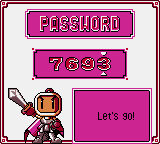

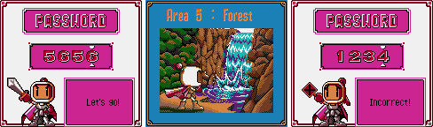

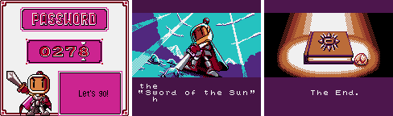

Entering: title, Normal Game, Password.

## GameFAQs check

- The **world/area lists** (IONO, Camelite, Kasket_Darkfyre; coolblmsBenjami, Lord000): all 25 accepted and decode
  as their labels say (Known).
- **5656**, **4622**, **9437** (oreolover13 and the lists above): accepted; what each sets is in the table above.
- **Maximum Powerup** (Anonymous): the stage-intro button code is real and works as described (Known): on the
  "Area n" screen of areas 1-4, with bombs and fire both under 3, Left Right Left Right Up Down Up Down B Left B Right
  B Up B Down, then A or Start (`$02:48D5`, sequence `$02:4983`). Any other press resets it. The bombs to place come
  from `$02:4943`:

| World | Area 1 | 2 | 3 | 4 |
|---|---|---|---|---|
| Forest | 10 | 20 | 30 | 15 |
| Ocean | 20 | 30 | 40 | 15 |
| Wind | 20 | 30 | 30 | 15 |
| Cloud | 15 | 20 | 30 | 20 |
| Evil | 20 | 30 | 10 | 20 |

  The GameFAQs table has lost its area numbers, and its Ocean and Wind rows hold each other's counts (the 40 is
  Ocean 3's). Checked in Mesen (`tools/pocket/test_flower.lua`): on Ocean 3 the code arms 40 (`$C35B` = 1,
  `$C35C` = 40) and the flower is spawned (`$02:680C`) at the 40th bomb; Wind 3 and Ocean 2 arm 30.

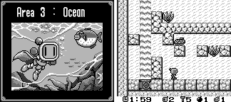

## Secrets

### The unused debug password (★ New)

`$01:66CD` is a second password decoder with no caller anywhere (no CALL, JP or pointer to it). It reads the four
digits as switches:

| Digit | Range | Sets |
|---|---|---|
| 1 | 0-1 | `$C2CC`: invincible |
| 2 | 0-4 | world `$C1DC` |
| 3 | 0-1 | `$C2CD`: Start stops the clock instead of pausing |
| 4 | 0-4 | area `$C1DD` (0 = area 1) |

Anything out of range is rejected. The real check clears `$C2CC` and `$C2CD` first (`$01:6549`), and nothing else ever
sets them, so both debug features are dead in the retail game.

Calling the decoder when a code is not in the table (file `$6588` = `CD CD 66 FA BD C1 C9`) keeps the 32 real codes
working, and none of them is also a debug code. Mesen: **1010** starts Forest
area 1 invincible with the Start clock toggle; **0214** starts the Wind boss, not invincible.

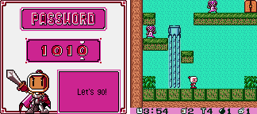

- **`$C2CC` invincible**: both player-death checks skip when it is set (`$02:436B`, which also covers the clock running
  out, and `$02:4DC3`).
- **`$C2CD` clock stop**: Start in play toggles `$C1F8` (the clock) and `$C2CB` and opens no pause screen
  (`$02:40C8`).
- An orphaned 10 bytes after the ending branch (`$01:666F`: fire 4, lives `$FF`) is never reached either.

### Cheats (★ New unless marked, `tools/pocket/test_cheats.lua`)

| Code | Effect | Verified | Other device (same test) |
|---|---|---|---|
| `0101CCC2` | invincible (the debug flag) | 0 deaths in 2 x 20,000 frames of the random-input bot | Game Genie: the ROM patch below |
| `C33-6FB-E61` + `18D-C7B-6EA` (Game Genie) | invincible as a ROM patch (`$02:436F` JP NZ -> JP, `$02:4DC7` JR NZ -> JR) | 0 deaths in 2 x 20,000 frames | GameShark `0101CCC2` |
| `0103F1C1` | infinite lives | 40 deaths in 20,000 frames, lives stay 3 | Game Genie `A73-70A-19E` (`$02:5370` DEC A -> AND A): 37 deaths, lives stay 3 |
| `0101CDC2` | Start stops / restarts the clock (the debug flag) | clock held at 3:55 for 600 frames, then ran on | Game Genie `380-CCB-4CA` (`$02:40CC` JR Z -> JR C, never taken): the same |
| `0F9-C1A-E62` (Game Genie, Known) | the debug menu in place of the title menu | the numbered test menu shows, text partly garbled | no GameShark form: holding the scene byte `$C1A8` at `$0F` skips the setup the title hands over, the screen stays blank |

The Game Genie pair needs both codes: with only the first, the bot still died 3 times in 20,000 frames (the second death
check, `$02:4DC3`).

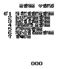

### Button codes

- **Soft reset** (★ New): A + B + Select + Start held (`$00:032A`) goes back to the boot state. Checked in Mesen.
- The stage-intro bomb code above (Known). The pad scan finds nothing else.

## Hidden-content sweep

Coverage (`tools/pocket/cov.sh`, 37 scenarios, plus the test runs): the intro and title, New Game, Jump Game, a game
over, the ending, and every one of the 32 passwords played invincible with the bot. Executed: **58,181 bytes** of code.

- **Dead code** (`disasm/pocket/dead_us.txt`): branch-reachable never-run 8,276 bytes, dead 4,201, no reference 260
  (the 249-byte `$04:4229` block, reached through a pointer the scan can't follow, and RST stubs). 229 orphan
  candidates, mostly data. The debug menu (opened with its Game Genie code, not part of the sweep) runs 3,345 more
  bytes, mostly in banks 0, 2 and 4. The unused debug decoder `$01:66CD` and `$01:666F` sit between the password tables and are not in the trace or the orphan list (found by reading the code after the tables).
- **Unset flags** (`disasm/pocket/flags_us.txt`): only `$C025-$C089` reads in the copies of one routine in banks
  `$0D-$11` (written through HL, so not real). `$C2CC` and `$C2CD` were found by hand: they have writes (clears),
  so the scan doesn't list them.
- **Input codes** (`disasm/pocket/pad_us.txt`, 35 hits): menus, the password cursor, movement, the soft reset and the
  stage-intro code. No other hidden pad code.
- **Text**: drawn from tile records, not ASCII; no text dump.
- ★ **Graphics: Japanese blocks left in.** The loader (`$00:163C`) copies 2 KB blocks from the table at `$0C:6F44` (76
  entries). Coverage runs in Game Boy Color mode, checked against the table, leave four Japanese text blocks unread,
  each replaced by an English one. The code still loads the Japanese number first and overwrites it on the next
  instruction: `LD B,$19` / `LD B,$43` (`$01:5E10`, `$01:5EE9`, `$02:5865`), `$2E` / `$44` (`$01:6B2B`, `$03:482F`),
  `$2F` / `$45` (`$03:483B`), and `$3F` in place of `$46` (`$02:4629`). Changing the operands back (file `$5E12`,
  `$5EEB`, `$6467` → `$19`; `$6B2E`, `$C832` → `$2E`; `$862A` → `$3F`) shows はじめから / パスワード and LICENSED BY
  NINTENDO on the title menu, kana world plates (モリ for Forest), and かんたん / ふつう / むずかしい on LEVEL SELECT
  (Mesen); the mode menu comes out scrambled, as its English layout points at other tiles. Block `$2F` is loaded only
  from offset `$400` (`$01:52B6`); its first 768 bytes (ただいまのけっか, ranking text) were not shown.
  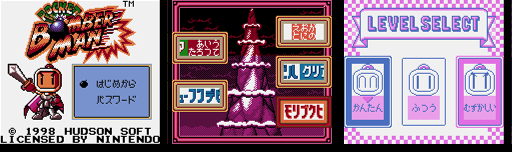
- **Stage format**: not decoded.

### Super Game Boy

Packets (`tools/emu/sgb.lua`): MLT_REQ, DATA_SND x8, PAL01, MASK_EN, ATTR_TRN, PAL_TRN, PAL_SET, CHR_TRN x2 + PCT_TRN
(the Normal Game border), later a second CHR_TRN x2 + PCT_TRN (the Jump Game border), and PAL_SET / MASK_EN around
each screen change.

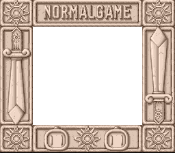
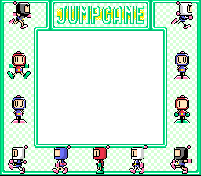

### Game Boy Color

On a Game Boy Color (boot `A` = `$11`) the game sets `$C1A2` = 2, switches to double speed (`$00:0578`) and uses
colour palettes. The passwords and everything above are the same in both
modes (the tests ran in DMG mode). The screenshots on this page are Game Boy Color captures (Mesen, model
GameboyColor), except the SGB borders and the debug menu: that menu never loads a colour palette, so on a Game Boy
Color it is a blank white screen (all 64 palette entries stay `$7FFF`, the menu is in VRAM), and its picture is the
DMG capture.

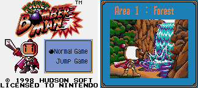

## Title

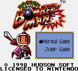

Logo: `docs/img/logos/pocket.png` (`tools/pocket/logo.py`, Game Boy Color colours).

## Open

- What the player's `$C40E` (4, or 6 after a power-up code) and ability bit 3 change in play.
- The boss rush wasn't played past the first boss.
- The flower was spawned but not collected, so its effect (maximum bombs and fire, the primer) is GameFAQs', not
  checked.
- The Japanese original and the first European cart are not covered.
