# Bomberman Quest (Game Boy Color, 1998): secrets

Hudson's action RPG: Bomber Man Quest in Japan. Everything here comes from the two ROMs and from Mesen 2 (headless
test runner), each run starting from an empty cartridge RAM. `bb:aaaa` is ROM bank and address, US unless a region is
named. "Written" means a value put into RAM in the emulator.

Prior art: the GameFAQs "Bomberman Quest" cheats page and a second page on the game's debug material (both in `res/`: the test menu through a Game Genie
code, the stage and enemy labels, the Super Game Boy 2 battle border, the hidden characters and the dancer).
Marks: ★ **New** (in neither), **Known**.

 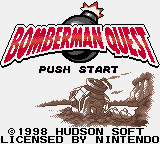

| | USA | Japan |
|---|---|---|
| Header title | `BOMBERQUEST`, code `AVQE` | `BOMBERMAN QUEST` |
| Cartridge | MBC5 + RAM + battery, 1 MB, 8 KB RAM | MBC1 + RAM + battery, 1 MB, 8 KB RAM |
| Licensee | `6F` (Electro Brain) | `18` (Hudson) |
| Checksums | header `$1C`, global `$EAA7`, both good | header `$79`, global `$E735`, both good |
| Build stamp (`27:6CA2`) | 12/24/1998.17:29:48 | 10/27/1998.19:56:37 |

## No passwords: the save

None of the game's 25 states is a password screen. One file is saved to battery RAM: `$A000-$A0F3` is a copy of
`$CE72-$CF65` (Japan: one byte lower), with a "DMG SAVE DATA." magic and an 8-bit checksum at both ends.

## ★ The debug byte, `$C234`

| Bit | Effect | How it is set |
|---|---|---|
| 0 | Select on the title opens the test menu; allows the debug new game | set early in the boot, then cleared again before the title |
| 1 | new game starts from the debug data | Down + Select + A on the first title-menu line (`08:42B8`); useless without bit 0 |
| 7 | no damage (`09:5921`) | nothing sets it |

**The Japanese button code.** The boot code that clears bit 0 is skipped when exactly A + Select are held
(Japan `00:19C5`: `CP $05`). Hold both from power-on until the logos end. The US ROM has the same routine without the
check, so the bit is always cleared there. 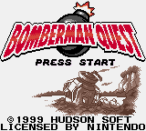
The window is strict: both buttons down from controller poll 47 to 165, the whole logo state. One poll late, one early
or a one-frame gap loses it. 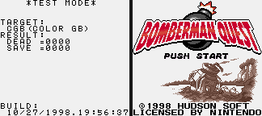

- Then press Select on the title: the test menu. 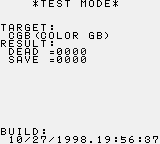
- Or keep Select held, add Down, press Start, and press A on the first menu line: a new game with 10 hearts of HP
  and every item. 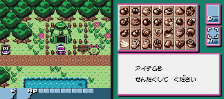

On the US ROM the same things need the bit held on: GameShark `010134C2`. 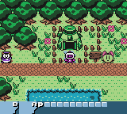

## ★ The test menu

Game state `$18`, bank `$27`. It shows the hardware (`$C22F`: DMG, MGB&MGL, COLOR GB, SUPER GB, SUPER GB 2), DEAD and
SAVE counters from the save file, and the build stamp.

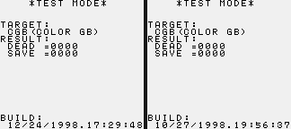 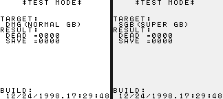

| Button | Screen | |
|---|---|---|
| A | PCG MAP: 26 tile sets, Left/Right to change | 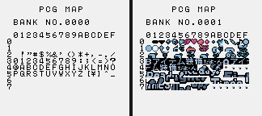 |
| Start | SOUND TEST: BGM_81-BGM_F2 (39), SE_8E-SE_DC (67); A plays | 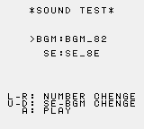 |
| Up | COLOR TEST: R, G, B levels 0-`$1F` and the 15-bit word | 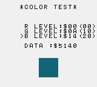 |
| Down | the true ending and staff roll | 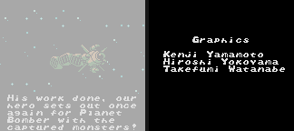 |
| Select | back to the title | |

Left over in the bank with no reference: `LOAD =`, `STAGE=`, `ENEMY=`, `A     (BG_PCG)`, `B     (SPR_CHR)`,
`START (SOUND TEST)`, `SPR NO.`, `PCG NO.`, `UP.DN  PCG_CHENG`, `LF.RH  SPR_CHENG`, `  B: STOP`. The menu's
third screen slot is a null pointer: a stage select and sprite viewer were taken out.

## ★ The endings

The ending code (`22:4205`) tests the captured bit (bit 6) of the 51 monster flags `$CEB2-$CEE4`.

- All set: "Bomberman's true enemy... The Chaos Bomber!", a talk screen, and his fight on interior screen `$1B`.
  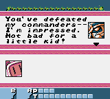 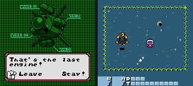
- Otherwise: "?? Is that really the end?", the staff roll, then "Next time, try to capture all the monsters?".
  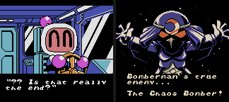 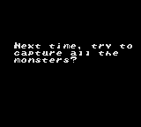

The check runs when Bomberman answers Leave at the Bomber Shuttle (overworld `$1B`) with the four commander flags
set. Played on both ROMs by setting the flags and walking to the shuttle with the no-damage bit held. The fight was
then won on the US ROM. He has 10 HP twice: at 0 the code at `10:5C59` rebuilds him with 10 more, a new look and new
attacks. Every hit is 1 HP (`10:400E`) followed by `$40` frames of immunity, and only the Flak Bomb's lingering burst
flags him; Normal and Aqua bombs do not, and the other types were not tried. Leather Armor halves his damage and the
healing items work from the Start menu.
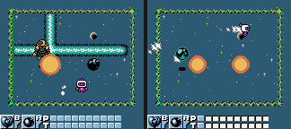

Set beforehand by one write on the start screen: the four commander flags, monsters 1-51 captured, 10 hearts,
Leather Armor, the Flak Bomb at firepower 5, the Remote Control and three healing items. Everything after that was
pad input: the walk, Leave, the talk and the fight. Played straight, the first form went down once and the second
then killed Bomberman. The win is one input history over three emulator launches joined by savestates, with a
rewind of a second or two each time Bomberman was hit (about 530 in all) and eight discarded legs. It shows the
fight can be won with this kit, not that it is won reliably.

The ending: "After an epic battle, Bomberman defeats the mighty Chaos Bomber!", Bomberman waving in the cockpit,
"End", the staff roll and the title. The game saves by itself during it, and flag 53 ends as `$E0`.
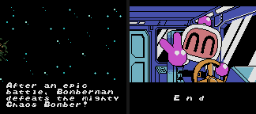 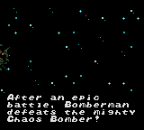

## ★ Hidden characters

Monster flags 54-56 are three hidden characters to duel, standing in the commanders' rooms (`12:41D5`).

| Flag | Where | Needs | |
|---|---|---|---|
| 54, Mami | Water Commander's room | Water and Electro commanders beaten | 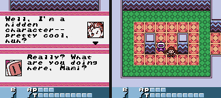 |
| 55 | Electro Commander's room | three commanders and Mami | 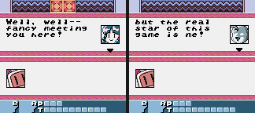 |
| 56 | Hurricane Commander's room | four commanders and the second | |

Beating one adds a heart of max HP and refills it. 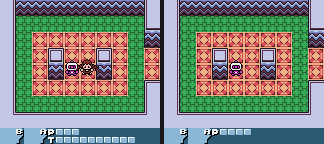 The characters were reached on
the US ROM by setting the flags. Mami's duel was then won with the pad alone from 3 hearts (a Normal Bomb at
firepower 5 and the Remote Control given beforehand): her HP went 10 to 0, max HP 3 to 4 hearts, flag 54 `$A0` to
`$B0`, and the second character appeared. 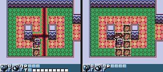 She never hurts Bomberman; she stuns with the
Hammer, kicks bombs away and digs. Losing is an ordinary Game Over. The second and third duels were won the same way with Gold
Armor on and no rewinding: the second took 8,800 frames and landed 10 hits on Bomberman, the third 3,550 frames and
6 hits. Unlike Mami, both do damage with their bombs. The third win took max HP from 9 to 10 hearts; the second
started at the 10-heart cap. No talk follows a win, the room is empty afterwards, and none of the three enters the
Monsters book, whose tables stop at flag 52. Neither was tried without the armour.
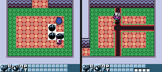
The text names only Mami, in both languages; GameFAQs names the other two Lewysia and Deral, and the dancer
Pampu, after their Saturn Bomberman characters.

Each fighter has 10 hearts and a fixed kit (`0C:4000`): Mami the Shovel, Hammer and Combat Boots; the second Jump
Shoes, Poison Bomb and Teleport Armor; the third Power Gloves, Short-fused Bomb and Rocket Shoes; the unused fourth
Power Gloves, Rubber Bomb and Silver Armor. All three kits were read back in the duels.

- A fourth fighter's kit and sprites (`2E:4680`) are complete and unused as a fighter. Its set is the dancer's: the seven
  tiles of her cameo above the shuttle are byte-identical to tiles of it. The duel draws it in another palette.
  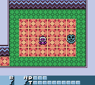
- With the Chaos Bomber's flag captured, a pink character dances above the shuttle. Her object (`11:6D4E`) tests only
  that flag; nothing reads the hidden characters' flags 54-56. Shown both ways by writing flags.
  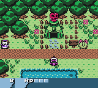 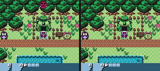
- Flag 53 is the Chaos Bomber himself.

## GameShark codes

Held RAM writes in Mesen, written in GameShark form; none was run on a GameShark.

| Code | US | Japan | |
|---|---|---|---|
| Test menu on Select | `010134C2` | `010134C2` | |
| No damage | `018034C2` | `018034C2` | 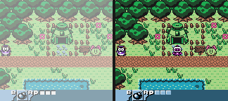 |
| Infinite HP | `013082CE` | `013081CE` | 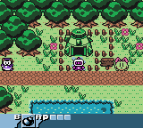  |
| 10 hearts | `01A081CE` | `01A080CE` | 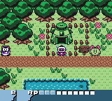  |
| Start on screen NN | `01NN91CE` | `01NN90CE` | 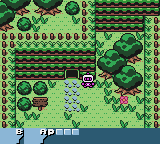 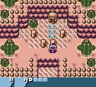  |

Written once, not held:

- Item flags `$CF23 + id` = `$10` (Japan `$CF22 + id`): all 60 items. 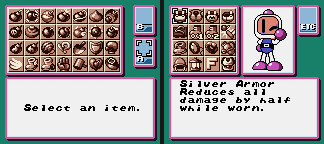
  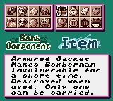
- Monster flags `$CEB1 + id` (Japan `$CEB0 + id`), bit 6: the Monsters book fills in. Twelve single flags were
  checked against the book on both ROMs; the book is not in flag order. 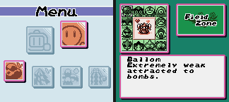
- Holding Select in the Monsters book shows a Defeated count. 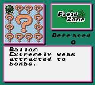

**Screens.** The world is two layers of an 8 by 8 grid, overworld and interior, and a door keeps the id and flips the
layer. The start-screen code loads the overworld layer only. Overworld: Field `00-03 08-0B 10-13 18-1A`, Forest
`04-07 0C-0F 14-17 1D-1F`, Peace Town `1B 1C 23 24`, Desert `20-22 28-2B 30-33 38-3B`, Beach `25-27 2C-2F 34-37 3C-3F`.
Interior `40`-`45` are the six Battle stages. 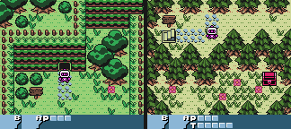 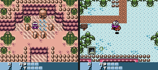
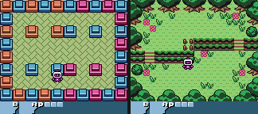 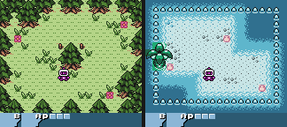
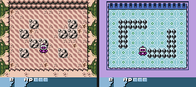

Variables: `$C3E1` game state, `$C3F5` current screen, `$C6D9` buttons held, `$C6DA` newly pressed, `$CE81` max HP,
`$CE82` HP (`$10` a heart), `$CE85`/`$CE86` A and B weapons, `$CE91` start screen, `$CE93`/`$CE94` start X and Y.

**Items** (id; names from the description table `0C:48DE`): 1 Wings, 2 Jump Shoes, 3 Dash Shoes, 4 Power Gloves,
5 Hammer, 6 Remote Control, 7 Tackle Belt, 8 Normal Bomb, 9 Ice Bomb, 10 Poison Bomb, 11 Short-fused Bomb,
12 Long-fused Bomb, 13 Rubber Bomb, 14 Wide-range Bomb, 15 Skull Bomb, 16 Land Mine, 17 Flak Bomb, 18 Homing Bomb,
19 Speed Bomb, 20 Aqua Bomb, 21 Robot Bomb, 22 Right Bomb, 23 Left Bomb, 24 Yo-yo, 25 !?, 26 Shovel, 27 Shield,
28 Gauntlets, 30 Silver Armor, 31 Gold Armor, 32 Platinum Armor, 33 Teleport Armor, 34 Steel Shoes, 35 Sneakers,
36 Rocket Shoes, 37 Combat Boots, 38 Safety Shoes, 39 Glasses, 40 Power Bracelets, 41 Scuba Gear, 42 Helmet, 43 Lamp,
44 Full Fire, 45 Leather Armor, 47 Rubber, 48 Clock, 49 Ice Shard, 50 Poison Ivy, 51 Boomerang, 52 Skull,
53 Explosive Core, 54 Fire, 55 Armored Jacket, 56 Stopwatch, 57 Flute, 58 Heart, 59 Full Heart, 60 White Card,
61 Black Card, 62 Honey Card. Ids 29 and 46 are empty slots; no unused item was found. Only 8 and 57 were tied to
their ids by a run, the rest follow the table order.

## Super Game Boy

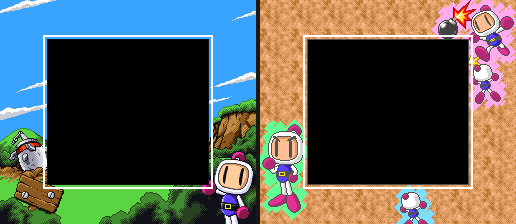

- The normal border is the same data in both ROMs.
- A second border is sent from one place only (`08:66DE`), after Battle mode's link handshake and only on Super Game
  Boy hardware, so it needs a Super Game Boy with a link port. Shown by a one-byte patch on a copy of the US ROM.
- Three palette packets (entries 5-7 of the table at `00:1B11`) are never sent.
  

## ★ Cut pieces

- **Town versions of the hidden characters.** Town object `$1F` picks one of three short talks (`21:4A10`, `4A26`,
  `4A3C`) by its parameter 0-2 (table `11:54F5`). No screen in either ROM places those parameters. One byte of a US
  ROM copy changed (file `$4877F`) stands each in Peace Town. Nothing follows the talk: play resumes in the town and A repeats it.
  The town screens load front-facing tiles of Mami and the second character (`18:6080`) that only these figures draw; the
  third wears the dancer's tiles, not her own. 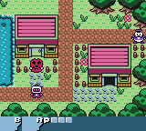
  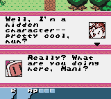
  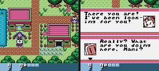 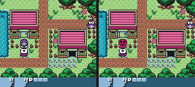
- **A third pause-menu button.** The main pause menu's cursor `$C3E7` is 0 or 1. Written to 2 with the menu open, A
  draws a third button, still labelled in kana in the US ROM; A on it does nothing.
  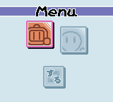
- **After-battle lines.** Japan holds lines for each commander after losing (monster `$5D`-`$68`) and Bomberman's
  replies (`$7A`-`$7F`); the US has fillers there. Neither ROM's talk records use them.
- **Music.** BGM `$81`, `$9F`, `$E0` and `$E1` were played in the sound test with the sound-chip writes logged for
  all 39 ids: no id repeats another. `$81` and `$9F` are full pieces still playing at 40 seconds, `$E0` a one-shot
  of about 16 seconds, `$E1` one of about 38 seconds that opens with `$F0`'s first 65 notes. The thirteen
  unrequested effects were logged the same way, all 67 effects in turn: each is real and none matches another;
  `$D0` and `$DB` are long.
- **Screens.** A graph of borders, doors, entrances and the shuttle reaches all 128 screens, so none is unused.
  Interior `$17` and `$1F` are joined to the rest only across a water channel; that crossing was not played.
- **Portraits.** All 62 slots of the portrait bank are used by a talk record.

## Battle mode

It needs a second Game Boy: A on the Battle line alone does nothing, and there is no waiting screen. Reached by
writing the game state: "Transmission error!" and "Select game rules!". The rules are Games, Time, Item Chg and a
stage, 0-5 or random; the code holds no hidden option or button check. `$CF62-$CF64` are Battle wins, losses and
rank. 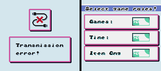

## Region differences

- The Japanese ROM keeps the A + Select debug check; the US ROM lost it.
- Title: PUSH START and ©1998 in Japan, PRESS START and ©1999 in the US.
- MBC1 in Japan, MBC5 in the US; the save block is one byte lower in Japan, so save-data codes differ by one.
- Bank `$26` in Japan holds the pause menu's text: 147 item and monster descriptions and help pages. The US keeps
  the same table at `0C:48DE` with 158 entries, because the English help needs more boxes.
- Text, from both scripts (512 line pairs compared): signs `$6C` and `$6D` exist only in the US; the US overwrote
  signs `$23` and `$25` and Bomberman lines `$47`, `$48` and `$58` with copies of other lines. Japan's description
  entries `$02` and `$03` read "No. 2 free space" and "No. 3 free space".
- Japan prints text a character at a time and labels the pause icons in kana. 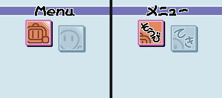
- The map and object tables are the same in both.

## Open

- A Chaos Bomber win without rewinds, and the other bomb types against him.
- The second and third duels without armour, and any of the fights on the Japanese ROM.
- The second and third characters, the fourth fighter and the dancer have no names in either ROM's text.
- A tile-by-tile pass over the graphics banks; the screen shown when a commander is beaten was read, not seen.
- Japan's text entries `$74`-`$79` and the cut-scene narration, which is drawn as tile maps.
- A Battle match itself, which needs a link partner.
