# Bomberman Quest (Game Boy Color, 1998-1999): codes and secrets

Everything here comes from disassembling the ROMs (`tools/sm83.py`, listing `disasm/quest/us.asm`) and checking in
Mesen 2 (`tools/quest/run.sh`, helpers in `tools/quest/lib.lua`). Addresses are `bank:address` in the US version
unless noted.

Prior art: the GameFAQs "Bomberman Quest" cheats page (in `res/`: the hidden bosses, the Power Gloves tricks) and
other published notes (the test-mode Game Genie codes, the test-mode text, the Super Game Boy 2 battle-mode codes).
Marks: ★ **New**, **Known**.

| Tag | Dump | Header title | Header CRC | MD5 |
|---|---|---|---|---|
| `us` | Bomberman Quest (USA) (SGB Enhanced) | `BOMBERQUEST` + `AVQE` | `$EAA7` | `ad358f284c3303db01212016ed3944d5` |
| `jp` | Bomber Man Quest (Japan) (SGB Enhanced) | `BOMBERMAN QUEST` | `$E735` | `632793107d6a279a2f38236955353906` |

Both: 1 MB, 8 KB battery RAM, CGB flag `$80` (colour on a Game Boy Color, runs on any Game Boy), SGB flag `$03`. The
US cart is MBC5 (`$1B`), the Japanese MBC1 (`$03`); new licensee `6F` (US) / `18` (Japan). The European release is
not in `roms/`.

## There is no password

The game saves to battery RAM: one file, saved at the Kepo statue in the Bomber Shuttle (the game's own text, `$0C:6D56`).
No screen takes a code. So the codes here are **GameShark codes for the save block the game plays from**, and
`tools/quest/password.mjs` builds them (`node tools/quest/test_password.mjs` round-trips all of them).

### The save

Cart RAM `$A000-$A0F3`, the same layout in both versions:

| Offset | Meaning |
|---|---|
| `+$00` | checksum: (sum of `+$01..+$F2`) & `$FF` |
| `+$01-$0E` | `DMG SAVE DATA.` |
| `+$0F-$F2` | the game block (228 bytes) |
| `+$F3` | the checksum again |

The title copies it to WRAM (`$00:0B28`, US `$CE72`, Japan `$CE71`) and checks it (`$00:0BEC`, Japan `$00:0BF9`):
signature, `+$00` = `+$F3`, and the sum. If any fails, the new-game template is copied in instead (`$00:0B60`).
`$00:0BBC` writes it back on a save.

The game block the game plays from is at **WRAM `$CE81` (US) / `$CE80` (Japan)**, one byte apart, so every GameShark
code differs by one between the versions:

| Block offset | Meaning | Evidence |
|---|---|---|
| `+$00` / `+$01` | max HP / HP, `$10` per heart (in play also `$C38E` / `$C390`) | `$00:0B60` template, `$09:5928` |
| `+$04` / `+$05` | the weapons on A / B (weapon id) | `tools/quest/lib.lua` `arm()` |
| `+$08` | armour worn | |
| `+$A2` + id | weapon 1-28 | bag page 1 |
| `+$BF` + id | equipment 1-16 | bag page 2 |
| `+$D0` + id | item 1-16; 1-8 are bomb components | bag page 3 |

Each weapon, equipment and item byte: bit 4 = owned, bits 0-3 = level / count (the bomb components count 1-15).
A code is `01` + value + low + high byte of the address (GameShark type `$01`, a WRAM write each frame): the
Normal Bomb is `01102BCF` (US) / `01102ACF` (Japan); Rubber x 9 is `011952CF` (US) / `011951CF` (Japan).

### What the save holds

Names are the US bag's; icons ripped from the bag pages in Game Boy Color colours (`tools/quest/items.lua` +
`items.py`, `docs/img/items/quest/`).

| Id | Weapon | | Id | Weapon |
|---|---|---|---|---|
| 1 |  Wings | | 15 |  Skull Bomb |
| 2 |  Jump Shoes | | 16 | 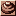 Land Mine |
| 3 |  Dash Shoes | | 17 |  Flak Bomb |
| 4 |  Power Gloves | | 18 |  Homing Bomb |
| 5 | 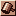 Hammer | | 19 |  Speed Bomb |
| 6 |  Remote Control | | 20 |  Aqua Bomb |
| 7 |  Tackle Belt | | 21 | 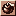 Robot Bomb |
| 8 |  Normal Bomb | | 22 |  Right Bomb |
| 9 |  Ice Bomb | | 23 |  Left Bomb |
| 10 |  Poison Bomb | | 24 | 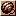 Yo-yo |
| 11 |  Short-fused Bomb | | 25 |  !? |
| 12 |  Long-fused Bomb | | 26 |  Shovel |
| 13 | 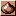 Rubber Bomb | | 27 |  Shield |
| 14 | 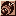 Wide-range Bomb | | 28 |  Gauntlets |

| Id | Equipment | Item |
|---|---|---|
| 1 |  Silver Armor |  Rubber |
| 2 |  Gold Armor |  Clock |
| 3 |  Platinum Armor |  Ice Shard |
| 4 |  Teleport Armor |  Poison Ivy |
| 5 |  Steel Shoes |  Boomerang |
| 6 | 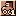 Sneakers |  Skull |
| 7 | 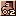 Rocket Shoes |  Explosive Core |
| 8 |  Combat Boots |  Fire |
| 9 |  Safety Shoes |  Armored Jacket |
| 10 |  Glasses |  Stopwatch |
| 11 | 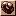 Power Bracelets |  Flute |
| 12 |  Scuba Gear |  Heart |
| 13 | 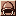 Helmet |  Full Heart |
| 14 |  Lamp |  White Card |
| 15 |  Full Fire |  Black Card |
| 16 |  Leather Armor |  Honey Card |

Items 1-8 (Rubber to Fire) are the bomb components (the bag's "Bomb Component" panel), 9-16 the "Item" panel. The
bag shows weapons as 7 x 4 starting with the Normal Bomb (ids 8-28, then 1-7), equipment 4 x 4, items as two 4 x 2
panels.

**Codec API** (`tools/quest/password.mjs`): `encode({weapon: [ids], equipment: [ids], item: {id: count}, hearts: 1-10},
ver)` returns the GameShark codes; `decode(code, ver)` returns `{kind, id, name, value}` (or `{kind: 'hearts' | 'hp',
value}`), else `null`; `validate(code, ver)`; `checkSave(bytes)` (the game's load check) and `makeSave(block)` (a
244-byte image the game accepts); constants `VERSIONS`, `BLOCK`, `WEAPONS`, `EQUIPMENT`, `ITEMS` (`{id, name, icon}`),
`KINDS`, `CHEATS`.

### Verification

- `node tools/quest/test_password.mjs`: all 344 item codes (each count 1-15 for the bomb components) and the 20 heart
  codes round-trip in both versions; wrong-shape codes are rejected.
- **Typed in Mesen's cheat engine** (`tools/quest/test_items.py`): per version, a new game with the codes for every
  odd id, then one with every even id (30 codes each), and every slot of the three bag pages read back: exactly the
  expected slots show an icon (plus the Normal Bomb and Flute a new game has), and in the US version the names the
  menu prints are exactly the codes' names. **4 of 4 runs ok** (US and Japan, odd and even).
- **Save check fuzz** (`tools/quest/fuzz.py`, `fuzz.lua`): 1,000 cart RAM images per version (valid saves of random
  blocks from `makeSave`, mutated one of six ways, or noise) put through the game's own load check (savestate at the
  CALL, the path taken read off): 375 accepted in each version, **0 mismatches** with `checkSave`.

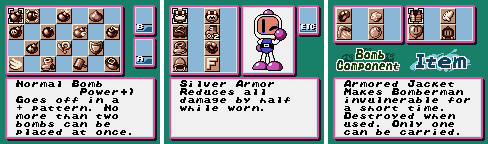

## Cheats (★ New unless marked)

| Code | Effect | Verified (both versions) | Other device |
|---|---|---|---|
| `018034C2` | invincible: `$C234` bit 7, the debug no-damage switch the hit code tests (`$09:5921`) | 10 bombs at Bomberman's feet: the damage routine `$09:58B1` ran 5 times, HP never dropped (3 hits and dead without) | Game Genie `189-26A-6EA`: `$09:5926` JR NZ -> JR, same test, same result |
| `01A081CE` + `01A082CE` (US), `01A080CE` + `01A081CE` (Japan) | 10 hearts, kept full | max HP and HP 160 on the field; a bomb leaves HP 160 | none (WRAM) |
| `010134C2` | the debug flag (`$C234` bit 0) held on: the test mode and the debug start, below | Select on the title menu gives the test mode; Down + Select + A on New Game gives the debug start | Game Genie `FF9-BCE` (US) / `FF9-D0E` (Japan) |

`tools/quest/test_cheats.sh` (`test_cheats.lua`) and `tools/quest/test_hearts.lua`. `010134C2` writes the whole
byte, so it clears bit 7: `018134C2` sets both switches.

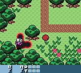 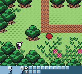

Patches: `patches/quest_invincible_<ver>.ips` for `us` and `jp` (file `$25926` = `$18`, the Game Genie byte; the same
in both): 0 HP drops in the same test. `patches/quest_debug_<ver>.ips` (US file `$19BC` = `$FF`, Japan `$19D0`): the
debug flag kept on, as the Game Genie codes.

## The debug flag and the test mode

`$C234` holds debug switches: bit 0 the debug flag, bit 1 Down + Select + A held when New Game was picked, bit 7 no
damage. The boot screen sets bit 0 (`$00:194A`) and the next state clears it (`$00:19B8`), so in the retail game it
is on for one frame and nothing else sets it.

- **Test mode, state `$18`** (Known as a Game Genie code): `187-F2E-B36` (US) / `187-FFE-B36` (Japan) change the
  state the boot hands over (`$00:17F1` LD A,`$17`) to `$18`, so the game boots into it. Checked in Mesen in both
  versions (`$C3E1` = `$18`).
- ★ **The way in that the game has**: with bit 0 kept on (`FF9-BCE` / `FF9-D0E`, `010134C2`, or the debug patch),
  **Select on the title menu** opens the test mode (`$08:4328`), and **Down + Select + A held when New Game is
  chosen** starts the **debug game** (`$08:42BB` sets bit 1; with bits 0 and 1, `$00:0B60` copies the template
  `$3E:4324` instead of `$3E:4240`): 10 hearts and every weapon, equipment and item. Without the flag, Select does
  nothing and Down + Select + A starts a normal game (checked in Mesen, both versions: `tools/quest/test_debug.sh`).

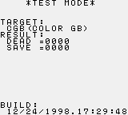 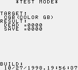

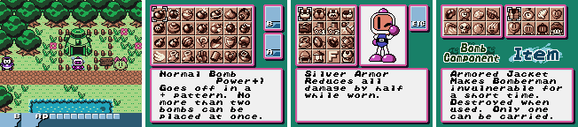

The test mode shows `TARGET:` (the console it detects: `CGB(COLOR GB)` here; the ROM also has `MGB&MGL(BG POKET)`),
`RESULT:` `DEAD =` / `SAVE =` counters, and `BUILD:` **12/24/1998.17:29:48** in the US version and
**10/27/1998.19:56:87** in Japan (★ the build stamps; the Japanese one has 87 seconds). Buttons, checked in Mesen in
both versions:

| Button | Goes to |
|---|---|
| Start | `*SOUND TEST*` (BGM / SE numbers; L-R number, U-D SE / BGM, A play) |
| Up | `*COLOR TEST*` (R / G / B levels and the colour) |
| A | `PCG MAP`: the tile viewer, one bank per page (Right steps the bank) |
| Down | the ending |
| Select | the title |
| B | nothing (no case in the dispatch, below) |

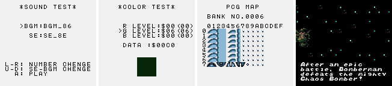

Leftover text next to the menu's (`$27:6AFF`, file `$9EAFF`, both versions, Known): `STAGE=`, `ENEMY=`,
`A (BG_PCG)`, `B (SPR_CHR)`, `START (SOUND TEST)`: a stage and enemy select that the test mode no longer draws.

## Hidden-content sweep

Coverage (`tools/quest/cov.sh`, US): boot, logo, title and attract for 8,000 frames; Battle on the title menu with no
link partner; a new game through the intro to Peace Town and the fields west of it with the random-input bot
(invincible); the debug start with every bag page; the test mode reached through the title menu (its colour test and ending; the sound test and tile viewer were shown in
the screenshot runs, which keep no CDL). Executed: **28,035 bytes** of code; ROM bytes touched at all: 128,615 of 1 MB. Most of the game (the four lands, the bosses, the
ending played to) was not reached, so this sweep is partial.

- **Dead code** (`disasm/quest/dead_us.txt`): branch-reachable never-run 6,176 bytes, dead 3,008, no reference 84;
  531 orphan candidates (mostly data and the unreached parts of the game). The largest dead pieces are the link code
  (`$00:1639`, from the serial handler `$00:15E0`), `$00:2308` and the test-mode screens not entered
  in the runs (`$27:6337` sound test, `$27:6780` tile viewer).
- ★ **The test mode's missing screen.** Its sub-state table (`$27:60D6`: 0 menu `$60E0`, 1 tile viewer `$67A9`,
  **2 = `$0000`**, 3 sound test `$6380`, 4 colour test `$61BC`) has an empty slot, and the menu's button dispatch
  (`$27:60E0`) handles Select, A, Start, Up and Down but not B. With the leftover `B (SPR_CHR)` and `STAGE=` / `ENEMY=`
  text, slot 2 was most likely the sprite viewer or the stage / enemy select, taken out.

- **Unset flags** (`disasm/quest/flags_us.txt`): no candidates with all five CDLs. `$C234` was found by hand: it has writes (the boot's set and
  clear), so the scan doesn't list it.
- **Input codes** (`disasm/quest/pad_us.txt`, 40 hits): the joypad and SGB reads, menus, movement, the title menu's
  Select (test mode, debug flag only) and the Down + Select + A held combination. No sequence code and no soft reset.
- **Text**: US text is ASCII-like with control bytes (`tools/quest` has no text tool; the strings above were found by
  an ASCII scan). The test-mode strings are the only development text.

### Super Game Boy

Packets (`tools/emu/sgb.lua`): MLT_REQ, DATA_SND, then the border (CHR_TRN x 2 + PCT_TRN) and PAL01 / PAL23, ATTR_BLK / ATTR_DIV / ATTR_CHR,
MASK_EN around screen changes. The border is the same in both versions.

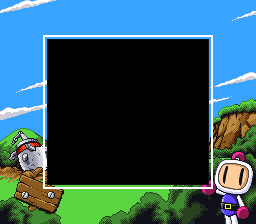

### Game Boy Color

The screenshots on this page are Game Boy Color captures (Mesen, model GameboyColor), except the SGB border.

## Title

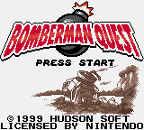 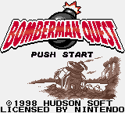

Logo: `docs/img/logos/quest_us.png` (`tools/quest/logo.py`); the Japanese title has the same logo pixel for pixel
(only "PUSH START" and the copyright year differ), so there is one file.

## Open

- The Super Game Boy 2 battle-mode codes published for this game (`C05-FEE-2A9`, a transmission error and then the
  battle mode with its unused palette; the test borders `C0A-73E-D5D` + `58A-34E-08A`) were not run: they need a Super
  Game Boy 2 link. `C05-FEE-2A9` patches `$00:15FE` (`F0` -> `C0`) in the serial handler.
- The item codes were checked on the bag pages, not played: what each weapon does in play, and whether a save made with
  a code on keeps the item (it should: the code writes the block the save copies), are not checked.
- What the test mode's `DEAD` / `SAVE` counters read (probably the block's `$CE8D` / `$CE8E` stats, `$00:0B85`).
- The hidden bosses and the after-game cameo (GameFAQs) were not reached.
- A wider coverage run (the four lands, bosses, ending) and the Japanese sweep; the European release.
