# Super Bomberman (SNES): passwords and secrets

Everything here comes from disassembling the ROMs (`tools/disasm.py`, coverage grown from Mesen 2 code/data
logs via `tools/sb1/cdl2entries_hi.py`, the HiROM version of `tools/cdl2entries.py`) and checking the results in
Mesen 2. Addresses are US retail unless a version is named. Prior art: the GameFAQs codes page and a published
article in `res/`. Marks: ★ **New** (in neither), **Fixed** (prior art is wrong), **Known** (prior art has it;
any detail added here is noted).

The game is HiROM, 512 KB, banks `$C0-$C7`. The four dumps:

| Dump | MD5 | vs US |
|---|---|---|
| USA | `d83699a009a62480a7e7e9f1bb5bff6e` | |
| Europe | `ddee4ddff2f3b6e31b8f73d0cb597ef1` | 4 bytes: header region/checksum and `$C4:07F4` |
| Japan | `cbef5f02304a2b821a0e1642a6307564` | ~30 KB of code and data not found anywhere in the US ROM |
| USA beta 1993-05-11 | `d67a1a2b0fac0564d950f8cd45fee3c2` | ~14 KB (see [The beta](#the-1993-05-11-beta)) |

## RAM that matters

| Address | Meaning | Evidence |
|---|---|---|
| `$00A4` | next scene. `$00-$2F` = stages 1-1 to 6-8 (index = (world-1)*8 + stage-1), `$31` title, `$32` battle setup, `$33` prologue, `$34-$36` demos, `$37` continue screen, `$38` password screen, `$39` new Normal Game, `$3C` sound test. Matches the debug menu's scene list (END TIT SEL DM1-4 CON PAS PRM ...) | writes at `$C5:4FEE`, `$C5:5023`, `$C5:5040`, `$C5:509E`, `$C5:7281`, `$C5:7326` |
| `$1030-$1033` | the four digits on the password screen (the entry object lives at `$1000`, digits at `$30,X`) | Mesen write watch, `$C5:7258` |
| `$0C7F-$0C82` | last password made by the game (pre-loads the entry screen, `$C5:71B3`) | `$C5:7FB9` |
| `$0C8F` | "9 lives next game" flag (prologue X trick) | `$C5:65E2`, `$C5:5106` |
| `$0C90` | small-Bomberman flag (5656) | `$C5:72A1`, `$C4:18B0`, `$C6:179B` |
| `$0C95` / `$0C96` | prologue X rhythm: frames since the last X / good presses in a row | `$C5:6698` |
| `$0CE1-$0CEF` | raw pads: `$0CE1`,`$0CE3`,`$0CE5`,`$0CE7` pads 1-4, `$0CE9` pad 5 (US) | `$C4:09DE` |
| `$0CF0,Y` / `$0CF8,Y` | held / newly pressed, Y = 0,2,4,6 for players 1-4 (`$0CFA` = player 2 new presses) | `$C4:0A2B` |
| `$0D40` / `$0D80` | player 1 / player 2 structs; `+$04` active ($FF), `+$3D` lives (`$0D7D`, `$0DBD`) | `$C5:5100` |
| `$0D10` | current scene; the scene object at `$0D00` loads a new one whenever `$00A4` differs | `$C4:63AE` |
| `$0D16` / `$0D17` | scene and stage (`$WS`, world and stage nibbles) saved from `$0D10`/`$0D24` at each scene change | `$C4:63B8`, `$C5:7FBC` |
| `$0D3A` | battle timer (BCD seconds) | `$C4:0800` |
| `$0314` | game state bits: `$40` paused, `$01` debug menu open, `$80` scene loading | `$C6:001B`, `$C6:00D2`, `$C4:63C8` |
| `$0316` | debug menu cursor (0-18) | `$C6:0226` |
| `$00A5-$00B6` | debug menu values (`$00A4` + item; item 0 *is* `$00A4`) | `$C6:01A4` |

## The password

Code: `$C5:71F3` (entry screen input), `$C5:72B0` (decode), `$C5:7FB9` (encode). Tables `$C3:0D30` and
`$C3:0D40`. `tools/sb1/password.py` and `tools/sb1/password.mjs` reproduce both directions.

- 4 digits, each **0-7**; 8 and 9 can't be entered. How the screen behaves: [Entering a password](#entering-a-password).
- Each digit maps through DEC = `$C3:0D40` = `1 3 4 6 2 0 5 7` (digit 0 → 1, 1 → 3, ...) to values t0 t1 t2 t3.
- **t1 = world-1, t2 = stage-1, t3 = salt, t0 = check digit.** The game accepts a code when:
  1. t3 is even (`$C5:72FA`),
  2. (t1 + t2 + t3) & 7 = t0 (`$C5:7302`),
  3. t1*8 + t2 < 48 (`$C5:731E`); that value goes to `$00A4`.
- Nothing else is stored: no lives, score or power-ups. A password start gets 5 lives (`$C5:5100`; 9 after the prologue trick below).
- The encoder (`$C5:7FB9`) takes world and stage from `$0D17`, picks the salt from the RNG (`$C6:1F13`, `& 6`),
  and maps back through ENC = `$C3:0D30` = `5 0 4 1 2 6 3 7`. So every stage has exactly **4 codes**, and
  the one the game shows you is random. 48 stages × 4 = **192 valid codes** out of 4,096.
- ★ **New:** after a game over on a boss stage, `$C5:6F23` steps the stage back to x-7 before encoding, so the
  CONTINUE screen never shows an x-8 code. Verified: game over at 5-8 (`7272`) showed `2234`, a 5-7 code, with
  `$0D17` = `$57`. 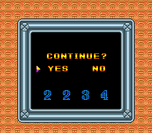

### Entering a password

Checked in Mesen with real button presses (`tools/sb1/password_entry.lua`, `tools/sb1/password_reopen.lua`, US):

- **Start value:** the screen opens on the last code the game showed you (`$0C7F-$0C82`, written by the encoder).
  After power-on that is **0 0 0 0**. After a game over at 2-1 the CONTINUE screen showed `7053` and, after NO, the
  password screen opened on **7 0 5 3**. ★ New 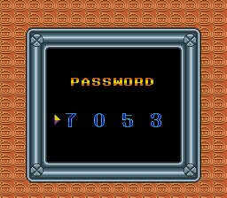
- **Cursor:** always starts on the first digit. **A** moves one digit right; there is no way back (Left, Right, B, Y
  do nothing).
- **Digits:** Up adds 1, Down subtracts 1, and both wrap: Down on 0 gives 7, Up on 7 gives 0 (`AND #$07` at `$C5:7266`).
- **Submit:** A on the 4th digit, or **Start** at any time (Start after one digit submitted the code as it stood).
  A wrong code goes back to the title; the next visit opens on the last *game* code again (0000 after power-on), not
  on what was typed.

So to type a code from scratch: for each digit press Up that many times (or Down 8 − digit times), then A; the 4th A
submits. From a pre-loaded code, change only the digits that differ and press Start.

### Every valid password

GameFAQs codes in bold. Any of the four works.

| Stage | salt 0 | salt 2 | salt 4 | salt 6 |
|---|---|---|---|---|
| 1-1 | **5555** | 4554 | 2552 | 3553 |
| 1-2 | 0505 | 1504 | 6502 | **7503** |
| 1-3 | 4545 | 2544 | 3542 | **5543** |
| 1-4 | 1515 | 6514 | 7512 | **0513** |
| 1-5 | 2525 | 3524 | **5522** | 4523 |
| 1-6 | 6565 | **7564** | 0562 | 1563 |
| 1-7 | **3535** | 5534 | 4532 | 2533 |
| 1-8 | **7575** | 0574 | 1572 | 6573 |
| 2-1 | **0055** | 1054 | **6052** | 7053 |
| 2-2 | **4005** | 2004 | 3002 | 5003 |
| 2-3 | 1045 | 6044 | 7042 | **0043** |
| 2-4 | 2015 | 3014 | **5012** | 4013 |
| 2-5 | 6025 | **7024** | 0022 | 1023 |
| 2-6 | 3065 | **5064** | 4062 | 2063 |
| 2-7 | 7035 | **0034** | 1032 | 6033 |
| 2-8 | 5075 | 4074 | **2072** | 3073 |
| 3-1 | 4455 | 2454 | 3452 | **5453** |
| 3-2 | 1405 | 6404 | **7402** | 0403 |
| 3-3 | 2445 | **3444** | 5442 | 4443 |
| 3-4 | 6415 | 7414 | **0412** | 1413 |
| 3-5 | 3425 | 5424 | 4422 | **2423** |
| 3-6 | 7465 | **0464** | 1462 | 6463 |
| 3-7 | 5435 | **4434** | 2432 | 3433 |
| 3-8 | **0475** | 1474 | 6472 | 7473 |
| 4-1 | 1155 | **6154** | 7152 | 0153 |
| 4-2 | 2105 | 3104 | 5102 | **4103** |
| 4-3 | 6145 | **7144** | 0142 | 1143 |
| 4-4 | 3115 | **5114** | 4112 | 2113 |
| 4-5 | 7125 | 0124 | **1122** | 6123 |
| 4-6 | 5165 | **4164** | 2162 | 3163 |
| 4-7 | **0135** | 1134 | 6132 | 7133 |
| 4-8 | 4175 | **2174** | 3172 | 5173 |
| 5-1 | 2255 | 3254 | **5252** | 4253 |
| 5-2 | 6205 | **7204** | 0202 | 1203 |
| 5-3 | 3245 | **5244** | 4242 | 2243 |
| 5-4 | 7215 | 0214 | 1212 | **6213** |
| 5-5 | 5225 | **4224** | 2222 | 3223 |
| 5-6 | 0265 | **1264** | 6262 | 7263 |
| 5-7 | 4235 | 2234 | **3232** | 5233 |
| 5-8 | 1275 | 6274 | **7272** | 0273 |
| 6-1 | **6655** | 7654 | **0652** | 1653 |
| 6-2 | **3605** | 5604 | 4602 | 2603 |
| 6-3 | **7645** | 0644 | 1642 | 6643 |
| 6-4 | **5615** | 4614 | 2612 | 3613 |
| 6-5 | 0625 | 1624 | 6622 | **7623** |
| 6-6 | **4665** | 2664 | 3662 | 5663 |
| 6-7 | **1635** | 6634 | **7632** | 0633 |
| 6-8 | 2675 | 3674 | **5672** | 4673 |

### GameFAQs codes, checked

All 52 distinct codes on the GameFAQs page (level list, boss list and the Total! magazine list) were **typed
with real button presses** in Mesen from the password screen, and `$00A4` read back after the 4th A.

| GameFAQs entry | As posted | Result | Status |
|---|---|---|---|
| Level passwords 1-1 to 6-8 (43 codes) | as listed | every one decodes to the stage it is listed for | Known |
| Boss passwords 1-8 to 6-8 (6 codes) | as listed | all correct | Known |
| Total! magazine: 2-1 `6052`, 3-1 `5453`, 4-1 `6154`, 5-1 `5252`, 6-1 `6655` | as listed | all correct (the note "the other passwords don't seem to be correct" is wrong: both lists work) | Known |
| Total! magazine: Level 7-1 | `7632` | **there is no world 7**; the game starts **6-7** 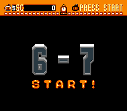 | **Fixed**: it's a 6-7 code |

★ **New:** the other 140 codes in the table above (GameFAQs gives one per stage; each stage has four).

### Fuzz check against the real decoder

Every one of the 4,096 possible codes (0000-7777) was written into `$1030-$1033` from a savestate on the
password screen and submitted with Start (`tools/sb1/fuzz.sh`, `tools/sb1/fuzz_decoder.lua`); the result was read
at the decoder's own exits (`STA $00A4` for a good code, the invalid path after the 5656 test). Compared with
`password.py` by `tools/sb1/check_fuzz.py`:

| Version | Codes tried | Accepted by the game | Disagreements with `password.py` | Special |
|---|---|---|---|---|
| USA | 4,096 | 192 | 0 | `5656` only |
| Europe | 4,096 | 192 | 0 | `5656` only |
| Japan | 4,096 | 192 | 0 | `5656` only |
| USA beta | 4,096 | 192 | 0 | `5656` only |

So **all four versions take exactly the same passwords**, and every accepted code set the stage index
`password.py` predicts. The JP decoder sits at `$C5:7192` (tables `$C5:6FCC`/`$C5:6FDC`), the beta's at `$C5:72A5`;
the code is the same instruction for instruction.

## Special codes and tricks

### 5656: small Bomberman (Known)

When the checksum fails, `$C5:7287` compares the raw digits with 5, 6, 5, 6. On a match it sets `$0C90` = 1
and plays a different sound; the screen returns to the title either way (`$00A4` = `$31`). `$0C90` then picks a
different sprite set for the player (`$C4:18B0` loads `$C3:26F4` instead of `$C3:26D0`; `$C6:179B`), for every
Normal Game until power-off (cleared only at boot, `$C4:0211`). Typed in Mesen, then a Normal Game:
normal start on the left, after 5656 on the right.

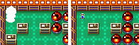

### Sound test: controller 5, R on the title (Known)

`$C5:4F52`: in US/EU the title checks that a multitap is present (`$0CEF & $1F` = 1, from the "MULTI5 CONNECT
CHECK" library) and that pad 5 holds R (`$0CE9` bit `$10`), then sets `$00A4` = `$3C`. In JP and the beta
(`$C5:4E2C` / `$C5:4F52`) only pad 5's R is tested (`$0CEE` bit `$10`; pad 5 is read only when the multitap ID
byte `$0CE0` is `$FF`). Verified with a **real pad-5 press** in all four versions: Mesen with a multitap in port 2 (command-line switch
`--snes.port2.type=Multitap`), R held on multitap port D from frame 600 of the title, no RAM writes
(`tools/sb1/test_sound_test_pad5.lua`): US, EU, JP and beta all set `$00A4` = `$3C` and show the sound test. Without
the multitap, US stays on the title (`$0CE0` = 0, pads 4 and 5 not read). The catch was Mesen's Lua `emu.setInput`: it
takes its numbers from the end, so the call is `emu.setInput(input, 0, port, subport)`; `setInput(input, 1, 3)` lands on
port 3, which doesn't exist. US/EU read pads 4-5 only when the multitap check `$C4:00D7` found one (`$0CE0` = `$40`).

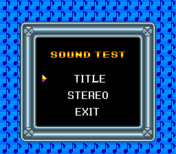

### Prologue: X in rhythm for 9 lives (Known, timing ★ New)

Pressing X during the prologue is known to give nine lives. The code (`$C5:6515`, `$C5:6698`) is a rhythm
check: each frame `$0C95` counts up; an X press when it reads **7-9** adds one to `$0C96`, any other press or 32
frames without one resets both. A row of bomb icons across the top shows progress. At **48** good presses
`$0C8F` is set, and the next Normal Game starts with 9 lives instead of 5 (`$C5:5106`). One press every 8 frames
(about 7.5 per second, i.e. a turbo controller) does it.

Only the Japanese version plays the prologue: its demo table `$C5:501F` is `33 34 33 35 33 36` (prologue between
each demo); US/EU `$C5:5158` and the beta `$C5:514D` are `34 35 36` and nothing else sets `$00A4` = `$33`. So in
the international versions the trick needs a cheat to reach the scene (the known PAR `7E00A433`).

Verified: JP, untouched title, X every 8 frames: the prologue started at frame 1544 and `$0C8F` was set at
frame 1978. US, NORMAL GAME redirected to `$33`: 60 presses → 9 lives in 1-1; 40 presses → `$0C96` = 39, 5 lives.

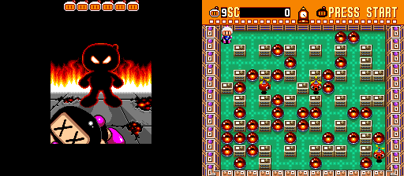

### Starting with controller 2 (★ New, minor)

`$C5:5128` (new game) and `$C5:7350` (password) check whether controller 2 pressed A or Start on that frame
(`$0CFA & $1080`). If so the lives go to player 2 (`$0DBD`) and player 1 is left out (PRESS START on the HUD).
Verified in US: Start on controller 2 at the title → `$0D44` = 0, `$0D84` = `$FF`, `$0DBD` = 5. Same result in JP and the beta (`tools/sb1/test_p2_start.lua`, the JP code is at `$C5:4F9C`/`$C5:4FEF`).

### Debug menu (Known; restored and every option checked ★ New)

The text (known to start at 0x607D8) is drawn into `$7E:2000` by `$C6:09F5`. Three pieces are cut off in every
version, beta included; the code itself is intact and bank `$C6` is byte-identical in all four dumps:

- **Opening.** The pause object (`$C6:0000`, every frame in a stage) calls `$C6:0081`, which finds the first active
  player whose new presses have Start *or Select* (`BIT #$30`) and then always toggles pause (`$C6:001B`). Nothing
  calls the menu toggle `$C6:00D2` (open: copy the player's state into `$00A5-$00B6`, draw, set `$0314` bit 0; second
  call: clear the buffer, write the values back, `$C6:053C`). The known note that Select opened it fits.
- **Input.** The menu's handler `$C6:01B9` is uncalled: Up/Down move the cursor `$0316` (wrapping 0-18), Left/Right
  change the value, A on BGM NO./SE NO. plays it; holding L or R makes Up/Down/Left/Right repeat (it reads held
  instead of new presses). That is why the cursor never moved in round 1.
- **Display.** `$C4:0B6F` (DMA `$7E:2180` → VRAM `$58C0` while `$0314` bit 0 is set) is uncalled.

**Patches** `patches/sb1_debug_menu_<us|eu|jp|beta>.ips` (138 bytes each; EU = US), made and checked against each
ROM by `tools/sb1/make_debug_ips.py`. They add 4 small hooks in the zero-filled `$C6:7F00-$C6:7F5F`:
`$C6:0011` jumps to a check that sends Select to `$C6:00D2` and Start to the normal pause (Start does nothing while
the menu is open), and runs `$C6:01B9` each frame the menu is open; the main loop's VRAM step (`JSL $C6:2460` at US/EU
`$C4:035D`, JP `$C4:01D4`, beta `$C4:01CF`) also calls the upload routine (US/EU `$C4:0B6F`, JP `$C4:0965`, beta
`$C4:0960`). The 4th hook makes NO DEATH work (below). The same bytes as **Pro Action Replay ROM codes** (90 per
version; Mesen's PAR cheats accept them, tested on the unpatched US ROM: menu opens, cursor moves, values change) are
printed by `make_debug_ips.py` and stored in `sb1_codes.json`.

**Use:** in a stage, Select opens the menu for the player who pressed it ("P:" is that player's number, `$40`; only player 1 tested), the game freezes,
Up/Down pick a line, Left/Right change it, Select closes it and applies the values. Checked in all four versions
(open, move, change, close; NO DEATH on/off). 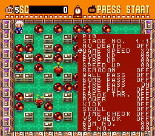

| # | Line | Value | What it does (Mesen, US; `tools/sb1/debug_menu_*.lua` on the patched ROM) | Status |
|---|---|---|---|---|
| 0 | STAGE NO. | `$00A4`, 78 labels | It *is* the next-scene byte, so closing the menu goes there at once (the scene object `$C4:63AE` reloads when `$00A4` changes). 1-1 to 6-8 = stages 0-47; END (`$30`, ending), TIT (title), SEL (battle setup), DM1 (`$33`, the prologue), DM2-DM4 (demos), CON, PAS, PRM (`$39`, new game / map), DRW (draw), WIN (victory); then labels run one behind: "B-1" is `$3C` the sound test, "B-2" to "B-C" and "DR" are battle stages 1-12 (`$3D-$48`); the last entries (`$49-$4D`, labels read past the table) give a black screen | Known list; offset confirmed |
| 1 | NO DEATH | player `+$2E` | Stored on close but **nothing reads it** (only the menu): the hit code `$C4:1385`/`$C4:13ED` goes straight to the death routine. With the patch's reconstruction (a hit is dropped while `+$2E` is set): own bomb, 5 lives kept; off: 5 → 4 | ★ New |
| 2 | GAME SPEED | `$00A6`, X1-X4 | Nothing reads `$00A6` in any version, and it isn't copied back: no effect | Known ("no longer works") |
| 3-5 | BOMB UP / FIRE UP / SPEED UP | `+$30` / `+$31` / `+$32`, 0-9, 0-9, 0-7 | Set the bomb count, blast range and speed level (read back after closing: 9, 9, 7) | ★ New (checked) |
| 6 | REMOCON | `+$33` | Remote bombs: drawn as remote bombs (+`$0C` bit 6), one stayed 700 frames and went off 1-2 frames after B | ★ New (played) |
| 7 | WALL PASS | `+$39` bit 6 | Walks through soft blocks (ORed in: turning it OFF later does not clear it) | ★ New (played) |
| 8 | BOMB PASS | `+$39` bit 5 | Walks back onto a bomb (same OR caveat) | ★ New (played) |
| 9 | FIRE PASS | `+$36` | Not a power-up: it is the invincibility timer. Shown ON while the start/respawn flashing lasts; ON writes `$0160` frames (5.9 s). Own bomb with it on: survived, timer ran out normally | ★ New |
| 10 | FIRE FULL | `+$31` bit 7 | Maximum blast: a fire-3 bomb burned across the whole row 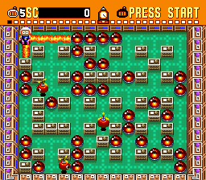 | ★ New |
| 11 | BREAK THR. | `+$38` | Red bombs whose blast passes through soft blocks, burning every one in range (stop mask `$02E0` → `$00A0`, `$C4:45A2`); item 11 (`$C6:0F37`) sets the same bit | ★ New (played) |
| 12 | POWER | `+$39` bit 0 | The kick: walk into a bomb and it slides until something stops it (`$C4:22B0`) | Known (played) |
| 13 | KICK | `+$39` bit 1 | The punch: Y throws a bomb 3 cells (`$C4:1D0B`, Y or L) | Known (played) |
| 14 | SKULL | `$C6:113D` | Gives a random skull disease (`+$13A`/`+$13C` = `$23F5`...), the same routine the skull item calls (`$C6:0FC5`) | ★ New |
| 15 | TIME CHECK | `$00B3` | Nothing reads it in any version: no effect | ★ New |
| 16 | VS CHECK | `$00B4` | The path search `$C6:39C0` of the blue enemy in 1-5 and 6-5 (the only stages that run it) sets bit `$0200` of every map cell it visits (`$C6:3A40`), which draws them black; the clear routine `$C4:0B9F` is uncalled too, so the marks pile up. Already known as "a debugging tool for Pakupa" 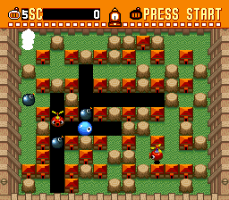 | Known; effect ★ New |
| 17 | BGM NO. | `$00B5`, 00-41 | A plays track n (`$C3:002C`, Y = n via `$C6:0996`); verified Y = 3 for 03 | ★ New |
| 18 | SE NO. | `$00B6`, 00-39 | A plays sound n (`$C3:0042`, via `$C6:096A`) | ★ New |

REMOCON, WALL/BOMB PASS, BREAK THR., POWER and KICK were played on 1-1 (bits written as the menu's close routine
writes them, real pad input; A drops a bomb, B sets off remote bombs). The item pickups make bomb pass and kick
exclusive (`$C6:0E74` sets bit 5 and clears bit 0, `$C6:0F5E` the reverse); the menu ORs them, so both can be on.
BREAK THR. off (left) and on (right), fire 3 into two soft blocks: 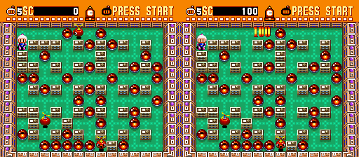

## Secret items

Each stage's object list (pointer table `$C3:2EEF`, one entry per stage) can hold one **secret-item object**:
a 3-byte pointer to its constructor `$C6:2ABF` followed by a condition number and an item number. The object
(`$C6:2B03`) runs every frame, calls the condition routine from the table at `$C6:2D4D` for player 1 and
player 2, and when one returns carry it spawns the item once through `$C4:2483` on a free cell. There are
exactly **20** such entries in the ROM, the same in US, EU, JP and the beta; the other 28 stages, among them all of world 5
and every boss stage, have no secret item.

### The 20 secret items

| Stage | Item | Condition (# and routine) | GameFAQs says | Status | Verified |
|---|---|---|---|---|---|
| 1-2 | Ice cream ($18) | 7 `$C6:2CDF`: the stage's enemy count `$0D25` goes **up** (bombing the exit releases enemies) | bomb the exit | Known | Mesen, `$0D25`+1 |
| 1-3 | Popsicle ($17) | 6 `$C6:2C21`: one of the player's chain counters `$0C3F+` reaches 3 (3 enemies from one blast or kick chain) | 3 enemies at once | Known | Mesen, counter = 3 |
| 1-4 | Cake ($12) | 2 `$C6:2B8F`: player on the exit cell (map low bits = `$10`) for 1,280 frames in a row (21.3 s) | stand on the exit 21 s | Known | Mesen, player held on the exit (spawned after ~2,600 frames: the count restarts whenever the check fails, e.g. while he was dying) |
| 1-5 | ? ($13) | 4 `$C6:2BCC`: bombs in all 4 corner cells (`$0916`+`$44`, `$5C`, `$2C4`, `$2DC`) | bombs in the 4 corners | Known | Mesen, corner cells flagged |
| 1-7 | Heart ($11) | 1 `$C6:2B73`: **no button held for 1,280 frames** (21.3 s), anywhere | stand on the exit 21 s | **Fixed** | Mesen, real input: no input, spawned |
| 2-2 | Onigiri ($0E) | 3 `$C6:2BBD`: Start held (i.e. pause) | pause | Known | Mesen, real Start |
| 2-4 | ? ($13) | 5 `$C6:2C10`: items on the board `$0C91` = `$0D03`+1 (everything revealed, nothing taken) | reveal the items, take none | Known | Mesen, `$0C91` set |
| 2-7 | Heart ($11) | 8 `$C6:2D02`: 5 frames in the punch state `$C4:1C9F` (each punch is 1 frame, so 5 punches; needs the glove) | punch the air 5 times | Known | static (same routine as 6-5) |
| 3-3 | Apple ($15) | 11 `$C6:2D3E`: score's last two digits are 20 (`$0D5C` = `$20`) | score ends in 20 | Known | Mesen, score byte set |
| 3-4 | Kendama ($14) | 0 `$C6:2B5C`: player in the dying state `$C4:19E3` with 1 life (you lose your second-to-last life) | last life | Known | Mesen, lives = 1, then bombed himself |
| 3-6 | Fire extinguisher ($16) | 10 `$C6:2D2F`: exactly 6 of your bombs out (`+$24` = 6) | 6 bombs | Known | Mesen, count set |
| 3-7 | Heart ($11) | 7 (as 1-2) | bomb the exit | Known | Mesen |
| 4-1 | Popsicle ($17) | 4 (as 1-5) | 4 corners | Known | Mesen |
| 4-4 | ? ($13) | 6 (as 1-3) | 3 enemies at once | Known | Mesen |
| 4-5 | Fire extinguisher ($16) | 0 (as 3-4) | last life | Known | Mesen |
| 4-7 | Heart ($11) | 2 (as 1-4) | stand on the exit 21 s | Known | Mesen |
| 6-2 | Cake ($12) | 9 `$C6:2D1F`: player in the stunned state `$C4:159E`, which a punched bomb landing on you causes (`$C4:137D`) | hit by a punched bomb | Known | Mesen, state written |
| 6-4 | Apple ($15) | 11 (as 3-3) | score ends in 20 | Known | Mesen |
| 6-5 | Ice cream ($18) | 8 (as 2-7) | punch the air 5 times | Known | Mesen: glove flag set, 5 real Y presses |
| 6-7 | Heart ($11) | 3 (as 2-2) | pause | Known | Mesen, real Start |

`tools/sb1/secret_items.py` runs all 20 (the condition is met by real input or by writing the RAM its routine
reads, as listed), hooks `$C4:2483` to confirm the spawn came from `$C6:2B4C`, then moves player 1 onto the item
and reads score and lives. All 20 spawned the listed item. GameFAQs' list is complete: there are no others.

### What each item gives

Pickup: the map cell's item number indexes the handler table at `$C6:0D26` (`$C6:0C75`; entry 0 is empty). Points are BCD, added by
`$C4:1AD8` to the player's score (`+$1A`/`+$1C`).

| Item | Handler | Effect | Measured in Mesen |
|---|---|---|---|
| $0E onigiri | `$C6:0F95` | 5,000 | 5,000 |
| $11 heart | `$C6:1006` | 800 and a shield: the next hit clears it and gives brief invincibility instead of a death (`$C4:1385`) | 800, `$0D79` bit 7 set |
| $12 cake | `$C6:102A` | **999,900** | 999,900 |
| $13 ? | `$C6:1046` | a random item 1-23 (15, 16 and 19 become the 1-up) | 4,000 + glove; extinguisher; apple (three runs) |
| $14 kendama | `$C6:1077` | 100 | 100 |
| $15 apple | `$C6:10AF` | 8,000 | 8,000 |
| $16 fire extinguisher | `$C6:10CB` | lives set to **9**, plus 9,000 | lives 9 |
| $17 popsicle | `$C6:10F1` | 500 | 500 |
| $18 ice cream | `$C6:110D` | 50,000 | 50,000 |

Points turn into lives: the first extra life comes at 5,000 points and the threshold then doubles (10,000,
20,000, 40,000 ...; `$C4:1C43`, threshold at player `+$11A`), with lives capped at 9 (`$C6:0E4C`).

**The 1-2 "9 lives if you haven't died" claim (Known, explained):** the ice cream sets nothing; its 50,000
points cross the 5k, 10k, 20k and 40k thresholds at once, +4 lives. From a fresh start (5 lives, under 5,000
points) that makes 9. Having died doesn't matter in itself: with 4 lives you get 8, and points already
scored use up thresholds. Measured: 1-2 from a password, 5 lives → 9 with 50,000 points. The cake does the same
from almost any state (999,900 points), and the fire extinguisher sets 9 directly.

## Regions

| | US | EU | JP | beta |
|---|---|---|---|---|
| Passwords, 5656 | same | same | same | same |
| Sound test check | multitap ID + pad 5 R | same as US | pad 5 R only | pad 5 R only |
| "MULTI5 BIOS Ver2.00 / CONNECT CHECK" library at `$C4:0009` | yes | yes | no | no |
| Prologue in attract loop | no | no | yes | no |
| Battle timer frames per second (`$C4:07F4`) | 60 | **50** | 60 | 60 |
| Title logo | ™ | same as US | no ™, other colours | same as US |
| Debug menu code (bank `$C6`) | uncalled | same | same | same |
| Music and samples | | same | same | same |

Screen by screen (`tools/sb1/region_shots.lua`: each scene reached by writing `$00A4` from a Normal Game, screenshots
at the same frame counts; EU runs at 50 Hz, so its shots fall at other moments):

| Screen | Difference | Status |
|---|---|---|
| Title | JP: no ™ and only "©1993 HUDSON SOFT" (US/EU/beta: "TM & ©1993 HUDSON SOFT / Licensed by Nintendo"), other logo colours. Beta = US 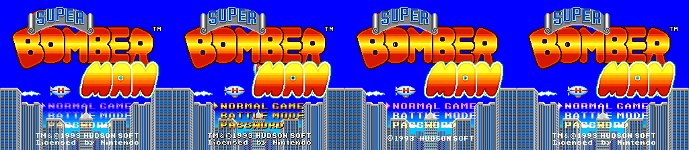 | Known |
| Prologue (`$33`) | Same scene in all four when reached; only JP's attract loop plays it | Known |
| Normal Game, world 3 | JP Moguchan brown/red with a mouth, US/EU/beta green/purple (US left, JP right) 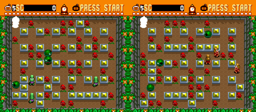 | Known |
| Normal Game 1-1, 2-1, 6-1, 6-8, map, continue, password | no difference seen (apart from random codes and timing) | ★ New (checked) |
| Battle setup, battle stages 1 and 8 | no difference seen | ★ New (checked) |
| Battle victory | JP Bomberman yellow with red hands; US/EU/beta white 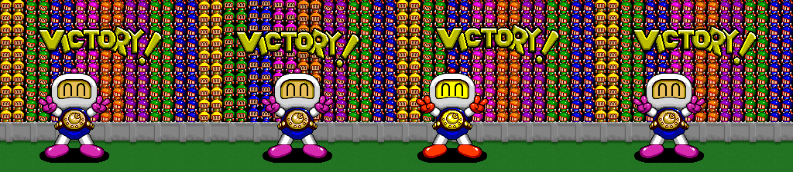 | Known |
| Battle draw | not reached this way (the scene needs a finished battle) | not re-checked (Known) |
| Ending credits | JP's heading reads **"game planner"**; US, EU and beta read "game planners" 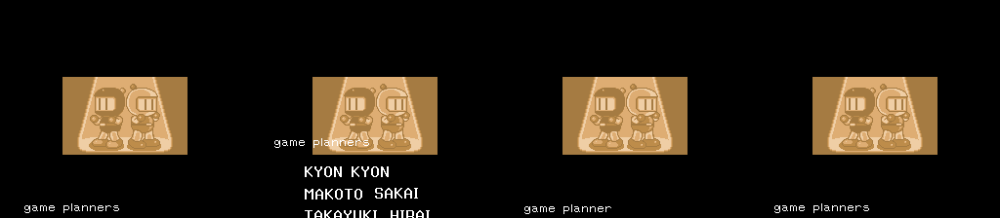 | ★ New |
| Sound test | same | ★ New (checked) |
| Text | Apart from the credits heading, no other text difference found: the only ASCII differences are the multitap library strings, and the debug text is identical | ★ New |
| Timers | Only the battle timer constant differs (EU) | Known |
| Music | Each of the 42 tracks played from the debug menu (BGM NO., `tools/sb1/debug_menu_bgm_spc.lua`) leaves the same APU RAM in US, JP and beta, apart from the echo buffer and ~110 bytes of player state; EU's ROM differs from US in 4 bytes only | ★ New |

- Europe differs from US in 4 bytes: 3 header bytes (region, checksum) and the timer constant at `$C4:07F4`
  (`CMP #$003C` → `#$0032`), so battle seconds are real seconds at 50 Hz. Known ("Battle Length").
- ★ **New:** the multitap library strings and the stricter sound-test check exist only in US/EU.
- ★ **New: START during the first title intro.** US/EU/beta check START only once `$0CAE` is set (`$C5:42E8`);
  `$C5:4EF0` sets it when Bomberman's first walk across the title ends. JP (`$C5:41ED`) checks START at once. In
  Mesen with START every 16 frames from power-on, JP skipped at frame 123 and US not before frame 424.
  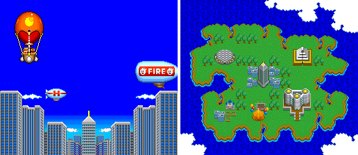
- ★ **New: retail ignores anything that isn't a standard pad.** After reading the pads through the MULTI5 library, US/EU
  zero a port's buttons unless its device ID (`$0CEB+n`) is 1; the old reader is still there, jumped over, at US
  `$C4:096C`. JP and the beta keep the old reader, which would take a mouse's bits as buttons. JP also turns on NMI
  and IRQ (`$C4:0172`) before setting the IRQ timers, the reverse of US; nothing visible comes of it.

## The 1993-05-11 beta

The beta was listed as undocumented. What the comparison found (`tools/sb1/romdiff.py`, a shift-tolerant
diff of 16-byte runs, plus the code checks above):

- ~14 KB of the beta is not found anywhere in US retail, almost all in banks `$C4`/`$C5` and in pointer tables
  in `$C3`: code moved by the insertion of the multitap library at the start of bank `$C4` in retail. The beta
  is much closer to US retail than to JP (~28 KB unique vs JP).
- Same password decoder and tables (fuzzed: 192 codes), same 5656 check, same prologue X code (`$C5:65D7`),
  same debug-menu text and the same unreferenced debug entry.
- No MULTI5 library; the pad reader (`$C4:0784`) is the JP one, and the sound test tests pad 5 R alone, like JP.
- Demo loop has no prologue, like US retail; title logo identical to US retail (with ™).
- No new text: every string in the game's tile encoding and every ASCII string longer than 5 characters is
  shared with retail except the multitap library's.

## Title logos

`docs/img/logos/sb1_us.png` (US, EU and beta are pixel-identical) and `sb1_jp.png`. Made from the game's own
data: VRAM, CGRAM and PPU registers dumped on the title screen in Mesen (`tools/sb1/logo_dump.lua`), BG1
(4bpp, 16×16 tiles, tilemap at VRAM word `$5000`) rendered with `tools/sb1/vram_render.py` with colour 0
transparent, cropped to the logo (223×136 US, 219×136 JP) and saved as indexed PNGs.

## Unused graphics

Method (`tools/sb1/scene_cdl.lua`, `tools/sb1/unused_tiles.py`): Mesen code/data logs, which also mark bytes read by
DMA, from every scene `$00-$48` (450 frames each with button mashing) plus the 13 round-1 stage logs, ORed together;
then the non-empty runs of the graphics banks `$C0-$C2` that were never read.

| Address (all four dumps) | What | Status |
|---|---|---|
| `$C1:0E40-$C1:17BF` (74 tiles, 4bpp) | Right after the world-4 enemy sheet `$C1:0800-$C1:0E3F` (read by DMA in 4-1, 4-3, 4-6 and a demo); the DMA stops at `$C1:0E3F`. Small round faces with eyes and teeth (4 + 6 frames), a ring that shrinks to a dot over 7 frames and a larger ring. Never read in the sweep; identical in US, EU, JP and beta. Red boxes = never read; the right half uses 4-1's sprite palette 0, which may not be the intended one 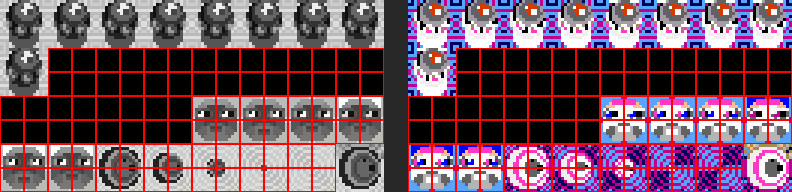 | ★ New (could be the known unnamed "strange graphic") |
| `$C1:A1DA`, `$C1:AEA1`, `$C1:C193`, 32-192-byte pieces in `$C2:0100-$C2:2400`, `$C2:8E57` | never read, but they don't decode as 4bpp tiles (compressed or other data) | not graphics as far as checked |

Not covered: palettes. The CPU copies palettes in blocks, so an unused colour set inside a used block counts as read,
and no never-read region of banks `$C3-$C7` looks like BGR555 colours. So the known green bomb, Starnuts and gold Mecha
Bomberman palettes (Known) were not re-found, and no new palette is claimed. The debug font (Known) is loaded at boot
and used by the restored menu.

## Dead code

Method (`tools/sb1/coverage.lua`, `tools/sb1/sweep.py dead2`, listing `disasm/sb1/dead_us.txt`): code/data logs from
a clean portable Mesen (no debug patch or PAR code ever loaded into it), merged: every scene `$00-$4D` written to
`$00A4` and played 500-4000 frames each with random presses on all five pads (multitap), player 1 and 2 kept
invincible (+`$36`), random power-ups every 40 frames, an item 1-24 put under player 1 every 40 frames (so every
pickup handler runs), a forced stage clear (enemy count 0, player on the exit) in each stage, a run with deaths to
GAME OVER and the continue screen, 8,000 frames of attract mode, plus the earlier scene and stage sweeps. 62,873
bytes of code ran (US). The listing was then rebuilt from those logs (`disasm/sb1/us`, 1,216 entries).

Never-run code falls in two groups:

- **Reachable, not covered:** 339 places where a conditional branch in code that ran leads to code that never ran
  (6,477 bytes): boss and enemy states, rare collisions, battle cases. Situations the runs did not reach, not hidden
  features; the biggest are the 6-8 boss (`$C7:5911`, 413 bytes) and per-direction collision branches
  (`$C4:31D9`/`329B`/`335D`/`341F`).
- **Boss defeats and the ending lead-in** (Mesen, boss hits forced in short windows, the hit counters left to run
  down on their own): all six bosses die and the map follows. `$C7:2678` (1-8, with the boss explosion spawner
  `$C6:31D7`-`332A`), `$C7:3EF7` (2-8) and `$C7:4900` (4-8, after being pushed into the arena edges, `$C7:4AF4`-`4CC4`)
  are the defeats. 3-8: `$C7:128E` → `$C7:1396` freezes the game (`$0314` bit 3) and places the players, `$C7:12EE`
  flashes white, `$C7:165B` leaves the scientist alone, then `$C7:184C` and `$C7:16F1` fill the field with columns and
  rows of little coloured Bombermen. 5-8: the boss is an AI Bomberman in player slot `$0DC0` (state `$C4:2E0A`, 5 hits:
  +`$106` = 4, each hit `$C4:2EAA` → `$C4:30B6`); the last one takes `$C4:30DA` past the battle death object, and the
  stage object `$C4:384A` gives both players points (`$C4:3893`) and goes to the map (`$C4:3883`). 4-8 also runs a
  boss-stage item dropper (`$C7:69DD`: every `$800` frames a random item from `$C7:6A35`). No unused phase, attack or
  text turned up. After the 6-8 second form
  (`$C7:6B4E`) takes its 5th hit, `$C7:71E0` jumps to the arena scene `$C7:7292`: P1 and P2 at (`$68`,`$B8`) and
  (`$A8`,`$B8`) in state `$C4:273F` beside the two villains, ending with `$00A4` = `$39` (`$C7:7384`). That map runs
  with `$0D17` = `$68`: the map object `$C5:7409` plays sound `$1B` and the gathering animations (`$C5:7449`,
  `$C5:74A5`), with the repeating sound object `$C7:7277` (through `$C7:724D` from `$C5:749C`); the Bombermen stop
  walking (`$C5:7B07`, `$C5:7CC3`), the map lasts `$500` frames (`$C5:766D`) and then the ending (`$30`) starts.
  The game-over step-back (`$C5:6F2C`) can't reach it: CONTINUE goes to a stage scene, not the map.
- ★ **Dud bombs in Battle Mode** (`$C4:4F95`). When a fuse runs out (`$C4:4F57`) with `$0C3C` = 3 (battle and the
  attract demos), the bomb is at least its owner's 3rd and the round still has duds left (`$0CAF`, set 0-2 by
  `$C4:6E0E`), a 1-in-256 roll (`$C6:15F2` = `$AE`) makes it fizzle: sound `$0F`, a smoke puff (`$C5:3976`), and a
  wait of (5 to 15) × 64 frames plus another fuse. Forced in Mesen (`$C4:4F8F` BEQ → BRA). 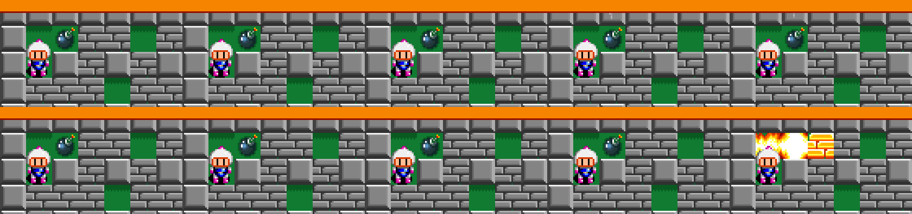
- **Islands:** 70 runs of plausible code (8+ instructions after a return or jump, with a return or jump in them)
  that no code that ran leads to; 54 of them (8,030 bytes) in the code banks `$C4-$C7`. The 16 in `$C0-$C3` are
  graphics or data that happen to decode. The ones in the code banks:

| Address | Bytes | What it is | Class | Status |
|---|---|---|---|---|
| `$C6:00D2`, `$C6:0474`, `$C6:09D9`, `$C4:0B6F` | 312, 303, 124, 70 | the debug menu: toggle, cursor/values, buffer clear and draw, VRAM upload | debug feature | Known (restored above) |
| `$C6:1093` | 28 | an item handler (100 points, the pickup sound) that the handler table `$C6:0D26` skips: the table goes from the kendama `$C6:1077` straight to the apple `$C6:10AF`. A byte copy of the kendama handler, so the slot of a cut 100-point item | cut feature | ★ New |
| `$C7:7277`, `$C7:7292`, `$C4:273F` | 320, 162 | the end of the final boss: `$C7:7292` is the arena scene after the 6-8 second form dies (P1 and P2 at (`$68`,`$B8`) and (`$A8`,`$B8`) in state `$C4:273F` beside the villains), `$C7:7277` the repeating sound on the map that follows (below) | reached through `$C7:71E0` and `$C7:724D` | seen in Mesen |
| `$C5:3B7C`, `$C5:3C16` | 123, 618 | the battle HURRY UP! banner at 1:00 (`$C4:0883`) and the TIME UP! banner at 0:00 (`$C4:087A` → `$C4:0769`, every live player dies, a DRAW); reached through `$C4:08xx`, not unreferenced. TIME UP! is almost never seen because the blocks end the round first ([img](img/sb1/battle_time_up.png)) | used | ★ identified (coverage round) |
| `$C4:4FCB` | 325 | walks the four blast arms from a cell and clears bit `$0800` (fire) in each map cell until a wall: the old end-of-explosion routine. The same code runs in the Japanese version (`$C4:48A3`); US/EU/beta use a replacement | superseded | ★ New |
| `$C4:5F89`, `$C5:59A7` | 257, 279 | two byte-identical copies of a "pick a random cell in the 13 × 11 field" routine (RNG `$C6:1F13`) | unreferenced | ★ New (minor) |
| `$C6:11BA`, `$C7:786A`, `$C7:7897` | 370 ... 136 | palette loaders (colours 1-13 through `$C6:2436`) | unreferenced | not identified |
| `$C4:8085`-`$C4:8150` | 89, 45 | entry stubs of the "BOOT VER1.03" sound-driver library (`$C4:8002`) that the game never calls | library | ★ New (minor) |
| `$C6:1F68`, `$C6:207D` | 40, 185 | distance-to-player-1 check (`$40` pixels), a loop over 4 players | unreferenced helpers | not identified |
| `$C7:1396`, `$C7:184C`, `$C7:1B2C`, `$C7:12EE`, `$C6:3BF9`, `$C6:326B`, `$C7:73D7` | 456 ... 397 | boss code reached through state pointers: the 3-8 boss's hit and defeat sequence (above), the 6-8 second form's hit test, the boss explosion | used | ran in Mesen with forced hits |
| `$C4:FA8F`, `$C4:F801`, `$C5:B1EE`, `$C5:F70F` ... | small | data decoded as code (sound and graphics in the code banks) | not code | |

EU equals US. In JP the same islands exist where the code exists (checked by byte search plus a JP coverage run of
every scene, `tools/sb1/coverage.lua` with FR=500).

## Input codes

`tools/sb1/sweep.py pads` (listing `disasm/sb1/pads.txt`) scans the disassembly for the shapes a hidden input
code needs: a frame counter checked against a window and followed by a press counter (rhythm codes), `AND #m` then
`CMP #m` with two or more buttons (held combinations), a compare against a table indexed by a RAM counter
(sequences), and every test of a fixed pad (not indexed by player). Run on all four versions:

| Hit | What | Status |
|---|---|---|
| `$C5:66B0` (JP `$C5:6572`, beta `$C5:66A5`) | the prologue X rhythm (window 7-9 frames, counter `$0C96`) | Known (only rhythm code in the game) |
| `$C5:4F52`/`$C5:4F5D` (JP `$C5:4E2C`) | pad 5 R and the multitap ID: sound test | Known |
| `$C5:50D5`, `$C5:5128`, `$C5:6FD2`, `$C5:7350` (JP `$C5:4F9C` ...) | player 2's Start / A+Start: the controller-2 start, present in all four versions | ★ New (above) |
| `$C6:160A` | a table compare with a counter: the random number generator (lagged table `$C6:161D`), not input | false hit |
| combos `#$0700`, `#$003F` ... | map-cell and object bit masks, not pads | false hits |

No button-sequence table and no other held combination exists. The scanner also finds SB2's turbo-X code, so the
pattern works.

## Unset flags

`tools/sb1/sweep.py flags` lists RAM (absolute addresses and object fields `dp,X`) that code which ran tests and
branches on, but that no instruction writes, or only never-run code writes. With the clean logs (US):

| Address | Tested at | Result | Status |
|---|---|---|---|
| `$00B4` | `$C6:3A40` | VS CHECK: written only by the debug menu | Known (above) |
| player +`$2E` (`$0D6E`) | (nothing) | NO DEATH: written by the debug menu, read by nothing | Known (above) |
| `$0304` | `$C6:22E7` | a frame-skip mask for the palette fader: fade speed classes 6-14 skip a step whenever `$0304 AND $C6:2426[class]` ≠ 0. Written once, by the RAM clear at boot (`$C4:0211`), so class 6 (every stage and title fade-in) and class 7 run at full speed. Counted up each frame, the 1-1 fade-in takes 64 frames instead of 33; set to `$FF` the stage fade-ins never run and the game is played on a black field 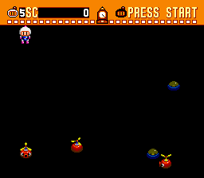 | ★ New |
| `$0D6F`, `$0CFB` | `$C4:091B`, `$C5:50D5` | written through `$2F,X` (1,450 writes in the watch) and the 16-bit pad store: false hits | |

So beyond the debug menu's own variables nothing is tested that the game never sets.

## Text

`tools/sb1/text.py` dumps every run of bytes in the debug-font encoding (A-Z = `$01-$1A`, 0-9 = `$20-$29`, `.`
`$1C`, `:` `$1E`, `-` `$34`, space `$36`) and in ASCII, and marks runs no log ever read (listing
`disasm/sb1/text_us.txt`; most short runs are graphics bytes). The game's own screens (title, menus, credits) are
graphics, so the real text is:

| Address | Text | Read in play | Status |
|---|---|---|---|
| `$C6:07D3` | the debug menu: P:, STAGE NO., NO DEATH ... SE NO. (each line has a 2-byte position) | no | Known |
| `$C6:0659` | the debug scene labels 1-1 ... 6-8, END TIT SEL DM1-DM4 CON PAS PRM DRW WIN B-1 ... B-C DR WIN, **then a second 2-1 ... 2-8**, then X1-X4 and 0-F. The known list stops at DR WIN / X1-X4; the eight extra labels sit where scenes `$4A-$51` would be | no | ★ New (minor) |
| `$C6:0448`, `$C6:096B`, `$C6:0997` | character tables of the debug font | no | |
| `$C4:0000`-`$C4:0190` | START OF MULTI5 BIOS / MODIFIED FROM SHVC MULTI5 BIOS Ver2.00 / ... CONNECT CHECK Ver1.00 (US, EU only) | yes (library code) | Known (above) |
| `$C4:8002` | BOOT VER1.03 (sound driver) | no | ★ New (minor) |

No Japanese text: the JP ROM has the same strings (no kana encoding in use).

## Maps

Format (decoder `$C4:7B33`; each stage header in the table `$C3:2EEF` (JP `$C3:2E8A`) holds a 24-bit map pointer at
offset `$11`): 14 words of wall bitmap, 17 columns × 13 rows, MSB first; then the floor tile codes for the same cells
two at a time, with a mask word before every 16 pairs (bit set = two new tile words, clear = repeat). Soft blocks are
not in the map: they are placed at random when the stage starts. `tools/sb1/maps.py` decodes every map the table
points to, then scans the whole ROM for any other block with the wall signature (row 0 and columns 0, 1, 15, 16
solid), and renders each one: walls grey, floor coloured by tile code so special floors stand out
(`docs/img/sb1/maps/map_<address>.png`, contact sheet `sheet.png`, `index.txt`). 20 maps, identical in all four
versions; two are referenced by no stage:

| Map | Used by | Note |
|---|---|---|
| `$C1:9CF4` | 1-1, 1-2, battle 3 | standard grid |
| `$C1:9DF2` / `$C1:9EE8` | 1-3 to 1-5, battle 2 / 1-6 to 1-8, battle 4 | |
| `$C1:A0D4`, `$C1:A324` | 2-1 to 2-5, battle 7 / 2-6 to 2-8 | |
| `$C1:A74C`, `$C1:A41A`, `$C1:A520` | 3-1 to 3-3, battle 8 / 3-4 to 3-7 / 3-8 (33 extra walls, a smaller arena) | |
| `$C1:9FDE`, `$C1:A84E` | 4-1 to 4-7, battle 9 / 4-8, battle 10 | |
| `$C1:A62A` | all of world 5 (20 extra walls: the narrow top) | |
| `$C1:AA52`, `$C1:A954` | 6-1 to 6-3, battle 12 / 6-4 to 6-8 | |
| `$C1:AB70`, `$C1:AC5E`, `$C1:AD84`, `$C1:C28C` | battle 1 / battle 11 / battle 6 / battle 5 | |
| **`$C1:A1DA`** | **none** | 23 extra walls: a block of walls filling the middle, so the field is a ring 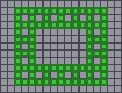 | Known (the ring-shaped structure); address and render ★ New |
| **`$C1:AEA2`** | **none** | a plain grid with its own floor tiles | Known (the second known structure); address and render ★ New |

These two were also the "never read, not 4bpp" blocks of the graphics sweep. 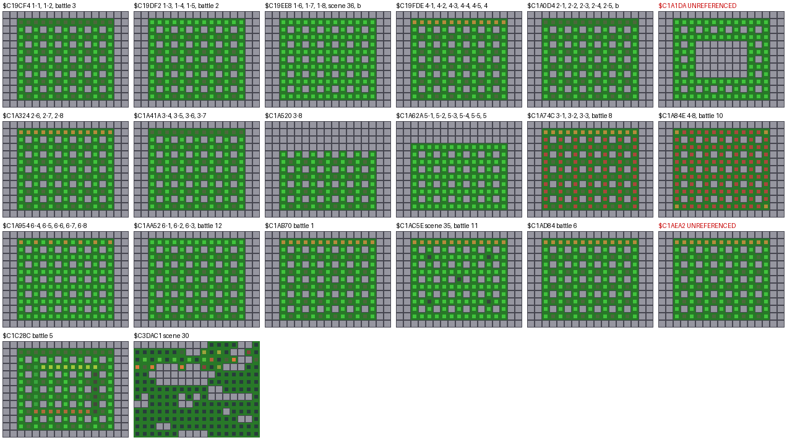

## Cheat codes

Pro Action Replay codes, each checked with Mesen's own cheat engine (`emu.addCheat`) on the unpatched US ROM and real
presses only (`tools/sb1/cheats.lua`, `tools/sb1/cheats.sh`): NORMAL GAME from the title, a bomb laid under player 1
after the start flash, player 1 read back 800 frames later. RAM codes work the same in EU, JP and beta (same RAM map);
those were not run there. All in `sb1_codes.json` (`section: "cheat"`).

| Code | Effect | Check | Status | Game Genie (same test, US, EU, JP, beta) |
|---|---|---|---|---|
| `7E0D7660` `7E0D7701` | player 1 invincible: the respawn-flash timer (+`$36`) held at `$0160` | own bomb: lives stay 5 (control run: 5 → 4) | ★ New | `3CFC-77FF` `3CFC-779F` (JP `3CFC-8D9D` `3CFC-8DBD`, beta `3CFB-87FD` `3CFB-879D`): `DEC $36,X` → 2 NOPs at `$C4:14AC`, the start flash never ends (every player); lives stay 5 |
| `7E0D7D09` | player 1 always 9 lives | died, respawned, still 9 | ★ New | `3CFE-57B4` `3CFE-5724` + the two codes of `7E0C8F01` (JP `3CFE-ED2F` `3CFE-EFFF`, beta `3CF3-E7BF` `3CF3-E72F`): `DEC $3D,X` → 2 NOPs at `$C4:19FE`; 9 lives, still 9 after dying |
| `7E0D7180` | maximum blast (FIRE FULL) | RAM and blast on screen | ★ New | 5 codes (`sb1_codes.json`): the five FIRE FULL `BEQ`s (`$C4:3F5F` ...) → `BEQ +0`; every bomb laid with range 10, as with the PAR code |
| `7E0D7009` | 9 bombs | RAM, several bombs laid | ★ New | 6 codes: `LDA $30,X` → `LDA #$09` in the three lay routines (`$C4:241C`, `$C4:3083`, `$C4:4548`); two bombs out, as with the PAR code |
| `7E0D7963` | power, kick, bomb pass, wall pass (+`$39` bits 0, 1, 5, 6) | RAM only | ★ New | none: each bit is tested in its own routine and only pickups set them |
| `7E0D7301` | remote-control bombs | bombs stayed unexploded 800 frames | ★ New | 6 codes: `LDA $33,X` → `LDA #$01` where a bomb is placed, `BEQ +0` at the two other remote tests; the bomb waits for a button, as with the PAR code |
| `7E0C9001` | small Bomberman (as 5656) | flag and sprite at 1-1 | ★ New code (effect Known) | `DDF8-7FF4` `DDFB-E72B` (JP `DDFC-849F`, beta `DDFC-8FFF`, + `DDFB-E72B`): both `$0C90` tests `BEQ +0`; small sprite at 1-1 |
| `7E0C8F01` | next Normal Game starts with 9 lives (the prologue-X flag) | 9 lives at 1-1 | ★ New code (effect Known) | `DB98-7DB0` `DB9D-5D20` (JP `DB05-E495` `DB0A-E4B5`, beta `DB9C-7F20` `DB9E-74F0`): both start-lives `LDA #$05` → `#$09`; 9 lives at 1-1 |
| `7E00A43C` | sound test | scene `$3C` from power-on | Known | `7A10-E4BD` (JP `7A17-572D`, beta `7A17-54BD`): the boot's title scene `$31` → `$3C` (`$C4:6349`); scene `$3C` from power-on |
| `7E00A4xx` | go to scene xx (list under Debug menu, STAGE NO.); switch it off once the scene has loaded | `7E00A42F` loads 6-8 | Known | `xx10-E4BD` (JP `xx17-572D`, beta `xx17-54BD`), xx in Game Genie letters: power-on goes to scene xx; `4E10-E4BD` loads 6-8 |
| `C30D63A2` `C30D64AE` | ROM codes: 1-1 is built from the unused map `$C1:AEA2` (US/EU/beta; the JP header table is elsewhere) | loads and plays 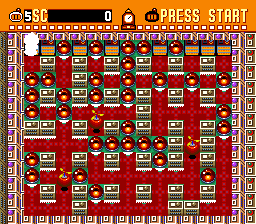 | ★ New | `C4D1-5DAE` `C3D1-5FDE` (the same bytes): loads and plays (US, EU, beta) |
| (`C30D63DA` `C30D64A1`) | the same for the ring map `$C1:A1DA` | hangs: Normal Game's soft-block placer (`$C6:1DC7`) needs 112 free cells reachable from the start (`$C6:1E93`), the ring has 90 | ★ New | not run |
| `C32226DA` `C32227A1` + `7E00A43F` | battle 3 built from the ring map `$C1:A1DA` (battle mode skips that check, `$C6:1DC9`) | loads and plays; the floor tiles are wrong with battle 3's and battle 7's sets 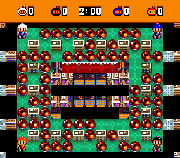 | ★ New | not run |

The debug-menu ROM codes (90 per version) are listed under Debug menu. Their Game Genie forms (the same bytes, in
`sb1_codes.json`) open the menu and change values in all four versions.

## Searched, nothing found

- Battle Mode: all 12 stages (Normal, Western, Bomb, Jump, Belt, Tunnel, Duel, Flower, Light, Power, Warp,
  Speed) are selectable from the start and wrap 12 → 1; the debug list's B-1 to B-C matches. No hidden stage.
- No other hard-coded password: the only compare on the raw digits is `$C5:7287` (5656).
- Password-screen button holds: the decoder reads only the digits and controller 2's new presses.

## Unused music and sounds

- ★ Every track request goes through `$C3:002C` (Y = track): the stage and scene table `$C3:2F83`, the jingle tables
  `$C4:1874` and `$C4:6C04`, constants `0F`, `11`, `1B` and the sound test's list at `$C7:07C9` (00 01 07 02 04 06
  0B 14 08 0A 12 16 0D 0E 0C 0F 10 11). Tracks 03, 05, 09, 13, 15, 28 and 29 are in none of them; only the debug
  menu's BGM NO. plays them (same in US, EU, JP and the beta).
  - 03 is another arrangement of the world 1 theme (02), denser, with parts an octave apart.
  - 05, 09, 13 and 15 are 04, 08, 12 and 14 starting past their intros (by about 3.3, 1.1, 0.55 and 0.65 s).
  - 28 and 29 copy the two per-world jingles (`0D`... at `$C4:6BFF`, `0E`... at `$C4:189C`) note for note; they sit in
    the demo's song set, where no table index reaches them.
- 1C and 1D belong to no song set: unassigned numbers, not music.
- ★ Effects go through `$C3:0042` (Y = effect). All 74 calls have the number written in except the debug menu's SE
  NO. (table `$C6:096A`); they ask for 00-0C, 0E, 0F, 11-13 and 15-1F. An effect sounds only with the instruments of
  the loaded song set: 0D (about 2.9 s, a noisy sweep fading out) plays in sets 5 and 12, 10 (about 0.85 s, a loud
  low tone) in battle sets 7, 9, 10 and 11, 14 (a 0.18 s rising blip) in set 9. 20-28 are empty slots: the
  driver's effect map (SPC `$0E61`) holds `$FF` for them in all 14 song sets, so it returns without playing.

## Open

- Unused palettes: needs the palette tables mapped (see Unused graphics).
- Regions: the battle DRAW screen and the NPC / Mecha Bomberman palettes (Known) not re-shot.
