# Super Bomberman 3 (SNES): passwords and secrets

Everything here comes from the ROM: a disassembly (`tools/disasm.py`, coverage grown from Mesen 2 code/data logs via
`tools/sb3/cdl2entries_hi.py`, a HiROM copy of the shared script) and byte searches across the three dumps. Each find
was then checked in Mesen 2, headless (`tools/sb3/run.sh`), by poking the digits into the password buffer and pressing
Start, or by typing them on the PASSWORD screen with real button presses (`tools/sb3/type.lua`).

ROMs: `Super Bomberman 3 (Europe).sfc` (primary; HiROM, FastROM, 1.5 MB, header `SUPER BOMBERMAN 3 PAL`),
`(Japan)` and `(Europe) (Beta)`. There was no US release. Addresses are for the European ROM unless noted. The Japanese
ROM has the password code at the same addresses. In the beta it sits 8 bytes lower, so `$C2:67DB` there is `$C2:67D3`.

Prior art: the GameFAQs codes page and a published article on the game (both in `res/`). **★ New** = in neither. **Fixed** = posted
with a wrong effect. **Known** = works as posted.

## RAM that matters

| Address | Meaning |
|---|---|
| `$7E5429-$542C` | the four password digits, 0-9 each (left to right) |
| `$0362` | password cursor (0-3) |
| `$0346` | stage id (`$0B` = 1-1 … `$3F` = 6-1, `$46` = final boss) |
| `$0349` | area (1-6), from the table at `$C2:6984` |
| `$0FF1/$0FF2` | the script VM's accumulator; the decoder leaves 1 (accepted) or 0 (rejected) in `$0FF1` |
| `$7E5430` | what to start after a password: a stage id, `$7C` new game from the intro, `$7D` battle mode, `$7E` ending |
| `$7E542D` | number of battle stages: 10, or 12 once the hidden stages are unlocked |
| `$7E542E` | battle arena variant 0-3 |
| `$7E542F`, `$7E6C6F` | battle COM level (`$6C6F` is the one the game uses and the GAMEPLAY screen shows) |
| `$7E6C6E` | selected battle stage (1-12) |
| `$7E2901` | full-equipment flag (set by the area codes) |
| `$7E2902` | hard-mode flag (enemies +1 HP) |
| `$7E4C0C` | battle player index that gets palette `$11`; `$FF` at boot |
| `$12E7,X` | enemy hit points (`$C3:029E` takes one per hit, the enemy dies at 0) |

Boot (`$C0:1EE0`) sets `$542D`=10, `$542E`=0, `$542F`=3, `$4C0C`=`$FF`, `$2902`=0 (`$2901` is only cleared by the
boot RAM wipe). Apart from those, only the special-code handlers below (and the title X trick, for `$542D`) store
to them (ROM search), so a code's effect lasts until the console is reset.

## Entering a password

Title → NORMAL GAME → 1PLAYER/2PLAYER GAME → PASSWORD. Checked in Mesen on the European ROM with real button
presses, logging the cursor `$0362` and the digits `$7E5429-$542C` after each press (JP and the beta were not
stepped through; their screen looks the same):

- The four digits start at **0000** with the cursor on the **leftmost** digit.
- **Up** adds 1, **Down** subtracts 1, and both **wrap**: Up on 9 gives 0, Down on 0 gives 9.
- Holding Up or Down repeats: one step at once, the next after about 18 frames, then one every 4-5 frames.
- **Left/Right** move the cursor and also **wrap**: Left on the first digit goes to the fourth, Right on the fourth
  goes back to the first.
- A, B, X, Y, L, R and Select do nothing on this screen. **Start** submits.
- A wrong code leaves the digits and the cursor where they were, so you can fix one digit and press Start again.

So typing a code is: for each digit, press Up that many times (or Down 10 − n times), then Right.

## The password

Code: `$C2:67DB` decode, `$C2:67FD` encode (both are script-VM natives, listed at `$C2:0670`), `$C2:680A`
digits → number, `$C2:68B6` scramble, `$C2:691D` check, `$C2:693B` checksum, `$C2:6949` stage lookup, `$C2:69C9`
special codes. `tools/sb3/password.py` and `tools/sb3/password.mjs` reproduce it.

1. Special codes first (`$C2:69C9`): 14 entries at `$C2:6A08`, 6 bytes each (4 digits + handler), ended by `$0A`.
   A match runs the handler and the password counts as accepted.
2. Otherwise `N = d0·1000 + d1·100 + d2·10 + d3 − $0710` (16-bit).
3. Unscramble (`$C2:68B6`): `V = N XOR $0DDE`, then swap bits 0↔5 and 9↔12. The key has 0 in all four of those bits,
   so the step is its own inverse; the encoder uses the same routine.
4. Reject if `V ≥ $2000`. Then `V` is `000c cccx xsss ssss` (bit 15 first): bits 0-6 = stage − `$0B`, bits 7 and 8 =
   not checked, bits 9-12 = checksum.
5. Checksum (`$C2:693B`): `c = (((V & $7F) >> 4) + (V & $FF)) & $0F`; must equal bits 9-12.
6. Stage = `(V & $7F) + $0B` must be in the 26-entry table at `$C2:6984` (5 stages per area for areas 1-5, plus `$3F`).
   That table also gives the area.

The encoder writes bits 7-8 as 0, so the game only ever shows one code per stage. It also clamps stage ids ≥ `$40`
to `$3F` (`$C2:68FA`), so losing at the final boss (`$46`) gives the 6-1 code. Stage `$46` is not in the decoder's
table: only the special code 3104 starts there.

Bits 7-8 give every stage four codes: 26 × 4 = **104 stage codes**, plus 14 specials = **118 valid codes out of
10,000**. A further 408 pass the checksum but fail the stage table (e.g. 5363 → `$48`).

**Fuzz check against the real decoder.** All 10,000 codes were run through the game's own routine
(`tools/sb3/fuzz.lua`: savestate on the PASSWORD screen, poke the digits, press Start, read the result at the
decoder's `RTL`). EU: the game accepted exactly the 118 the codec accepts, and each of the 104 stage codes gave the
codec's stage. JP: all 10,000 gave exactly the same result as EU (accept flag, stage, start mode and both equipment
flags). Beta (hooked at its `RTL`, `$C2:67F4`): also identical to EU on all 10,000.

### Stage codes

All 26 GameFAQs stage codes are right. The other three spellings of each are ★ New (the game never shows them).

| Stage | Id | GameFAQs (Known) | Also accepted (★ New) |
|---|---|---|---|
| 1-1 | `$0B` | 5358 | 5230 5102 4974 |
| 1-2 | `$0C` | 9486 | 9358 9230 9102 |
| 1-3 | `$0D` | 4332 | 4204 4076 3948 |
| 1-4 | `$0F` | 3306 | 3178 3050 2922 |
| 1 boss | `$11` | 2280 | 2152 2024 1896 |
| 2-1 | `$12` | 6408 | 6280 6152 6024 |
| 2-2 | `$13` | 5862 | 5734 5606 5478 |
| 2-3 | `$15` | 4836 | 4708 4580 4452 |
| 2-4 | `$18` | 7938 | 7810 7682 7554 |
| 2 boss | `$1A` | 6912 | 6784 6656 6528 |
| 3-1 | `$1B` | 9438 | 9310 9182 9054 |
| 3-2 | `$1D` | 8412 | 8284 8156 8028 |
| 3-3 | `$1F` | 7386 | 7258 7130 7002 |
| 3-4 | `$22` | 5880 | 5752 5624 5496 |
| 3 boss | `$24` | 4854 | 4726 4598 4470 |
| 4-1 | `$25` | 8916 | 8788 8660 8532 |
| 4-2 | `$27` | 7890 | 7762 7634 7506 |
| 4-3 | `$2A` | 5360 | 5232 5104 4976 |
| 4-4 | `$2D` | 3309 | 3181 3053 2925 |
| 4 boss | `$30` | 6411 | 6283 6155 6027 |
| 5-1 | `$31` | 5865 | 5737 5609 5481 |
| 5-2 | `$34` | 8967 | 8839 8711 8583 |
| 5-3 | `$37` | 2787 | 2659 2531 2403 |
| 5-4 | `$3A` | 9473 | 9345 9217 9089 |
| 5 boss | `$3E` | 2301 | 2173 2045 1917 |
| 6-1 (final stage) | `$3F` | 6363 | 6235 6107 5979 |

The ids skip numbers (`$0E`, `$10`, …): those are the later rooms of a stage. 5358 was checked on screen (STAGE 1
SWAMP ATTACK, then 1-1); the fuzz checked all 104.

### Special codes (`$C2:6A08`)

| Code | Handler | Effect | Prior art | Status |
|---|---|---|---|---|
| 0704 | `$C2:6A97` | 1-1 with full equipment | GameFAQs "Area 1" | Known |
| 3200 | `$C2:6A9B` | 2-1, full equipment | GameFAQs | Known |
| 2711 | `$C2:6A9F` | 3-1, full equipment | GameFAQs | Known |
| 3870 | `$C2:6AA3` | 4-1, full equipment | GameFAQs | Known |
| 4501 | `$C2:6AA7` | 5-1, full equipment | GameFAQs | Known |
| 0606 | `$C2:6AAB` | 6-1, full equipment | GameFAQs "Area 6" | Known |
| 3104 | `$C2:6A93` | final boss (`$46`, its own 8:00 arena), full equipment | GameFAQs | Known |
| 1511 | `$C2:6A87` | battle mode, COM level 4 (`$542F`=`$6C6F`=4) | GameFAQs | Known |
| 4622 | `$C2:6A6F` | battle mode, arena variant 1 | GameFAQs "new arenas" / "change levels" | Known (effect clarified) |
| 1616 | `$C2:6A73` | battle mode, arena variant 2 | GameFAQs "new arenas" | Known (effect clarified) |
| 3194 | `$C2:6A77` | battle mode, arena variant 3 | GameFAQs "new arenas" | Known (effect clarified) |
| 5656 | `$C2:6A62` | battle mode; `$4C0C`=`$7F`, which changes nothing | GameFAQs "yellow character" | Fixed (no effect) |
| 6514 | `$C2:6ACB` | **hard mode**: new game from the intro, every enemy takes one more hit | none | ★ New |
| 0803 | `$C2:6ADE` | ending | GameFAQs | Known |

How each was checked (in Mesen on EU; the fuzz also ran every one on JP and the beta):

- **Full equipment** (`$2901`=1): when the player is set up for a stage, `$C4:03A7` gives bombs `$144F`=8 (normally
  2), fire `$48B9`=8 (normally 1), speed `$126F`=2 (normally 0) and abilities `$48D1`=7 (normally 0). These are the RAM values read after 0704 and after 5358;
  the field names come from the item-pickup code, not from an on-screen check. `$48D1` holds
  bomb types in bits 0/4/5/6 (only one at a time, `$C2:6407` clears the others) and two stackable abilities in bits
  1 and 2 (`$C2:6415`, `$C2:6419`), so 7 = one bomb type plus both abilities.
  The flag is never cleared, so later passwords in the same session also get the kit.
- **Hard mode 6514** (`$2902`=1, start mode `$7C`): `$C3:00B2` adds 1 to every enemy's hit points as it spawns. After
  6514 the intro plays and 1-1 starts with six enemies at 2 HP each; 5358 gives the same six at 1 HP. Typed with
  real button presses as well as poked. Like the equipment flag it stays on until reset.
- **Battle codes** (start mode `$7D`): the game goes straight to SELECT MATCH. 4622, 1616 and 3194 also write
  `$542D`=10 (`$C2:6A81`), so **they re-lock the hidden battle stages** if the X trick had unlocked them (★ New).
  1511 and 5656 leave `$542D` alone.
- **1511**: `$6C6F` is the COM level the battle AI reads (`$C4:2DBD`); the default is 1. After 1511 the SELECT
  GAMEPLAY screen shows COM LEVEL 4.
- **Arena variants 4622/1616/3194**: `$542E` is read only by a battle script at `$C6:62CE`: a 12-way switch on the
  stage number that loads data set `base + $542E` for stages 1-10 (bases `$4D $51 $55 $59 $5D $61 $65 $69 $76 $71`,
  four sets each) and fixed sets `$75` / `$6D` for stages 11 and 12. So each code picks one of four versions of
  every normal stage; they add no new arenas, and stage select shows nothing different. The variants move the
  stage's fixed pieces around: on stage 5 the igloos change number and place, on stage 2 the green orbs and blue
  blocks move, and on stage 1 variant 1 (4622) has no soft blocks at all while variant 2 (1616) starts all five
  players in the middle. (Soft-block gaps are re-rolled every match, so only the fixed pieces are compared.)
  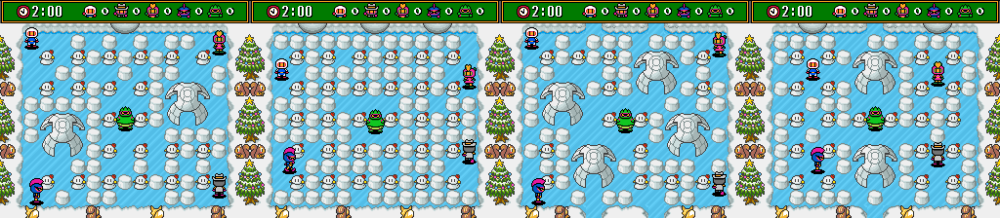
- **5656**: `$4C0C` is read once, at `$C4:04C5`: while setting up the five battle players, the one whose index equals
  `$4C0C` gets palette `$11` instead of its own. Indexes are 0-4, so neither the boot value `$FF` nor 5656's `$7F`
  ever matches, and no code writes any other value (a read watch through a whole 5-player match saw only
  `$C4:04C5`; a ROM search finds no other access). The colour swap is a leftover feature; this code has no effect in any version.
- **0803**: start mode `$7E` runs the ending (ship, space station, exploding UFO, Bomberman close-up).
  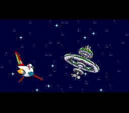
- **Unused handler**: `$C2:6AD5` sets `$7E2900`=1 and falls into the stage-start tail, but no table entry points at it and nothing
  reads `$2900`. A cut special code (★ New).

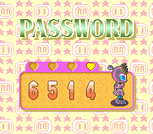

## Hidden battle stages (title screen X)

Code: `$C1:6E4D`, a title-screen task. Known (GameFAQs and others); the exact rule is ★ New.

- It waits for a new X press on any of the five pads (`$C1:6ECD` checks bit `$40` of the new-press bytes `$58-$5C`),
  then counts X presses in `$05AA` and frames in `$055A/$0582`.
- 16 frames without a press restarts it (`$05D2`), so you have to keep tapping.
- At frame 360 (`$C1:6EA4`, 7.2 s on the PAL game, 6 s on the 60 Hz Japanese one) it accepts if
  `((count − 7) & $F0) = $20`, i.e. **39 to 54 presses after the first** (a steady 7-9 frames per tap). Then it plays
  sound 2/8 and sets `$542D`=12. Too fast fails as well as too slow.
- Checked by tapping X from frame 200: every 7 and every 9 frames unlocked it (write to `$542D` from `$C1:6EC9`), every
  6 and every 10 frames did not. With `$542D`=12 the stage select goes past STAGE 10 SWAMP BOOGIE to **STAGE 11
  SUPERSTAR** and **STAGE 12 HAPPY HAPPY**, then wraps; with 10 it wraps after stage 10.
  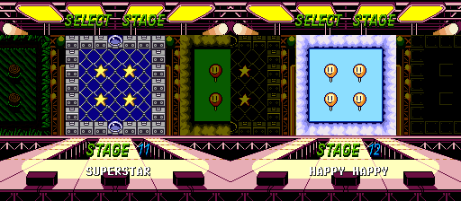
- The beta tests `(count & $F8) = $28` instead: only **40-47 presses**. Tapping every 9 frames (40) worked there and
  every 7 (51) did not (★ New).

The known Pro Action Replay route (`7E6C6E:0B`/`0C`) pokes the selected stage directly and needs no unlock.

## Regions and the beta

- **Passwords are the same in all three.** The code is byte-identical apart from relocated addresses (JP: 6 bytes,
  the math-library call targets; beta: the whole block 8 bytes lower). The JP fuzz matched EU on all 10,000 codes.
- **Title-screen code**: the same in EU and JP. The beta uses the narrower 40-47 window above.
- **Logo**: the title logo (BG1) uses the same tiles, tilemap and colour indices in all three; only the palette
  cycling on SUPER, the spark and the 3 is at a different step on a given frame. `docs/img/logos/sb3_eu.png` was
  rendered from VRAM/CGRAM at frame 1240 (`tools/sb3/logo.lua` + `tools/sb3/vram.py`).
- **The beta is a Japanese-text build.** Its header reads `Hu SUPER BOMBERMAN 3` with region byte `$00` (Japan) like
  the JP ROM, and its title screen has the Japanese layout ("OPTION", "© 1995 HUDSON SOFT" with no TM line). Its
  credits match the JP text. 253 KB of 1.5 MB differ from EU retail and 170 KB from JP, mostly shifted code.
- **Credits** (EU vs JP and beta, ★ New): EU says PROGRAMMERS (JP: PROGRAM), NAOTO YOSHIMI (YOSIMI), AKIHIKO AZUMA
  (AKIHIRO), CHARACTER DESIGN (PLAYER CHARACTER DESIGN), SOUND PROGRAMMERS (SOUND PROGRAM), SOUND FX (SOUND
  EFFECT), and adds a nickname to HIDEKI "DRUMMERBOY" MIFUJI under SPECIAL THANKS.
- ★ **A random-number log in JP and the beta.** Their RNG routine (`$C0:0BA8`) ends with 22 more bytes
  (`$C0:0BCE-$C0:0BE3`) that store every result in a 256-byte ring at `$7E:2AFC` (index `$7E:2AFB`). Nothing reads it,
  so it looks like a debug trace; EU ends the routine with `RTL` at `$C0:0BCE`, which is the `$15`-byte shift in its
  bank `$C0`. In Mesen, 20 START presses from power-on left index 84 in JP and the beta, 0 in EU.
- ★ **Continues in two-player Normal Game (beta).** The rejoin task (`$C2:5964`) picks which player gets PUSH START
  (`$BA`, beta `$C2:5AC1`, JP/EU `$C2:5AC3`). JP and EU leave `$BA` unset when both players are down and refuse the
  press (`CPX #$02`, then `LDA $147F,X`); the beta needs only someone out (`$147F|$1480` bit 7), a continue and Start.
  The one case that differs: P1 is out and P2 is hit, and P1 presses Start on that frame (before the round-end flag
  `$0345` bit 1 is set on the next). In Mesen with real inputs: in the beta P1 comes back, a continue is spent (3 to 2)
  and the round goes on; in JP and EU the press is ignored, the round is lost and restarts with P2 (the game spends
  the continue itself). It is a one-frame window. Beta 300 frames after the hit (left), EU after the restart (right).
  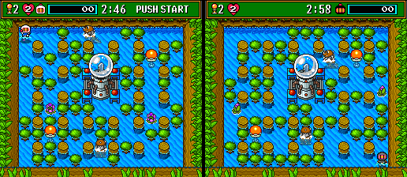

- **Battle data sets.** The switch at `$C6:62EF` (JP `$C6:62DB`, beta `$C6:62E5`, the same bytes) gives each battle
  stage four data sets (base + `$542E`), except stages 11 and 12, fixed at `$75` and `$6D`. Sets `$6E-$70` are named by
  no case: ★ they are stage 12's three missing variants. With the set byte (EU file `$6636C`, JP `$66358`, beta
  `$66362`) changed to each, stage 12 plays with its arrow panels in other places, the same in all three versions.
  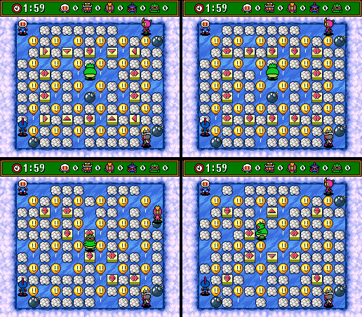
  The beta has no layouts of its own (its extra bytes are moved code and script). (A portable Mesen with an empty
  settings file has no pad in port 1, which is why the battle menus seemed stuck before.)

### Screen by screen (EU vs JP vs beta)

Each screen was reached in all three ROMs with the same button presses and compared on screenshots; the graphics
assets were also decompressed from all three and compared byte for byte (`python tools/sb3/assets.py diff`: only six
of 240 differ).

| Screen | EU | JP | Beta | Status |
|---|---|---|---|---|
| Title menu | NORMAL GAME / BATTLE GAME / OPTIONS, "TM & © 1995 HUDSON SOFT / Licensed by Nintendo" | OPTION, "© 1995 HUDSON SOFT" | as JP | Known |
| Player count | 1PLAYER GAME / 2PLAYER GAME | 1PLAYER␣␣GAME / 2PLAYERS GAME | as JP | Known |
| Battle menu headers | SELECT MATCH, SELECT PLAYER, SELECT GAMEPLAY, SELECT COUNTRY, SELECT STAGE | Japanese sentences (対戦モードを えらんで下さい …) | as JP | ★ New |
| Battle rule names | SUDDEN DEATH, BAD BOMBER, SOCCER BOMBER | サドンデス, みそボン, PKーボンバー | as JP | ★ New |
| Country map (asset 3.41) | FRANCE, KENYA | **FRANCE, KENYA** | **FRENCH, KENIA** | **Fixed**: the misspellings are usually credited to Japan, but the JP retail dump already has the corrected map; only the beta has FRENCH/KENIA |
| Battle stage names | English (STAGE 1 BLOCKBUSTER …) | katakana (オナジミサン …) | as JP | ★ New |
| Story stage card (asset 3.57, the stage-name font) | STAGE 1 SWAMP ATTACK | ステージ1 モリモリスター | as JP | ★ New |
| Controller error screen (asset 3.72) | CONTROLLER MALFUNCTION | コントローラー 接続が異常です | as JP | ★ New (from the ROM; the screen was not brought up) |
| Credits | see above | | as JP | ★ New (round 1) |

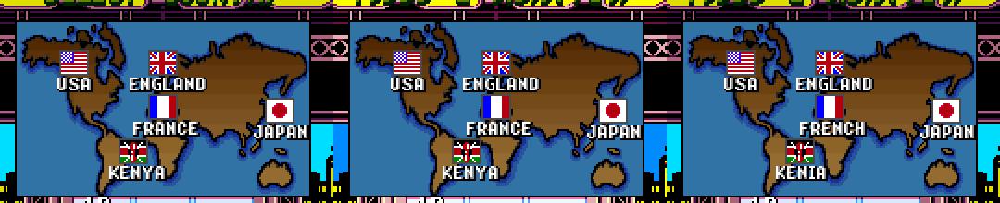

**Timers (★ New).** The battle clock (`$7E17E3` seconds, `$7E17E2` frame counter, `$C2:58B9`) counts **60 frames
per second in every version**: a write watch saw one tick every 60 frames on EU as on JP and the beta. The PAL
game runs at 50 frames a second, so a 2:00 battle lasts 2:24 of real time in Europe. The reload value `#$3B` is
hard-coded in all three. (The title X window, 360 frames, is likewise 7.2 s on PAL and 6 s on JP.)

**Music.** Banks `$D5-$D7` (sound driver and music) are byte-identical in all three ROMs; the SPC700 keeps its own
time, so the music should play at the same speed in all three (not timed by ear).

**Modes.** The same modes and options everywhere: NORMAL GAME (1 or 2 players), BATTLE GAME (single/tag match,
COM level, battle count, time, sudden death, bad bomber, soccer bomber), OPTION(S). Default battle time 2:00 in all
three.

## Unused graphics

**How graphics are stored** (★ New): almost everything goes through one asset loader, `$C0:193F` (A = asset id,
`$0D78` = table set). The tables are at `$C1:8000` (sets 0, 8, 6, 3, 4; 240 entries of 8 bytes: VRAM address,
length, 24-bit source, type) and every asset is compressed with a small RLE/back-reference codec read byte by byte
through `$C0:25B1`. `tools/sb3/assets.py` decodes all of them; its self-check confirms that 235 of the 239 streams
end exactly where the next one begins. Type-5 assets are sprite sheets stored as 16×16 cells (top-left,
bottom-left, top-right, bottom-right).

**The sweep.** Ten Mesen runs on EU covered every stage id `$0B-$47` (5358 with the stage overridden at the
decoder), all 12 battle stages with each of the four arena variants, the intro (6514), the ending (0803), the final
boss (3104), the title and option menus, and a game over. Three logs were combined: every asset request at
`$C0:1942`, every stream opened at `$C0:2595`, and the code/data log of every ROM byte read. **25 of the 240 assets
were never read in any run.** They are rendered in `docs/img/sb3/unused/` (file name = asset id and ROM address):

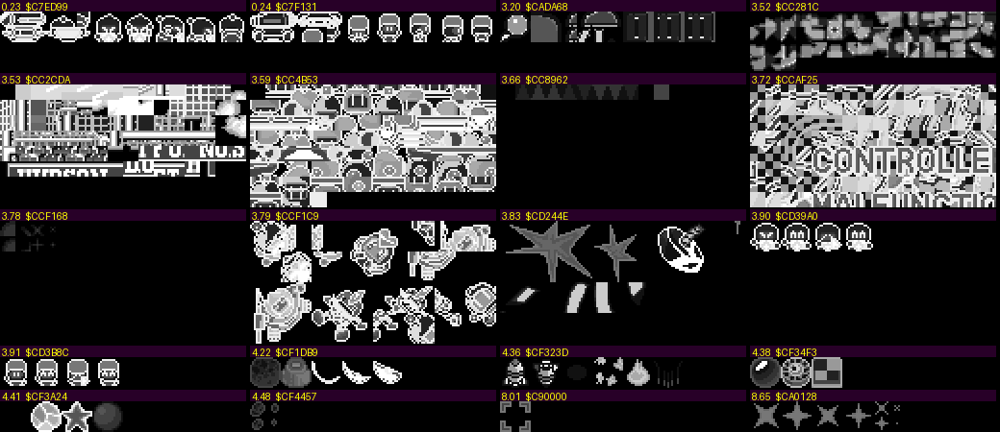

| Asset | ROM | What it is | Status |
|---|---|---|---|
| 0.23, 0.24 | `$C7:ED99`, `$C7:F131` | battle-character heads and bodies (two characters' extra frames) | ★ New, probably characters not picked in our runs |
| 3.90, 3.91 | `$CD:39A0`, `$CD:3B8C` | character face portraits | as above |
| 3.72 | `$CC:AF25` | CONTROLLER MALFUNCTION screen | used only on a controller fault, which no run caused |
| 3.53 | `$CC:2CDA` | a city skyline with HUDSON signs | ★ New, scene not identified |
| 3.59 | `$CC:4B53` | BG tiles: houses, clouds, a blimp | ★ New, scene not identified |
| 3.79, 3.83 | `$CC:F1C9`, `$CD:244E` | large sprites: explosions/debris, stars, a dish | ★ New |
| 8.52, 8.60, 8.61, 8.65 | `$C9:E312` … `$CA:0128` | boss/enemy sprite parts, a star burst | ★ New |
| 8.01, 8.02, 3.20, 3.78, 4.22, 4.36, 4.38, 4.41, 4.48 | see the file names | small item, cursor and object sprites | ★ New |
| 3.19, 3.52, 3.66 | `$CA:CC9C`, `$CC:281C`, `$CC:8962` | tilemaps / a short tile strip | ★ New |

"Never read" is only as good as the coverage: two-player story mode, every battle character, the boss of every
area being beaten and the controller fault were not exercised, so some of these may still be used there.

**Known items:**
- **Egg power-up icon (Known)**: found as tiles `$50-$53` of asset 6.02 (`$C0:6D46`, BG tiles at VRAM `$0800`),
  matched pixel for pixel against the published image. That sheet is loaded for story stages and battles, so the icon sits unused inside
  a used sheet. 
- **Heart-eyed Bomberman and Louie (Known, not located)**: no single 8×8 tile of the published image matched any asset,
  probably because the sprite is built from overlapping head and body pieces; not found.

**Palettes** were not swept: the palette requests (`$C0:1B38`, 14 sets in the table at `$C0:1CD0`) were logged, but
nothing tells which palette belongs to an asset, so unused ones could not be told from the logs. Unverified.

## Debug features (second pass)

- **No debug menu text**: no ASCII or `@`-spaced menu strings beyond the credits, the sound-driver banner and the
  multitap BIOS ID strings (EU and JP searched).
- **RAM flags that are tested but look never set**: a scan of all absolute reads without a direct write found
  `$1C8A` (tested by the title-screen demo task at `$C1:6C5F`/`$C1:6E13`) and `$7E6C4D` (`$C1:5414`). A write
  watch over all ten coverage runs shows both are written by the script VM (`$C2:0ACD`), so they are ordinary
  script variables, not dormant debug flags. `$7E2900` (set only by the unused password handler `$C2:6AD5`) is
  still never written and never read.
- **Pad 2**: the input code reads all five pads alike (`$C0:F3F3`, `$C0:0094`); nothing reads pad 2 alone.
- **★ New: an unreferenced soft reset.** `$C0:013A` is `LDA $4E / CMP #$33 / BNE / JML $80F000`: with
  **Select+Start+L+R** held on pad 1 it jumps to the reset routine. Nothing calls it in EU, JP or the beta (no
  JSR/JSL/JML to it anywhere).

## Hidden-content sweep (round 3)

Six passes over the European ROM, with spot checks on JP and the beta. Tools: `tools/sb3/sweep.py` (dead code, pad
scanner, flag scanner; shared with SB4), `tools/sb3/strings.py`, `tools/sb3/monkey.lua` (random-input coverage),
`tools/sb3/watch.lua` (write watch), `tools/sb3/maps.lua`, `tools/sb3/par.lua`, `tools/sb3/sheet.py`. Raw outputs are
in `disasm/sb3/` (`dead.txt`, `pads.txt`, `flags.txt`, `strings.txt`).

**A bug in the earlier logs.** Every code/data log dumped by `cdl.lua` (and SB4's `lib.lua`) looped
`for i=1,#c` over Mesen's 0-based table, so byte 0 was dropped and every flag sat one byte early. Listing entries
grown from those logs started one byte inside instructions, which is why parts of the old listing were garbage.
The helpers now loop from 0, `sweep.py cdl` shifts old dumps back, and `disasm/sb3/` was regenerated from scratch
(fresh `entries.txt`, `tools/sb4/cdl_fill.py`). The earlier note that "Mesen marks DMA blocks one byte early" was
this bug. The merged log (26 runs: rounds 1-2, Mesen's own `.cdl`, a 2-player random run) has 69,142 code bytes.

### Dead code

- ★ **New (coverage round): an unused object shift.** `$11F5`/`$11F6` are only ever cleared (`$C0:2726`); if set,
  `$C0:2736` subtracts them every frame from the position of every object of type `$11` or higher (the same helper
  as Super Bomberman 5's `$1CBD`). Forced on the title in Mesen, the characters and PUSH START BUTTON slide off the
  screen while the backgrounds stay put: a camera-follow leftover.
- ★ **New (coverage round): two tilemap draw modes nothing selects.** Mode 1 (`$0DB8` = 1, set only by the uncalled
  entry `$C0:1D00`) draws a block 32 tiles lower and queues an NMI VRAM-to-VRAM copy back up (`$C0:1E05`,
  `$C0:054B`, `$C0:019C`); mode 4 (`$C0:1D70`, script op `$C1:1BD1`, used by no script) skips the frame. Forced in
  Mesen by patching `$C0:1CFA`: mode 1 draws the battle bar twice, mode 4 leaves out the title logo and the bar's frame.
- Coverage of the reachable code, after a round of play runs (stages, battle, Tag Match, menus): 90.2%. The rest is
  enemy states, boss-kill extras and script ops no script uses (`$C1:6FC9`, `$C1:2E59`, `$C1:1A31`-`$C1:200D`).

`sweep.py dead` takes every JSR/JSL target and every block after an unconditional jump that no branch reaches,
decodes executed code straight from the log (exact widths), and drops blocks that read as data, use BRK/COP/WDM/STP
or call into nowhere. **755 entry points never ran**:

| Class | Count | Meaning |
|---|---|---|
| only from code that never ran | 440 | callers exist, none ran (mostly enemy/boss states in `$C3`/`$C4`, 2-player and battle-rule paths) |
| pointer/table only | 229 | the address sits in a pointer table or is built with `LDA #hi / XBA / LDA #lo` (object state handlers) |
| no reference | 72 | nothing points at them |
| referenced by code that ran | 14 | a state pointer was set but that state never came up |

Most are reachable but not covered: the bot never beats a boss or clears an area. The no-reference ones worth
naming:

- `$C2:6AD5`, the cut password handler (`$2900`=1). Known from round 1.
- `$C0:013A`, the soft-reset check from round 1.
- **★ New: an unused raster effect.** `$C1:63B9` sets the V-IRQ timer (`$4209`), points the IRQ vector at `$38`
  to `$F758` and enables IRQs. `$C0:F758` waits a few lines and writes the complements of `$031D`/`$031E` to BG3's
  horizontal scroll (`$2111`). Nothing calls `$C1:63B9` and nothing else installs `$F758`, so this is a dropped
  split-scroll effect. Static only; not run.
- **Actor script commands.** `$C2:1541`-`$C2:1861` are about 15 small handlers that read their arguments through
  `($B8)` and return to the VM's argument loop (`$C2:14F4`/`$C2:14F8`). They are the commands of the actor script
  engine (`$C2:12C4`), whose 64-entry table is at `$80:B01B`; op `$14` (`$C2:1802`) is its sound request.
- The rest are one-instruction stubs (`RTL`, `NOP / RTS` at `$C2:631A`) and alternate entry points into live
  routines.

JP and the beta were not swept separately. Their code matches EU apart from the address shifts listed above.

### Input codes

`sweep.py pads` flags code that loads a pad byte (`$3B-$66`, `$036F-$037D`, `$4016/7`, `$4218-$421F`, also
through a helper that returns one) and then compares it with a constant or a table, bit-tests it, or bumps a
counter. It gets 42 hits, including both known codes: the title X counter (`$C1:6E4D`/`$C1:6ECD`) and the
soft-reset check (`$C0:013A`). The rest are the pad driver, multitap detection (`$C0:F4EE`-`$C0:F50E`), "any
button" checks (`$C1:1A9F`, `$C2:55B5`) and player movement in `$C4`. **No new button code in native code.**
Menus run on the script VM, and its pad reads go through the VM's generic load. Scripts were not decoded, so a
code hidden inside a script would not show up here.

### Unset flags

`sweep.py flags` finds 28 RAM addresses that are tested but either never written directly (10) or written only by
code that never ran (18). `tools/sb3/watch.lua` watched all of them through a story stage (5358) and a battle
(1511), with 4,000 frames of random input each:

- Written by the script VM (`$C2:0ACD`) or by indexed code: `$147F/$1480` (`$C4:0012`), `$1B1F`, `$1C8A`,
  `$1C8D`, `$1EB0`, `$1ED1/$1ED2`, `$2908`, `$6C4D`, `$0D7B`, `$0DB8`, `$0F0E`.
- Never set to non-zero: `$2900` (round 1's cut handler), `$2907` (the VM only ever writes 0; it is the index
  whose cursor blinks at `$C1:2681`), `$64F6` (read only by the dead `$C1:54A1`), and the 18 that only dead code
  writes. None of them is a debug switch, so nothing was worth poking beyond round 2.

### Text

The game has one text table: **the staff roll** at `$C1:7A72`-`$C1:7D7C` (EU). It is ASCII with `@` for a space,
`^` for `/`, `a`/`_` for opening/closing quotes and `b` for `!`. `python tools/sb3/strings.py <rom> <cdl>` dumps it,
along with the noise, and marks what was read. JP and the beta have the same table 34 bytes lower, with the
round-1 credit differences. **PRESENTED BY HUDSON** (`$C1:7D69`) is the only entry the logs never saw read. The
0803 ending runs may simply have stopped before the last card (unverified).

All other on-screen text (menus, stage names, battle text, the Japanese headers) is tile graphics in the asset
sets, which the round-2 asset sweep covered. The only other ASCII is the ROM header and the multitap BIOS IDs at
`$C0:F3DD`-`$C0:F55F` (`NINTENDO SHVC MULTI5 BIOS Ver2.10`, `CONNECT CHECK Ver1.00`). The IDs are never read;
they are markers inside the driver.

### Maps

These are rendered from the game itself (`tools/sb3/maps.lua`), not from the data, because the stage format lives
in script data that was not decoded. Each frame shows the arena just after it starts.

- **Story**: every id `$0B`-`$47`, forced at the decoder's RTL (`$C2:67FC`) after 5358.
  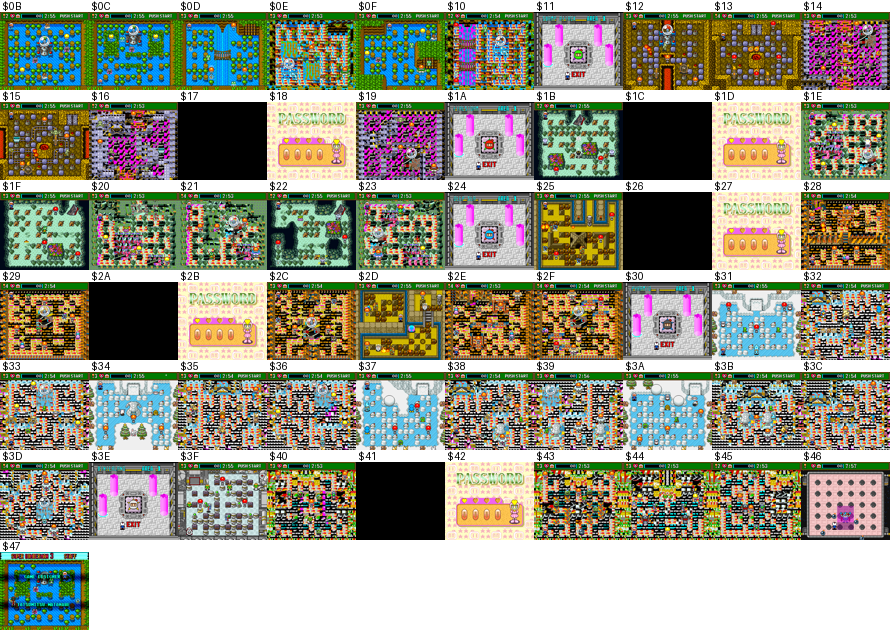
  - The 26 ids in the stage table play normally.
  - The ids in between are the later rooms of a stage. Entered cold, they show broken tiles.
  - `$17 $1C $26 $2A $41` stay black, and `$18 $1D $27 $2B $42` drop back to the password screen. These are not
    playable rooms; they are probably area-clear or boss-intro scene ids.
  - `$46` is the final boss arena. **`$47` is the staff-roll field**: the credits scroll over a copy of 1-1, as
    part of the ending.
  - No cut stage turned up.
- **Battle**: 12 stages × arena variants 0-3, with `$6C6E` and `$542E` written at the stage select:
  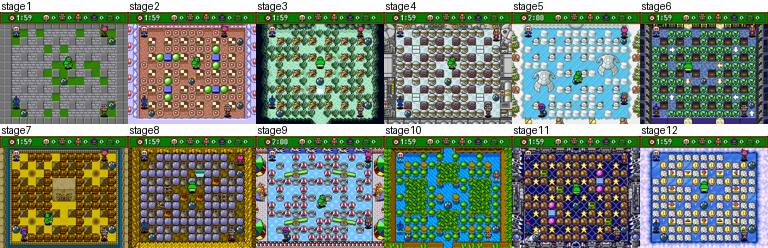
  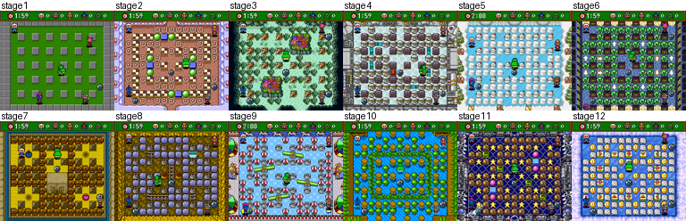
  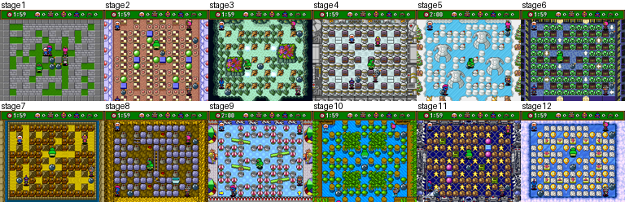
  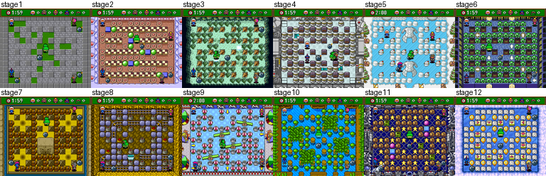
  Stages 11 and 12 look the same in every variant (fixed data sets `$75`/`$6D`).

### Cheat codes (Pro Action Replay)

Each code was checked in Mesen's cheat engine (`emu.addCheat`, `tools/sb3/par.lua`) on the unpatched ROM:

| Code | Effect | Checked | Game Genie (same test) |
|---|---|---|---|
| `7E542D:0C` | battle stages 11 and 12 on the stage select | EU: Left from stage 1 goes to 12 | `DAFE-84A7` `DA16-8DDC` (JP `DAFF-EDD7` `DA16-8DDC`, beta `DAFF-EDD7` `DA15-84DC`): both `LDA #$0A` before `STA $7E542D` load 12; `$542D`=12 in all three, EU Left 1 -> 12 |
| `7E2901:01` | full equipment at every stage start | EU: bombs 8, fire 8, speed 2, `$48D1`=7 at 1-1 | `DDDC-E7FD`: `$C4:03AB` `BEQ` -> branch of 0; 8/8/2/7 at 1-1 in EU, JP, beta |
| `7E2902:01` | hard mode (enemies take one more hit) | EU: the flag holds. The effect itself was checked with 6514 in round 1 | `DDD8-7FAA`: `$C3:00B6` `BEQ` -> branch of 0; JP and beta enemies start with 2 HP instead of 1 (as with the PAR code) |
| `7E6C6E:0B` / `0C` | pick stage 11 / 12 | Known, not re-run | none (no ROM form built) |

No invincibility code: no tested-but-unset flag guards the death path, so there is nothing to point one at.

## Unused sounds

- ★ Effects go through `$C0:07A1` (table `$80:80DC`); no code, script or actor asks for 06 (command `$0D`, APU
  `$2C84`), a 2-channel rising sweep of about 0.76 s. 25 (command `$2C`) is a placeholder that sets an instrument and
  volume and plays no notes; 2B (command `$66`) replays the voice clip last uploaded, like the voice commands
  `$67-$7B`, so it has no sound of its own. Music: every track 01-23 is requested.
- ★ The effect table maps 62-6B onto commands 32-3B again, so 68 and 6A share commands 38 and 3A with 5C and 5E. Those
  are sent only by the final boss's actors (types `$4D`/`$4E`, spawned only in stage `$46`) while that stage's sound
  set 37 is loaded. Nothing asks for 68 or 6A, so the title set 38's own commands 38 (a 1.1 s tone with a sharp
  attack) and 3A (a 1.2 s quiet rising tone) never play.
- ★ Voices 0B-13 come only from the battle results request at `$C6:0F7F`: `$0B` + the player's character (`$1347`,
  set at `$C4:04BE` from the 8-character select screen), so 0B-12; the results screen sent 0B, 0D and 11 for
  characters 1, 3 and 7. Voice 13 (sample set 2F, `$D5:E5E9`, command 79) is never sent, a spoken clip of about 1.2 s.

## Tools

- `tools/sb3/password.py`, `tools/sb3/password.mjs`: the codec (decode, encode, validate, list all). `python
  tools/sb3/password.py` lists all 118; the `__main__` self-check asserts the counts.
- `tools/sb3/run.sh script.lua [eu|jp|beta]`: Mesen wrapper. `cdl.lua` (helpers, CDL dump), `pw.lua` (boot to the
  PASSWORD screen, poke codes, print state), `type.lua` (type a code), `battle.lua` (walk to the battle stage select),
  `fuzz.lua` (decoder fuzz), `xtap.lua` (title X tapping), `logo.lua` + `vram.py` (title logo rip), `assets.lua`
  (log asset streams and palette requests). `run.sh` runs a portable Mesen
  copied from `K:\Emulators\Mesen` into `$SB3_MESEN_DIR`, with its own `settings.json`, so nothing is written to the
  normal Mesen data folder.
- `tools/sb3/assets.py`: asset codec and tables (`list`, `diff`, `png ID out.png`); runs a self-check with no arguments.
