# Super Bomberman 4 (SNES, Japan): passwords and secrets

Everything here comes from disassembling the ROM (`tools/disasm.py`, coverage grown from Mesen 2 code/data
logs with `tools/sb4/cdl_fill.py`) and checking the results in Mesen 2 (`tools/sb4/*.lua`, run with
`tools/sb4/job.sh`). Prior art: the GameFAQs codes page and a published article on the game in `res/`. Marks: ★ **New** (in
neither), **Fixed** (prior art is wrong), **Known** (prior art has it; any detail added here is noted).

The game is HiROM, 2 MB, banks `$C0-$DF`, header title `SUPER BOMBERMAN 4`. One dump: `Super Bomberman 4
(Japan).sfc`, MD5 `df33e261104efee409de8f294d80ad6e`, CRC32 `3BBAEB19`. The menus quoted below are the
game's own text (the title menu is in English: NORMAL GAME / BATTLE GAME / PASSWORD).

## RAM that matters

| Address | Meaning | Evidence |
|---|---|---|
| `$7F:70A8` | password cursor, 0-3 | `$C2:A7CA`, `$C2:A870` |
| `$7F:70A9-70AC` | the four digits, stored as `(10 - digit) % 10`; table `$C2:AE74` turns them back | `$C2:A8A3` (store), `$C2:AE0D` (read) |
| `$7F:70BB` | the entered number as a 16-bit value (thousands digit first) | `$C2:AE1F` builds it, `$C2:A9CD` keeps it |
| `$0092` | normal-game stage index, `(world-1)*8 + stage-1`; also the password table index | `$C2:A9C5`, `$C1:004D` |
| `$01A4` | game mode: `$10` battle, `$30` normal game (constants at `$C0:0B3E`/`$C0:0B42`) | `$C2:AA79`, `$C1:9707` |
| `$024A` | battle start-position/block set 0-3 (`$024C` is used instead in the attract demo, and is never written) | `$C4:004C` |
| `$1F48` | gold-winner flag (7777) | `$C2:AAFE`, read `$C1:75CD`, `$C2:55D2`, `$C2:8BF8` |
| `$1F4C` | winner of the last battle round (player 0-4) | read `$C2:8C00` |
| `$7F:70B5` | power-up code world 1-5 (1019 ...); cleared when the player-2 slot initialises | `$C2:0360`-`$C2:0375` |
| `$7F:70B7` | "never tired" flag (5656) | `$C2:4473`, `$C2:4557`, `$C2:45F2` |
| `$7F:70BD` | wide item pool flag (0164) | `$C1:5DC0`, `$C3:196F` |
| `$7F:202B` / `$7F:202D` | battle stage selected (0-based) / number of battle stages, 10 or 12 | `$C1:A60C`-`$C1:A645`, `$C4:4040` |
| `$7F:7157`, `7159`, `715B`, `715D` | title-screen X counters (see the turbo trick) | `$C3:C83C` |
| `$0330`, `$0388` (+`$100` per player) | pad held / newly pressed; `$01D0` / `$01CE` are the OR of all players | `$C0:0921` |
| `$1EF2` | normal game started from pad 2 (1 = you play Black Bomberman, the `$0400` player, on pad 2) | `$C2:AACA`, `$C2:A0F5`; read `$C2:DEC3` |
| `$7F:1F06` | which normal-game player objects run: bit 0 `$0300` (White, pad 1), bit 1 `$0400` (Black, pad 2) | `$C2:DEC3`-`$C2:DECB`, read `$C2:E751`-`$C2:E785` |
| `$0322` (+`$100` per player) | normal game: rider type (0 = on foot, 1-5 = riders with a super attack; `$C2:43DB` dispatches on it). Battle: the character picked | `$C2:43DD`, `$C2:017B` |
| `$03E2` (+`$100`) | "tired" timer after a super attack, `$A0` = 160 ticks of 4 frames (about 640 frames); no new super attack until 0 | `$C2:447B` |
| `$0340-$034B`, `$03D8` | player 1 power-ups: `$40` speed, `$41`/`$42` fire, `$43`, `$44` extra bombs, `$48-$4B` and `$D8` ability flags | `$C2:0540` |

## The password

Code: `$C2:A8C5` (START/A on the entry screen), `$C2:AE07` (read a digit), `$C2:AE1F` (digits to a number),
`$C2:A916` (table search), `$C2:A9E3` (special codes). `tools/sb4/password.py` and `tools/sb4/password.mjs`
(`encode`, `decode`, `validate`, `all`) reproduce it.

- **There is no algorithm and no checksum.** The four digits are read as an ordinary decimal number
  (`$C2:AE1F`: d0×1000 + d1×100 + d2×10 + d3) and searched for in a table of **50 words at `$C2:AE9A`**
  (file `0x2AE9A`). A hit stores the index in `$0092`; a miss (`$C2:A926`) sends you back to the title.
- Up/Down change the digit under the cursor, Left/Right move, START or A confirms (`BIT #$1080`), B leaves
  (details under "Entering a password" below).
- The first 38 entries are stages 1-1 to 5-6 in order (index = (world-1)×8 + stage-1). After the search,
  `$C2:A9E3` compares the number against twelve values first; those do something else and never start a
  stage. Entries 38 and 39, which sit in the 5-7 and 5-8 slots, are two of them (7777 and 4622).
- So there are exactly **50 valid passwords out of 10,000**, one per stage and no alternates.
- The game shows a password only on the GAME OVER screen (CONTINUE / END), and it is simply the table entry
  for the current stage: `LDA $C2:AE9A,X` with X = `$0092`×2 at `$C2:A2B9`. Checked in Mesen: a game started
  with 5714 (1-4) and left to time out three times showed PASSWORD 5714.

  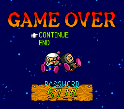

| Index | Code | Effect | Index | Code | Effect |
|---|---|---|---|---|---|
| 0 | 7352 | 1-1 | 25 | 4080 | 4-2 |
| 1 | 8831 | 1-2 | 26 | 2501 | 4-3 |
| 2 | 7255 | 1-3 | 27 | 5736 | 4-4 |
| 3 | 5714 | 1-4 | 28 | 3211 | 4-5 |
| 4 | 5289 | 1-5 | 29 | 5589 | 4-6 |
| 5 | 1352 | 1-6 | 30 | 8902 | 4-7 |
| 6 | 6892 | 1-7 | 31 | 0721 | 4-8 |
| 7 | 6722 | 1-8 | 32 | 3703 | 5-1 |
| 8 | 7793 | 2-1 | 33 | **2679** | 5-2 (GameFAQs: 2609) |
| 9 | 6428 | 2-2 | 34 | 2479 | 5-3 |
| 10 | 8492 | 2-3 | 35 | 4792 | 5-4 |
| 11 | 7490 | 2-4 | 36 | 6790 | 5-5 |
| 12 | 4370 | 2-5 | 37 | 1574 | 5-6 (final boss) |
| 13 | 6682 | 2-6 | 38 | 7777 | battle: gold winner |
| 14 | 4677 | 2-7 | 39 | 4622 | battle: set 1 |
| 15 | 4692 | 2-8 | 40 | 0520 | battle: set 2 |
| 16 | 4680 | 3-1 | 41 | 0903 | battle: set 3 |
| 17 | 2247 | 3-2 | 42 | 1019 | 1-1, full power-ups |
| 18 | 5725 | 3-3 | 43 | 1222 | 2-1, full power-ups |
| 19 | 7821 | 3-4 | 44 | 1107 | 3-1, full power-ups |
| 20 | 5890 | 3-5 | 45 | 0827 | 4-1, full power-ups |
| 21 | 7258 | 3-6 | 46 | 0107 | 5-1, full power-ups |
| 22 | 3379 | 3-7 | 47 | 1009 | ending |
| 23 | 6009 | 3-8 | 48 | 5656 | riders never tired |
| 24 | 5389 | 4-1 | 49 | 0164 | battle: wide item pool |

### Entering a password

Checked in Mesen with real button presses on pad 1, reading the cursor `$7F:70A8` and the digits
`$7F:70A9-70AC` every frame (the screen is set up at `$C2:A7CA`, the input handled by the shared menu
routine `$C2:B2CF` with the cursor table at `$C2:AE87`):

- The screen opens with **0000** and the cursor on the **first (left) digit**. It does not remember the last
  code: after B or after a wrong code it opens at 0000 / first digit again.
- **Up adds 1, Down subtracts 1**, and both **wrap**: Up on 9 gives 0, Down on 0 gives 9.
- **Right moves to the next digit, Left to the previous one, and both wrap**: Right on the fourth digit goes to
  the first, Left on the first goes to the fourth.
- Holding a direction repeats: one step at once, the next after 20 frames, then one every 5 frames, for the
  digits and the cursor alike.
- START or A checks the code (any pad; `$01CE` is all pads ORed). B goes back to the title.

So the shortest way to type a digit d is Up d times when d ≤ 5 and Down 10-d times otherwise; e.g. 7352 is
Down 3, Right, Up 3, Right, Up 5, Right, Up 2, START.

### What the special codes do (`$C2:A9E3`)

| Code | Sets | Then | Effect |
|---|---|---|---|
| 7777 | `$1F48 = 1` | title | In battle mode, the winner of the last round (`$1F4C`) gets a different palette: +`$18` at `$C1:75E9` (and `$C2:55EE`), plus the table at `$C2:8C6F` |
| 4622, 0520, 0903 | `$024A = 1, 2, 3` | title | Battle stages 1-10 load from a different table: four tables of 14 three-byte pointers at `$C3:6233`, `$C3:625D`, `$C3:6287`, `$C3:62B1` (picked at `$C4:004C`). Each set changes the start positions and the soft-block layout; stages 11 and 12 use the same data in every set |
| 1019, 1222, 1107, 0827, 0107 | `$7F:70B5 = 1-5` | normal game | World start from `$C1:0082` (0, 8, 16, 24, 32 = x-1). As each player starts, `$C2:0540` sets speed 5, fire 8, 8 bombs and every ability flag (`$48-$4B`, `$D8` = `$FF`), using the caps at `$C0:0B48`-`$C0:0B50` |
| 1009 | (jumps to `$C2:ABE4`) | ending | Plays the ending (`$C4:2256`) |
| 5656 | `$7F:70B7 = 1` | title | Skips `STA $E2,X` with `$A0` at `$C2:4479`, `$C2:455D`, `$C2:45F8`: the "tired" wait after a rider's super attack (160 ticks of 4 frames, about 10.7 s) never starts. Despite the GameFAQs label it works in the normal game, where the riders are |
| 0164 | `$7F:70BD = 1` | title | When a battle item is randomised (`$C1:5DB2`, `$C3:196D`), it is drawn from a 32-entry table at `$C1:5D87` (item types `$31-$36`, `$39-$3F`) instead of the 16-entry `$C1:5DA4` (`$32 $33 $3A $3C $3D $3E $3F` only) |

Nothing but these codes writes `$1F48`, `$024A`, `$7F:70B7` or `$7F:70BD` (every reference in the ROM was
checked), so the battle flags stay set until reset and should stack (7777 + 0903 + 5656); stacking was not
tried in Mesen.

### GameFAQs codes, checked

Every code was typed with real button presses in Mesen from the password screen (`tools/sb4/pwcheck.lua`)
and the RAM above read 700 frames later.

| GameFAQs entry | As posted | Result |
|---|---|---|
| Levels 1-1 to 5-6 | 37 codes | 36 start the stage named. **Fixed:** "5-2 2609" is rejected (not in the table); the 5-2 code is **2679** (index 33; typed, `$0092` = 33, stage 5-2 loads) |
| "with all powerups" 1019, 1222, 1107, 0827, 0107 | | OK. Start at x-1 of world 1-5; player 1 RAM after: `$0340` = `05 08 08 01 07 .. .. .. FF FF FF FF`, `$03D8` = `$FF` (a plain start is `00 01 01 00 00 ...`) |
| View ending 1009 | | OK |
| Battle sets A/B 0520, 0903 | "different stages" | OK, but they do not change the stages: they change the start positions and blocks of stages 1-10 (sets 2 and 3) |
| Gold winner 7777 | | OK: round 2 of a COM battle, the round-1 winner (2P) is gold; without the code the round-1 winner keeps its colours 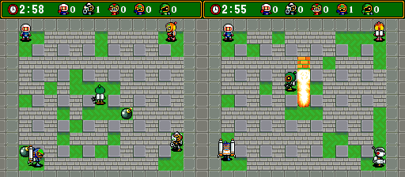 |
| Super attacks without getting tired 5656 | | OK, played out (below) |

### Fuzz check against the real decoder

`tools/sb4/fuzz.lua` wrote every number 0000-9999 into `$7F:70A9-70AC` from one savestate of the password
screen, pressed START, and let the game's own compare decide (exec hooks on the hit at `$C2:A9C9` and the miss
at `$C2:A926`). **50 of 10,000 accepted**, exactly the table above with the same indices; the other 9,950
were rejected. `password.py` and `password.mjs` accept the same 50 (`python tools/sb4/password.py <rom>`,
`node tools/sb4/check.mjs <rom>` also check the table against the ROM).

### 5656 in play

`tools/sb4/super5656.lua`: a normal game in 1-1, once from the plain title and once after typing 5656 (which
set `$7F:70B7` = 1). In both runs the rider type `$0322` was set to 1 by hand (the bot never caught a rider;
see Not verified), then the super attack (hold B, then tap a direction; `$C2:4418` fires on a new direction
press with B held) was tried every 40 frames for 800 frames:

| | Super attacks done (frame) | Tired timer `$03E2` after the first |
|---|---|---|
| no code | 7, 647 | `$A0`, counts down 1 per 4 frames, 0 at about frame 647 |
| 5656 | 7, 127, 247, 367, 487, 607, 727 | stays 0; the only limit is the attack itself (120 frames) |

Without the code the rider slumps into the tired pose for ten seconds after the attack (top row, frames 1,
120 and 240 after the first attempt); with 5656 it attacks again as soon as the last one ends (bottom row).

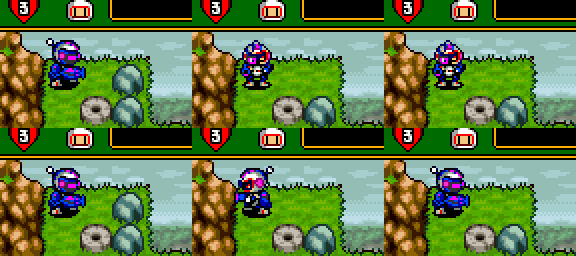

## New finds

- ★ **4622 is a third battle set.** `$024A` takes 0-3, and 4622 sets 1 (`$C2:AB06`). Set 1 puts all five
  players in the middle of the arena. All four sets for stage 1, from the left 0 (default), 1 (4622), 2 (0520),
  3 (0903); the three codes were typed for real, and each arena matched the one with `$024A` written by hand
  pixel for pixel:

  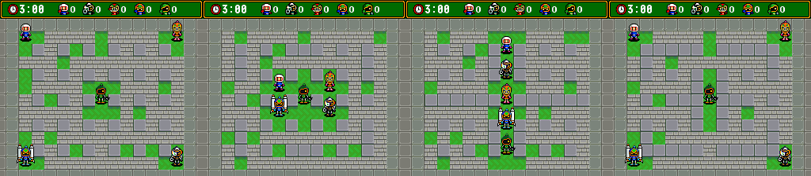
- ★ **0164 widens the battle item pool** (table above). In Mesen a battle with 0164 drew item `$36`, which
  is not in the normal pool.
- ★ **Why there is no 5-7 or 5-8 code.** The table has a slot for every stage up to 5-8, but slots 38 and 39
  hold 7777 and 4622, and those are caught as special codes before the stage would start. World 5 has six
  stages; with `$0092` set to 38 or 39 by hand the game loads the empty final-boss arena with no boss, which
  are the filler levels (Known). 40 and up give a black screen.

  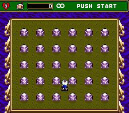
- ★ **The title X trick, exactly.** `$C3:C83C` runs on the title menu (while `$7F:7114` ≠ 0) and counts X
  presses: `$7157` is the time since the last press, and every press 7, 8 or 9 ticks after the previous one
  adds 1 to `$7159`; any other gap clears it. At 48 (`CMP #$30`, `$C3:C8A8`) it stores 12 in `$7F:202D`
  (the battle stage count, normally 10 from `$C4:4040`) and plays sound 9. The title runs at 30 fps at first,
  so a "tick" is two frames; but after 16 X presses in a row (`$715B` ≥ 16, `$C2:D560`) the villains'
  silhouettes under the logo stop being drawn and the title speeds up to 60 fps, where a tick is one frame.
  Net effect: any **turbo X at a 7, 8 or 9 frame period** (6.7-8.6 presses a second) unlocks stages 11 and 12
  after 7.5-10 s (Mesen: 450, 506 and 614 frames of tapping); 10 frames does not. A Super Joycard does it,
  but so does any turbo pad set to that rate. After the unlock the stage select wraps to STAGE 12 はたはたとりとり
  ("flag grab") and STAGE 11 とろっこやろう ("mine-cart guy"), and both load (Known: GameFAQs and others).

  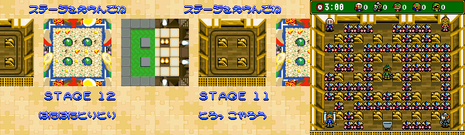
- ★ **Starting from pad 2 plays as Black Bomberman.** If the START/A that confirms a normal game (title
  menu or password) comes from a pad other than pad 1 (`$C2:ADC2`: pressed in `$01CE` but not in pad 1's
  `$0388`), `$7F:70C0` and then `$1EF2` are set, and `$C2:DEC3` starts only the `$0400` player: Black
  Bomberman, at the top right, on pad 2. Pad 1 then does nothing (pressing it moves nobody; checked in Mesen
  with pad 2 in its own slot, `$0430`). Normally (pad 1) only White Bomberman, `$0300`, at the top left.
  Left: started from pad 1; right: from pad 2.

  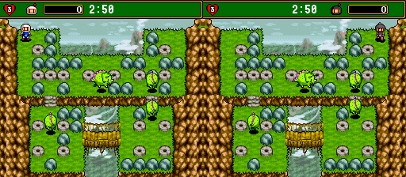
- ★ **Tapping X hides the title villains.** 16 X presses with gaps under 32 ticks (`$715D`) remove the dark
  silhouettes under the logo until you stop.

  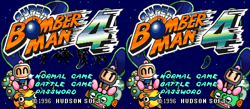

## Debug and unused content

- **Debug parameter menu text** at `$C4:6E6A` (Known): a build stamp `96-02-29 21:38` and the list
  PARAMETER / EXIT / WHO'S PRM / FIRE LEV / BOMBCOUNT / BOMBTYPE / SPEED / PASS BOMB / PASS WALL / PASS 16SEC /
  STOP TIME / PUSH / PUNCH / KICK / POW GLOVE / HEART / NODEATH (`#` = space, `&` = new line, `$` = end).
  Nothing references it: no 16- or 24-bit pointer to `$C4:6E40`-`$C4:6F9B` exists anywhere in the ROM, and
  the only nearby reference (`LDA #$6FAA` at `$C4:4533`/`$C4:4884`) is the object-script table that follows
  the text. The menu code itself is gone, so there is no way in. Round 2 looked for anything else left of it:
  - **No text printer.** The text uses `#` for a space, `&` for a new line and `$` as the end. No routine in
    the ROM compares a character with both `$26` and `$24` (no `CMP #$26` within 48 bytes of a `CMP #$24`, raw
    search, disassembled or not), and this is the only string in that format anywhere in the ROM.
  - **The font survives** (Known, the "unused font"): 64 2bpp tiles at `$D1:BC16`, tile n = character
    `$20`+n, in which `#`, `$`, `%` and `&` are blank tiles. It is loaded with the battle graphics (DMA of
    `$D1:BC15`-`$D1:EFA2`) to VRAM word `$5000`, the BG3 character base in battle, but BG3's map there is
    tile `$6E` throughout, so it is never shown. Drawn with this font, the text would look like the mock-up below
    (made by `tools/sb4/unused_img.py`; the game itself never draws it).
  - **No parameter table.** The entries after EXIT / WHO'S PRM are the player power-up fields (`$0340`
    speed, `$0341` fire, `$0344` bombs, the ability flags ...), but no table of those offsets in menu
    order exists (searched as bytes and as words, with and without the `$03` high byte).
  - **No leftover flag.** RAM that code reads but nothing writes (scan of the disassembly) gives no
    NODEATH, STOP TIME or similar switch; the closest is `$7F:70E4`, read at `$C3:4106`/`$C3:4188`, which
    would let a cut-scene skip itself as if START were pressed. Nothing writes it, but it belongs to the scene
    code, not to this menu.
  - The byte after the closing `$` (`$C4:6FA9`) is `$6B` (RTL), just before the object-script table at
    `$C4:6FAA`: probably the tail of the removed code.

  So nothing usable is left: no IPS or PAR code can bring back a menu whose code is not in the ROM. What the
  menu edited can be had directly with PAR codes on the player fields above (for example `7E0341:08` for
  fire 8; not tried), which is what the power-up passwords already do.

  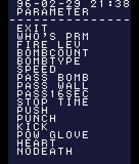
- **Unused item icons** (Known: the Power Bomb left over from Super Bomberman 2 and the "?" item). Both
  are raw 4bpp 16×16 icons in the battle item sheet: Power Bomb at `$D1:C558`, "?" at `$D1:C598` (tiles t,
  t+1, t+16, t+17; found with `tools/sb4/findtile.py` from the published pictures). The sheet starts at `$D1:C018`
  and goes to VRAM word `$2800` in battle, so they are BG tiles `$2AA` and `$2AC`; no battle tilemap dumped
  during play used them. Shown with the battle item palette (CGRAM palette 4, `tools/sb4/battle_cgram.bin`):

  
- **Unused font** (Known): `$D1:BC16`, 64 2bpp tiles, loaded to BG3 in battle and never shown (see
  the debug menu above).

  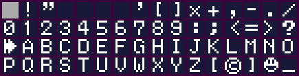
- **What a coverage sweep leaves.** `tools/sb4/cover.lua` played every stage 1-1 to 5-6 from its password
  with a random bot (3000 frames each), all 12 battle stages, the ending (1009), two power-up codes and the
  attract mode, and saved Mesen's code/data log; with round 1's logs that is 62 runs. `tools/sb4/unused.py`
  merges them: 1,338,317 of 2,097,152 bytes were read as code or data (DMA reads count), 758,835 never were (that list came from dumps that were off by one byte; see round 3).
  The unread part is not "unused": the bot dies early, never catches a rider, never sees most boss phases
  or the between-world scenes, and many of the unread blocks are enemy and boss sprite sheets of that kind
  (for example `$C5:FF1C`-`$C6:3FFF`, `$C6:8800`-`$C6:FFFF`, `$CD:2F80`-`$CD:717F`, `$CE:FEB6`-`$CF:3D41`,
  `$D7:6C3A`-`$D7:DB3A`, `$DD:24CA`-`$DD:86D4`, `$DE:9C93`-`$DE:FFFF`). None of them was confirmed unused, so
  no New unused graphics are claimed; the list is in the sweep's output and is the place to start. Palettes
  were not swept.
- **Sound driver banner** at `$DE:744D` (Known): `SFX SOUND DRIVER Ver 2.28 (C)1993-95 Hudson Soft`,
  `Program : LU.Iwabuchi`, `Driver : Kazumi-TYPE`.
- **Filler stages 5-7, 5-8** (Known; see above for why no password reaches them).

## Not verified

- **Catching a rider in play.** A random bot played 1-1 for 3 × about 9600 frames and never got on one, so the
  5656 test puts the rider type in `$0322` by hand. How riders are caught was not traced.
- **Which item IDs are unused.** Item types `$30`, `$37` and `$38` are in neither random pool (`$C1:5DA4`,
  `$C1:5D87`); which icons they would show was not pinned down.
- **The power-up abilities.** `$43`, `$48-$4B` and `$D8` are set to 1 / `$FF` by the power-up codes, but which
  of kick, punch, remote and so on each is was not mapped.
- No sound test or other debug entry was found in the title, password or battle-menu input code; the rest
  of the game was not searched for button combinations.

## Hidden-content sweep (round 3)

Six passes over the Japanese ROM. The English ROM was checked wherever its code is the same (see
[sb4en.md](sb4en.md)). Tools: `tools/sb3/sweep.py` (dead code, pad scanner, flag scanner; shared with SB3),
`tools/sb3/strings.py`, `tools/sb3/monkey.lua`, `tools/sb3/watch.lua`, `tools/sb3/sheet.py`, `tools/sb4/maps.lua`
and `tools/sb4/par.lua`. Raw outputs are in `disasm/sb4/` (`dead.txt`, `pads.txt`, `flags.txt`, `strings.txt`).

**The old logs were off by one byte.** `lib.lua` dumped Mesen's 0-based code/data table from index 1, so every
flag landed one byte early (see sb3.md). The listing had been grown from those dumps, which is why it decoded
operands as opcodes in places (for example the title X code at `$C3:C84A`). `lib.lua` is fixed, and `disasm/sb4/`
was rebuilt from a fresh `entries.txt`. The merged log comes from 70 runs (rounds 1-2, Mesen's `.cdl`, a
2-player random run and this round's menu runs) and covers 127,720 code bytes. The round-2 note that "Mesen marks
DMA blocks one byte early" was this bug.

### Dead code

**471 entry points never ran**:

| Class | Count |
|---|---|
| only from code that never ran | 327 |
| pointer/table only (object states, menu handlers) | 68 |
| no reference | 68 |
| referenced by code that ran | 8 |

What stands out:

- **The Maniac battle setup (Known content; it was just uncovered).** The battle-menu dispatcher
  `$C1:9725` indexes a six-entry table at `$C1:BB26` by `$7F:2004`. Entries 3-5 (`$C1:AB08`, `$C1:ADBC`,
  `$C1:BB40`) had never run. Forcing the index from the title (an exec hook at `$C1:96F5`) brought up these
  screens:
  - アイテムを設定してね, "set the items": 15 battle items with a count each, out of 60 (`$7F:2054`+).
  - 各キャラのHPをきめてね, "decide each character's HP": 1-5PLAYER (`$7F:2045`-`2049`, copied to
    `$1F16`-`$1F1E` and then to player +`$D2` at `$C1:9117`/`$C2:019A`).
  - A direct battle start.

  EXIT on either list leads to マニアックステージの設定をしてね ("set up the Maniac stage": アイテムセレクト /
  ハンデキャップ / バトルスタート). So these are the third battle mode's (Maniac) own setup screens, not hidden
  ones. Earlier coverage had never entered that mode.
- **★ New: a dormant exit at `$C3:CF94`.** The screen loop at `$C3:CF16`-`$C3:CF90` (entered from `$C1:11B5`, seen
  running in the Maniac runs) ends with `JML $C3:CF16`. Right after it is an unreferenced tail: if A, B or Start
  is pressed (`BIT #$9080`), it fades out over `$30` frames and returns. Nothing jumps there. Static only; which
  screen it belongs to was not pinned down.
- **★ New: battle stage table entries 13 and 14.** The four 14-entry tables at `$C3:6233` end with two pointers to
  stage 1's record (`$C3:62DB`). The stage select stops at 12, so they are never chosen. Forced, they load stage 1
  (maps below).
- The other no-reference blocks are object and AI helpers (`$C0:5D57`, `$C1:2CFF`, `$C1:3238`, …) and short stubs.

### Input codes

145 hits; most are object fields read through `$30,X`/`$88,X`. Of the pad reads proper (`$01CE`/`$01D0`, `$0330`
and up), these never ran:

- `$C1:A52F`, `$C1:AF25`, `$C1:B1E7`, `$C1:BE73`: the Maniac setup menus above (cursor and EXIT).
- `$C3:3426`-`$C3:36E7`: an interactive scene. B (`$8000`) speeds a scroll up (`$017A`, capped at `$19`), and
  Left/Right (`$0100`/`$0200`) steer `$0178` through tables at `$C3:367C` and `$C3:36BA`. It belongs to the
  between-world scene code next to `$7F:70E4`, which no run reached.
- `$C2:80A9`, `$C2:DAB2`, `$C3:40FC`, `$C3:CF96`: "A/B/Start to continue" checks in uncovered scenes. The last is
  the dormant exit above.

The known codes come up as expected: the title X counter `$C3:C83E`/`$C3:C871` and the password screen. **No new
button sequence, held combination or rhythm counter.**

### Unset flags

`sweep.py flags` finds 47 candidates: 9 never written directly and 38 written only by unreached code. A write
watch (`tools/sb3/watch.lua`) ran through a 1019 game and a battle, 5,000 random frames each. Then each flag that
was never set non-zero was poked on its own:

| Address | Read at | What it does when set | Status |
|---|---|---|---|
| `$0274` | `$C1:0766` | **Start pauses without the PAUSE! label**: the pause code skips loading the label's position into `$0180/$0182`. Checked in Mesen, JP and EN (PAR `7E0274:01`) | ★ New |
| `$00A0` | `$C41AAC` | a buffer copy at `$C4:1AB4` takes the `EOR #$FFFF` path at `$C4:1B77` (inverted words) | no visible change in a stage or a battle; unverified |
| `$01C2` | `$C4:1E31` | forces the odd-frame half of a double-buffered table switch (`$0130-$0134`) | no visible change |
| `$0352`/`$0452` | `$C2:E3CC` | object field +`$52` = 6 for both players ends a wait | object fields, written indexed; not a flag |
| `$0796` | `$C2:5A5B` | read only by dead code | — |
| `$7F:70E4` | `$C3:4106` | lets the between-world scene skip itself as if B were pressed (round 2) | scene not reached; unverified |

The 38 "written only by unreached code" are the between-world scene (`$7F:70DF`-`$7F:7111`), the Maniac and
Championship menus (`$7F:2012`, `$7F:202B`, `$7F:70A6`) and boss code.

### Text

The game draws almost all of its text as tile graphics. The menu-value printer `$C1:BB49`/`$C1:BB76` draws short
tile-index strings (rule values, counts) through a 3-byte pointer list in `[$5C]` and a tile table in `[$54]`
(`$D6:89CC`). Five lists were logged on the battle menus (`$C1:C2D4`, `$C1:C2FC`, …). It holds digits and
symbols, not words. **The only ASCII strings** (`tools/sb3/strings.py`) are:
- the debug PARAMETER text at `$C4:6E69` (Known; never read);
- the multitap BIOS IDs at `$C0:FB00`-`$C0:FC9F` (never read);
- the header.

There are no unused dialogue strings. Japanese seen on the screens this round, with translations:
- ステージをえらんでね: choose a stage
- アイテムを設定してね: set the items
- 各キャラのHPをきめてね: decide each character's HP
- マニアックステージの設定をしてね: set up the Maniac stage
- アイテムセレクト / ハンデキャップ / バトルスタート: item select / handicap / battle start
- あと60コ: 60 left
- いつもの: "the usual", stage 1's name
- はたはたとりとり: flag grab, stage 12

### Maps

These are rendered from the game (`tools/sb4/maps.lua`), with the record addresses from the tables. A battle
stage record is 34 bytes. It holds pointers to the BG and layout data in `$D6`/`$D7` (different for each set) and
to start-position data in `$C3`. Those streams are compressed and were not decoded.

- **Battle**, sets 0-3 × all 14 table entries (`$024A` and `$7F:202B` written at the stage select):
  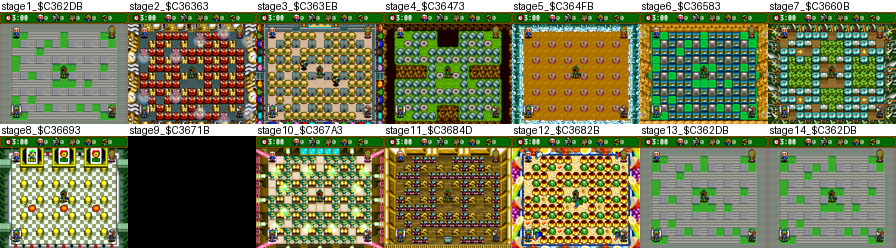
  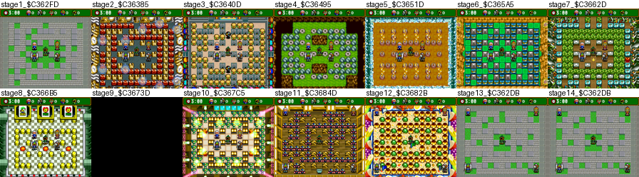
  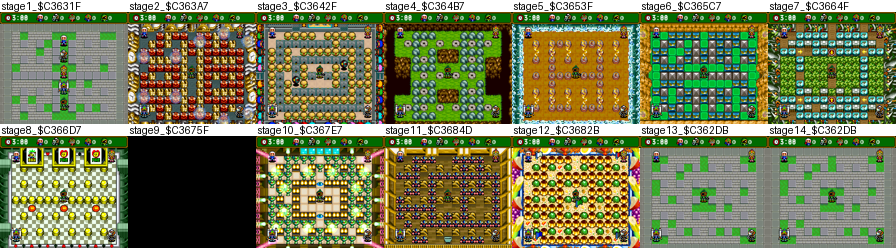
  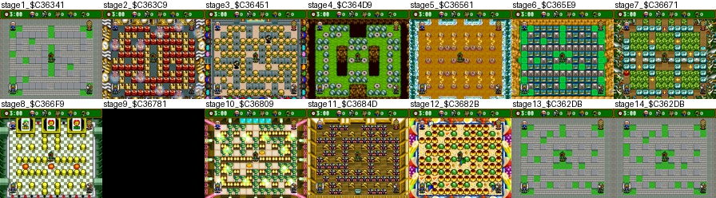
  - Entries 13-14 are stage 1 again.
  - Stages 11 and 12 use the same record in every set.
  - Stage 9 was still black at the capture frame. It needs a later shot.
- **Normal game**, all 40 slots of `$0092`, forced at the password hit (`$C2:A9C9`):
  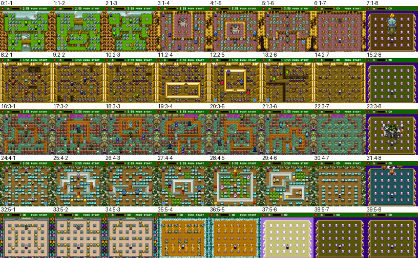
  Slots 38 and 39 are the empty final-boss arena (the known filler 5-7/5-8), and no other slot is cut.

### Cheat codes (Pro Action Replay)

Each code was checked in Mesen's cheat engine (`tools/sb4/par.lua`) on the unpatched Japanese ROM, and on the
English ROM where marked:

| Code | Effect | Checked |
|---|---|---|
| `7F202D:0C` | battle stages 11 and 12 without the turbo trick | JP: stage select goes from 1 to 12, then 11. EN: `$7F:202D`=12 (stage select not walked) |
| `C2AEE6:7D` + `C2AEE7:16` | password **5757** starts the filler stage 5-7 (index 38) | JP and EN: `$0092`=38, empty arena |
| `C2AEE8:E2` + `C2AEE9:16` | password **5858** starts filler 5-8 (index 39) | JP: `$0092`=39 |
| `7E0274:01` | pause without the PAUSE! label | JP and EN |
| `7F202B:0A` / `0B` | stage 11 / 12 at the select | Known, not re-run |

The two filler codes rewrite table slots 38/39, which hold 7777 and 4622. Both are caught as special codes before
the table is searched, so the slots were dead.

No invincibility code: `7E03D2:05` (player 1's extra hits) did not change a random-bot run, and no NODEATH-style
flag exists.

## Title logo

`img/logos/sb4_jp.png` (249×118, 25 colours, transparent) is BG1 of the title screen rebuilt from VRAM and
CGRAM dumped in Mesen (mode 1, 16×16 tiles, map `$4000`/chr `$0000` word addresses) with
`tools/sb4/bgrender.py`, cropped to the logo; the bombermen and villain silhouettes are sprites and are not in it.
