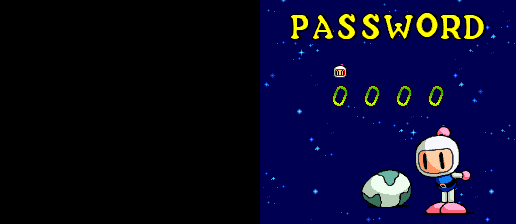
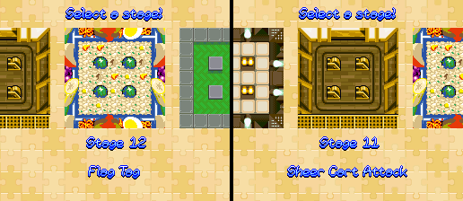
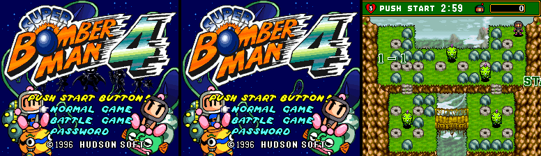
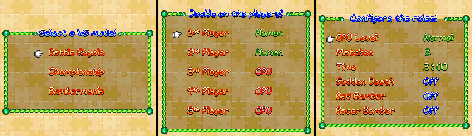
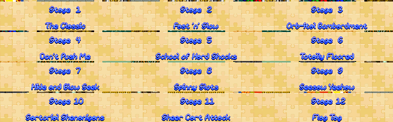
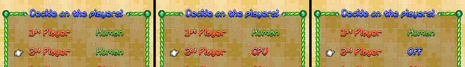

# Super Bomberman 4 (SNES, Super Bomberman Collection English version): passwords and secrets

This is the English ROM of Super Bomberman 4 from Konami's Super Bomberman Collection, compared with the
Japanese original documented in [sb4.md](sb4.md). Method: a function-by-function diff of the two ROMs
(`tools/disasm.py`, `tools/lin65.py`, `tools/sb4en/hooks.py`), then Mesen 2 runs with the tools in
`tools/sb4en/` (`run.sh`, `job.sh`, `lib.lua`). Addresses are the same in both ROMs unless stated.

**Short version:** the game code and the password table are untouched. All 50 Japanese passwords work and
nothing else does, and every secret carries over. The localization swaps in English graphics for the menus
and stage names, changes Left/Right on one menu, and adds hooks that read two addresses that aren't SNES
hardware. Those can only come from the collection's emulator.

## What the ROM is

`Super Bomberman 4 (English)[Official Localization].sfc`: 4,194,304 bytes, MD5
`390fbd3349b4b763dbc365dab718f9cb`, CRC32 `4DC7D0D3`.

| Header field (`$FFC0`) | English | Japanese |
|---|---|---|
| Title | `SUPER BOMBERMAN 4` | same |
| Map mode | `$31` (HiROM, FastROM) | same |
| ROM size | `$0C` (4 MB) | `$0B` (2 MB) |
| Cartridge type / SRAM | `$00` / `$00` | same |
| Region | `$00` (Japan) | same |
| Maker / game code | `$33` → `$18` (Hudson), `A4BJ` | same |
| Version | `$00` | same |
| Checksum / complement | `$B460` / `$4B9F` (valid) | `$8AF3` / `$750C` |

The size byte and the checksum are the only header changes. The ROM has no Konami, collection, year or
build string. The copyright on the title is still `©1996 HUDSON SOFT`, and the sound driver banner
(`$DE:744D`) and the debug-menu build stamp `96-02-29 21:38` (`$C4:6E6A`) are unchanged. Nothing in the
ROM names the release, so "Super Bomberman Collection" comes from the file's origin, not from the data.

**Map mode.** It isn't ExHiROM. Plain HiROM addresses 4 MB directly as banks `$C0-$FF`, so the header just
says 4 MB. The original 2 MB sits where it was (`$C0-$DF`). The additions are:

- `$E0:0000-$E2:89xx`: new code and English graphics (about 64 KB, 64 KB and 35 KB that aren't `$FF`).
  `$E3-$FF` are all `$FF`.
- `$C0:FCA0-$C0:FFAF`: 784 bytes of new code in what was `$FF` fill.
- Inside the original 2 MB, 1,052 bytes differ, in 54 runs: hooks (JSL/JML redirected to `$E0-$E2`),
  graphics pointer tables (`$C3:E43A`, `$D8:CE04`, `$D8:EA1A`, `$C1:C24F-$C1:C382`) and a few bytes of
  layout data (`$C4:5782`, bank bytes at `$C3:D761`/`$C3:D804`).

Banks `$C5-$D7` and `$D9-$DF` are byte-identical to the Japanese ROM.

## The password

**Unchanged.** The routines from `$C2:A7CA` to `$C2:AEFF` (screen, digit entry, `$C2:AE1F` digits to
number, `$C2:A916` search, `$C2:A9E3` special codes) and the 50-word table at `$C2:AE9A` are
byte-identical. The page can reuse `tools/sb4/password.mjs`; there is no separate English codec.

- **Fuzz:** `tools/sb4en/fuzz.lua` wrote every number 0000-9999 into `$7F:70A9-70AC` from one savestate of
  the English password screen, pressed START, and let the game's compare decide (hit at `$C2:A9C9`, miss
  at `$C2:A926`). **50 of 10,000 accepted**, the same 50 codes with the same indices as the Japanese table
  (checked against the table read from the Japanese ROM); 9,950 rejected.
- **Typed:** `tools/sb4en/pwcheck.lua` typed 7352, 2679, 1574, 7777, 4622, 0520, 0903, 1019, 0107, 1009, 5656,
  0164 and 2609 with real button presses. Each set the same RAM as in the Japanese ROM (`$0092`, `$024A`,
  `$1F48`, `$7F:70B7`, `$7F:70BD`, power-ups `05 08 08 01 07 … FF FF FF FF` / `$03D8 = $FF` for 1019 and
  0107). GameFAQs' 2609 is rejected here too; the 5-2 code is 2679.
- The game-over password comes from the same table (`$C2:A2B9` unchanged). I didn't reach a game-over
  screen in this round (see Not verified).

### Entering a password

Same screen and controls as the Japanese game (see [sb4.md](sb4.md#entering-a-password)): `PASSWORD`, four
digits starting at `0000`, Up/Down change a digit, Left/Right move, START or A confirms, B leaves.

## Secrets: what carries over

Every secret from `sb4.md` works. The code behind each is byte-identical, and each one was also run in
Mesen:

| Secret | Code | English ROM |
|---|---|---|
| Stage codes 1-1 … 5-6 | table `$C2:AE9A` | Same 38 codes (fuzz). 7352, 2679 and 1574 typed and loaded |
| 1019 / 1222 / 1107 / 0827 / 0107 | `$7F:70B5`, `$C2:0540` | 1019 and 0107 typed: full power-ups as in JP |
| 1009 | `$C2:ABE4` | Typed: plays the ending (staff roll, then THE END) |
| 7777 | `$1F48` | Typed: `$1F48 = 1`; readers `$C1:75CD`, `$C2:55D2`, `$C2:8BF8` unchanged |
| 4622 / 0520 / 0903 | `$024A` = 1/2/3 | Typed: `$024A` = 1, 2, 3; `$C4:004C` and the tables at `$C3:6233`… unchanged |
| 5656 | `$7F:70B7` | Typed: `$7F:70B7 = 1`; `$C2:4473`-`$C2:45F8` unchanged |
| 0164 | `$7F:70BD` | Typed: `$7F:70BD = 1`; `$C1:5D87`/`$C1:5DA4` pools unchanged |
| Turbo X on the title: stages 11-12 | `$C3:C83C` | X at a period of 8 frames (4 on, 4 off) for 720 frames: `$7F:202D` 10 → 12. The stage select then wraps to Stage 12 and Stage 11 |
| 16 X taps hide the title villains | `$C3:C83C`, `$C2:D560` | Checked: the silhouettes are gone |
| Confirm with pad 2: Black Bomberman | `$C2:ADC2`, `$C2:DEC3` | Checked: `$1EF2 = 1`, Black Bomberman at the top right of 1-1 |
| Debug parameter text, unused font, unused item icons | `$C4:6E6A`, `$D1:BC16`, `$D1:C558` | Still there, same bytes, still unreferenced |

## What the localization changed

### Text and graphics

The Japanese game already used English for the title menu, the password screen, the staff roll and THE END.
The English ROM translates the rest, mostly as new tile graphics rather than through a font. About twenty
calls to the graphics loader `$C1:BF88` (and a few to `$C2:CED5`, `$C3:D247`, `$C4:092E`, `$C4:5144`) now
go to wrappers in `$E0-$E2`. A typical one (`$E2:8D7D`) runs a copy of the loader (`$E1:FF7F`), then
loads the English tiles or map on top (`JSL $E1:330E`). The text printer was changed too (`$C1:BBBE`,
`JML`s at `$C1:BF43`/`$C1:BF72` to `$E0:FFC1`/`$E0:FFAD`).

Samples (Mesen screenshots):

| Screen | English |
|---|---|
| Title menu | NORMAL GAME / BATTLE GAME / PASSWORD, then 1 PLAYER GAME / 2 PLAYER GAME (JP: 2 PLAYERS GAME) |
| Battle mode | "Select a VS mode!": Battle Royale / Championship / Bombermania; Free-for-All / Team Battle |
| Players | "Decide on the players!": 1st … 5th Player, Human / CPU / Off (JP 対戦人数をきめてね, 1PLAYER MAN/COM) |
| Rules | "Configure the rules!": CPU Level, Matches, Time, Sudden Death, Bad Bomber, Racer Bomber |
| Characters, stages | "Select a character!", "Select a stage!" |
| In game | AREA 1-1 START!, PAUSE!, the HUD (unchanged layout) |

Battle stage names (stage select):

| Stage | Name | Stage | Name |
|---|---|---|---|
| 1 | The Classic | 7 | Hide and Blow Seek |
| 2 | Fast 'n' Slow | 8 | Spinny Slots |
| 3 | Orb-ital Bombardment | 9 | Seesaw Yeehaw |
| 4 | Don't Push Me | 10 | Sartorial Shenanigans |
| 5 | School of Hard Shocks | 11 | Sheer Cart Attack (JP とろっこやろう) |
| 6 | Totally Floored | 12 | Flag Tag (JP はたはたとりとり) |

The opening demo has no text in either version, and the staff roll is the same. The title logo is the
same art (see below).

### A control change on the players screen

`$C2:B34F` and `$C2:B3A9` (Left/Right in the shared menu routine `$C2:B2CF`) now jump to `$E0:FF02` and
`$E0:FEA5`. For any menu except the one whose data is at `$E1:FFC9` they run the original code. For that
menu ("Decide on the players!") Left takes the value 1 → 2 → 0 and stops there, and Right takes
0 → 2 → 1 and stops. On screen, **Left** steps Human → CPU → Off and **Right** steps back. In the
Japanese game Right turns MAN into COM. Checked in Mesen on 2nd Player: Right does nothing on Human, Left gives CPU,
then Off (below). `tools/sb4en/lib.lua`'s `battle_menus()` presses Left for this reason.

### Hooks for the collection's emulator

Two hooks read addresses where a SNES has no hardware: `$00:4402` and `$0C:4400`. On a real console or a
plain emulator they read open bus, so only the collection's emulator can supply a value there.

- **Winner screen graphics.** `$C3:38EA` and `$C3:3915` are two of the graphics uploads in the routine
  reached from `$C3:311C`, the screen built around the last round's winner (`$1F4C`). They now call
  `$E0:FD15`/`$E0:FD59`. If `$00:4402` is non-zero, they load one English graphics set (`$E2:76DB` /
  `$E2:7AF4`). Otherwise they call `$C0:FCEA` and pick one of four sets (`$E2:5613`, `$E2:5E45`,
  `$E2:6677`, `$E2:6EA9`, and the same for the second upload) by its result.
- **`$0C:4400` lookups.** `$C0:FCA0`-`$C0:FDAF` are eight small routines, two per player slot 0-3 (16- and
  8-bit). Each reads `$0C:4400` and, for values 0-23, returns a slot number from a 24-entry table; the 24
  entries are the 24 orders of four players. A value of 24 or more returns the slot unchanged. Only the
  slot-1 routine `$C0:FCEA` is called (from the two hooks above).
- **Ending.** `$C2:EC7E` (the ending's graphics load) now calls `$C0:FF15`, which picks one of four
  English sets (`$E1:4AB5`, used for two of its five cases, `$E1:8EC0`, `$E1:C959`, `$E1:A2D9`) from `$1F2A`, `$1F2C` (with `$7F:200C`) and
  `$1F46`, then the original `$C3:D247`.

In Mesen neither address was read during boot, the title, a 1-1 start, a full battle round with the
scoreboard, or the 1009 ending (read callbacks on `$00:4400-4402` and `$0C:4400`). What the collection
puts there (a player-to-pad order and a mode flag, judging by the tables) is not verified.

No save-state, rewind, region or version check was found in the added code. Apart from the two
addresses above, it reads only RAM, ROM and the usual registers.

## Title logo

`img/logos/sb4_en.png` (249×118, 26 colours, transparent) is BG1 of the English title screen. It was
rebuilt from VRAM and CGRAM dumped in Mesen (`vdump` in `tools/sb4en/lib.lua`, then
`tools/sb4/bgrender.py vram.bin cgram.bin 32768 0 1`), cut above the menu and cropped tight
(`tools/sb5en/croplogo.py`). Compared with `sb4_jp.png`, every pixel has the same shape. The 2,433 that
differ in colour are all in the "4" (x 151-220), whose colours cycle, so the art is unchanged.

## Not verified

- **What the collection writes to `$00:4402` and `$0C:4400`**, and which screen variants that brings up.
  The winner-screen path wasn't triggered in my runs.
- **The game-over password screen in English.** My bot never lost its lives (B didn't kill it on its own
  bomb), so the CONTINUE/END screen wasn't seen. The code that picks the code shown is unchanged.
- The between-world scenes and boss scenes, the 2-player normal game, Championship and Bombermania
  screens were not visited, so their English text isn't sampled here.
- 5656 and 7777 were checked by their flags and unchanged readers, not played out again; 0164 likewise.

## Round 3 cheat codes on the English ROM

The round-3 sweep ([sb4.md](sb4.md#hidden-content-sweep-round-3)) only touched code that is byte-identical here:
the pause code at `$C1:0766`, the password table at `$C2:AE9A` and the stage count `$7F:202D`. In Mesen's cheat
engine on this ROM, `7E0274:01` paused without the label, `C2AEE6:7D C2AEE7:16` made 5757 load filler slot 38, and
`7F202D:0C` set the stage count to 12. The stage select was not walked, because `lib.lua`'s menu walk for this ROM
differs. The code/data dump in `tools/sb4en/lib.lua` had the same off-by-one as SB4's (fixed, loops from 0).

## Files

- `tools/sb4en/`: `run.sh` (English ROM by default; `ROM=` overrides), `job.sh`, `lib.lua` (Left on the
  players screen), `fuzz.lua`, `pwcheck.lua`, `hooks.py` (lists the redirected JSL/JML
  sites).
- `disasm/sb4en/`: banks `$C0-$E2` (`$E3-$FF` are `$FF`); `entries.txt` is the Japanese one plus the
  added routines.
- `img/sb4en/`, `img/logos/sb4_en.png`.
