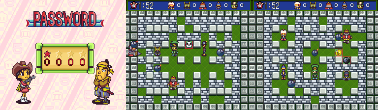

# Super Bomberman 5 (SNES, Japan): passwords and secrets

Everything here comes from the ROM, read with `tools/disasm.py` (HiROM; coverage from Mesen 2 code/data
logs via `tools/sb5/cdl2entries_hi.py`) and `tools/lin65.py`, and was checked in Mesen 2 headless
(`tools/sb5/run.sh`, helpers in `tools/sb5/lib.lua`). Codes were injected into the entry buffers and
confirmed, and a sample of each kind was also typed with real button presses. Two ROMs:

- **retail**: `Super Bomberman 5 (Japan).sfc`, header title `SUPER BOMBERMAN 5`.
- **Caravan**: `Super Bomberman 5 (Japan) (Caravan Event Ban).sfc`, header title `SUPER BOMBERMAN 5G`.
  Its RAM layout matches the addresses TCRF gives for the gold cartridge (`$627D` for retail `$625F`).

Prior art: GameFAQs and TCRF (`res/`). Marks: ★ **New** = in neither; **Fixed** = posted wrong;
**Known** = posted and confirmed. Codecs: `tools/sb5/password.py` and `tools/sb5/password.mjs`;
every code is listed in `sb5_codes.json`.

There are **no Normal Mode progress passwords**. Normal Mode saves to three battery files (ファイル1-3;
the menu is さいしょから "from the start", つづきから "continue", ファイルをけす "erase file").

## RAM and SRAM map (retail; Caravan in brackets where it moves)

| Address | Meaning |
|---|---|
| `$7E:6241-6244` | option password digits, 0-9 each |
| `$7E:6245` | number of battle stages: 10, or 13 with stages 11-13 unlocked |
| `$7E:6246` | battle layout code: 0 normal, 1 = 4622, 2 = 0413, 3 = 0926 |
| `$7E:6247` | COM levels on offer: 3 (よわい/ふつう/つよい, weak/normal/strong), 4 adds スーパー (super) |
| `$7E:6248` | scene to run after the password screen: 2 back to options, 3 Normal menu, 4 Battle menu, `$67` boss rush, `$AA`/`$AB` good/bad ending, `$AC`-`$AE` debug rooms |
| `$7E:1031` | scene / room being started; `$102F` is its copy for the running room (`$C5:3BFF`). Scenes index the script table at `$C6:0000` (3-byte pointers) |
| `$7E:15D2`/`$15EA` | player speed, 16-bit (`$00E0` normal start, `$0200` full power) |
| `$7E:4ED5` | player item bits: 0x01 remote control (fuse `$FF`, `$C4:3059`), 0x02 kick, 0x04 power glove; 0x10, 0x20, 0x40 are the other bomb types (one at a time, `$C5:438C`) |
| `$7E:6253` [`$6271`] | invincibility (no password sets it; see "Cut passwords") |
| `$7E:6254` [`$6272`] | boss rush / battle: start fully powered |
| `$7E:6273` [`$6291`] | every option code ever entered (bits as in the table below), saved to SRAM `$1E8` |
| `$7E:6274` [`$6292`] | codes active this session: bit 0x80 = boss rush or ending (blocks saving, `$C0:48D6`), 0x40 = 5656, 0x08 = 2657 |
| `$7E:6293` | Caravan only: 4737 flag |
| `$7E:62DE-62F1` [`$62FD-`] | character being edited: body, color, name (6 bytes), bomb, fire, speed, 9 item flags |
| `$7E:62F2-62F7` [`$6311-`] | character password entry buffer, one symbol value per byte |
| `$7E:62F8` [`$6317`] | set to 1 when a character password loads |
| `$7E:624F-6252` | character password work bytes (the 30 bits) |
| SRAM `$1E8` | code history (`$6273`) |
| SRAM `$1E9` | Gold Bomberman unlocked |
| SRAM `$1EA` | battle stages 11-13 unlocked (`$FF`) |

The menus run on a bytecode script interpreter (`$C2:03xx`, script pointer in `$0A`/`$0D`). Opcode
`FF nn` calls native routine `nn-1` from the table at `$C2:0650` (3-byte pointers). Results go back
to the script in `$0373`.

## Option passwords (オプション > PASSWORD)

Up/down change a digit, left/right move, A enters. `$C5:651B` sets the default scene (2 = back), then
`$C5:6836` walks the table at **`$C5:6875`**. Each entry is 4 digit bytes plus a 2-byte handler address,
called with `JSR ($6879,X)`. A first byte of `$0A` ends the table. Most handlers call `$C5:6909`, which
ORs the code's bit into `$6273` (masked to 7 bits) and into `$6274` (after clearing bits 0x08, 0x40 and
0x80, so 2657, 5656 and the ending codes cancel each other), then saves `$6273` to SRAM (`$C0:4858`).

| Code | Handler | Bit | Effect | Status |
|---|---|---|---|---|
| 4622 | `$C5:68C4` | 0x01 | `$6246=1`, Battle menu: start positions closer to the centre | Known |
| 0413 | `$C5:68CA` | 0x02 | `$6246=2`, Battle menu: different hard-block/item layout | Known |
| 0926 | `$C5:68D0` | 0x04 | `$6246=3`, Battle menu: start positions moved in, less open space | **Fixed**: it does not unlock Gold Bomberman |
| 2657 | `$C5:6928` | 0x08 | Normal menu; stage starts fully powered (`$C4:2926`): 8 bombs (`$17CA`), 8 fire (`$4EBD`), speed `$0200` (`$15EA`:`$15D2`), and `$4ED5`=7 = remote control + kick + power glove. Round 1 read `$4ED5`=7 as "speed 7"; it is the item bitfield (see below) | Known |
| 3879 | `$C5:695E` | (0x80) | boss rush: mode `$67`, `$6254=0`, straight into a boss arena | Known |
| 1103 | `$C5:68E0` | 0x10 | `$6247=4`, Battle menu: COM LEVEL gains スーパー (super). Bit 0x10 of SRAM `$1E8` brings it back at every boot (`$C0:486D`), so it only needs entering once | Known |
| 0110 | `$C5:6997` | 0x20 | Battle menu: every soft block holds a power-up | Known |
| 5656 | `$C5:69A9` | 0x40 | Normal menu: 9 lives, 8:00 stage timer (`$C5:03A9` picks 8 or 3 minutes) | Known |
| 1999 | `$C5:68F1` | 0x80 | mode `$AA`, the good ending | Known |
| 0803 | `$C5:68FD` | 0x80 | mode `$AB`, the bad ending | Known |

These 10 are the whole retail table. All 10 were injected in Mesen and each scene and RAM flag
checked. 5656 was also typed with real presses.




### The Caravan table: 0719 and 4737 are Caravan-only

The Caravan ROM's table is at `$C5:688D`: the same 10 codes plus two more. GameFAQs lists these two as
"lost passwords". **The retail ROM rejects both** (Mesen: scene stays 2).

| Code | Handler | Effect | Status |
|---|---|---|---|
| 0719 | `$C5:69BB` | 3879 with `$6272=1`: boss rush starting with 8 bombs, 8 fire, speed and items (Mesen: `$17CA`=8, `$4EBD`=8, `$15EA`=2) | Known, Caravan only (new detail) |
| 4737 | `$C5:6A08` | `$6293=1`. At each battle start `$C5:0DE1` sets `$6272=1` (unless `$627C`=2), and every player starts fully powered (`$C4:2908`, `$C4:2A22`) | **Fixed**: GameFAQs says "many power-ups every 10 seconds". The code only gives full starting power, and a 2-minute match in Mesen showed nothing else; `$6272`/`$6293` have no other readers |

★ **New: the retail ROM still has 0719's effect.** `$C4:2906` gives players 8 bombs/8 fire/speed 7
when `$6254`≠0, but retail 3879 always stores 0. Forcing `$6254=1` as players spawn in a 3879 boss rush
gave 8 bombs, 8 fire and `$4ED5`=7 (remote, kick, glove) in Mesen. PAR-style `7E6254:01` alone is too late, because 3879 builds the players straight
away (`$C4:286F`).

### ★ New: cut passwords (orphaned handlers)

Between the live handlers, the retail ROM has eight more that nothing in the table (or anywhere else)
points to. They look like passwords that were removed. Each was run in Mesen by forcing its scene
after a valid code:

| Handler | Does | Result in Mesen |
|---|---|---|
| `$C5:6951` | `$6253=1`, back to options | **invincibility**: `$C4:2D2B` skips the hit timer and sets the blink flag while `$6253`≠0. With it held at 1, Bomberman sat in his own blast and lived (below). The debug-menu text TCRF found includes MUTEKI (無敵, invincible) |
| `$C5:698D` | `$6255=1`, back to options | `$6255` is never read: dead |
| `$C5:6934` | 2657's bit 0x08, then scene = A, also stored to `$1D1F`/`$4D63`/`$4D65` (`$0D` for scenes ≥ `$AE`) | entry with no caller; `$C5:698D` jumps into its tail |
| `$C5:69B5` | scene 8 | the GAME OVER / CONTINUE screen |
| `$C5:69BC` | scene 9 | the end-of-game certificate (認定状) |
| `$C5:69C3` | `$35C4`=`$102F`, scene `$0A` | the DRAW GAME screen |
| `$C5:69D1` | scene `$A8` | the Bowling Bomber bonus game |
| `$C5:69D8` | scene 1 | reboot to the Hudson logo |

The Caravan ROM has the same set (`$C5:6958`-`$C5:6A38`).


## Config Battle character passwords

Battle > コンフィグバトルモード (Config Battle) > コンフィグさくせい (make a config) > データロード (data
load) > パスワードロード (password load). Code: `$C5:6530` decodes (`$C5:654F` unpack, `$C5:671B`
checksum, `$C5:6789` fields), `$C5:6545` encodes. They are script natives 91 and 92.

- **32 symbols**, 5 bits each, value order `0123456789ABCDEFGHJKLMNPQRTUVWXY`. The grid shows
  `ABCDEFGHJKLMN` / `PQRTUVWXY` / `1234567890 もどる(back) 決定(OK)`: there is **no I, O, S or Z**.
- The 6 symbols are packed LSB first into 30 bits (symbol *i* at bit 5*i*), the 4 bytes are each XORed
  with **`$CB`**, and the result is read as a 32-bit little-endian value *v*:

| Bits of *v* | Field | RAM | Editor range | Shown as |
|---|---|---|---|---|
| 0-3 | body | `$62DE` | 0-8 | see below |
| 4-6 | color | `$62DF` | 0-5 | white, black, red, blue, green, yellow |
| 7-9 | bomb | `$62E6` | 0-7 | value+1 |
| 10-13 | fire | `$62E7` | 0-6 | value+2 |
| 14-16 | speed | `$62E8` | 0-7 | value+1 |
| 17-25 | items 0-8 | `$62E9-$62F1` | any | Heart, Pierce bomb, Land mine, Remote bomb, Bomb pass, Soft-block pass, Power glove, Kick, Punch (named from the editor icons) |
| 26-29 | checksum | | | sum of every 4-bit nibble of the 26 data bits (bytes 0-2 and bits 0-1 of byte 3), mod 16 (`$C5:6759`) |

- Bodies: 0 Bomberman, 1 Bomber Woof, 2 Dave Bomber, 3 Gary Bomber, 4 Pirate Bomber, 5 Muscle Bomber,
  6 Iron Mask Bomber, 7 Baron Bombano, 8 Plunder Bomber (GameFAQs' names); **9 Subordinate Bomber**.
  The editor cycles bodies 0-8 and colors 0-5 (Mesen: `$62DE` wraps 8→0, `$62DF` 5→0).
- **Only the checksum is checked.** Any body 0-15, color 0-7 and fire 0-15 loads. The name isn't in the
  password; the game gives a default (`$C2:1955`). One game state has exactly one code.
- Out-of-range values, all loaded in Mesen: color 7 is the boss palette (TCRF's "Boss palette" PAR
  code). Its color name reads past the end of the name table and fills the editor with junk kana. Color 6
  is the burnt palette. Fire above 6 shows junk digits. Body 9 has no portrait (a red Bomberman in the
  editor, a red X in the select list) and no icon, so it uses Pirate Bomber's in matches.

Why Subordinate Bomber (body 9) breaks things: the editor only offers bodies 0-8, so the game's
per-body art and sound (portrait, select icon, victory voice) were never finished for index 9. In
Mesen his editor portrait is a stand-in red Bomberman. TCRF blames the freeze when he wins a single
match on the missing voice clip.

What the code shows (round 2): the in-match body is `$16C2,X` (`$625F,X`−1, `$C4:2A3C`). Two
per-body animation tables have exactly 9 entries, so body 9 reads the next instruction byte as an
animation number, which `$C0:11EC` then looks up:

| Reader | Table | Bodies 0-8 | Body 9 reads |
|---|---|---|---|
| `$C5:12DD` | `$C5:12FE` | `1E 1F 20 21 22 23 26 24 25` | `$5A` (the `PHY` that follows) |
| `$C5:1307` | `$C2:1470` | `14 15 16 17 18 19 1C 1A 1B` | `$B7` (an `LDA [$0D],Y`) |

The per-body tables at `$80:BB30`/`BB3A`/`BB44`/`BB4E` have 10 entries and do cover him. **Not
verified:** I could not get a COM-free win in a scripted match (forcing the other players' state
bits didn't end the round), so I didn't see the freeze or which of these reads it, and the voice
upload path was not traced. The two 9-entry tables are the best lead.


### Fuzz check against the real decoder

815 codes went through the real entry screen in Mesen (`tools/sb5/fuzz.sh`): 400 random strings,
every one-symbol change of D24GJN (186), and 228 encoded codes covering every body 0-15 × color 0-7
plus random fields. Each was injected into the buffer at a savestate and then OK pressed. **Retail:
261 accepted, 554 rejected, 0 disagreements** with `password.py`/`password.mjs`, including every decoded
field of the accepted ones. **Caravan** (buffer `$6311`, fields `$62FD`), the same 815 cases: **261 accepted, 554 rejected, 0 disagreements**. Four codes (U04GJL, KR3MT9, 23D830, 2YLPVD) were
also typed with real presses (`tools/sb5/typecode.lua`); all loaded with the expected fields. All 20
typeable codes posted on GameFAQs/TCRF went through the real decoder too (`CASES=... fuzz.sh`). Every
one loaded, with the fields in the table below. The JS
and Python codecs agree on all 815 and round-trip 4,096 field sets (`tools/sb5/test.mjs`).

### GameFAQs codes, checked

| Posted | Result | Decodes to |
|---|---|---|
| D24GJN W04VJ4 D344J6 W24G0N W24LKN W04V0T W1440E D24L1A (Alchav, no effects given) | all OK | Iron Mask Bomber with full stats (8 bombs, fire 8, speed 8) and five items each; see `sb5_codes.json` |
| JWLPVP | OK | Subordinate Bomber, boss palette, 1 bomb, fire 8, speed 1, no items |
| KR3MT9 QM3PDF RMHPCN TDK4VU VM6NVQ WM6XC5 YH1PLQ | OK | the posted bosses, boss palette |
| UO4GJL (Gold Bomberman) | **Fixed**: the letter O can't be typed (no O on the grid) | `U04GJL`, with a zero. It's a yellow Bomberman with full stats plus Heart, Bomb pass, Soft-block pass, Power glove and Punch. It is not the real Gold Bomberman, who isn't a config character |
| XROPLG (Muscle Bomber) | **Fixed**: same letter-O typo | `XR0PLG` |
| 23D830 | OK | Subordinate Bomber, red, all stats past max (fire 15 = junk digits), all 9 items |
| 2YLPVD (TCRF) | OK | Subordinate Bomber, red, 1 bomb, fire 8, speed 1 |

TCRF's editor PAR codes (`7E62FD`, `7E62FE`) are the Caravan/gold addresses. Retail's are `7E62DE`
(body) and `7E62DF` (color) (**Fixed**).

## Gold Bomberman (100% completion)

The certificate after the ending (認定状: "your stage clear rate is N%, so we certify you as ...")
computes the clear rate into `$103C`. At `$C6:E081` the script compares it with 100 and, if it matches,
calls native 67 (`$C0:4880`), which writes 1 to SRAM `$1E9`. At the battle character select, native
68 (`$C0:4893`) reads `$1E9`, and Gold Bomberman takes the place of the random-pick X. Both halves were
checked in Mesen: forcing `$103C`=100 at that compare wrote SRAM `$1E9`=1, and setting `$1E9`=1 put
Gold on the select screen. No password sets `$1E9`. GameFAQs' "0926 unlocks Gold Bomberman" is wrong.


## Battle stages 11-13 (Super Joycard)

A title-screen task (`$C1:75F1` spawns `$C1:75F9`) watches newly pressed buttons on all five pads
(`$36-$3A`, `$C1:7677`) for X. Every frame adds to a counter (`$0C87/$0CAF`). Every frame with a new X
press adds to `$0CD7`. A run of 16 frames without one starts over. At 360 frames (6 s) the unlock
happens if `($0CD7-7) & $F0 = $20`, i.e. **39-54 X presses in 6 seconds** (6.5-9 Hz). Then a sound
plays and `$C0:489C` sets `$6245`=13 and SRAM `$1EA`=`$FF`; at boot `$C0:48B5` picks 13 or 10 stages from
it. A Super Joycard's turbo held on X makes this pulse rate. Tested in Mesen: 4 frames on/4 off and 3/5
and 1/7 unlock; 2/2, 1/1, 4/10, 6/6, 8/8 and plain holding don't. (Known: GameFAQs and TCRF. The exact
window is new.)

**Caravan:** `$C1:75F1` is `JSL $C0:48A2`, the unlock itself. The stages are on from the first boot
(Mesen: `$6245`=13 with blank SRAM).

## Endings and zone routing

Every room has a script; the scene number (`$1031`) indexes a table of 3-byte pointers at
`$C6:0000` (rooms `$0D`-`$66` are stages 1-1 … 5-30, `$67`-`$70` the bosses, `$71`-`$73` special
rooms, `$74`+ battle stages, `$A8` Bowling Bomber, `$AA`/`$AB` the endings, `$AC`/`$AD` debug rooms;
`$AE` has no entry). The stage name of each room is the word table at `$80:8A8A` (zone×1000 + stage,
or the boss number). Script op `0F nn` (`$C2:0C20`) starts room/scene *nn*; op `11` (`$C2:0C38`) appears to place a map
marker whose look (`$41`/`$42`) depends on that room's clear flag (room+3, set by `$C5:3D19`) is set. Script op `05`/`06`/`07`/`08`
set/clear/toggle/test a flag bit in `$7E:2900`.

**What decides the ending is the last boss room you clear.** The script of boss room `$6E` ends with
`0F AA` (`$C7:27D7`, the good ending) and the script of boss room `$6F` ends with `0F AB` (`$C7:28DA`,
the bad ending). The only other writers of `$AA` are the 1999 handler and a demo native at `$C5:6E26`; `$AB` only comes from 0803 and this script. Following
the `0F` ops in the room scripts (`tools/sb5/scripts.py rom routes`), the stage maps that lead to `$6F` are
5-23, 5-24 and 5-25, and the one that leads to `$6E` is 4-14; 4-15 opens zone 5 at 5-2 / 5-9.

Not verified in Mesen: beating a boss to watch the next scene, and whether the `0F` ops in a room's
script are its exits or the markers on the map shown before it (the 1-1 script lists 1-1 itself),
so the route list above is a static reading. GameFAQs' "fight boss 4-F to enter zone 5a" is neither
confirmed nor ruled out.

## Debug menu and debug rooms

### The debug menu text (★ New: decoded, and the scripts that show it)

TCRF's text at file `0x11EEFA` is message `$F1` of text table 6. The text drawer (`$C0:0000`-`$C0:0134`)
takes a table number (`$0340`) and a message number; table 6's base is in the 3-byte list at
`$80:8000`, and its 16-bit pointers start at `$D1:A000`, so message `$F1` starts at `$D1:EEF3` (file
`0x11EEF3`). A message is one or more windows: `w h x y attr`, then `w×h` tile bytes, plus a second
`w×h` layer of tile high bytes when `attr` is 0. Both layers go through the decompressor at
`$C0:1CB0`/`$C0:1D45`: a control byte gives a count `(c & 31) + 1` and a mode `c >> 5` (0 literal
bytes, 1 previous byte + 1, 2-7 copy from 1, 2, 4, 16, 32 or 64 bytes back). That is why the raw
bytes look like broken words. `tools/sb5/textwin.py` decodes any message (`textwin.py rom 6 F1`).

Message `$F1` is a 14×11 window (high byte `$21` on every tile: priority, palette 0, tile `$100`+ASCII):

```
>REST SET XXX
 TIME SET XXX
 POWERMAX OFF
 NON MOVE OFF
 BOM MINE OFF
 BOM PENE OFF
 BOM REMO OFF
 BOM HOMI OFF
 MUTEKI   OFF
 WARP     OFF
          OK?
```

Messages `$F2`-`$F5` are the 4×1 value fields pasted over the right column: `MAX`, `XXX`, `ON ` and
`OFF`. Table 6 ends at `$F5`, so the debug menu is its last group. Read as names only: REST = lives,
TIME = stage timer, POWERMAX = full power, NON MOVE = enemies frozen, BOM MINE/PENE/REMO/HOMI = land
mine, pierce, remote and homing bombs (they match the four exclusive bomb-type bits of `$4ED5`),
MUTEKI = invincible (the cut `$6253` code above), WARP = room warp. No code that applies them was found.

Two script fragments draw it, with the native `FF 8D F1 06` (show message `$F1` of table 6):
`$C6:72BB` and `$C6:F13F`. Nothing points at either (no scene, no script jump; the scene sweep below
never read those bytes, nor the text at `$D1:EEF3`). Forcing a script task to `$C6:F126` (the start of
the second one) in Mesen runs it: it loads graphics (ops `26 03`, `27 01`, `2A 02`), calls the drawer
with `$F1`/table 6, which puts the window on BG1, and then sits in an input loop at
`$C6:F181`-`$C6:F1A5` reading the cursor bytes `$1032`/`$1034`. But BG1 tiles `$100`+ASCII hold no font
in the contexts I tried (after the password screen, and from `$C6:728C`, which also switches to BG
mode 7), so the window shows as garbage and **no readable screenshot of the menu was possible**. It
is not made reachable: there is no patch for it.

### Debug rooms `$AC`-`$AE` (Known; ★ New: a patch and the scene variable)

They are plain scenes. The password screen's scene variable `$6248` is copied to `$1031` and run, so
any value works. A sweep of every scene `$00`-`$B2` through `$6248` showed `$A0`-`$A7` boss arenas,
`$A8` Bowling Bomber, `$A9`-`$AB` the ending scenes, and:

| Scene | Script | Name (TCRF) | Seen in Mesen |
|---|---|---|---|
| `$AC` | `$C6:0309` | Battle test | Zone 3 mine-cart cave layout, only the player, 2:00 timer |
| `$AD` | `$C6:03B8` | Single-player level test | battle stage 1 layout, Normal HUD, two enemies, soft blocks |
| `$AE` | none (`$FFFFFF` in the scene table) | Single-player enemy test | one enemy, broken HUD; black screen about 10 s later |

Scenes `$AF` and up are past the table (junk). **Patch:** `patches/sb5_debug_rooms.ips` (retail;
built and self-checked by `tools/sb5/make_ips.py`) adds three option passwords: **0172 → `$AC`,
0173 → `$AD`, 0174 → `$AE`**. It copies the 10-entry table from `$C5:6875` to free space at
`$C5:6FA0`, adds the three entries and their handlers (`$C5:6FF0`; like the ending codes they set
bit 0x80, so nothing is saved), and repoints the five table operands of the walker at `$C5:6836`.
All three were typed with real presses on the patched ROM and reached their scenes; 4622 and 1999
still work. Without a patch, PAR `7E6248:AC` (or `AD`/`AE`) held while entering any valid option
code does the same (tested by writing `$6248` after the 4622 handler).


## Entering a password

### Option screen (4 digits)

- The digits start at **0000** on the first visit after power-on (RAM clear), with the star cursor on
  the first digit. Leaving and coming back keeps the last digits typed; the cursor goes back to digit 1.
- Up adds 1, down subtracts 1, and both **wrap** (9 → 0, 0 → 9).
- Left/right move the cursor and **wrap** between digit 4 and digit 1. There are four positions only
  (no OK box).
- A checks the code at once from any position. A wrong code just stays on the screen (no message);
  B leaves to the title.

### Config Battle grid (6 symbols)

The grid is `ABCDEFGHJKLMN` / `PQRTUVWXY` / `1234567890` + もどる (back) + 決定 (OK). Cursor row
`$1032`, column `$1033`, next entry slot `$1040`.

- The cursor starts on **A**, entry slot 1. The entry shows `000000`: empty slots hold symbol 0, so a
  short code is padded with zeros.
- A (or Start) types the symbol under the cursor and moves to the next slot. **After the sixth symbol
  the slot stays on the last one**: further symbols overwrite symbol 6. The cursor doesn't jump to 決定.
- もどる moves the slot back one (it doesn't clear the symbol); B leaves the screen.
- Left/right **wrap** within a row (A ↔ N, P ↔ Y, 1 ↔ 決定). The bottom row has a gap: columns 0-9 are
  the digits, column 10 is empty and skipped, 11 is もどる and 12 is 決定.
- Up/down **keep the column** and wrap top ↔ bottom; a row with no key in that column is skipped
  (from N, down goes straight to 決定; from 0, up goes to K). On L (column 10), up/down do nothing.

All of the above was checked in Mesen by pressing the buttons and reading `$6241-$6244`, the cursor
bytes and the entry buffer.

## Caravan version: what changes

- Header title `SUPER BOMBERMAN 5G`. Code/script banks `$C0-$C7` and data bank `$D1` differ. `$D1` has
  `$1DB` bytes added at `$D1:A000` (a pointer table) and `$1C` at `$D1:EFCF`; the rest is shifted
  addresses.
- WRAM from `$6249` up moves `$1E` bytes higher (`$6253`→`$6271`, `$6273`→`$6291`, `$625F`→`$627D`),
  and the editor block moves `$1F` (`$62DE`→`$62FD`). The 4-digit buffer `$6241` and `$6245-$6248`
  don't move.
- Battle stages 11-13 unlocked at boot (above).
- Two extra option codes, 0719 and 4737 (above). All 10 retail codes behave the same (Mesen, RAM
  flags).
- Same character-password codec, at addresses shifted by `$18` (`$C5:6579` reads the buffer), with the
  same XOR and checksum: the routine differs only in address operands.
- Same title logo, same default timers seen in Mesen (battle 2:00, Normal stages 3:00).
- Nothing else found: no new ASCII text and no extra menu.
- Screen by screen (round 2): the same input script ran on both ROMs (Hudson logo, intro, title,
  options, option password, battle menu, single/tag, player select, character select, rules, stage
  select, battle start, Config Battle menu, Normal menu, file select, zone map, stage 1-1) and the
  screenshots were compared pixel by pixel. All are identical except the title logo (483 pixels in
  the SUPER lettering: the colour-cycle phase, not the art), the zone map (a blinking marker caught
  in another frame) and the stage select, where Caravan offers stages 11-13 (12 presses right from
  stage 1 land on stage 13 in Caravan and wrap to stage 3 in retail). The demo stages differ only by
  the random soft-block layout.


## Unused and debug content

- **Cut passwords**: the orphaned handlers above, including invincibility (★ New). The code that does
  set `$6253` is the ending/demo natives at `$C5:6DEC`-`$C5:6E93` (players can't die in those scenes).
- **Dormant boss-rush full power** in retail (`$6254`, ★ New).
- The debug menu text and debug rooms: see the next section.
- Unused graphics: no sweep yet (it needs code/data-log coverage of every graphics load, which this round didn't build).
- Script natives 67/68 (Gold flag) and the SRAM signature strings `CONFIG BATTLE DATA Ver 1.00` /
  `SuperBomberman5 by Hudson ver0.9` (Known, TCRF) are read at boot (`$C0:47F6`, `$C0:4A94`).

## Files

- `tools/sb5/password.py`, `tools/sb5/password.mjs` (+ `test.mjs`): both codecs and the option tables.
- `tools/sb5/textwin.py`: text-window decompressor and decoder (`textwin.py rom 6 F1`; `textwin.py rom test`).
- `tools/sb5/scripts.py`: script VM listing (`dis`) and the `0F` targets of every room script (`routes`).
- `tools/sb5/make_ips.py` → `patches/sb5_debug_rooms.ips` (debug-room passwords 0172/0173/0174, retail).
- `tools/sb5/lib.lua` (helpers, boot paths, savestates at the NMI), `typecode.lua`, `fuzz.sh` +
  `fuzzcases.py`, `run.sh`, `xref.py` (finds `$7E:xxxx` long accesses), `cdl2entries_hi.py`,
  `logo.lua` + `bgrender.py` + `croplogo.py` (logo rip).
- `disasm/sb5/` (retail, `entries.txt` from Mesen's CDL plus the handlers) and `disasm/sb5/caravan/`.
- Logo: `img/logos/sb5_jp.png`, rendered from BG1 of the title screen (VRAM tiles and map at
  `$3000`/chr `$0000`, CGRAM palette, index 0 transparent), cropped to 233×107. The Caravan logo
  renders identical pixel for pixel, so there is no separate file.
