# Super Bomberman 5 (SNES, Japan): passwords and secrets

Everything here comes from the ROM, read with `tools/disasm.py` (HiROM; coverage from Mesen 2 code/data
logs via `tools/sb5/cdl2entries_hi.py`) and `tools/lin65.py`, and was checked in Mesen 2 headless
(`tools/sb5/run.sh`, helpers in `tools/sb5/lib.lua`). Codes were injected into the entry buffers and
confirmed, and a sample of each kind was also typed with real button presses. Two ROMs:

- **retail**: `Super Bomberman 5 (Japan).sfc` (MD5 `3103de24bd9b46aad3e211574e5a0621`), header title `SUPER BOMBERMAN 5`.
- **Caravan**: `Super Bomberman 5 (Japan) (Caravan Event Ban).sfc` (MD5 `772ca292857d5bcf1f8776009fa1d280`), header title `SUPER BOMBERMAN 5G`.
  Its RAM layout matches the published addresses for the gold cartridge (`$627D` for retail `$625F`).

Prior art: GameFAQs and other published notes (`res/`). Marks: ★ **New** = in neither; **Fixed** = posted wrong;
**Known** = posted and confirmed. Codecs: `tools/sb5/password.py` and `tools/sb5/password.mjs`;
every code is listed in `sb5_codes.json`.

There are **no Normal Mode progress passwords**. Normal Mode saves to three battery files (ファイル1-3;
the menu is さいしょから "from the start", つづきから "continue", ファイルをけす "erase file").

## RAM and SRAM map (retail; Caravan in brackets where it moves)

| Address | Meaning |
|---|---|
| `$7E:6241-6244` | option password digits, 0-9 each |
| `$7E:6245` | number of battle stages: 10, or 13 with stages 11-13 unlocked |
| `$7E:6246` | battle layout code: 0 normal, 1 = 4622, 2 = 0413, 3 = 0926 |
| `$7E:6247` | COM levels on offer: 3 (よわい/ふつう/つよい, weak/normal/strong), 4 adds スーパー (super) |
| `$7E:6248` | scene to run after the password screen: 2 back to options, 3 Normal menu, 4 Battle menu, `$67` boss rush, `$AA`/`$AB` good/bad ending, `$AC`-`$AE` debug rooms |
| `$7E:1031` | scene / room being started; `$102F` is its copy for the running room (`$C5:3BFF`). Scenes index the script table at `$C6:0000` (3-byte pointers) |
| `$7E:15D2`/`$15EA` | player speed, 16-bit (`$00E0` normal start, `$0200` full power) |
| `$7E:4ED5` | player item bits: 0x01 remote control (fuse `$FF`, `$C4:3059`), 0x02 kick, 0x04 power glove; 0x10 pierce, 0x20 land mine (fuse `$FE`), 0x40 the fourth bomb type (fuse +30, by elimination homing); the bomb types are exclusive (`$C5:438C`) |
| `$7E:6253` [`$6271`] | invincibility (no password sets it; see "Cut passwords") |
| `$7E:6254` [`$6272`] | boss rush / battle: start fully powered |
| `$7E:6273` [`$6291`] | every option code ever entered (bits as in the table below), saved to SRAM `$1E8` |
| `$7E:6274` [`$6292`] | codes active this session: bit 0x80 = boss rush or ending (blocks saving, `$C0:48D6`), 0x40 = 5656, 0x08 = 2657 |
| `$7E:6293` | Caravan only: 4737 flag |
| `$7E:62DE-62F1` [`$62FD-`] | character being edited: body, color, name (6 bytes), bomb, fire, speed, 9 item flags |
| `$7E:62F2-62F7` [`$6311-`] | character password entry buffer, one symbol value per byte |
| `$7E:62F8` [`$6317`] | set to 1 when a character password loads |
| `$7E:624F-6252` | character password work bytes (the 30 bits) |
| SRAM `$1E8` | code history (`$6273`) |
| SRAM `$1E9` | Gold Bomberman unlocked |
| SRAM `$1EA` | battle stages 11-13 unlocked (`$FF`) |

The menus run on a bytecode script interpreter (`$C2:03xx`, script pointer in `$0A`/`$0D`). Opcode
`FF nn` calls native routine `nn-1` from the table at `$C2:0650` (3-byte pointers). Results go back
to the script in `$0373`.

## Option passwords (オプション > PASSWORD)

Up/down change a digit, left/right move, A enters. `$C5:651B` sets the default scene (2 = back), then
`$C5:6836` walks the table at **`$C5:6875`**. Each entry is 4 digit bytes plus a 2-byte handler address,
called with `JSR ($6879,X)`. A first byte of `$0A` ends the table. Most handlers call `$C5:6909`, which
ORs the code's bit into `$6273` (masked to 7 bits) and into `$6274` (after clearing bits 0x08, 0x40 and
0x80, so 2657, 5656 and the ending codes cancel each other), then saves `$6273` to SRAM (`$C0:4858`).

| Code | Handler | Bit | Effect | Status |
|---|---|---|---|---|
| 4622 | `$C5:68C4` | 0x01 | `$6246=1`, Battle menu: start positions closer to the centre | Known |
| 0413 | `$C5:68CA` | 0x02 | `$6246=2`, Battle menu: different hard-block/item layout | Known |
| 0926 | `$C5:68D0` | 0x04 | `$6246=3`, Battle menu: start positions moved in, less open space | **Fixed**: it does not unlock Gold Bomberman |
| 2657 | `$C5:6928` | 0x08 | Normal menu; stage starts fully powered (`$C4:2926`): 8 bombs (`$17CA`), 8 fire (`$4EBD`), speed `$0200` (`$15EA`:`$15D2`), and `$4ED5`=7 = remote control + kick + power glove. Round 1 read `$4ED5`=7 as "speed 7"; it is the item bitfield (see below). In play (A drops a bomb), a 2657 bomb's fuse `$0E40` stays `$FF` for 300 frames and B sets it off; without the code the fuse counts down from `$82`. Kick and glove: RAM bits only, not tried in play | Known |
| 3879 | `$C5:695E` | (0x80) | boss rush: mode `$67`, `$6254=0`, straight into a boss arena | Known |
| 1103 | `$C5:68E0` | 0x10 | `$6247=4`, Battle menu: COM LEVEL gains スーパー (super). Bit 0x10 of SRAM `$1E8` brings it back at every boot (`$C0:486D`), so it only needs entering once | Known |
| 0110 | `$C5:6997` | 0x20 | Battle menu: every soft block holds a power-up | Known |
| 5656 | `$C5:69A9` | 0x40 | Normal menu: 9 lives, 8:00 stage timer (`$C5:03A9` picks 8 or 3 minutes) | Known |
| 1999 | `$C5:68F1` | 0x80 | mode `$AA`, the good ending | Known |
| 0803 | `$C5:68FD` | 0x80 | mode `$AB`, the bad ending | Known |

These 10 are the whole retail table. All 10 were injected in Mesen and each scene and RAM flag
checked. 5656 was also typed with real presses.

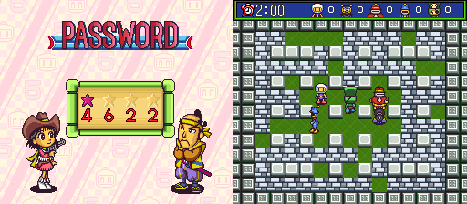
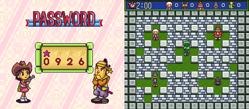
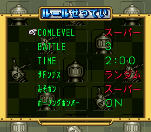

### The Caravan table: 0719 and 4737 are Caravan-only

The Caravan ROM's table is at `$C5:688D`: the same 10 codes plus two more. GameFAQs lists these two as
"lost passwords". **The retail ROM rejects both** (Mesen: scene stays 2).

| Code | Handler | Effect | Status |
|---|---|---|---|
| 0719 | `$C5:69BB` | 3879 with `$6272=1`: boss rush starting with 8 bombs, 8 fire, speed and items (Mesen: `$17CA`=8, `$4EBD`=8, `$15EA`=2) | Known, Caravan only (new detail) |
| 4737 | `$C5:6A08` | `$6293=1`. At each battle start `$C5:0DE1` sets `$6272=1` (unless `$627C`=2), and every player starts fully powered (`$C4:2908`, `$C4:2A22`) | **Fixed**: GameFAQs says "many power-ups every 10 seconds". The code only gives full starting power, and a 2-minute match in Mesen showed nothing else; `$6272`/`$6293` have no other readers |

★ **New: the retail ROM still has 0719's effect.** `$C4:2906` gives players 8 bombs/8 fire/speed 7
when `$6254`≠0, but retail 3879 always stores 0. Forcing `$6254=1` as players spawn in a 3879 boss rush
gave 8 bombs, 8 fire and `$4ED5`=7 (remote, kick, glove) in Mesen. PAR-style `7E6254:01` alone is too late, because 3879 builds the players straight
away (`$C4:286F`).

### ★ New: cut passwords (orphaned handlers)

Between the live handlers, the retail ROM has eight more that nothing in the table (or anywhere else)
points to. They look like passwords that were removed. Each was run in Mesen by forcing its scene
after a valid code:

| Handler | Does | Result in Mesen |
|---|---|---|
| `$C5:6951` | `$6253=1`, back to options | **invincibility**: `$C4:2D2B` skips the hit timer and sets the blink flag while `$6253`≠0. With it held at 1, Bomberman sat in his own blast and lived (below). The known debug-menu text includes MUTEKI (無敵, invincible) |
| `$C5:698D` | `$6255=1`, back to options | `$6255` is never read: dead |
| `$C5:6934` | 2657's bit 0x08, then scene = A, also stored to `$1D1F`/`$4D63`/`$4D65` (`$0D` for scenes ≥ `$AE`) | entry with no caller; `$C5:698D` jumps into its tail |
| `$C5:69B5` | scene 8 | the GAME OVER / CONTINUE screen |
| `$C5:69BC` | scene 9 | the end-of-game certificate (認定状) |
| `$C5:69C3` | `$35C4`=`$102F`, scene `$0A` | the DRAW GAME screen |
| `$C5:69D1` | scene `$A8` | the Bowling Bomber bonus game |
| `$C5:69D8` | scene 1 | reboot to the Hudson logo |

The Caravan ROM has the same set (`$C5:6958`-`$C5:6A38`).

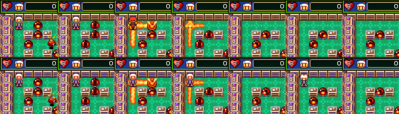
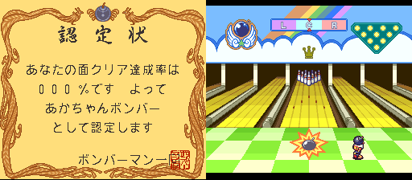

## Config Battle character passwords

Battle > コンフィグバトルモード (Config Battle) > コンフィグさくせい (make a config) > データロード (data
load) > パスワードロード (password load). Code: `$C5:6530` decodes (`$C5:654F` unpack, `$C5:671B`
checksum, `$C5:6789` fields), `$C5:6545` encodes. They are script natives 91 and 92.

- **32 symbols**, 5 bits each, value order `0123456789ABCDEFGHJKLMNPQRTUVWXY`. The grid shows
  `ABCDEFGHJKLMN` / `PQRTUVWXY` / `1234567890 もどる(back) 決定(OK)`: there is **no I, O, S or Z**.
- The 6 symbols are packed LSB first into 30 bits (symbol *i* at bit 5*i*), the 4 bytes are each XORed
  with **`$CB`**, and the result is read as a 32-bit little-endian value *v*:

| Bits of *v* | Field | RAM | Editor range | Shown as |
|---|---|---|---|---|
| 0-3 | body | `$62DE` | 0-8 | see below |
| 4-6 | color | `$62DF` | 0-5 | white, black, red, blue, green, yellow |
| 7-9 | bomb | `$62E6` | 0-7 | value+1 |
| 10-13 | fire | `$62E7` | 0-6 | value+2 |
| 14-16 | speed | `$62E8` | 0-7 | value+1 |
| 17-25 | items 0-8 | `$62E9-$62F1` | any | Remote control, Pierce bomb, Land mine, Homing bomb, Bomb pass, Soft-block pass, Power glove, Kick, Punch (round 2: item 0 is the remote control, because it sets `$4ED5` bit 0x01, the never-expiring fuse, and GameFAQs lists a remote for U04GJL; item 3 sets bit 0x40, the fourth bomb type, named homing after the debug menu's BOM HOMI. The order matches the editor's icon row) |
| 26-29 | checksum | | | sum of every 4-bit nibble of the 26 data bits (bytes 0-2 and bits 0-1 of byte 3), mod 16 (`$C5:6759`) |

- Bodies: 0 Bomberman, 1 Bomber Woof, 2 Dave Bomber, 3 Gary Bomber, 4 Pirate Bomber, 5 Muscle Bomber,
  6 Iron Mask Bomber, 7 Baron Bombano, 8 Plunder Bomber (GameFAQs' names); **9 Subordinate Bomber**.
  The editor cycles bodies 0-8 and colors 0-5 (Mesen: `$62DE` wraps 8→0, `$62DF` 5→0).
- **Only the checksum is checked.** Any body 0-15, color 0-7 and fire 0-15 loads. The name isn't in the
  password; the game gives a default (`$C2:1955`). One game state has exactly one code.
- Out-of-range values, all loaded in Mesen: color 7 is the boss palette (the known "Boss palette" PAR
  code). Its color name reads past the end of the name table and fills the editor with junk kana. Color 6
  is the burnt palette. Fire above 6 shows junk digits. Body 9 has no portrait (a red Bomberman in the
  editor, a red X in the select list) and no icon, so it uses Pirate Bomber's in matches.

Why Subordinate Bomber (body 9) breaks things: the editor only offers bodies 0-8, so the game's
per-body art and sound (portrait, select icon, victory voice) were never finished for index 9. In
Mesen his editor portrait is a stand-in red Bomberman. The usual explanation blames the freeze when he wins a single
match on the missing voice clip.

**Confirmed in Mesen (round 2):** a Battle Royal single match with BATTLE set to 1, P1 set to body 9
(`$625F`=`$0A`; the in-match body `$16C2` is then 9), the other four killed by bombs placed on their
tiles (P1 kept alive by forcing `$6253` only for P1 at the hit check `$C4:2D2B`). The VICTORY screen
(scene 5) appears and then freezes for good: the same frame for 30+ seconds, with the CPU looping at
`$C0:0E82`-`$C0:0E8E`, waiting for the sound CPU to echo a command on `$2140`. The same run with body 0
goes on to Bowling Bomber (`$A8`) and back to the Battle menu.

**Cause: the victory voice table has only 9 entries.** The victory script at `$C6:7963` reads the
winner's character (`$625F`,X − 1) and looks up the voice in a byte table at `$C6:74D1`: `05 06 07 08
09 0A 0B 0C 0D` for bodies 0-8. Body 9 reads the next byte, `$EF` (part of the following script),
and plays "voice" `$EF` (sound call `$03EF`, `$C0:0D5F`). Its entry in the voice-pointer table
`$80:8765` is junk (`$0010`), so the sample upload that follows sends the sound driver garbage, and
the next sound command (`$0247`) is never acknowledged. So the usual explanation is right: it's the missing victory
voice. The two 9-entry animation tables suggested last round (`$C5:12FE`, `$C2:1470`) are not the cause.


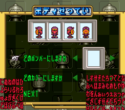
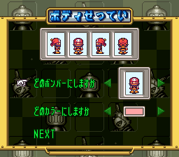

### Fuzz check against the real decoder

815 codes went through the real entry screen in Mesen (`tools/sb5/fuzz.sh`): 400 random strings,
every one-symbol change of D24GJN (186), and 228 encoded codes covering every body 0-15 × color 0-7
plus random fields. Each was injected into the buffer at a savestate and then OK pressed. **Retail:
261 accepted, 554 rejected, 0 disagreements** with `password.py`/`password.mjs`, including every decoded
field of the accepted ones. **Caravan** (buffer `$6311`, fields `$62FD`), the same 815 cases: **261 accepted, 554 rejected, 0 disagreements**. Four codes (U04GJL, KR3MT9, 23D830, 2YLPVD) were
also typed with real presses (`tools/sb5/typecode.lua`); all loaded with the expected fields. All 20
typeable codes posted on GameFAQs and elsewhere went through the real decoder too (`CASES=... fuzz.sh`). Every
one loaded, with the fields in the table below. The JS
and Python codecs agree on all 815 and round-trip 4,096 field sets (`tools/sb5/test.mjs`).

### GameFAQs codes, checked

| Posted | Result | Decodes to |
|---|---|---|
| D24GJN W04VJ4 D344J6 W24G0N W24LKN W04V0T W1440E D24L1A (Alchav, no effects given) | all OK | Iron Mask Bomber with full stats (8 bombs, fire 8, speed 8) and five items each; see `sb5_codes.json` |
| JWLPVP | OK | Subordinate Bomber, boss palette, 1 bomb, fire 8, speed 1, no items |
| KR3MT9 QM3PDF RMHPCN TDK4VU VM6NVQ WM6XC5 YH1PLQ | OK | the posted bosses, boss palette |
| UO4GJL (Gold Bomberman) | **Fixed**: the letter O can't be typed (no O on the grid) | `U04GJL`, with a zero. It's a yellow Bomberman with full stats plus Remote control, Bomb pass, Soft-block pass, Power glove and Punch. It is not the real Gold Bomberman, who isn't a config character |
| XROPLG (Muscle Bomber) | **Fixed**: same letter-O typo | `XR0PLG` |
| 23D830 | OK | Subordinate Bomber, red, all stats past max (fire 15 = junk digits), all 9 items |
| 2YLPVD | OK | Subordinate Bomber, red, 1 bomb, fire 8, speed 1 |

The published editor PAR codes (`7E62FD`, `7E62FE`) are the Caravan/gold addresses. Retail's are `7E62DE`
(body) and `7E62DF` (color) (**Fixed**).

## Gold Bomberman (100% completion)

The certificate after the ending (認定状: "your stage clear rate is N%, so we certify you as ...")
computes the clear rate into `$103C`. At `$C6:E081` the script compares it with 100 and, if it matches,
calls native 67 (`$C0:4880`), which writes 1 to SRAM `$1E9`. At the battle character select, native
68 (`$C0:4893`) reads `$1E9`, and Gold Bomberman takes the place of the random-pick X. Both halves were
checked in Mesen: forcing `$103C`=100 at that compare wrote SRAM `$1E9`=1, and setting `$1E9`=1 put
Gold on the select screen. No password sets `$1E9`. GameFAQs' "0926 unlocks Gold Bomberman" is wrong.

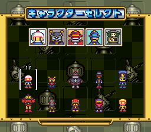

## Battle stages 11-13 (Super Joycard)

A title-screen task (`$C1:75F1` spawns `$C1:75F9`) watches newly pressed buttons on all five pads
(`$36-$3A`, `$C1:7677`) for X. Every frame adds to a counter (`$0C87/$0CAF`). Every frame with a new X
press adds to `$0CD7`. A run of 16 frames without one starts over. At 360 frames (6 s) the unlock
happens if `($0CD7-7) & $F0 = $20`, i.e. **39-54 X presses in 6 seconds** (6.5-9 Hz). Then a sound
plays and `$C0:489C` sets `$6245`=13 and SRAM `$1EA`=`$FF`; at boot `$C0:48B5` picks 13 or 10 stages from
it. A Super Joycard's turbo held on X makes this pulse rate. Tested in Mesen: 4 frames on/4 off and 3/5
and 1/7 unlock; 2/2, 1/1, 4/10, 6/6, 8/8 and plain holding don't. (Known: GameFAQs and others. The exact
window is new.)

**Caravan:** `$C1:75F1` is `JSL $C0:48A2`, the unlock itself. The stages are on from the first boot
(Mesen: `$6245`=13 with blank SRAM).

## Endings and zone routing

### How rooms are linked

Every scene/room has a script; scene *n* runs entry *n*−1 of the 3-byte pointer table at `$C6:0000`
(checked in Mesen: scene `$0D` runs `$C6:1ADB`, `$6F` runs `$C7:26B8`). Rooms `$0D`-`$66` are stages
1-1 … 5-30, `$67`-`$70` bosses 1-10, `$71`-`$73` the three bonus rooms, `$74`+ battle stages, `$A8`
Bowling Bomber, `$AA`/`$AB` the endings, `$AC`-`$AE` the debug rooms. Stage names come from the word
table at `$80:8A8A` (zone×1000 + stage, or the boss number). A room's script is a set of event
handlers. Each exit is a warp: `11 <dest+3> x y` places it (`$C2:0C38`; it looks lit if that room's
clear flag, room+3, is already set, `$C5:3D19`), and its handler runs `0F <dest>` (`$C2:0C20`, start
room *dest*), sometimes after `05`/`06` (set/clear flag in `$7E:2900`, which picks a boss-room variant).
`tools/sb5/scripts.py rom routes` lists every room's exits.

The stage-clear trigger is `$1D50`, the enemies left: each enemy death decrements it (`$C4:3DB3`) and
at 0 `$C5:3B4E` posts event `$0D`, which opens the warps. Boss rooms instead get event `$1B` when the
boss dies (`$C3:438D`, `$C1:16A9`).

### Verified in Mesen

- **4-14 and 4-15 lead to boss 8 (room `$6E`).** Loaded each room through `$6248`, killed all
  enemies (moved them onto P1's blast through the actor arrays `$182A`/`$1872`/`$16AA`, X = 5…), and
  walked P1 to the exit with real presses (bombing soft blocks on the way). Walking to (11,10) in 4-14
  and to (7,5) in 4-15 both started room `$6E`.
- **5-27 leads to boss 10 (room `$70`).** Same method, exit (7,11).
- **Boss 9 (room `$6F`) → good ending `$AA`; boss 10 (room `$70`) → bad ending `$AB`.** In each boss
  room, the main script task was sent to its event-`$1B` handler (`$C7:2760` for `$6F`, `$C7:2879` for
  `$70`), which is what the game does when the boss dies. `$6F` then played `$AA` (the 1999 sequence:
  the bubble scene, then the staff roll over boss arenas `$67`, `$68`…), and `$70` played `$AB` (the
  0803 space scene). The scripts end in `0F AA` (`$C7:27D7`) and `0F AB` (`$C7:28DA`).

### Which route gives which ending (from the exit graph)

Zone 4 has three bosses, and each one opens a different part of zone 5:

| Zone-4 boss (room) | Reached from | Opens zone 5 at | Final boss reachable | Ending |
|---|---|---|---|---|
| boss 6 (`$6C`) | 4-8, 4-9, 4-10 | 5-1, 5-2, 5-3 | boss 9 (via 5-10 → 5-16/5-18 → 5-24/5-25/5-26) | **good** |
| boss 7 (`$6D`) | 4-11, 4-12, 4-13 | 5-4, 5-5, 5-6 | boss 10 (via 5-19/5-20/5-21 → 5-27/5-28) | bad |
| boss 8 (`$6E`) | 4-14, 4-15 | 5-7, 5-8 | boss 10 (via 5-15/5-22 → 5-29/5-30) | bad |

So **the ending is decided by which zone-4 boss you beat**: only boss 6's half of zone 5 contains the
exits to boss 9. Inside zone 5 the halves don't connect (checked over the whole exit graph by
`scripts.py routes`, which prints the reachability). GameFAQs' "fight boss 4-F to enter zone 5a" is
**right in substance** if "4-F" is boss 6 (`$6C`). The stage names don't give zone-4 bosses a
letter, so I can't confirm which boss the poster meant. The route rows other than 4-14/4-15 → `$6E`
and 5-27 → `$70` come from the scripts and were not walked.

## Debug menu and debug rooms

### The debug menu text (★ New: decoded, and the scripts that show it)

The known text at file `0x11EEFA` is message `$F1` of text table 6. The text drawer (`$C0:0000`-`$C0:0134`)
takes a table number (`$0340`) and a message number; table 6's base is in the 3-byte list at
`$80:8000`, and its 16-bit pointers start at `$D1:A000`, so message `$F1` starts at `$D1:EEF3` (file
`0x11EEF3`). A message is one or more windows: `w h x y attr`, then `w×h` tile bytes, plus a second
`w×h` layer of tile high bytes when `attr` is 0. Both layers go through the decompressor at
`$C0:1CB0`/`$C0:1D45`: a control byte gives a count `(c & 31) + 1` and a mode `c >> 5` (0 literal
bytes, 1 previous byte + 1, 2-7 copy from 1, 2, 4, 16, 32 or 64 bytes back). That is why the raw
bytes look like broken words. `tools/sb5/textwin.py` decodes any message (`textwin.py rom 6 F1`).

Message `$F1` is a 14×11 window (high byte `$21` on every tile: priority, palette 0, tile `$100`+ASCII):

```
>REST SET XXX
 TIME SET XXX
 POWERMAX OFF
 NON MOVE OFF
 BOM MINE OFF
 BOM PENE OFF
 BOM REMO OFF
 BOM HOMI OFF
 MUTEKI   OFF
 WARP     OFF
          OK?
```

Messages `$F2`-`$F5` are the 4×1 value fields pasted over the right column: `MAX`, `XXX`, `ON ` and
`OFF`. Table 6 ends at `$F5`, so the debug menu is its last group. Read as names only: REST = lives,
TIME = stage timer, POWERMAX = full power, NON MOVE = enemies frozen, BOM MINE/PENE/REMO/HOMI = land
mine, pierce, remote and homing bombs (they match the four exclusive bomb-type bits of `$4ED5`),
MUTEKI = invincible (the cut `$6253` code above), WARP = room warp. No code that applies them was found.

Two script fragments draw it, with the native `FF 8D F1 06` (show message `$F1` of table 6):
`$C6:72BB` and `$C6:F13F`. Nothing points at either (no scene, no script jump; the scene sweep below
never read those bytes, nor the text at `$D1:EEF3`). Forcing a script task to `$C6:F126` (the start of
the second one) in Mesen runs it: it loads graphics (ops `26 03`, `27 01`, `2A 02`), calls the drawer
with `$F1`/table 6, which puts the window on BG1, and then sits in an input loop at
`$C6:F181`-`$C6:F1A5` reading the cursor bytes `$1032`/`$1034`. But BG1 tiles `$100`+ASCII hold no font
in the contexts I tried (after the password screen, and from `$C6:728C`, which also switches to BG
mode 7), so the window shows as garbage and **no readable screenshot of the menu was possible**. It
is not made reachable: there is no patch for it.

### Debug rooms `$AC`-`$AE` (Known; ★ New: a patch and the scene variable)

They are plain scenes. The password screen's scene variable `$6248` is copied to `$1031` and run, so
any value works. A sweep of every scene `$00`-`$B2` through `$6248` showed `$A0`-`$A7` (battle stages 12 and 13, see "Maps"; round 2 called them boss arenas, **fixed**),
`$A8` Bowling Bomber, `$A9`-`$AB` the ending scenes, and:

| Scene | Script | Known name | Seen in Mesen |
|---|---|---|---|
| `$AC` | `$C7:170D` | Battle test | Zone 3 mine-cart cave layout, only the player, 2:00 timer |
| `$AD` | `$C6:0309` | Single-player level test | battle stage 1 layout, Normal HUD, two enemies, soft blocks |
| `$AE` | `$C6:03B8` (the last entry; `$AF` would read `$FFFFFF`) | Single-player enemy test | one enemy, broken HUD; black screen about 10 s later |

Scenes `$AF` and up are past the table (junk). **Patch:** `patches/sb5_debug_rooms.ips` (retail;
built and self-checked by `tools/sb5/make_ips.py`) adds three option passwords: **0172 → `$AC`,
0173 → `$AD`, 0174 → `$AE`**. It copies the 10-entry table from `$C5:6875` to free space at
`$C5:6FA0`, adds the three entries and their handlers (`$C5:6FF0`; like the ending codes they set
bit 0x80, so nothing is saved), and repoints the five table operands of the walker at `$C5:6836`.
All three were typed with real presses on the patched ROM and reached their scenes; 4622 and 1999
still work. Without a patch, PAR `7E6248:AC` (or `AD`/`AE`) held while entering any valid option
code does the same (tested by writing `$6248` after the 4622 handler).

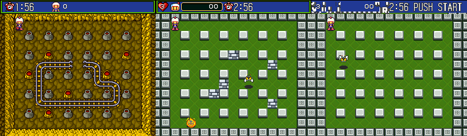

## Entering a password

### Option screen (4 digits)

- The digits start at **0000** on the first visit after power-on (RAM clear), with the star cursor on
  the first digit. Leaving and coming back keeps the last digits typed; the cursor goes back to digit 1.
- Up adds 1, down subtracts 1, and both **wrap** (9 → 0, 0 → 9).
- Left/right move the cursor and **wrap** between digit 4 and digit 1. There are four positions only
  (no OK box).
- A checks the code at once from any position. A wrong code just stays on the screen (no message);
  B leaves to the title.

### Config Battle grid (6 symbols)

The grid is `ABCDEFGHJKLMN` / `PQRTUVWXY` / `1234567890` + もどる (back) + 決定 (OK). Cursor row
`$1032`, column `$1033`, next entry slot `$1040`.

- The cursor starts on **A**, entry slot 1. The entry shows `000000`: empty slots hold symbol 0, so a
  short code is padded with zeros.
- A (or Start) types the symbol under the cursor and moves to the next slot. **After the sixth symbol
  the slot stays on the last one**: further symbols overwrite symbol 6. The cursor doesn't jump to 決定.
- もどる moves the slot back one (it doesn't clear the symbol); B leaves the screen.
- Left/right **wrap** within a row (A ↔ N, P ↔ Y, 1 ↔ 決定). The bottom row has a gap: columns 0-9 are
  the digits, column 10 is empty and skipped, 11 is もどる and 12 is 決定.
- Up/down **keep the column** and wrap top ↔ bottom; a row with no key in that column is skipped
  (from N, down goes straight to 決定; from 0, up goes to K). On L (column 10), up/down do nothing.

All of the above was checked in Mesen by pressing the buttons and reading `$6241-$6244`, the cursor
bytes and the entry buffer.

## Unused graphics sets

Graphics are loaded as numbered sets by `$C0:1B04` (group in `$0AE7`). Each group's table is pointed
to from `$C0:1C96` (bank `$85`): 8 bytes per set, VRAM address, size, 24-bit source, and flags (bit 7 =
raw copy, otherwise the same decompressor as the text). `tools/sb5/gfxsets.py` walks the five groups
(291 sets) and flags every set whose source bytes the Mesen code/data log never touched, then renders
it as greyscale 4bpp tiles to `docs/img/sb5/unused/` (file name = group, set, source address).

The log is the cumulative one from all this project's Mesen runs: every scene `$00`-`$B2` started
for 250-400 frames, boot, title, options, both password screens, Battle menus and a match, the Config
editor, rooms in zones 4 and 5, the boss rooms, both endings and the debug rooms. **61 sets were never
read.** That is "not reached in our runs", not proof of being unused: the zone maps between stages,
most cutscenes and most of the staff roll were never played, and sets in formats other than 4bpp
(flags `$02`/`$03`/`$05`) render scrambled here.

| Set (group/number) | Source (file) | What it looks like | Status |
|---|---|---|---|
| 3/10 | `$D3:9915` (0x139915) | The *Super Bomberman 3* logo ("…BER 3") with a plus sign | **Known** ("Super Bomberman 3 Logo") |
| 3/11 | `$D3:A7AC` (0x13A7AC) | A font sheet: katakana, big digits 1-12, ∞, MAN / COM / OFF, 1 2 5P 3 4, COMMAND, OK? | New, unconfirmed: looks like an older battle-setup font; not reached |
| 3/17, 3/18, 3/19 | `$D3:E50E`, `$D3:F0D7`, `$D4:081C` | Zone-map islands (prehistoric, city, machine) | not reached (zone maps weren't run) |
| 0/8, 0/11-0/15, 0/17, 0/18 | `$C8:0400`-`$C9:3400` (raw) | Character sprite sheets (Bomberman and the bosses in story poses) | not reached (cutscenes) |
| 0/22, 0/26, 0/29, 0/30, 0/32 | `$C9:A000`-`$CA:9000` (raw) | Large character sprites | not reached |
| the rest (36 sets, mostly groups 3 and 4) | see `unused/` | stage-piece and effect tiles; many are non-4bpp formats | not reached |

The other known graphics (the scrawled digits in VRAM, the Warooi frames) sit inside sets that are
loaded, so a set-level sweep can't flag them. A per-tile sweep would need VRAM-read logging, which
Mesen's code/data log doesn't record.


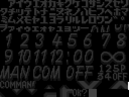

## Caravan version: what changes

- Header title `SUPER BOMBERMAN 5G`. Code/script banks `$C0-$C7` and data bank `$D1` differ. `$D1` has
  `$1DB` bytes added at `$D1:A000` (a pointer table) and `$1C` at `$D1:EFCF`; the rest is shifted
  addresses.
- WRAM from `$6249` up moves `$1E` bytes higher (`$6253`→`$6271`, `$6273`→`$6291`, `$625F`→`$627D`),
  and the editor block moves `$1F` (`$62DE`→`$62FD`). The 4-digit buffer `$6241` and `$6245-$6248`
  don't move.
- Battle stages 11-13 unlocked at boot (above).
- Two extra option codes, 0719 and 4737 (above). All 10 retail codes behave the same (Mesen, RAM
  flags).
- Same character-password codec, at addresses shifted by `$18` (`$C5:6579` reads the buffer), with the
  same XOR and checksum: the routine differs only in address operands.
- Same title logo, same default timers seen in Mesen (battle 2:00, Normal stages 3:00).
- Nothing else found: no new ASCII text and no extra menu.
- Screen by screen (round 2): the same input script ran on both ROMs (Hudson logo, intro, title,
  options, option password, battle menu, single/tag, player select, character select, rules, stage
  select, battle start, Config Battle menu, Normal menu, file select, zone map, stage 1-1) and the
  screenshots were compared pixel by pixel. All are identical except the title logo (483 pixels in
  the SUPER lettering: the colour-cycle phase, not the art), the zone map (a blinking marker caught
  in another frame) and the stage select, where Caravan offers stages 11-13 (12 presses right from
  stage 1 land on stage 13 in Caravan and wrap to stage 3 in retail). The demo stages differ only by
  the random soft-block layout.

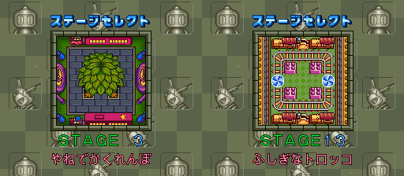

## Unused and debug content

- **Cut passwords**: the orphaned handlers above, including invincibility (★ New). The code that does
  set `$6253` is the ending/demo natives at `$C5:6DEC`-`$C5:6E93` (players can't die in those scenes).
- **Dormant boss-rush full power** in retail (`$6254`, ★ New).
- The debug menu text and debug rooms: see the next section.
- Unused graphics: see "Unused graphics sets" below.
- Script natives 67/68 (Gold flag) and the SRAM signature strings `CONFIG BATTLE DATA Ver 1.00` /
  `SuperBomberman5 by Hudson ver0.9` (Known) are read at boot (`$C0:47F6`, `$C0:4A94`).

## Round 3: hidden-content sweep

Method for this round: 13 new Mesen runs (every room `$0D`-`$AE` loaded through `$6248`, 360 frames of
looking plus 1,200-1,600 frames of random play with `$6253` held so the player survives; both endings for
9,000 frames; Bowling Bomber, the certificate and the menu scenes), merged with every earlier retail log and
the English ROM's log (code bytes copied over only where the two ROMs are byte-identical): 97,779 code bytes,
up from 71,301. `disasm/sb5/` was regenerated from it (1,180 seeded entries, 63,038 instructions). The
earlier logs include the orphaned handlers and the debug script, which round 2 forced to run, so those count
as "ran".

### Dead code

`tools/sb5/deadcode.py disasm/sb5 rom cdl` takes as entry points every JSR/JSL/JMP/JML target, the 251
script-op handlers (`$C2:04FA`), the native table (`$C2:0650`), and every label right after an exit that no
call or branch reaches (pointer-table or orphaned code). **2,604 entry points, 720 never ran**: 71 natives,
55 script-op handlers, 391 labels after an exit and 203 routines whose callers never ran either. Most of the
391 are data that the disassembler's guesser decoded as code (the sprite tables at `$C5:8000` are the largest),
so 720 is an upper bound. The ones read and worth reporting:

| Address | What it is | Class | Status |
|---|---|---|---|
| `$C0:0AFC` | `LDA $2C / CMP #$33 / BNE / JML $80:F345`: holding L+R+Select+Start jumps to the native-mode reset entry (`$F345` = `SEI SEC XCE`, falling into the RESET code at `$F348`). Nothing calls it and no pointer to it exists (no `FC 0A` operand anywhere). Same bytes at the same address in Caravan and English | truly unreferenced: a **cut soft-reset combo** | ★ New |
| `$C5:6806` | looks up `$1D1F` (the scene the orphaned handler `$C5:6934` stores) in a byte-pair table at `$C5:6825` to set `$1D22`. The table's first byte is `$00`: it is empty and the lookup always fails | cut feature, the other half of the cut-password handler | ★ New |
| `$C5:6934`-`$C5:69D8` | the eight orphaned password handlers | truly unreferenced | Known (round 1) |
| `$C3:4C13` | sets `$1FF3`=`$FF` around a boss-actor step; its only caller `$C5:4321` never ran | reachable in a boss state not covered | not identified |
| `$C5:6E37` (native `$D0`), `$C5:6D1E`, `$C5:6D9F`, `$C5:6DC1` | the demo/ending natives that set `$6253` and the player blocks | reachable: scene points not played to | — |
| natives `$29`-`$3E` (`$C1:4747`-`$C1:4B82`), `$8D`-`$90` callers | cutscene and text natives | reachable only in the story scenes between zones, which the room sweep skips | — |
| the 55 script-op handlers | ops that no script we ran used (mostly 16-bit compare/branch variants) | not covered | — |

No code that applies the debug menu's REST/TIME/POWERMAX lines turned up outside the two orphaned script
fragments (`$C6:72BB`, `$C6:F13F`).

### Input codes

`tools/sb5/padscan.py <asm dir>` splits banks `$C0`-`$C7` into routines and reports each routine that reads
`$4016/$4017`, `$4218-$421F` or the game's pad copies (`$19-$1E` raw, `$2C-$30` held buttons A X L R B Y Sel St,
`$31-$35` held d-pad, `$36-$3A` new presses, `$3B-$3F` new d-pad, `$40-$44` auto-repeat), marking compares with
a multi-button constant, compares against a table, and counters. On all three listings: **34 pad-reading
routines in retail and English, 37 in Caravan** (the three extra are listing coverage; the same code is in
retail), 11-12 flagged. Each flagged one was read:

| Routine | What it is | Verdict |
|---|---|---|
| `$C0:0AFC` | L+R+Select+Start → reset (above) | dead, cut combo, ★ New |
| `$C1:75F9`/`$C1:7677` | the title-screen X-tap counter (stages 11-13) | Known; window measured in round 2 |
| `$C0:0A56` | builds the pad copies and repeat timers | plumbing |
| `$C0:F1D7`, `$C0:F29F` | multitap (MULTI5) reading and connect check | plumbing |
| `$C4:47B1` | escape counter: 20 d-pad presses (`$4EED`) free a trapped player | gameplay |
| `$C5:05B5` | Normal mode: the partner presses Start (`$2C` bit 0) to spend a shared life (`$1D23`) | gameplay |
| `$C4:0174`, `$C4:30DD`, `$C0:3A61` | COM AI and cursor code that write the pad copies | not codes |
| `$C5:3440`, `$C5:8633` | data decoded as code | none |

The script VM has no pad opcodes; a byte scan of the script banks for address-taking ops with a pad address
found only data. **No hidden button code besides the X-tap and the cut reset combo.**

### Unset flags

`tools/sb5/flags.py <asm dir> rom cdl [--direct]` lists WRAM bytes that are tested (load, compare or BIT then a
branch) but never set: STZ and stores of 0 don't count; indexed stores count over `base..base+$7F` unless
`--direct`; script ops that take a WRAM address count as writes, including `7B` (INC). **220 tested
addresses; 38 with no executed setter under `--direct`.** Most are sound-driver and actor plumbing
(`$0393-$039C`, `$1782-$1784`, `$17FA/B`). A second run put write watches on all candidates through a 19-scene
sweep and logged every nonzero write with its PC. The ones that matter, each set in Mesen:

| Address | Tested at | Set by | Effect in Mesen | Status |
|---|---|---|---|---|
| `$6253` [`$6271`] | `$C4:2D2B` | orphan `$C5:6951`, demo natives | invincible (round 1); PAR re-tested below | Known (round 1) |
| **`$0E23`** | `$C4:2D31` (right after the `$6253` check), `$C5:0460` | **nothing**: only `STZ` at `$C5:0404` | **invincible and the stage clock stops**: `$C5:0460` skips the clock tick (`$0E1C-$0E1E`) while `$0E23`, `$0E20` or `$0E21` is nonzero. Same address in all three ROMs. A fit for the debug menu's MUTEKI/TIME lines | ★ New |
| `$0E20`/`$0E21` | `$C5:041A`, `$C3:4C36` | a countdown (`DEC $0E20`) | a clock-stop timer; `$0E21`=1 held the clock to one second in 300 frames | reachable |
| **`$6258`** | `$C5:3FAD`; saved per file (`$C0:491C`), loaded at `$C0:49DE` | the certificate script, `7B 58 62` (INC) at `$C6:E08F`, only when the clear rate is 100 and `$6258` is 0 | a per-file **100% flag**. When set (outside Battle) the soft-block item lists come from the second half of the table at `$C5:E5C7` (room index + 155). Holding it with PAR changed nothing visible at the start of 1-1, 2-1 and 5-1 (soft blocks are random anyway). The certificate's うらめん ("back side") comments below go with it | ★ New (item effect not verified in play) |
| `$0F64` | `$C5:1FC8` | the native at `$C0:450D` (=2) | held at 2 in 1-1 for 900 frames: no visible change | unclear |
| `$1FF3` | `$C3:4BCA` | `$C3:4C13` (never ran) | held in boss 1: no visible change | unclear |
| `$1D1F` | `$C5:680F` | orphan `$C5:6934` | lookup table empty, so no effect is possible | dead (above) |
| `$6254` | `$C4:2908` | script (`$C2:1AF1`) in the Normal menu; 0719 on Caravan | boss-rush full power (round 1) | Known |

### Text

There are only two text tables: the drawer `$C0:0000` reads its base from `$80:8000+3×$0340`, and only tables 4
(`$D1:0000`) and 6 (`$D1:A000`) are valid. Retail has **254 messages in table 4 and 246 in table 6**. Caravan has
247 in table 6 (one extra, `$F6`, an 8×2 tile window, by its tiles a small logo or icon). English has 249
(`$F6`-`$F8`; `$F7` is a 32×30 + 32×12 screen map). All 500 retail messages decode with no error
(`tools/sb5/textdump.py rom list`). Two fixes to `textwin.py`: the decompressor's history is a zero-filled
256-byte ring (back references before the start read 0; the old list version raised errors on 241 messages),
and the header always has the x/y bytes (flag bits only make the drawer ignore them).

**The drawer argument is message+1** (`$C0:0024` DECs it). So the debug script's `FF 8D F1 06` draws index
`$F0`, a 24×12 frame, and the debug text (index `$F1`, argument `$F2`) is drawn by no script found.

Most "messages" are not strings but tilemaps: whole 32×32 screens, frames, icons, and Japanese text drawn as
tiles from per-screen fonts. An exec hook on `$C0:0020` logged every (scene, table, message) drawn in all runs:
**114 drawn (66 + 48), 386 never drawn**. `textdump.py rom sheet dump name table first last out.png` renders
messages through a VRAM/CGRAM snapshot taken in Mesen (21 scenes). The undrawn ones are mostly story-scene and
zone-map maps (the sweep never played the cutscenes) whose fonts are in no snapshot, so they render as junk and
could not be read. The readable block is the certificate (認定状):

- Table 4 `$64`-`$85`: the rank titles, each + ボンバー: あかちゃん (baby), だざだ? (unclear), へなへな (feeble),
  チキン (chicken), リーダー (leader), グッド (good), よわよわ (weakling), はやどき? (unclear), ボスキラー (boss
  killer), おみごと (splendid), へろへろ (worn out), つわもの (veteran), あまちゅあ (amateur), まあまあ (so-so),
  そろそろ (getting there), いまいち (not quite), ちゃくじつ (steady), よくばり (greedy), いじん (great man),
  へんじん (oddball), たつじん (expert), がまん (patient), ぎりぎり (just made it), ビクトリー (victory),
  バッドエンド (bad end), まぬー? (unclear), パーフェクト (perfect), こんじょう (guts), しゅうさい (prodigy), めいじん
  (master), てんさい (genius), せんにん (sage), かみさま (god). Only あかちゃん was drawn in our runs; the rest
  depend on the clear rate and route, so they are not unused.
- `$8A`-`$A8`: the comment lines, e.g. クリアするのに10ねんかかりそう ("looks like clearing it will take you 10
  years"), ボスとたたかってないぜ！にげたな ("you haven't fought the bosses, you ran away!"),
  ラストがバッドエンドなんてわらっちゃうね ("ending on the bad ending, that's a laugh"),
  ついにうらめんまできたね こんじょういれてがんばれ ("you finally reached the back side, put your guts into it")
  and ついにうらめんも100% きみかみさまになれるぞ ("back side at 100% too, you can become a god"). The うらめん lines
  go with the `$6258` 100% flag.

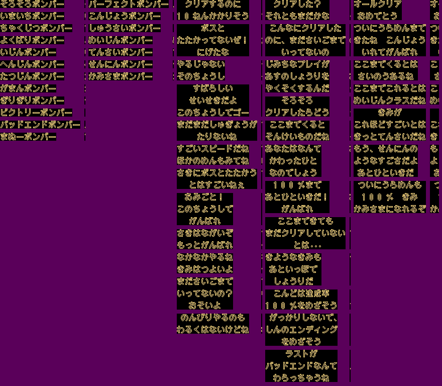

English vs Japanese: 75 messages of table 4 differ, 72 of them in window layout (`$64`-`$A8` = the certificate,
and `$03`-`$06`, `$DC`); 47 of table 6 differ, 10 in layout. Caravan's tables are byte-identical to retail
apart from the extra `$F6`.

### Maps

**Format** (found by write-watching the live map `$7E:1052` during a room load; `tools/sb5/maps.py`):

- Script op `0A <layout> <set>` (`$C2:0BED`) stores `$1B7E`=layout and `$1B7D`=set; op `0C <layout>` (`$C2:0C0C`)
  loads another layout into the same room (the second BG layer); `$C0:3550` builds it.
- Layout *n*: `$D0:A000+3(n−1)` points to a 3-byte entry that points to a stream for the text/tile decompressor
  (`$C0:1CB0`): 256 bytes, a 16×16 grid of cell types (field = columns 0-14, rows 0-12), unpacked to `$7E:2500` and
  copied to `$2400`. The first pointer is `$D0:A297`, so the table has **221 layouts**.
- Set *s*: `$D0:8000+2(s−1)` → a cell type → attribute table (bank `$D0`). Attributes go to `$2700`/`$2800` and,
  masked with `$B0`, to the collision map `$7E:1052` (16 bytes per row): bit 7 solid, `$30` soft block. Type 0 is
  always solid. `$D0:0000+2(s−1)` is the set's metatile table (4 BG tile words per type).
- Soft blocks are not in the layout: they are placed at room start (randomly in Battle); the per-room item lists
  are the table at `$C5:E5C7`.

**Room ids:** `$0D`-`$66` stages, `$67`-`$70` bosses, `$71`-`$73` bonus rooms, and **`$74`-`$A7` = the 13 battle
stages × 4 layout codes** (normal, 4622, 0413, 0926): stage *k*, code *v* is room `$74+4(k−1)+v`, so `$9C`-`$A7`
are stages 11-13. Then `$A8` Bowling, `$A9`-`$AB` endings, `$AC`-`$AE` debug rooms.

**Coverage:** a run logged every write to `$1B7D/$1B7E` while each room `$0D`-`$AE` loaded: 158 rooms use **220 of
the 221 layouts**. The one left, `$9A`, points to the same stream as `$9B` (battle stage 1): a duplicate pointer,
not a cut map. Every Normal room `$0D`-`$73` is reachable from 1-1 in the exit graph (`scripts.py routes`); only
the debug rooms `$AC`-`$AE` (Known) are outside it. **No cut rooms.**

Renders in `docs/img/sb5/maps/`: `rooms_zone1.png` … `rooms_zone5b.png`, `rooms_bosses_bonus.png`,
`rooms_battle.png` and `rooms_other.png` are Mesen screenshots of every room, labelled with room id, name, layout
ids and stream addresses; `room_layouts.png` is the decoded collision grid of every layout each room loads (grey
solid, green floor, blue other attributes). Second layouts (op `0C`) are BG-layer maps and show mostly solid.

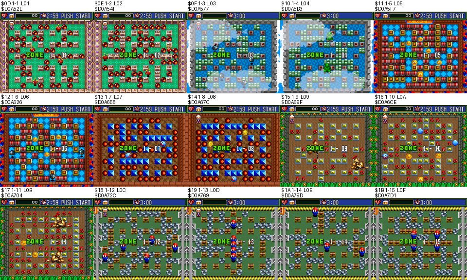

### Cheat codes

All verified with Mesen's own cheat engine (`emu.addCheat`, PAR type; Mesen takes the 8-digit form without the
colon) on unpatched ROMs, and added to `sb5_codes.json` with `section: "cheat"`:

| Code | Effect | Verified on | Status | Game Genie (same test) |
|---|---|---|---|---|
| `7E6253:01` (Caravan `7E6271:01`) | invincible: own bomb at the start of 1-1, the player survives (without it he dies, `$15A2`=`$81`) | retail, English, Caravan | Known address (round 1), PAR form new | `6D44-5727` (Caravan `6D45-5DF7`): `$C4:2D2F` (Caravan `$C4:2D70`) `BNE` -> `BRA`; survives, all three |
| `7E0E23:01` | invincible **and** the stage clock stops | retail, English, Caravan | ★ New | `6D44-5727` `6DD1-7499` (Caravan `6D45-5DF7` `6DD1-7499`): also `$C5:0469` `BNE` -> `BRA`; survives, clock frozen, all three |
| `7E6248:xx` + any option password | room/scene select: `AC`, `AD` and `2B` (3-1) each started after 4622 | retail, English | New (the known `7E1038` is a work byte) | none (no single ROM read of `$6248` found) |
| `7E6248:AC` / `AD` / `AE` | the three debug rooms | retail, English | Known rooms, new code | none |
| `3061E9:01` | Gold Bomberman on the Battle character select (the read of SRAM `$1E9` is patched; SRAM stays 0) | retail | ★ New | `CB0B-7DA4` `DF0B-7FD4` `3C0B-7F04` `3C0B-7F64` (Caravan `CB0B-7404` `DF0B-7464` `3C0B-74A4` `3C0B-77D4`): `LDA $3061E9` -> `LDA #$01` + 2 NOPs; Gold shown, all three |
| `7E6245:0D` | battle stages 11-13 without a turbo pad (`$6245`=13 at the Battle menu) | retail, English | New (the known `7E625A` sets the chosen stage instead) | `D20A-7FD4` (`$C0:48C3` `LDA #$0A` -> `#$0D`): `$6245`=13, retail and English |
| `C56983:01` (ROM) | 3879 boss rush starts fully powered (8 bombs, 8 fire, speed `$0200`, items `$07`): Caravan's 0719 on retail | retail, English | ★ New | `DF16-5D21` (the same byte): 8/8/2/7, retail and English |

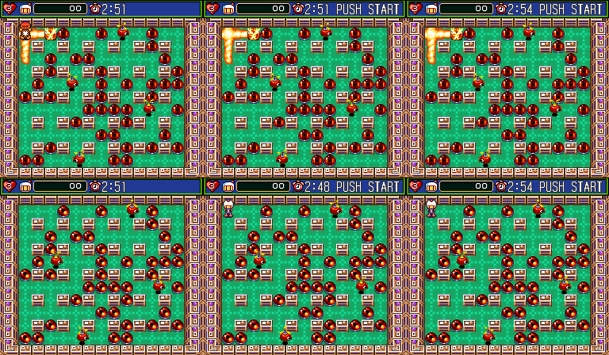
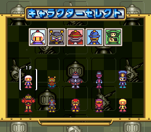

### Not verified (round 3)

- What `$6258` changes in play (the item lists), and `$0F64` and `$1FF3`: set in Mesen, no visible change.
- The soft-reset combo `$C0:0AFC` never runs (nothing reaches it); read only.
- The 386 undrawn text messages outside the certificate: no font context, not read.
- `3061E9:01` on Caravan and English (same code bytes, not run).

## Files

- `tools/sb5/password.py`, `tools/sb5/password.mjs` (+ `test.mjs`): both codecs and the option tables.
- `tools/sb5/textwin.py`: text-window decompressor and decoder (`textwin.py rom 6 F1`; `textwin.py rom test`).
- `tools/sb5/textdump.py`: every message of both tables (`list`) and renders through a Mesen VRAM snapshot (`render`, `sheet`).
- `tools/sb5/deadcode.py`, `tools/sb5/padscan.py`, `tools/sb5/flags.py`: never-run routines, pad-reading routines, tested-but-unset flags (round 3).
- `tools/sb5/maps.py`: layout decoder and the map renders in `docs/img/sb5/maps/`.
- `tools/sb5/scripts.py`: script VM listing (`dis`) and the `0F` targets of every room script (`routes`).
- `tools/sb5/make_ips.py` → `patches/sb5_debug_rooms.ips` (debug-room passwords 0172/0173/0174, retail).
- `tools/sb5/gfxsets.py`: graphics-set table walker, CDL check and renderer (`docs/img/sb5/unused/`).
- `tools/sb5/lib.lua` (helpers, boot paths, savestates at the NMI), `typecode.lua`, `fuzz.sh` +
  `fuzzcases.py`, `run.sh`, `xref.py` (finds `$7E:xxxx` long accesses), `cdl2entries_hi.py`,
  `logo.lua` + `bgrender.py` + `croplogo.py` (logo rip).
- `disasm/sb5/` (retail, `entries.txt` from Mesen's CDL plus the handlers) and `disasm/sb5/caravan/`.
- Logo: `img/logos/sb5_jp.png`, rendered from BG1 of the title screen (VRAM tiles and map at
  `$3000`/chr `$0000`, CGRAM palette, index 0 transparent), cropped to 233×107. The Caravan logo
  renders identical pixel for pixel, so there is no separate file.
