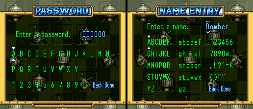
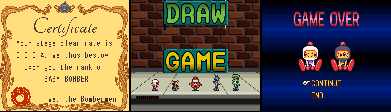
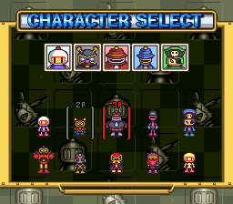
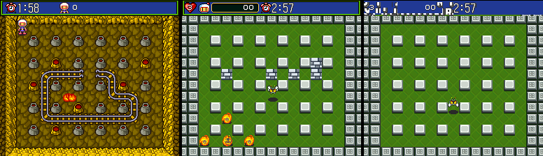
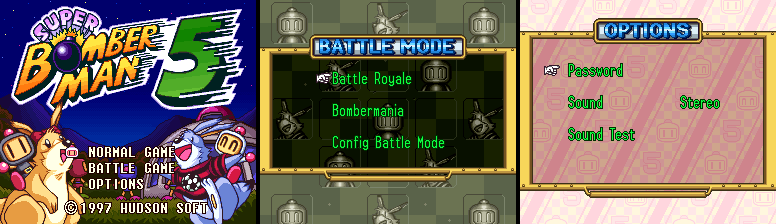

# Super Bomberman 5 (SNES, Super Bomberman Collection English version): passwords and secrets

This is the English ROM of Super Bomberman 5 from Konami's Super Bomberman Collection, compared with the
Japanese retail ROM documented in [sb5.md](sb5.md). Method: a function-by-function diff of the two ROMs
(`tools/disasm.py`, `tools/lin65.py`, `tools/sb4en/hooks.py`, `tools/sb5/textwin.py`), then Mesen 2 runs
with `tools/sb5en/` (`run.sh`, `fuzz.sh`, `typecode.lua`, with `tools/sb5/lib.lua`). Addresses and RAM are the same as
in the Japanese retail ROM unless stated.

**Short version:** a data-only localization. I found no added code. The password routines, the option
table, the eight orphaned handlers, the Gold Bomberman flag and the debug rooms are byte-identical and
behave the same in Mesen. The character-password alphabet and grid are the same; only the grid's labels
are translated. The text moved to new banks, sprite tables were repointed, and a few script coordinates
were changed.

## What the ROM is

`Super Bomberman 5 (English)[Official Localization].sfc`: 4,194,304 bytes, MD5
`bf19b8012b3e43b111cc05f9481b72ae`, CRC32 `C25AB56A`.

| Header field (`$FFC0`) | English | Japanese retail |
|---|---|---|
| Title | `Hu SUPER BOMBERMAN 5` | same |
| Map mode | `$31` (HiROM, FastROM) | same |
| ROM size | `$0C` (4 MB) | `$0B` (2 MB) |
| Cartridge type / SRAM | `$02` (ROM+RAM+battery) / `$03` (8 KB) | same |
| Region | `$00` (Japan) | same |
| Maker / game code | `$33` → `$18` (Hudson), `A5SJ` | same |
| Version | `$00` | same |
| Checksum / complement | `$129A` / `$ED65` (valid) | `$D5A5` / `$2A5A` |

As with SB4, only the size byte and the checksum changed. There is no Konami, collection, year or build
string. The title still says `©1997 HUDSON SOFT`, and the SRAM signatures (`SuperBomberman5 By HUDSON
ver0.9`, `CONFIG BATTLE DATA Ver 1.00`, `$C0:47CF`/`$C0:4A6C`) and the sound driver banner are unchanged,
so the save format is the same.

**Map mode.** Plain HiROM over banks `$C0-$FF`, not ExHiROM. The original 2 MB stays at `$C0-$DF`. The
additions are:

- `$E0-$E3` (about 52, 63, 63 and 48 KB that aren't `$FF`): graphics loaded by the scripts (`$E0`), text
  table 6 (`$E1:0000`, was `$D1:A000`), text table 4 (`$E2:0000`, was `$D1:0000`) and the sprite tables
  (`$E3`, was `$85`/`$C5`). `$E4-$FF` are `$FF`.
- New tile data (fonts and graphics) in former `$FF` space: `$C0:F940-$C0:FECF` and
  `$C3:4F00-$C3:7E7F`.

Inside the original 2 MB, 13,374 bytes differ, mostly those two blocks. The remaining edits are small:

| Where | What |
|---|---|
| `$C0:800E` | Text table bases: table 4 `$D1:0000` → `$E2:0000`, table 6 `$D1:A000` → `$E1:0000` |
| `$C0:1B0F`, `$C0:1C96` | Sprite table bank `$85` → `$E3` and its nine 16-bit offsets |
| `$C0:16E0` | One bank byte in a pointer table |
| `$C0:4B0E` | Default names of the five Config Battle data slots (shown as White, Black, Red, Blue, Green) |
| `$C1:0B0F` | The editor's default character name (now "Bomber") |
| `$C5:6F94` | `BIT #$01` → `BIT #$81` in `$C5:6F89`. Its caller, `$C5:6F5F`, jumps to scene 2 when a button is newly pressed: Start in JP, Start or A in English (`$36-$3A` hold A X L R B Y Select Start, high bit first; `$C0:0A75`) |
| `$C5:F02F`, `$C5:F129` | Two 25-byte tables (first byte of each pair `$01`/`$02` → `$0F`/`$1E` and `$08`/`$10`) |
| `$C6:7CA9`-`$C7:17D6` | Script bytes: screen coordinates and pointers to the new `$E0` graphics |

Banks `$C2`, `$C4` and `$C8-$DF` are byte-identical.

## Passwords

### Option passwords: unchanged

The walker `$C5:6836`, the table at `$C5:6875` and all handlers (`$C5:6500-$C5:6A40` is byte-identical)
are the Japanese ones. All ten codes were entered on the English option password screen (digits written
to `$6241-$6244`, then A) and give the same results as JP:

| Code | `$6248` scene | Flags |
|---|---|---|
| 4622 / 0413 / 0926 | 4 (Battle) | `$6246` = 1 / 2 / 3 |
| 2657 | 3 (Normal) | `$6273`/`$6274` = `$08` |
| 3879 | `$67` (boss rush) | `$6274` = `$80` |
| 1103 | 4 | `$6247` = 4 |
| 0110 | 4 | bit `$20` |
| 5656 | 3 | bit `$40` |
| 1999 / 0803 | `$AA` / `$AB` (endings; both played to the staff roll) | `$6274` = `$80` |
| **0719, 4737** | 2 (rejected) | none: still Caravan-only, as in JP retail |

### Character passwords: same codec, same alphabet

`$C5:6530` (decode), `$C5:654F` (unpack), `$C5:671B` (checksum) and `$C5:6789` (fields) are unchanged,
with the same XOR `$CB` and nibble checksum. The page can reuse `tools/sb5/password.mjs`; there is no
separate English codec.

- **Alphabet and grid:** the English grid is `A B C D E F G H J K L M N` / `P Q R T U V W X Y` /
  `1 2 3 4 5 6 7 8 9 0` + **Back** + **Done** (JP もどる / 決定). It still has **no I, O, S or Z**, the
  layout and cursor are the same, and `tools/sb5en/typecode.lua` (the JP grid) types codes correctly.
- **Fuzz:** `tools/sb5en/fuzz.sh` ran the same 815 cases as round 1 (400 random strings, every one-symbol
  change of D24GJN, encoded codes for every body 0-15 × colour 0-7 plus random fields) through the English
  ROM's own decoder: **815 cases, 261 accepted, 554 rejected, 0 mismatches** with `tools/sb5/password.py`,
  including every decoded field. These are the same counts as the Japanese retail and Caravan ROMs.
- **Posted codes:** the 20 typeable codes posted on GameFAQs and elsewhere (D24GJN, W04VJ4, D344J6, W24G0N, W24LKN, W04V0T,
  W1440E, D24L1A, JWLPVP, KR3MT9, QM3PDF, RMHPCN, TDK4VU, VM6NVQ, WM6XC5, YH1PLQ, U04GJL, XR0PLG, 23D830,
  2YLPVD): **20 accepted, 0 mismatches**, so they decode as in `sb5_codes.json`. U04GJL and 23D830 were
  also typed with real presses: both loaded, with `$62DE-$62F1` = `0,5,…,7,6,7,1,0,0,0,1,1,1,0,1` and
  `9,2,…,7,15,7,1,1,1,1,1,1,1,1,1`. The posted typos UO4GJL / XROPLG still can't be typed (no O).

## Entering a password

The controls are the Japanese ones (see [sb5.md](sb5.md#entering-a-password)). Only the labels differ:

- **Option screen:** OPTIONS > Password, four digits from `0000`, Up/Down change, Left/Right move (both
  wrap), A checks.
- **Config Battle grid:** Battle Mode > Config Battle Mode > Modify Config Setups > Password Load. The
  prompt reads "Enter a password." with the entry `000000`. The bottom row ends in **Back** (one slot
  back) and **Done** (OK), where JP had もどる and 決定.

The character **name** entry (Name Entry, not part of the password) is new: an English grid of
upper case, lower case, digits and punctuation, with Back and Done, and the default name "Bomber". The
name isn't stored in the password, so this doesn't affect codes.

## Secrets: what carries over

| Secret | English ROM |
|---|---|
| Eight orphaned handlers | All still there, unreferenced, byte-identical. Each was run in Mesen by redirecting the 4622 handler (`$C5:68C4`) to it: `$C5:6951` sets `$6253=1` (invincibility), `$C5:698D` sets `$6255=1`, `$C5:6934` sets bit `$08` of `$6274`, `$C5:69B5` → scene 8 (GAME OVER / CONTINUE / END), `$C5:69BC` → 9 (the Certificate), `$C5:69C3` → `$0A` (DRAW GAME), `$C5:69D1` → `$A8` (Bowling Bomber), `$C5:69D8` → 1 (Hudson logo) |
| 0719 / 4737 | Rejected (Caravan-only, as in JP retail). The dormant `$6254` boss-rush power-up (`$C4:2906`) is unchanged |
| Gold Bomberman | The certificate script compare (`$C6:E081`) and natives 67/68 (`$C0:4880`, `$C0:4893`) are unchanged. With SRAM `$1E9` = 1, Gold Bomberman is in the bottom-right slot of Character Select |
| Debug rooms `$AC-$AE` | Writing `$6248` after a valid option code reaches `$AC` (mine-cart battle test), `$AD` (level test) and `$AE` (enemy test), same as JP |
| `patches/sb5_debug_rooms.ips` | Also applies to the English ROM: every byte it overwrites is identical to JP. With it, 0172/0173/0174 reach `$AC`/`$AD`/`$AE`, and 4622 and 1999 still work |
| Turbo X on the title: stages 11-13 | X at 4 frames on / 4 off: `$6245` = 13 and SRAM `$1EA` = `$FF` |
| Debug menu text (message `$F1` of table 6) | Still there, moved with table 6 to file `0x21D9B0`, same text (`textwin.py rom 6 F1`); still unreferenced |
| PAR codes `7E6253:01`, `7E62DE`/`7E62DF`, `7E6248:AC` | Same RAM layout. `$62DE`/`$62DF` were read back after typed codes, and `$6248` was written in the test above. `$6253`'s reader `$C4:2D2B` is unchanged (bank `$C4` identical); invincibility itself wasn't replayed |

## What the localization changed

Screens sampled in Mesen:

| Screen | English |
|---|---|
| Title | PUSH START BUTTON / NORMAL GAME / BATTLE GAME / OPTIONS, `©1997 HUDSON SOFT` (as in JP) |
| Options | OPTIONS: Password / Sound (Stereo) / Sound Test |
| Normal Mode | NORMAL MODE: New Game / Continue / Erase File (JP さいしょから / つづきから / ファイルをけす); file select: File 1-3; ZONE 1-1 on the map |
| Battle | BATTLE MODE: Battle Royale / Bombermania / Config Battle Mode; BATTLE TYPE: Free-for-All / Team Battle; PLAYER SELECT: 1st-5th Player, Human / CPU; CHARACTER SELECT |
| Config Battle | MODE SELECT: Modify Config Setups / Start Battle; DATA LOAD: New Setup / Password Load / Data 1-5; BODY SETUP: Pick a Bomber / Pick a color / Next; SKILL SETUP: Name, Basic Skills, Extra Skills, Point cost, Points left, Save, Exit; NAME ENTRY |
| Option password | PASSWORD, four digits |
| Certificate | "Certificate", the clear rate and a rank (e.g. BABY BOMBER), signed "We, the Bombermen" |
| Other | GAME OVER / CONTINUE / END; DRAW GAME; the staff roll (good and bad endings) |

The intro has no text in either version. Body selection in the editor shows portraits only, so no
character names were seen on screen. The new fonts (`$C0:F940`, `$C3:4F00`) and the moved text tables
carry the English text.

**No emulator hooks.** Unlike SB4, the English SB5 has no reads of `$00:4400-4402`, `$0C:4400` or any
other non-hardware address, and no save-state, rewind, region or version check. Every added byte I looked
at is tile, text, pointer or script data.

## Title logo

`img/logos/sb5_en.png` (233×107, 24 colours, transparent): BG1 of the English title (`tools/sb5en/logo.lua`
dump → `bgrender.py` → `croplogo.py`). Its shape matches `sb5_jp.png` pixel for pixel. The 5,470
pixels that differ are shades of the cycling yellows and greens (the colour-cycle phase), so the art is
unchanged.

## Round 3 (hidden-content sweep, see [sb5.md](sb5.md#round-3-hidden-content-sweep))

- **Cheat codes:** `7E6253:01`, `7E0E23:01` (invincible + stage clock stops, new), `7E6248:xx` with any option
  password, `7E6245:0D` and the ROM code `C56983:01` (3879 fully powered) were run through Mesen's cheat engine
  on this ROM with the same results as Japanese retail. That also settles the old "invincibility not replayed"
  item: with `7E6253:01` the player survives his own bomb.
- **Text:** table 6 has three more messages than Japanese retail (`$F6`-`$F8`; `$F7` is a 32×30 + 32×12 screen
  map). 75 messages of table 4 differ from Japanese, 72 of them in window layout (`$64`-`$A8`, the certificate
  ranks and comments); 47 of table 6 differ, 10 in layout.
- **Input codes and dead code:** the pad-reading routines are the Japanese ones (`tools/sb5/padscan.py
  disasm/sb5en`), including the unreferenced L+R+Select+Start reset check at `$C0:0AFC`.

## Not verified

- Names of the characters and items in English: none are shown in the screens visited (the editor uses
  portraits and icons).
- The story text of Normal Mode beyond the menus, the zone map and stage 1-1. The boss and zone scenes
  weren't reached.
- The purpose of the two 25-byte tables at `$C5:F02F`/`$C5:F129`.
- Which screen `$C5:6F5F` serves (the one whose Start-skip also takes A).

## Files

- `tools/sb5en/`: `run.sh` (English ROM by default, `jp` for the Japanese retail ROM), `../sb5/lib.lua`,
  `fuzz.sh` + `fuzzcases.py` (compare with `tools/sb5/password.py`), `typecode.lua`, `logo.lua`,
  `bgrender.py`, `croplogo.py`.
- `disasm/sb5en/`: banks `$C0-$E3` (`$E4-$FF` are `$FF`), with the Japanese `entries.txt`.
- `img/sb5en/`, `img/logos/sb5_en.png`.
