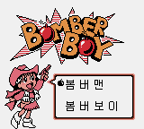
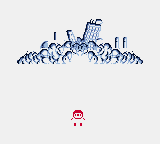

# Bomberman Selection (Game Boy Color, Korea, 2003): passwords and secrets

Everything here comes from disassembling the ROM (`tools/sm83.py`) and checking in Mesen 2 (`tools/emu/run.sh sel`,
helpers in `tools/sel/lib.lua`, `CODE=... tools/emu/run.sh sel tools/sel/test_codes.lua`). Addresses are `bank:address`
inside each game's slot.

Prior art: Bomberman GB's codes are on the GameFAQs page for that game (in `res/`). No list for Bomber Boy or its
Bomber Man mode is saved there. Marks: ★ **New**, **Known**.

| Dump | Header title | MD5 |
|---|---|---|
| Bomberman Selection (Korea) | `BOMSEL` | `d0c6ffc3602d91c0b2b1b0461553de33` |

1 MB MBC1, Game Boy Color only (`$C0`). The cart is four 256 KB slots, each a whole game with its own header:

| ROM | Header | What |
|---|---|---|
| `$00000` | `BOMSEL` | the cart menu: 봄버맨 (Bomberman) and 봄버보이 (Bomber Boy)  |
| `$40000` | `BOMBER BOY` | Bomber Boy (1990), 128 KB used |
| `$80000` | (empty, all `$FF`) | the slot Bomberman Collection gave to Bomberman GB 2 |
| `$C0000` | `BOMBERMAN` | Bomberman GB (Japan, 1994) in colour, its text in English |

## Bomber Boy: the password

CONTINUE opens INPUT PASSWORD: a grid of 32 symbols `12345678 ABCDEFGH JKLMNOPQ RSTUWXYZ` (no 9, 0, I or V), 8 of
them, END to check. `tools/sel/password.mjs` decodes and encodes; `node tools/sel/test_password.mjs` round-trips every
state.

- The buffer `$C480-$C487` holds each symbol's place in the grid (0-31). `$01:47BB` turns it sideways: byte k
  (`$C490 + k`) gets bit k of every symbol, the first symbol in bit 7. Bytes 5-7 must be 0, which they always are.
- **Checks** (`$01:47D9`): b1 + b2 + b3 = b0 and b1 ^ b2 ^ b3 ^ `$CA` = b4. ERROR !! otherwise.
- **Contents**: b1 → `$C0E9`, the islands cleared (one bit each); b2/b3 → `$C0E0`/`$C0E1`, the gold. That is all a
  code holds, so every state has exactly one code, and 1 string in 65,536 is valid.
- The game's own encoder (`$01:4979`, for the CONTINUE screen, from the copy kept at `$C9A0`) makes the same symbols:
  with islands `$5A` and 9,999 gold it showed `K3RMPEGE`, as `password.mjs` does.

| Bit | Island | | Bit | Island |
|---|---|---|---|---|
| 0 | Cuolece | | 4 | Jagoraz |
| 1 | Windria | | 5 | Grad |
| 2 | Thulia | | 6 | Faria |
| 3 | Hevol | | 7 | Wather |

Names from the stage-select table `$00:1013`; My Town, the hub you start on, has no bit. A new game is islands 0,
gold 100 (`$00:095B`): `J6O1JOJ1`.

- **Gold is 16 bits but capped at 9,999** (`$00:3663`, `$00:3922`: past `$270F` it is set back to 9,999). The password
  takes any value up to 65,535 (checked in Mesen: `XXFFXFXE` loads 65,535); the cap applies the next time gold changes.
- **Faria is the last island**: it opens once the other seven are cleared (`$00:0F21`, mask `$BF`).
- **All eight cleared goes to the ending** (`$00:0D07`: `$FF` jumps to bank 3). `33DMPZGZ` plays the closing scene
  and BOMBER BOY STAFF instead of opening the map; `$BF` and `$7F` open the map (checked in Mesen). 

Checked in Mesen (RAM read back after END): `J6O1JOJ1` (0, 100), `J6O1JOJM` (`$01`, 100), `4JS25FXE` (`$80`, 9,999),
`JJMM4M4M` (`$3F`, 0), `Q5L83DPM` (`$BF`, 1,234), `XXFFXFXE` (0, 65,535), and one map shot per island bit.

## Bomber Man mode: NES Bomberman's code

BOMBER MAN on the Bomber Boy title is a port of NES Bomberman, and its ENTER SECRET CODE screen is NES Bomberman's
code system unchanged: the letters `AOFKCPGELBHMJDNI` (`$02:44F5`), the chain v[k] = (l[k] + l[k-1] + 7) & 15
(`$02:452C`), the same three sum checks and the same 16 fields in the same places (table `$02:4621`). Only the RAM
moved:

| Field | NES | Here |
|---|---|---|
| stage | `$58` | `$C40B` (from `$C415`/`$C416`) |
| bombs | `$74` | `$C402` (code value + 1) |
| fire / speed | `$73` / `$75` | `$C403` / `$C404` |
| wall pass / flame pass / detonator | `$76` / `$79` / `$77` | `$C406` / `$C407` / `$C408` |
| exit and item marked | `$94` | `$C414` |
| score digits 1-7 | `$61-$67` | `$C40D-$C413` |

So `tools/nes1/password.mjs` and every NES Bomberman code work here. Typed in Mesen: `NMIHPPBPCAFHABDPCPCH` (stage
1, 10 bombs, fire 5, speed, score 0035915), `BACDIHCLOAFHABDNMOLG` (STAGE 59, as on the NES) and
`BOHIDJFEKJGKEFOLFHAC` (stage 50, every power-up). The 20th letter submits the code.

## Bomberman: Bomberman GB's codes

The Bomberman slot keeps the Japanese Bomberman GB's password table byte for byte (`$0A:42F3` here, `$0A:42EE` in
the Japanese cart; 34 records), so its 32 stage codes, 4622 (every power-up) and 5656 (the extra battle) are
unchanged. Typed in Mesen: 4622 (ROUND 1-1), 5656 (GREAT BATTLE), 9867 (ROUND 6-3); 1234 is rejected.
