# Bomberman Tournament (Game Boy Advance, 2001): codes and secrets

Japan: Bomberman Story. An adventure in the style of Bomberman Quest, with creatures called Karabons, and a Battle
mode. It saves to the cartridge and has no passwords. Read from the two ROMs and run in BizHawk (mGBA core);
addresses are the same in both unless a region is named. Each run was made once.

Prior art: a page on the game's debug material (in `res/`: the TEST SELECT code, the sound test, the halo heads, empty
sound-test numbers and the title differences). Marks: ★ **New** (not in it), **Known**.

| Dump | Header |
|---|---|
| Bomberman Tournament (USA, Europe) | `ABSE` |
| Bomberman Story (Japan) | `ABSJ` |

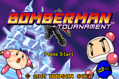 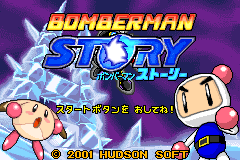

## How the game is laid out

- The game runs as a state machine: the state is the word at `03004F30`, set by `08000C78` (state, parameter), with
  a jump table at `08000CE0` for states 10-90: 10 the field, 11 and 12 two mini-games, 16 save and load, 20 Battle
  setup, 40 Karabon pick and duel, 50 scenes and the title, 51 game over, 60 the boot logos, 90 TEST SELECT.
- Controller: held `03004F44`, pressed `03005BFC`. Graphics are packed with the GBA BIOS's Huffman and LZ77
  routines. Music uses Nintendo's standard sound engine (song table `0831C890`, Japan `0831ABFC`).
- Text: bytes 00-DF are characters, `E0` starts a script command (`E0 03` sets a story flag), `FA` new line, `FB` new
  page, `FC` pause, `FF` end. English is ASCII; Japanese uses its own 224-character font (`0821CE68`).
- Field: the warp table at `082FCCF0` (391 entries) and the current entry at `030024C6`; story flags are bits from
  `02035274`.

## TEST SELECT

The first state the start-up code sets is `3C` (60, the boot logos) at `08000CBA`. Patching it to `5A` (90) boots
into TEST SELECT, as the patch `08000CBA 205A` does on all three ROMs. 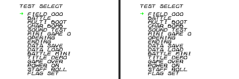
Without a patch: on New Game the game writes 50 to the state word; holding it at `5A` until the fade ends opens the
menu.  No controller route to state 90 was found: only the menu itself sets the
parameter that brings Game Over back to it, and parameters coming from event scripts were not searched.

- **FIELD nnn**: start at warp entry nnn (0-390; 391 and above, an empty grey room). 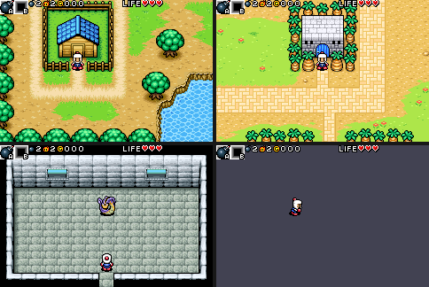
- **MINI GAME 0-3**: race, Ceedrun duel, balloon game, cannon game. 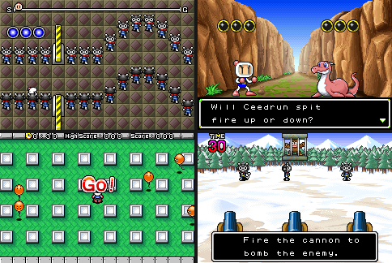
- **FLAG SET**: 256 flags a page; A toggles, L and R change page. 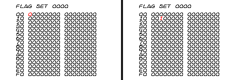
- **SOUND TEST**: 0-100; 0 and 29-39 are empty, and 100 reads past the table. 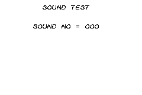
- **CHAR BOMB** (Karabon pick), **MULTI BOOT** (link send screen), **BATTLE MINI** (fishing), **BATTLE**, **OPENING**,
  **ENDING**, **STAFF ROLL**, **TITLE DEMO**, **GAME OVER**, **POWER ON**, **DATA SAVE**, **DATA LOAD**.
  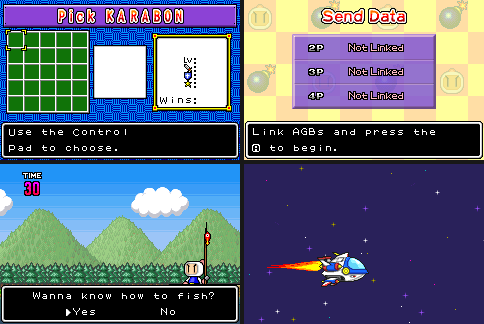

All 16 were run on the US ROM. Only FIELD 002 was picked with the pad; the other FIELD pictures had the entry number
written. The step sizes and the sound test's exit are read from the code.

## Cheats

| Effect | Write | |
|---|---|---|
| 10 hearts, 8 bombs, fire 8, 999 gold | `02035194`=14, `95`=14, `96`=08, `97`=07, `02035198`=03E7, then `0203519C`=FF | 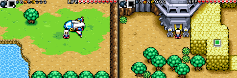 |
| All 25 Karabons | OR `02035296`-`020352A0` with 20 0C 81 F2 28 86 90 25 20 03 81 | 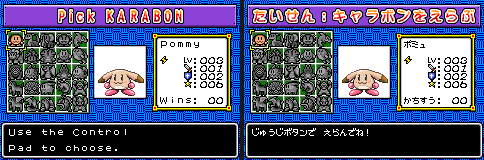 |
| Warp | `030024C6` = warp entry | |

Written once in memory on both ROMs (the US one under the patched menu's FIELD, Japan's after the memory route);
not tried as encrypted GameShark or Action Replay codes.

## Button codes and unlocks

No button code was found: every read of the controller words tests one button or any of several, and there is no
sequence table. The sound test exists only in TEST SELECT. Battle's 8 stages and its characters are all open on a
blank cart; a watch on the flag test from the title into a match saw no check. Which events give each Karabon was not
traced in full (below), and no hidden mode was found; the adventure was not played to the end.

## Karabons

The 25 Karabons are story flags, listed in order by `0831B24C`. Code touches that table in three places only: one
sets, one clears, one tests. The setter is called by the four bosses (enemy types 44-47), which give P.Fangs, P.Sea,
P.Dragon and SeaWing. Event scripts set three more with `E0 03`: Kai-man, P.Beast and Sibaloon (by the Step Counter
text). Where the other 18 come from was not found: their flag numbers overlap other flags, so a byte search is no
proof. Read from the code; none was earned by play.

## Enemies

Each area's header points at a list of placements (x, y, type, setting); 52 enemy types have their own start and
update routines. The lists place types 1-37 and 39-49. Type 38 is spawned by type 37 (three at a time), and 50 and 51
by the cannon mini-game, so no type is unused. A ROM patch that stood types 1-51 beside one area's warp points saw
every one spawn.

The cloud is type 33, in world 1. Its setting picks big, small, smallest or shadow. Bombed, the big cloud turns pink
and leaves two small clouds; they die without splitting, and nothing asks for the smallest. Changing the split's two
form numbers (ROM `080343AC` and `080343B0`, 401 and C01 to 402 and C02) gives the smallest instead.
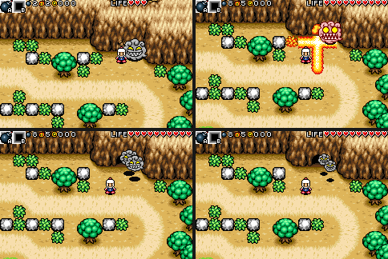 Its tiles are packed with the rest of
the cloud's; those boxed in red were drawn only by the patched split. 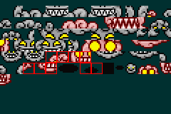

## Save layout

The cart keeps two files, at `0x10` and `0x4010` of the save memory, with `BOMBERMANCHECKER` before each, the last
file used at `7FFC`, and inside each the signature `BOMBERMAN STORY 11` and a checksum. A file is a copy of a buffer at
`0202C400`, which the game fills when it leaves the field with bit `80` of `030024A0` set. The status block (life,
maximum life, bombs, fire, gold, Karabons) is at `3B88` in file 1, and the story flags at `3288`. Shown by writing
1234 gold on the field, setting that bit, then DATA SAVE from TEST SELECT: file 1 held `06 06 02 01 D2 04`.
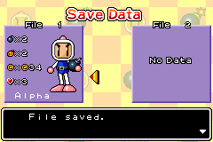 DATA SAVE with nothing packed writes an empty file.

## Japanese text

Decoded with a table built from the Japanese font, and checked against the screen.
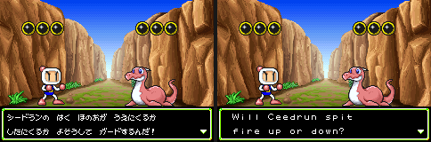 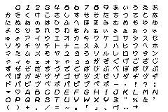
The English script is a shorter rewrite (Honey's long greeting is a few lines, without her ♡ marks) and adds the
"Load File 1?/2?" prompts. Twelve lines are empty in English (the fusion card above). About 50 small Japanese tables
were not compared.

## Unused content

- Halo versions of the Battle player heads, in video memory; the HUD's head table cannot draw them.
  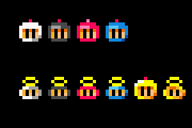
- Sound-test numbers 0 and 29-39 are empty. Music 23, 26, 80-86, 89, 90, 93, 96 and 97 is never asked for by a fixed
  number, but some calls pass a variable, so these are not proven unused.
- World 2 (8 areas, probably the Battle stages) and world 4 (1 area) have no warp-table entry; that is not proof they
  are unused.
- The cloud's smallest split. 
- The save signature "BOMBERMAN STORY 11" in every version, and Nintendo's multiboot library IDs dated 010214.

## Region differences

- Boot: the US and European ROM shows a legal screen, then Activision and Hudson; Japan only Hudson.
  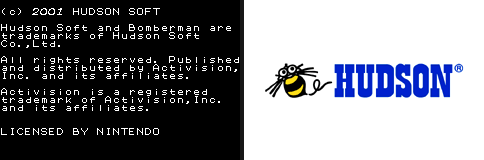
- Title: Japan's BOMBERMAN and STORY fly in from opposite sides, then a white flash and a blue burst; the US logo
  slides in as one piece. 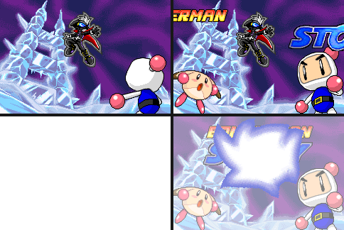
- Battle rules: Skulls starts on Burn in the US and Off in Japan. 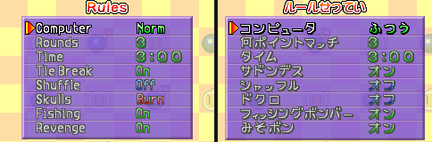
- The data moves from `0A8` on, but every table compared is the same: the warp table, the world headers, the song
  table, the state table, the debug menu and the RAM addresses.

## Open

- Where 18 of the Karabons come from, and the fusion events in the English game.
- Revenge's Super setting: On and Super both put a dead player in a cart at the edge; what Super adds was not found.
- The songs called by a variable, multiplayer Battle (no link cable in the emulator) and the adventure played to an
  ending.
